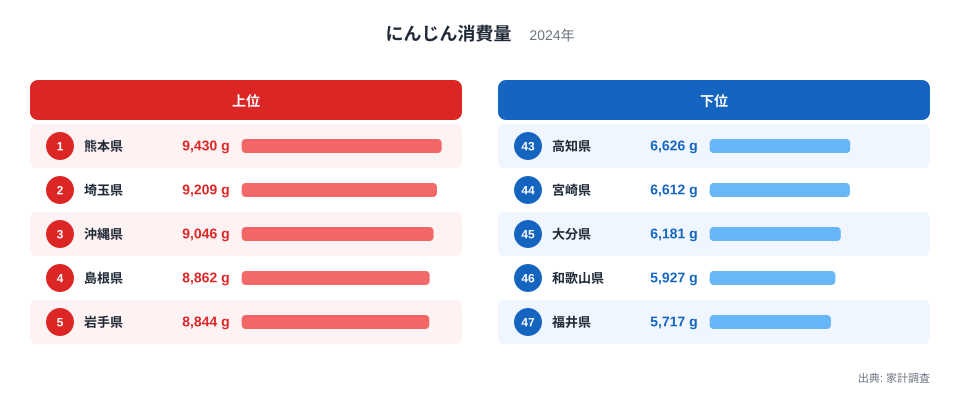
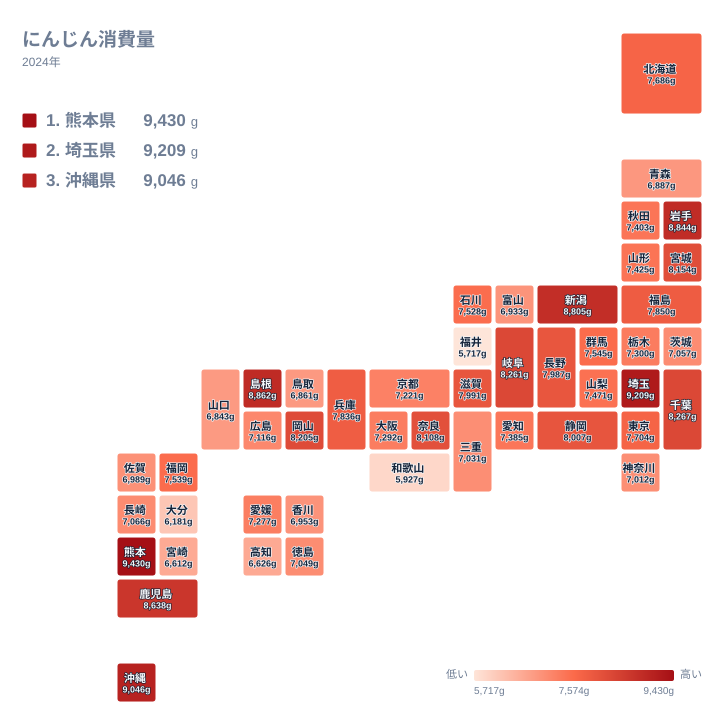

にんじんは、カレーや肉じゃが、きんぴら、サラダと、和洋を問わず台所に並ぶ野菜です。どの家庭でも当たり前に使われるため、地域差は小さいと思われがちです。ところが2024年の家計調査で都道府県別の購入量を見ると、1位の熊本県と最下位の福井県のあいだには、はっきりした開きがありました。この記事では、その差の姿を実データで確かめます。あわせて、食文化や産地との関わりについては、データから言えることと言えないことを分けて考えます。

## 熊本県が1位、福井県が最下位

2024年のにんじん消費量で1位になったのは熊本県の9,430gです。2位は埼玉県の9,209g、3位は沖縄県の9,046gと続きます。4位は島根県の8,862g、5位は岩手県の8,844gでした。

一方、下位に目を向けると、47位は福井県の5,717gです。46位は和歌山県の5,927g、45位は大分県の6,181g、44位は宮崎県の6,612g、43位は高知県の6,626gでした。最大の熊本県と最小の福井県を比べると、およそ1.65倍の差になります。

<source-link href="/ranking/carrot-consumption-quantity">にんじん消費量ランキングをもっと見る</source-link>

この図で注目したいのは、値の並び方が上位と下位で違う点です。上位では4位の島根県と5位の岩手県がほぼ並んでいて、上位の後半は団子状に詰まっています。下位では逆に、43位の高知県と44位の宮崎県がほぼ同じ水準にある一方、45位の大分県から46位の和歌山県、47位の福井県へと、値が一段ずつ離れていきます。つまり最下位の福井県は、下位グループのなかでも単独で低い側に外れているように見えます。

もうひとつ、順位の上下は単純な「都市か農村か」では説明しにくいようです。首都圏の埼玉県が2位に入る一方、東京都は7,704gで18位、神奈川県は7,012gで36位でした。同じ関東でも順位には大きな幅があります。県別の詳しい数値は[熊本県のデータ](/areas/43000)や[埼玉県のデータ](/areas/11000)でも確認できます。

> [!NOTE]
> ここでの消費量は、家計調査で世帯が1年間に購入したにんじんの量(単位はg)です。家庭で買った生鮮のにんじんが中心で、外食や加工食品に含まれるにんじんは基本的に入りません。「その県の人がどれだけ食べたか」ではなく、「家庭がどれだけ買ったか」を表す指標です。

## 産地と消費の関係は読み取れるか

熊本県が1位であることは事実です。ただ、なぜ熊本県が1位なのかを、この記事のデータだけで説明することはできません。使っているのは家庭の購入量だけで、各県の生産量や出荷先は含まれていないためです。どの県がにんじんの産地にあたるのかも、このデータからは裏付けられません。

仮説としては、産地が近い県では新鮮な野菜が手に入りやすく、購入量が増えるという筋書きが考えられます。しかし、これを確かめるには生産量や流通に関する別の資料が必要です。ここでは産地との関係については判断しません。

価格、買い物の習慣、料理の傾向、世帯の構成など、いくつもの要因が重なっている可能性があります。ただし、どれがどれだけ効いているかは、このデータだけでは判別できません。

## 地理分布から見える地方ごとの傾向

タイルマップで全体を見ると、上位と下位が特定の地方にまとまっているようには見えません。九州・沖縄では、熊本県が1位、沖縄県が3位、鹿児島県が7位と、上位に3県が入っています。その一方で、同じ九州・沖縄の大分県は6,181gで45位、宮崎県は6,612gで44位と下位に並びました。同じ地方の中で、順位が大きく割れています。

中国地方では島根県が4位の8,862g、岡山県が10位の8,205gです。広島県は7,116gで31位、鳥取県は6,861gで41位、山口県は6,843gで42位でした。東北では岩手県が5位、宮城県が11位と上位ですが、青森県は6,887gで40位でした。

中部では新潟県が6位の8,805g、岐阜県が9位の8,261g、静岡県が13位の8,007gと上位に並びます。ところが同じ中部の福井県は最下位です。地方というくくりだけでは差を説明しにくいことがわかります。県ごとの食習慣や買い物の仕方の違いが背景にある可能性はありますが、このデータだけでは確かめられません。

> [!TIP]
> この指標の中位は、値が密に詰まっています。12位の奈良県は8,108g、30位の京都府は7,221gで、両端を含めて19県がこの幅に収まります。隣り合う県の差は小さいため、中位では順位が1つ2つ違っても、実質的な差はほとんどないと読むのが安全です。順位より値の間隔を見てください。

## 沖縄県の3位をどう読むか

沖縄県が3位に入っている点は興味深い結果です。沖縄には、にんじんを卵と炒める「にんじんしりしり」という家庭料理があります。にんじんが主役になる一皿であるため、こうした料理が購入量の多さに関わっている可能性があります。

ただし、これも仮説です。家計調査の数値から、料理の影響を切り出すことはできません。他の品目の数値も扱っていないため、にんじんだけが特別に多いのか、野菜全般の購入量が多いのかも判断できません。ほかの品目の県別データは、[同じカテゴリの統計一覧](/category/economy)から確認できます。

## 下位の県をどう読むか

下位には福井県、和歌山県、大分県、宮崎県、高知県が並びました。福井県は5,717gで、1位の熊本県の9,430gと大きく離れています。ただ、購入量が少ないことは、野菜を食べていないことを意味しません。ほかの野菜を多く使う、自家栽培や贈答で入手する、外食や総菜で補うなど、家計の購入記録に表れない経路が考えられます。

とくに自家消費や近所からのおすそ分けは、家計調査では捕捉されません。そのため「消費が少ない」と「購入が少ない」は分けて考える必要があります。

> [!WARNING]
> にんじんは根菜で保存がきくため、特売のときにまとめ買いする世帯があります。標本として選ばれた世帯がたまたま大袋を買った年は、その県の購入量が押し上げられ、逆の場合は押し下げられます。さらに、にんじんの価格が上がれば買う量は減りやすくなります。2024年の1年分だけでは、こうしたぶれと地域の食習慣の違いを切り分けられません。下位の県を「にんじん離れ」と読むのは避けてください。

2024年の結果だけで地域の特徴を断定せず、ほかの年のデータとも見比べることで、より確かな姿が見えてきます。

## データについて

この記事で使ったのは、家計調査の「にんじん消費量」(2024年、単位はg)です。47都道府県の値が公表されており、本文の数値と順位はすべてこのデータに基づきます。倍率は、最大の熊本県9,430gと最小の福井県5,717gの比です。

## まとめ

2024年のにんじん消費量は、熊本県が9,430gで1位、埼玉県が9,209gで2位、沖縄県が9,046gで3位でした。最下位は福井県の5,717gで、最大と最小の差は約1.65倍です。上位と下位は特定の地方にまとまらず、同じ九州・沖縄でも熊本県や沖縄県が上位、大分県や宮崎県が下位と分かれました。

なぜこの順位になるのかについては、産地、料理、買い物の習慣などの仮説が考えられますが、このデータだけでは判別できません。数字の背景にある暮らしを想像しながら、ランキングを眺めてみてください。
