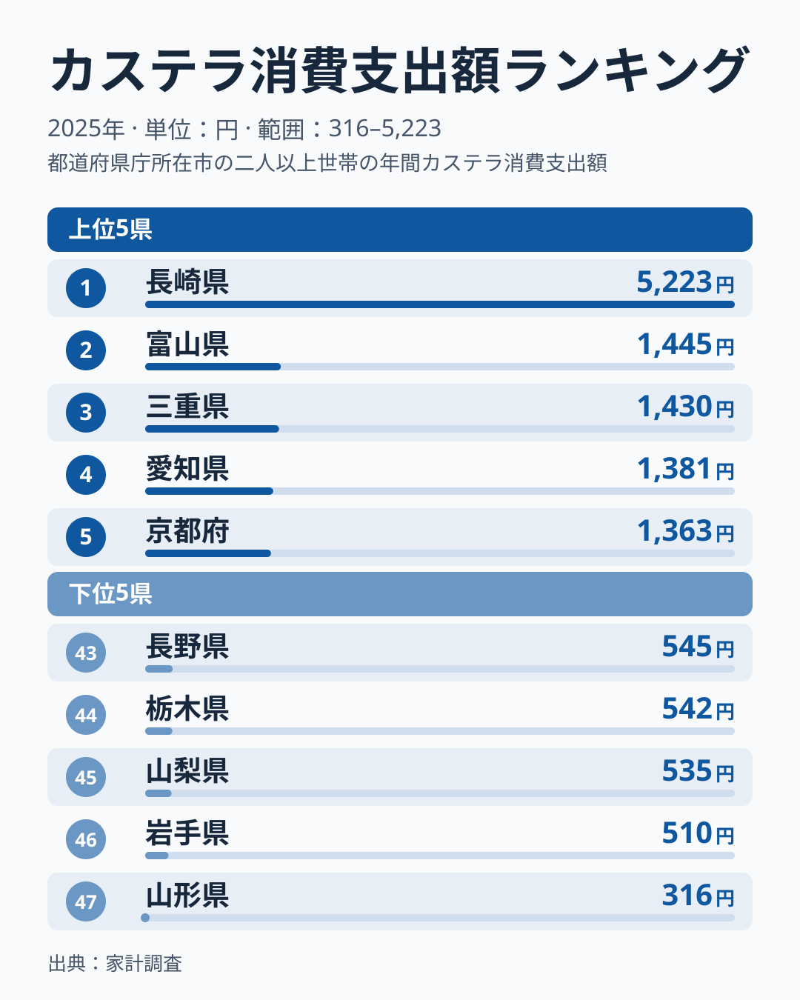

「カステラと言えば長崎」というイメージは、観光向けのブランディングだけではありません。総務省「家計調査」の品目別データでも、長崎市（県庁所在市）の二人以上世帯の年間カステラ支出額は5,223円です。富山市が1,445円で、長崎はその3.6倍に達します。富山から京都までの4市が1,400円前後で横並びになるなか、長崎だけが突き抜ける一極集中型の分布です。

この記事では、2025年の最新データで長崎の突出ぶりを確かめ、同じ家計調査のようかん・まんじゅう・チョコレートと比べて、カステラの偏りがどれほど特異かを数字で示します。なぜ長崎が突出するのかという因果は、1年分の支出額からは検証できません。歴史や贈答文化に触れる箇所は仮説として扱います。

> [!NOTE]
> この5,223円は長崎市の二人以上世帯の値で、長崎県全体の消費実態ではありません。家計調査は都道府県庁所在市（政令指定都市を含む）を対象にしており、本記事の「長崎」「富山」といった県名も、実際には県庁所在市の値を指します。

## 上位と下位の格差

1位の長崎5,223円に対し、最下位47位の山形は316円にとどまり、その開きは16.5倍です。一方で、富山が1,445円、三重が1,430円、愛知が1,381円、京都が1,363円と、1,300円台から1,400円台前半に並びます。この4市の幅は100円未満で、少しの違いで順位が入れ替わる水準です。

<source-link href="/ranking/castella-consumption-expenditure">カステラ消費支出額ランキングをもっと見る</source-link>

この図で読み取れるのは「長崎が突出している」「ほかの上位は僅差で並ぶ」の2点です。富山・三重・愛知・京都は、和菓子や茶席の菓子の文化が厚い地域とも言えますが、それがカステラ支出の高さの理由かどうかは、家計調査の数字からは確かめられません。[仮説]として扱うべき見立てです。

## 関連品目と比べると偏りの大きさがわかる

カステラの偏りがどれほど特異かは、同じ年の同じ家計調査の他の菓子と並べると見えてきます。1位と2位の倍率は次のとおりです。

- カステラ: 1位5,223円、次点1,445円で3.6倍
- まんじゅう: 鳥取2,835円、鹿児島2,097円で1.35倍
- ようかん: 福井1,400円、東京1,214円で1.15倍
- チョコレート: 埼玉9,359円、千葉8,642円で1.08倍

ようかんやチョコレートは、1位と2位がほぼ並んでいて、支出が全国に広く分散しています。まんじゅうも1位と2位の差は3割台にとどまります。これに対してカステラは、1位が2位の3.6倍という別格の開きです。「発祥地に支出が集中する菓子」と「全国に広く定着した菓子」の違いが、倍率にはっきり現れています。

> [!TIP]
> 同じ品目別データで、[チョコレートの支出額ランキング](/ranking/chocolate-consumption-expenditure)や[ようかんの支出額ランキング](/ranking/yokan-consumption-expenditure)、[まんじゅうの支出額ランキング](/ranking/manju-consumption-expenditure)を見比べると、1位と2位の差の小ささが確認できます。長崎の他の指標は[長崎県の地域プロフィール](/areas/42000)で確認できます。

## 最下位グループの特徴

下位5県は、43位が長野545円、44位が栃木542円、45位が山梨535円、46位が岩手510円、47位が山形316円です。地方別に見ると、中部の長野・山梨、関東の栃木、東北の岩手・山形で、いずれも東日本の県です。ただし、家計調査の市別の値は調査世帯が限られ、年ごとのぶれが大きくなります。5県に共通する理由を1年分の順位から断定することはできません。

同じ九州で、江戸時代に海外との交易で知られた鹿児島は、31位の769円という中位にとどまります。長崎と地理的に近くても、カステラの支出は伸びていないという事実は、支出の高さが単なる近さでは決まらないことを示しています。鹿児島には「かるかん」「あくまき」といった独自の郷土菓子があり、まんじゅうの支出が上位に入っていることとあわせて、菓子の支出が別の品目に向かっている可能性はあります。ただしこれも[仮説]で、検証には複数年の推移や他の菓子品目との比較が必要です。

## 長崎の突出をどう読むか

カステラは16世紀にポルトガル人によって長崎に伝えられた南蛮菓子で、長崎には福砂屋・文明堂・松翁軒といった創業100年を超える老舗が今も本店を構えています。観光土産だけでなく、贈答や慶事の菓子としての需要が長く積み重なってきたことが、突出した支出額の背景にあるかもしれません。これも[仮説]で、本記事のデータから確かめられるのは、2025年の長崎市の二人以上世帯の支出額が全国で飛び抜けて高いという事実までです。

[仮説] 長崎以外の上位の順位が入れ替わりやすいのは、カステラが「買った年と買わなかった年」で支出額が大きく変わる贈答色の強い品目であり、県庁所在市の調査世帯数が限られるため、数世帯の購入が市の値を動かすからではないでしょうか。長崎の突出が毎年続くのか、それ以外の顔ぶれが毎年入れ替わるのかは、複数年の推移を確かめて初めて言えます。日常的な購入習慣の強さを示すには、複数年の推移や購入頻度の統計が別に要ります。

## まとめ

- 長崎の5,223円は富山の1,445円の3.6倍、最下位山形の316円とは16.5倍の差がある
- 富山から京都までの4市は1,400円前後に並び、突出するのは長崎だけの一極集中型
- 同じ年のまんじゅう1.35倍、ようかん1.15倍、チョコレート1.08倍と比べて、カステラの偏りは際立っている
- 下位5県はいずれも東日本だが、単年の値から共通の理由は断定できない

> [!WARNING]
> 家計調査は調査世帯数が限られるサンプル調査のため、支出額の少ない品目は年による振れ幅が大きくなります。単年の数値だけでなく、複数年の推移とあわせて読むことが大切です。
