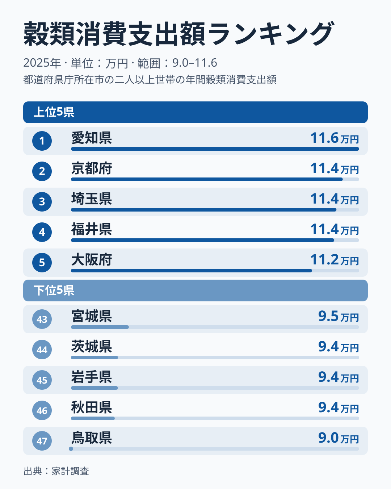
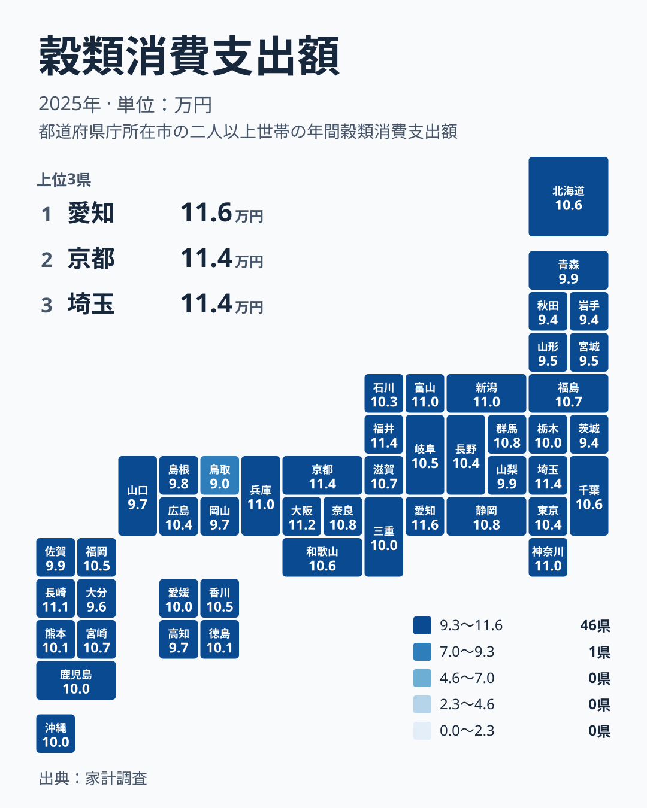

ごはん、パン、麺類。毎日の食卓に欠かせない穀類は、どの家庭でも買うものです。それでも、1世帯が1年間に穀類へ使う金額は、住む場所によって変わります。2025年の家計調査をもとに、47都道府県の穀類への支出を並べました。

先に断っておくと、このデータは穀類の総額だけを示したものです。愛知県が1位になった理由を、データから特定することはできません。この記事では、順位の並びを確認したうえで、食文化や産地の面からどんな仮説が考えられるかを、仮説として整理します。

1位は愛知県の115,973円、47位は鳥取県の89,645円でした。この最大と最小の開きは、どの程度のものなのでしょうか。

## 穀類への支出は愛知県が1位、鳥取県が47位

まず、上位と下位を図で確認します。

<source-link href="/ranking/cereals-group-consumption-expenditure">穀類への支出ランキングをもっと見る</source-link>

図から読み取れる点は、上位5県の金額が111,660円から115,973円の範囲に収まっていることです。1位の愛知県から5位の大阪府まで、順位は違っても金額は接近しています。一方、下位5県は89,645円から94,936円の範囲にあり、最下位の鳥取県だけが、46位の秋田県の93,646円から離れています。

上位が密集していることは、順位の入れ替わりが起きやすい可能性を示しています。ただし、これは金額の近さから推測した話で、原因までは分かりません。順位が隣り合う県どうしの差を、決定的な違いと読むのは避けたほうがよいでしょう。

上位5県は愛知県、京都府、埼玉県、福井県、大阪府で、中部、近畿、関東にまたがります。下位5県は鳥取県、秋田県、岩手県、茨城県、宮城県で、北海道・東北の3県を含みます。

> [!NOTE]
> ここでいう穀類への支出は、家計調査における1世帯あたりの年間支出額(円)です。米、パン、麺類などを合わせた総額で、内訳は分かりません。調査は都道府県庁所在市などを単位としているため、県全体の平均ではなく、主に県庁所在地の家計の姿である点に注意してください。

## 地図で見る分布:中部と近畿に厚み、北海道・東北に薄さ

次に、同じ数字を地図の上に置いて眺めます。

地図で目につくのは、中部と近畿の濃さです。中部では愛知県が1位、福井県が4位、新潟県が8位、富山県が10位と、上位10位に4県が入りました。近畿でも京都府が2位、大阪府が5位、兵庫県が9位で、上位10位に3府県が入っています。関東では埼玉県が3位、神奈川県が7位でした。

北海道・東北は、福島県が16位、北海道が17位と中位ですが、青森県は36位、山形県は42位、宮城県は43位、岩手県は45位、秋田県は46位でした。中国地方も、山口県が38位、岡山県が39位、鳥取県が47位と、下位側に並びます。島根県は37位で、広島県は24位です。

もっとも、順位が低いからといって、主食を食べていないわけではありません。地図は傾向を見るための道具であり、県ごとの豊かさや食生活の優劣を示すものではありません。

> [!WARNING]
> 家計調査は標本調査で、都道府県ごとの対象世帯は多くありません。順位が近い県どうしの差は、誤差の範囲に収まることもあります。また、この指標は購入額なので、買わずに手に入る穀類や、外食で食べる分は含まれません。

## 食文化と産地から考えられる仮説

愛知県の1位について、データは理由を教えてくれません。そのうえで、よく挙げられる見方を仮説として並べます。

一つめは、麺類やパンを含む食文化の影響です。愛知県には、きしめんや味噌煮込みうどん、小倉トーストなどの食文化があると言われます。京都府や大阪府についても、パン、麺、粉ものの文化が語られることがあります。こうした背景が、米以外の穀類の購入を押し上げている可能性はあります。ただし、今回のデータは内訳を持たないため、確かめることはできません。

二つめは、米どころとの関係です。新潟県は8位、富山県は10位、福井県は4位と、米どころとして知られる県が上位に入っています。米を主食とする習慣が強く、米への支出が穀類全体を押し上げている可能性があります。

ところが、秋田県は46位、岩手県は45位、宮城県は43位と、米の産地として知られる県が下位に並んでいます。こちらは、親類や知人から米を分けてもらう、自家で作った米を食べるなど、購入額に現れない入手経路が多い可能性が考えられます。

つまり、同じ米どころでも、一方は支出を押し上げる要因、もう一方は押し下げる要因として説明されることになります。この二つの説明は、そのままでは両立しません。どちらも結果に合わせた後付けの仮説で、データから検証されたわけではない点を、はっきり認めておきます。

> [!TIP]
> 支出額は、食べた量ではなく買った金額です。額が低いときは、食べていないのではなく、買わずに済んでいたり、外で食べていたりするのかもしれません。価格、購入ルート、食べ方の三方向を意識すると、読み違いが減ります。

## 関連品目との対比:総額だけでは見えないこと

穀類には、米、パン、麺類、その他の粉製品などが含まれます。今回のデータはそれらを合わせた総額で、どの品目が順位を決めているのかは分かりません。愛知県の1位が米によるのか、パンや麺によるのかも、この数字だけでは判断できません。

したがって、品目ごとの違いを知りたい場合は、米、パン、麺類それぞれの支出を別の統計で並べて見る必要があります。ほかの経済・家計の指標は、[同じカテゴリの統計一覧](/category/economy)から確認できます。

## 上位県と下位県をどう受け止めるか

中位の県にも目を向けます。北海道は17位で106,043円、東京都は25位で103,560円でした。東京都は大都市ですが、穀類への支出は中位です。外食や惣菜の利用が多いと家庭での購入額が抑えられるという見方もありますが、これも仮説にとどまります。

九州では、長崎県が6位の110,851円、宮崎県が14位の107,470円と、上位に近い県があります。一方で、大分県は41位の96,273円でした。同じ地方でも、順位には幅があります。

愛知県の詳しい数値は[愛知県のデータ](/areas/23000)で、京都府については[京都府のデータ](/areas/26000)で確かめられます。各県のページでは、穀類以外の項目も含めて、その県の暮らしぶりを見られます。

最後に、最大の開きを確認します。愛知県の115,973円と鳥取県の89,645円で、この差は小さくありません。ただし、食卓の豊かさや健康の優劣を意味するものではありません。何をどこで買い、どう食べるかという暮らしの違いが、金額の差として見えている可能性があります。

## データについて

この記事で使った統計は、家計調査の穀類消費支出額です。2025年の1世帯あたり年間支出額を、円の単位で示しています。調査の対象は二人以上の世帯で、集計は都道府県庁所在市などを単位としています。したがって、県内の郡部や離島の暮らしは、必ずしも反映されません。

また、食料品の価格は年によって変動します。支出額の違いには、購入量の違いだけでなく、価格水準や買う品目の違いが混ざります。数字の違いをそのまま食べる量の違いと受け取らず、地域の食文化を考えるきっかけとして活用してください。
