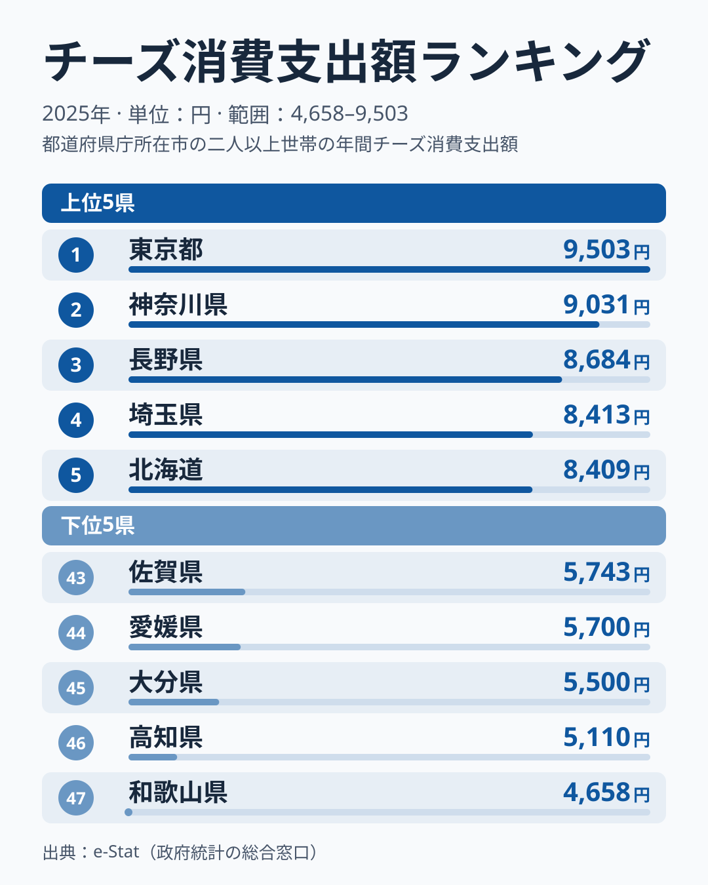
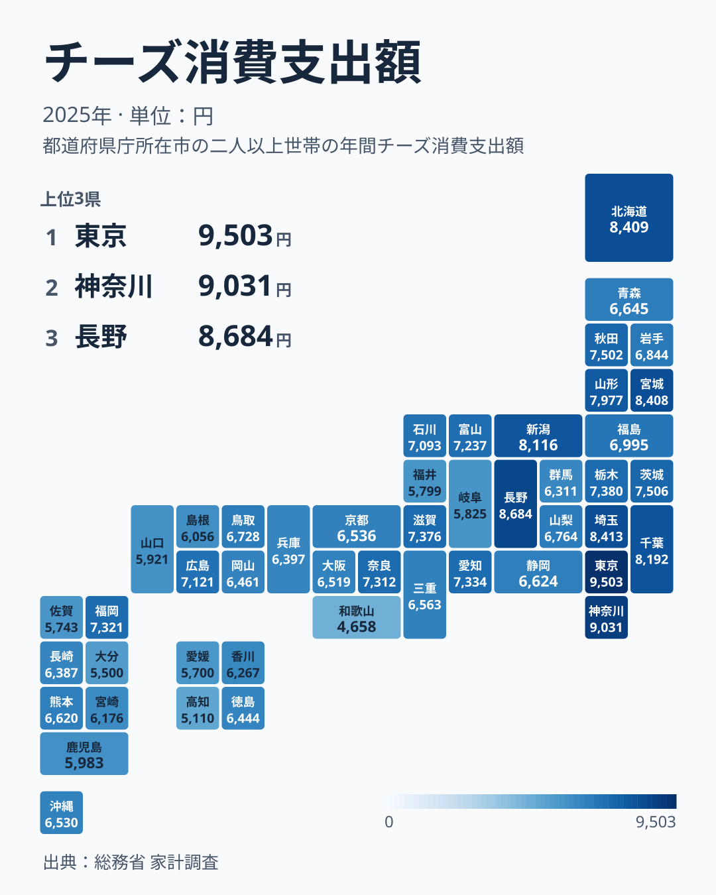

チーズは家計調査の品目のひとつで、年間の消費支出額が都道府県庁所在市ごとに公表されています。2025年のデータを見ると、1位の東京都は9,503円、最下位の和歌山県は4,658円と、実に2.0倍の開きがあります。同じ日本でも、住む場所によってチーズにかけるお金がこれほど違うのはなぜでしょうか。

結論から言うと、上位10県はすべて東日本で、東京都・神奈川県・埼玉県といった首都圏勢に加え、長野県と、生産地の北海道が並びます。仙台市を抱える宮城県も、わずか1円差で北海道に続いています。一方で下位は和歌山県・高知県をはじめ近畿南部・四国・九州など西日本に集中し、大阪府や京都府といった西日本の大都市も中位以下です。この記事では、上位・下位の具体的な数字を確認しながら、チーズの支出が都市の大きさよりも東西の軸で分かれていることを見ていきます。

> [!NOTE]
> このデータは総務省「家計調査」の品目別支出額で、対象は**都道府県庁所在市（政令指定都市含む）の二人以上世帯**です。県全体の平均ではなく、各県の代表都市（県庁所在地）における消費傾向を示す点に注意してください。

## チーズ支出額が多い都道府県

<source-link href="/ranking/cheese-consumption-expenditure">チーズ消費支出額ランキングをもっと見る</source-link>

2025年のチーズ消費支出額で1位となったのは東京都で9,503円でした。2位は神奈川県9,031円、3位は長野県8,684円、4位は埼玉県8,413円、5位は北海道8,409円と続きます。上位5県のうち3県（東京都・神奈川県・埼玉県）が首都圏に属しており、都市部での消費の多さが表れています。4位から6位までは5円以内に収まり、北海道と宮城県の差は1円しかないため、この3県の順位は誤差の範囲と考えるのが安全です。

[東京都](/areas/13000)・[神奈川県](/areas/14000)・埼玉県が上位に入る背景として、パン食やパスタ、洋菓子といった「洋食文化」への親和性の高さが考えられます。チーズはバターやワインと同じく西洋食の代表的な食材で、外食産業やスーパーでの取り扱い品目が多い地域ほど、家庭での購入機会も増える可能性があります。東京都は9,503円と、下位5県の平均（5,342円）の1.8倍にあたる水準です。

ただし、都市であることだけでは説明できません。西日本の大都市は同じ傾向になく、京都府は28位、大阪府は30位、兵庫県は33位と中位以下です。一方で上位には、政令指定都市を持たない長野県が3位、山形県が9位、秋田県が11位に入っています。上位を分けているのは都市の大きさよりも東日本か西日本かという軸で、6位以降は宮城県8,408円、千葉県8,192円、新潟県8,116円、山形県7,977円と東日本の県が続きます。3位の長野県については、このデータだけでは理由を特定できません。

一方で[北海道](/areas/01000)が5位に入っているのは、他の上位県とは異なる理由かもしれません。[仮説] 北海道は日本最大の生乳・乳製品の産地であり、地元産チーズの選択肢が豊富なことが背景にある可能性があります。ただし、産地であることが消費額の1位に直結するわけではなく、地元産の取り扱いが購入額にどれだけ効いているかは、このデータだけでは確かめられません。

> [!TIP]
> チーズとバターの消費支出額を並べると、洋食化の進み方の違いが見えます。バターの2025年の上位は近畿が強く、チーズの東高西低とは地域の軸が違います。

## チーズ支出額が少ない都道府県

下位を見ると、44位愛媛県5,700円、45位大分県5,500円、46位[高知県](/areas/39000)5,110円、そして47位（最下位）[和歌山県](/areas/30000)4,658円と、西日本・四国勢が並んでいます。43位佐賀県5,743円、42位福井県5,799円、41位岐阜県5,825円も含めると、下位10県のうち7県が中国・四国・九州地方に集中しています。特に和歌山県は1位の東京都比で49.0%の水準にとどまり、47都道府県の中で唯一支出額が5,000円を下回っています。

[仮説] 西日本は和食・魚介中心の食文化が根強く、乳製品の購入が東日本より少ないことが背景にある可能性があります。この仮説を確かめるには、牛乳やヨーグルトなど乳製品全体の支出額を地域別に比べる必要があり、この記事では測っていません。人口規模の小さい県庁所在市ほど低いという説明も考えられますが、上位に山形県や秋田県、長野県が入っているため、人口規模だけでは説明できません。

> [!WARNING]
> このランキングは県庁所在市の家計調査サンプルに基づくもので、県内全域の消費実態を代表するとは限りません。標本が小さいため、近い順位の差は誤差の範囲に入ります。

## 発見: 地図で見る東西差

地図で見ると、青の濃い（支出額が多い）エリアが関東・甲信越・東北・北海道に集まり、色の薄いエリアが近畿以西に広がっていることが一目で分かります。近畿では和歌山県が最下位で、大阪府・京都府・兵庫県も中位以下です。上位は「関東・甲信越・東北・北海道」、下位は「近畿南部・四国・九州」という構図で、都市の大きさよりも東西の位置が効いています。

[仮説] これは日本の食文化における東西差、特に洋食化の進み方の違いを反映している可能性があります。確かめるには、乳製品全体の購入額や外食の利用頻度など、別の統計との突き合わせが必要です。

同じ乳製品のバターは、チーズとは違う分布です。[バター消費支出額ランキング](/ranking/butter-consumption-expenditure)の2025年は、奈良県が2,124円で1位、兵庫県が2,037円で2位、京都府が1,938円で3位と近畿が上位に並び、神奈川県や東京都も上位に入ります。都市部・洋食文化圏が上位に入る点はチーズと共通しますが、近畿の強さはチーズにはありません。チーズ単体ではなく乳製品というくくりで見るときは、品目ごとに地域の軸が違うことに注意が必要です。

もうひとつの発見は、「生産地＝消費額1位」ではないという点です。北海道はチーズの一大産地でありながら、支出額では5位にとどまり、1位は生産地ではない東京都でした。[仮説] 産地の近さよりも、食文化や購買力、小売店の充実度がチーズの選び方に影響している可能性がありますが、このデータだけでは確かめられません。

## まとめ

- 1位は東京都9,503円、2位は神奈川県9,031円、3位は長野県8,684円
- 最下位は和歌山県4,658円で、1位東京都との差は2.0倍
- 上位10県はすべて東日本で、首都圏（東京・神奈川・埼玉）と長野県・北海道・宮城県が中心
- 下位は和歌山県・高知県・大分県・愛媛県など西日本・四国に集中し、西日本の大都市も中位以下
- 生産地の北海道は支出額で5位にとどまり、産地と消費額トップが一致しない点が特徴的

家計消費に関する他の指標は[家計・所得カテゴリ](/category/economy)でまとめて確認できます。

## データについて

総務省「家計調査」（品目別支出額、都道府県庁所在市の二人以上世帯）をもとに、e-Stat（政府統計の総合窓口）経由で集計した2025年データを使用しています。
