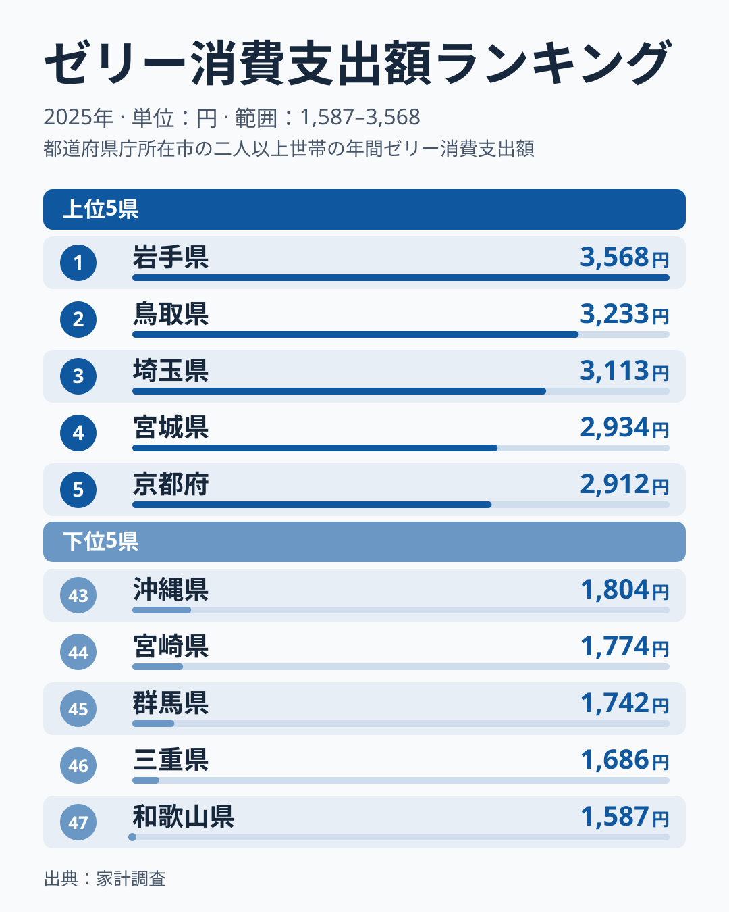
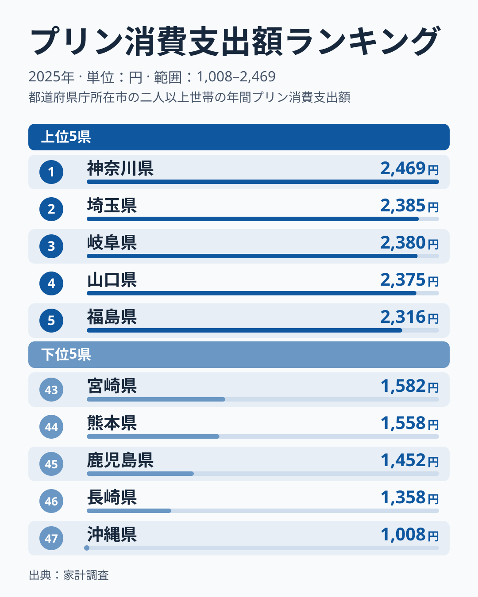
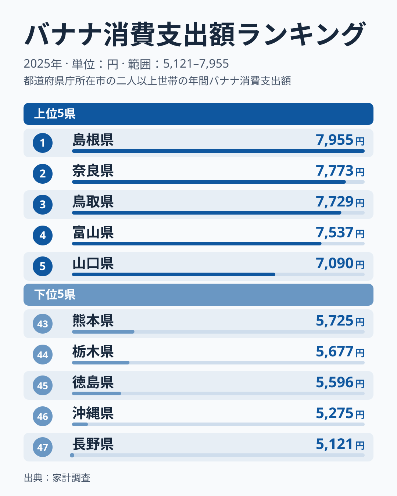
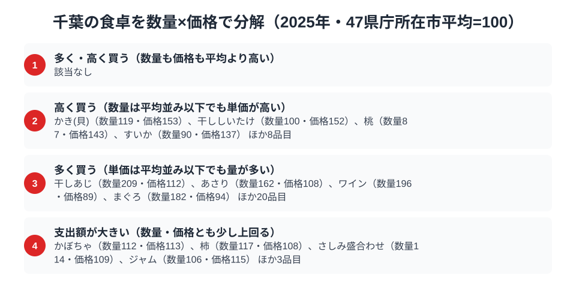

千葉県の家計調査には、2024年の結果で目を引く偏りがありました。ゼリーとプリンの消費支出額がそろって全国1位で、バナナは47都道府県中43位だったのです。「千葉は加工されたひんやりデザートに強く、生の果物には弱い」と読みたくなる並びでした。ところが2025年の結果で同じ3品目を見直すと、ゼリーは17位、プリンは12位、バナナは35位で、2つの1位は消えています。

この記事では、まず2025年の3品目で千葉市がどこにいるのかを確かめ、次に過去4年の順位の動きから「甘味王国」と呼べるだけの安定があったのかを検証します。最後に、支出額を数量と価格に分けて、年が変わっても残る千葉の食卓の特徴を探ります。千葉県の数値は県庁所在市である千葉市のデータです。単年の順位が大きく動きうる点を踏まえて読み進めてください。

> [!NOTE]
> 本記事のデータは総務省統計局「家計調査（品目別）」2025年の都道府県庁所在市・二人以上世帯を対象とした消費支出額です。千葉県の数値は県庁所在市である千葉市のデータを指します。県全体の消費傾向そのものではなく、あくまで県庁所在市というサンプルポイントの数値である点にご留意ください。

## ゼリー消費支出額 — 2025年は17位2,507円、1位の岩手県は3,568円

<source-link href="/ranking/jelly-consumption-expenditure">ゼリー消費支出額ランキングをもっと見る</source-link>

千葉市のゼリー消費支出額は2,507円で、47都道府県中17位でした。1位は岩手県の3,568円、2位は鳥取県の3,233円、3位は埼玉県の3,113円で、千葉と1位の差は1,061円あります。ただし47都道府県の中央値は2,309円、平均は2,381円なので、千葉は平均を126円上回っています。突出はしないものの、平均よりやや多く使っている位置です。上位には岩手・鳥取・埼玉・宮城・京都と、地域も気候もばらばらの県が並んでおり、「暑いから売れる」「大都市だから売れる」といった単純な説明では上位の顔ぶれを説明できません。

千葉市は2024年には3,500円で全国1位でしたから、1年で993円減り、順位は16位下がったことになります。共働き世帯の多い首都圏のベッドタウンでは、調理不要で子どものおやつや水分補給にも使えるゼリーが選ばれやすい、という説明は考えられます。しかしこの説明は2024年にも2025年にも同じように当てはまるはずなのに、順位は1位から17位まで動きました。[仮説] 市別の値は調査世帯が限られるぶん単年のぶれが大きく、2024年の1位はそのぶれが上向きに出た結果だった可能性があります。検証として、次の節で過去4年の順位を並べて確かめます。

## プリン消費支出額 — 2025年は12位2,079円、1位の神奈川県は2,469円

<source-link href="/ranking/pudding-consumption-expenditure">プリン消費支出額ランキングをもっと見る</source-link>

プリンの消費支出額は、千葉市が2,079円で12位でした。1位は神奈川県の2,469円、2位は埼玉県の2,385円、3位は岐阜県の2,380円で、千葉と1位の差は390円です。中央値は1,893円、平均は1,895円なので、千葉は平均を184円上回っており、ゼリーと同じく「平均よりやや多い」位置にいます。2024年は2,481円で1位でしたから、1年で402円減った計算です。

上位に注目すると、首都圏の4都県は神奈川が1位、埼玉が2位、千葉が12位、東京が13位(2,050円)と、プリンでは上位から中位にかたまっています。一方でゼリーでは、埼玉が3位、東京が10位、千葉が17位に対して神奈川は34位(2,149円)で、同じ首都圏でも順位がそろいません。[仮説] 「首都圏の生活スタイルがデザート支出を押し上げる」という説明はプリンには当てはまりやすいものの、ゼリーまで含めた一貫した説明にはなっていない可能性があります。千葉だけの特徴というより、品目ごとの好みや買い方の違いが重なっていると見るのが無難です。

## バナナ消費支出額 — 2025年は35位6,039円、1位の島根県は7,955円

<source-link href="/ranking/banana-consumption-expenditure">バナナ消費支出額ランキングをもっと見る</source-link>

バナナの消費支出額は、千葉市が6,039円で35位でした。1位は島根県の7,955円、2位は奈良県の7,773円、3位は鳥取県の7,729円で、千葉と1位の差は1,916円あります。最下位は長野県の5,121円で、47都道府県の中央値は6,300円ですから、千葉は中央値を261円下回る、下位寄りの位置です。2024年は5,413円で43位でしたから、1年で626円増え、順位は8位上がりました。

「ゼリー・プリンに強く、バナナに弱い」という2024年の対比は、2025年には「ゼリー・プリンはやや多め、バナナはやや少なめ」という小さな差に縮んでいます。バナナは朝食の一品や健康志向の間食として買われやすく、朝食習慣の違いが支出額に出やすい品目です。[仮説] 千葉でバナナの支出が伸びにくい背景には、通勤時間が長く朝に手間をかけにくい世帯が多いことがあるかもしれません。ただし、この説明も単年の順位だけで確かめられるものではありません。

> [!WARNING]
> ここでの数値は消費支出額（円）であり、消費量（グラム・個数）ではありません。単価の高い商品を少量買う県と、単価の安い商品を多く買う県では、支出額だけでは実際の消費量の多寡を判断できない点に注意が必要です。また、落花生など千葉の代表的な農産物は、家計調査の個別品目として集計されていないため本記事では扱っていません。

## 千葉の順位は4年でこれだけ動いた

ここまでの3品目について、千葉市の順位を2022年から2025年まで並べると次のとおりです。
各年の値は、同じランキング(ゼリー・プリン・バナナの消費支出額)の過去年の値から読み取っています。

- 2022年: ゼリー26位 (2,179円)、プリン14位 (1,927円)、バナナ28位 (5,323円)
- 2023年: ゼリー11位 (2,620円)、プリン18位 (1,852円)、バナナ5位 (6,439円)
- 2024年: ゼリー1位 (3,500円)、プリン1位 (2,481円)、バナナ43位 (5,413円)
- 2025年: ゼリー17位 (2,507円)、プリン12位 (2,079円)、バナナ35位 (6,039円)

3品目それぞれについて前の年との順位の差を取ると、全部で9回のうち7回が10位以上の変動でした。バナナは2023年に5位まで上がり、翌2024年に43位まで下がっています。ゼリーは26位、11位、1位、17位と推移し、プリンも14位、18位、1位、12位でした。1位を取ったのは両品目とも2024年の1回だけで、4年を通じて安定して上位にいたわけではありません。

この動きは、「千葉は甘味に強い県だ」という構造的な説明よりも、市別の値が年ごとに大きく入れ替わるという調査の性質を示しています。[仮説] 千葉市の標本は限られており、少数の世帯の買い方の違いで順位が動くため、1位という結果だけでは県の特徴を語れない、という読み方です。検証は、同じ4年分の順位を他の品目でも並べ、1位が連続する品目の割合を数えることで行えます。

## 年が変わっても残る千葉の食卓

甘味の順位が年ごとに入れ替わる一方で、数量と価格に分けて見ると、年をまたいで残る特徴も見えてきます。千葉の食卓で動かない部分は、デザートではなく魚介とワインの「量」にありました。後述する分解で、まぐろ・ワイン・干しあじは2024年も2025年も数量指数が170を超えています。

名産品や郷土料理が支出額の主役になる県の例としては、[宮崎県の食卓](/blog/miyazaki-food-culture)があります。千葉の場合は、特定の郷土産品が突出するというより、魚介や酒類など幅広い品目で量が多めに出る傾向がうかがえます。「千葉県は1位の品目が少ない」という見え方と、「特定の品目で毎年上位に入る」という見え方は両立します。

> [!TIP]
> 支出額の順位だけを見ると「千葉は甘味に強い」「バナナには興味がない」という印象で終わってしまいますが、複数年の順位と、数量指数・価格指数への分解を組み合わせると、単年のぶれと年をまたいで残る特徴を分けて読めます。他の都道府県のデータを読むときも、1位という結果だけでなく、数年分の順位と数量・価格の内訳をそろえて見ると、地域性の輪郭がより鮮明になります。

千葉県の消費傾向をさらに広く見たい方は、[千葉県の地域プロフィール](/areas/12000)から他の指標もあわせて確認できます。家計消費全体の動向は[経済カテゴリ一覧](/category/economy)からもたどれます。

## 数量×価格で分解する千葉市の食卓

<source-link href="/ranking/tuna-consumption-quantity">まぐろ消費量ランキングをもっと見る</source-link>

ここまで見た3品目の消費支出額は、いずれも「金額の大小」を示す数字です。ところが支出額は数量と単価の掛け算で決まるため、同じ支出額の高さでも、たくさん買っているから高いのか、一つひとつを高く買っているから高いのかで、背景にある生活の姿はまったく異なります。家計調査で数量と支出額の両方が公表されている138品目について、千葉市の2025年の値を47都道府県庁所在市の平均を100とした指数に直すと、この2つの効果を分けて読むことができます。

千葉市が際立って多く買っている品目の代表がまぐろです。まぐろ消費量は2,762gで47都道府県中4位、47市平均の約1.8倍にあたりますが、単価を示す価格指数は94と平均をやや下回ります。ワインは5,788mlで2位、数量指数196と平均の約2倍を買っている一方、価格指数は89と平均より1割ほど低くなっています。干しあじは数量指数209、あさりも162と、魚介を多く買っています。どれも「たくさん食べる・飲む」ことが支出額を押し上げているタイプで、単価の高さが理由ではありません。

対照的に、かき(貝)は数量指数119と平均をやや上回る程度なのに、価格指数は153と平均より5割以上高くなっています。干ししいたけ(数量100・価格152)、桃(数量87・価格143)、すいか(数量90・価格137)も、買う量は平均並みかそれ以下でも、単価の高いものを選んでいる品目です。こちらは「単価の高いものを選ぶ」ことが支出額を押し上げているタイプです。

2024年の分解と見比べると、まぐろ(数量181・価格96)、ワイン(数量291・価格62)、干しあじ(数量176・価格122)は、2年続けて数量指数が170を超えており、安定した特徴と言えそうです。逆に、2024年は価格で支出額を押し上げていたたけのこ(数量83・価格159)や緑茶(数量110・価格132)は、2025年にはたけのこが数量125・価格89、緑茶が数量126・価格94と、量で押し上げるタイプへ入れ替わりました。魚介やワインの量は動かず、果物や茶の単価は年ごとに揺れている、というのが2年分から読み取れる姿です。

この枠組みで見ると、バナナの姿も違って見えてきます。バナナの数量指数は96、価格指数は98.5とどちらも平均をわずかに下回り、極端に少ないわけでも、安いものだけを選んでいるわけでもありません。支出額の低さは、量・価格のどちらか一方が突出して低いからではなく、両方がわずかに平均を下回ることの積み重ねだと分かります。

> [!NOTE]
> ここでの指数は、家計調査で数量・支出額の両方が公表されている品目について、47都道府県庁所在市の単純平均を100として算出した相対値であり、総務省が公表する全国平均とは基準が異なります。また価格指数は「支出額÷数量」から求めた相対的な単価であり、購入している銘柄やブランドの違いも反映されるため、純粋な物価水準を表すものではありません。数値はいずれも二人以上世帯・千葉市の年間値です。

## まとめ

- 2025年のゼリー消費支出額は千葉が17位で2,507円、1位の岩手県の3,568円と1,061円差
- プリン消費支出額は千葉が12位で2,079円、1位の神奈川県の2,469円と390円差。バナナは千葉が35位で6,039円、1位の島根県の7,955円と1,916円差
- 2024年のゼリー・プリン1位は一過性で、過去4年の前年差9回のうち7回が10位以上の変動
- 年をまたいで残るのは甘味ではなく、まぐろ・ワイン・干しあじの数量の多さ
