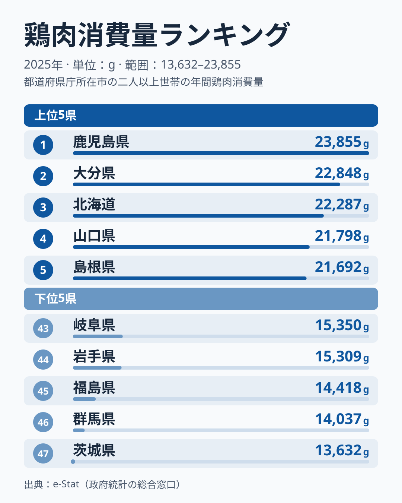

「鶏肉なら全国どこでも同じくらい食べているはず」と思うかもしれません。ところが総務省「家計調査」(2025 年) の都道府県庁所在市・二人以上世帯あたり **年間鶏肉消費量** を見ると、**1 位は鹿児島県で 23,855g**、最下位の **茨城県は 13,632g** と **1.7 倍** もの差があります。同じ日本でも、住む県によって家庭の鶏肉購入量はこれだけ違うのです。

しかもこの差は、ランダムにばらついているわけではありません。上位は **鹿児島・大分・北海道・山口・島根・岡山・広島・熊本・兵庫・福岡** と九州・中国地方を中心に西日本が占め、下位には北関東の **茨城・群馬** が並びます。この記事では「なぜ西日本で鶏肉がよく食べられ、北関東で少ないのか」という地域構造を、家計データから読み解いていきます。

> [!NOTE]
> ここでいう消費量は家計調査の品目「鶏肉」(生鮮肉)の購入グラム数で、外食の焼鳥や惣菜の唐揚げなど調理済みの食品は含まれません。家庭で調理する生鮮の鶏肉に限った数値のため、外食の多い都市部では実際の摂取量より低めに出る可能性があります。

## 鶏肉消費量が多い県・少ない県 (2025年)

まず上位5県と下位5県を見てみます。

<source-link href="/ranking/chicken-consumption-quantity">鶏肉消費量ランキング (47都道府県・各年版) をもっと見る</source-link>

1 位の **鹿児島県は 23,855g** で、二人以上世帯あたり年間 **約 24kg** の鶏肉を購入する計算になります。2 位の大分は 22,848g で、差は **1,007g (約4%)** にとどまり、トップ争いは南九州と大分の接戦です。続く 3 位の北海道は 22,287g、4 位の山口は 21,798g、5 位の島根は 21,692g と、上位は 21,000g 台から 22,000g 台に密集しています。

上位を地域でくくると、その偏りは一目瞭然です。TOP10 のうち **九州が 4 県 (鹿児島・大分・熊本・福岡)**、**中国地方が 4 県 (山口・島根・岡山・広島)** を占め、残りは兵庫と北海道です。4〜7 位は中国地方の 4 県が連続して並んでいます。東日本から TOP10 に入ったのは北海道だけで、鶏肉消費の地図は、おおむね「西高東低」の地図と重なります。

注目したいのは **3 位の北海道で 22,287g** です。東日本で唯一 TOP10 に入っており、「西高東低」の例外といえます。一方で 13 位の大阪府は 20,015g と上位 10 県には届かず、関西では 9 位の兵庫が 21,113g、11 位の和歌山が 20,755g とそれより高い値です。上位10県がいずれも2万1千g台以上で並ぶ一方、最下位の茨城は1万4千g未満にとどまり、上位群と下位群のあいだにははっきりとした開きがあります。

## 下位を占める北関東 — なぜ少ないのか

下位グループは様相が一変します。最下位の **茨城は 13,632g** で、1 位 鹿児島の **57%** です。次いで 46 位の群馬が 14,037g、45 位の福島が 14,418g、44 位の岩手が 15,309g、43 位の岐阜が 15,350g と続き、**茨城・群馬という北関東 2 県が最下位の 2 つを占めています**。

なぜ北関東で鶏肉消費が少ないのでしょうか。

> [!TIP]
> 「鶏肉が少ない県」は「肉を食べない県」とは限りません。鶏肉の順位だけで肉全体の消費を判断せず、豚肉など他の肉の購入量とあわせて読むのがコツです。

その手がかりとして、豚肉の購入量ランキングを見ます。[仮説] 豚肉が日常の主要肉として選ばれ、相対的に鶏肉の購入量が減っているのであれば、鶏肉が少ない県で豚肉が多いはずです。2025 年の豚肉では、栃木が 13 位、千葉が 8 位と上位寄りで、仮説と整合します。ところが最下位の茨城は豚肉も 38 位と下位寄りで、群馬も 23 位と中位にとどまり、「豚肉に乗り換えた」だけでは北関東の低さを説明できません。47 県で鶏肉と豚肉の購入量を突き合わせても、はっきりした逆相関は見えません。茨城・群馬の低さの理由は、この記事のデータでは特定できません。

あわせて見る: [豚肉消費量ランキング](/ranking/pork-consumption-quantity)

## 「西で多く東で少ない」境界線

上位と下位を地域クラスターでまとめると、鶏肉消費の東西差が浮かび上がります。

- **九州クラスター**: 鹿児島 1 位、大分 2 位、熊本 8 位、福岡 10 位 — 九州7県のうち4県がTOP10入り。長崎 14 位・宮崎 15 位・佐賀 18 位 も上位半分に入る
- **中国クラスター**: 山口 4 位、島根 5 位、岡山 6 位、広島 7 位 — 4〜7位を連続して占める
- **近畿クラスター**: 兵庫 9 位、和歌山 11 位、大阪 13 位
- **北海道**: 3 位
- **例外**: 中国地方の鳥取は 32 位、北関東の栃木は 33 位と下位半分、四国は徳島 12 位から高知 31 位まで分かれ、東北の秋田は 20 位と上位寄り
- **北関東・東北の下位クラスター**: 茨城 47 位、群馬 46 位、福島 45 位、岩手 44 位

特筆すべきは **九州 7 県すべてが上位 18 位以内** に入っている集中度です。[仮説] 九州では地鶏をはじめ鶏肉を日常的に食べる食文化が根づいていることが背景にある可能性があります。ただし、天草大王や薩摩地鶏のような地鶏は流通量が小さい銘柄で、世帯全体の購入量を説明できるかは、銘柄別や購入先別の鶏肉の購入量を見ないと確認できません。

「西で多く東で少ない」という傾向が 2025 年だけの偶然ではないことは、長い期間の順位で確かめられます。2007 年から 2025 年までの 19 年間の平均順位で見ると、上位は福岡・大分・熊本・宮崎・佐賀・鹿児島の九州勢と山口・広島で、下位は群馬・福島・富山・長野・沖縄・茨城です。東日本の県が下位に多く、西日本の県が上位に多いという構図は、単年の入れ替わりを均しても残ります。

> [!WARNING]
> 家計調査の対象は各県の県庁所在市の二人以上世帯であり、県全体の平均とは厳密には一致しません。また年ごとのサンプル世帯の入れ替えで数値が上下することがあるため、単年の順位だけでなく複数年の傾向で読むのが安全です。実際、前年の2024年版では島根が1位、熊本が2位、岐阜が3位でしたが、2025年は島根が5位、熊本が8位、岐阜が43位と入れ替わっています。県ごとの順位は年によって大きく動くため、地域の傾向として読むのが安全です。

## まとめ

- 1 位は **鹿児島県で 23,855g**、2 位は **大分で 22,848g**、3 位は **北海道で 22,287g**
- 最下位は **茨城で 13,632g**、**1.7 倍** の地域差 (1位鹿児島の57%)
- TOP10 のうち **九州が 4 県、中国地方が 4 県**、東日本からは北海道のみ
- 下位は **茨城・群馬の北関東 2 県** が最下位の2つを占める
- 長期の平均順位でも九州・中国が上位、群馬・福島・茨城などが下位で、西高東低の傾向は単年の偶然ではありません。豚肉への乗り換え仮説は栃木・千葉とは整合しますが、茨城では支持されません

各県の年次推移や全47都道府県の順位は [鶏肉消費量ランキング](/ranking/chicken-consumption-quantity) で確認できます。世帯の食費全体の地域差に関心があれば [経済・消費カテゴリ](/category/economy) の他のランキングもあわせてどうぞ。
