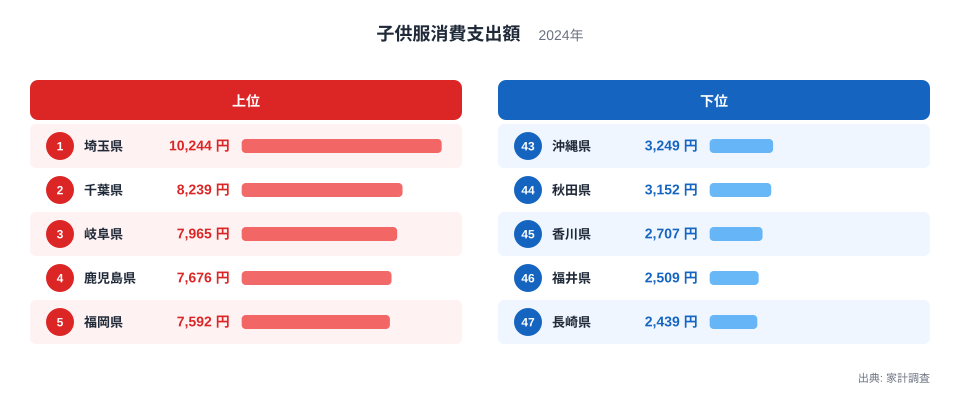
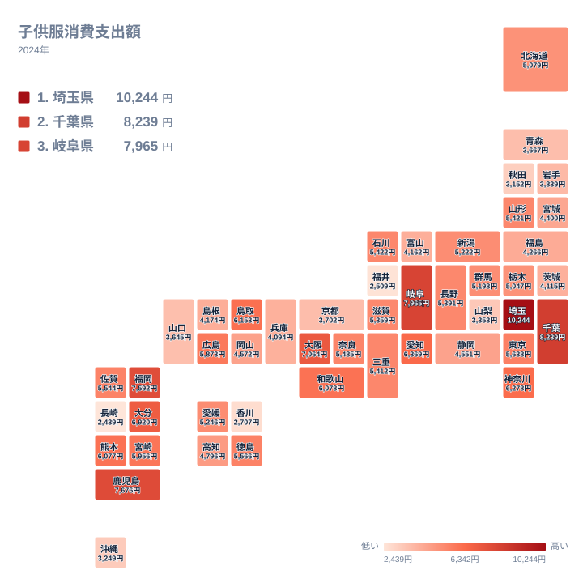

## 子供服への支出、首位は埼玉県

子供の成長は早く、服はすぐに小さくなります。毎年のように買い替えが必要になるため、子供服は家計のなかで意外に存在感のある支出です。ところが、その金額は住んでいる県によって大きく違います。

2024年の家計調査で、子供服への支出が最も多かったのは埼玉県で、10,244円でした。2位は千葉県の8,239円、3位は岐阜県の7,965円と続きます。一方、最も少なかったのは長崎県の2,439円です。46位の福井県は2,509円、45位の香川県は2,707円でした。

まずは上位5県と下位5県を並べた図で、全体の姿をつかみます。

<source-link href="/ranking/childrens-clothes-consumption-expenditure">子供服への支出ランキングをもっと見る</source-link>

図を見ると、上位は埼玉県、千葉県、岐阜県、鹿児島県、福岡県の順です。首位の埼玉県と2位の千葉県のあいだには、およそ2,000円の開きがあります。2位から5位までは8,239円、7,965円、7,676円、7,592円と接近しており、首位だけが抜けた形です。

下位は長崎県、福井県、香川県、秋田県、沖縄県の順になっています。秋田県は3,152円、沖縄県は3,249円で、上位の県とは水準そのものが違います。顔ぶれを見ると、上位にも下位にも九州・沖縄の県が入っている点が目を引きます。

> [!NOTE]
> ここでいう子供服への支出は、家計調査で世帯が1年間に子供服へ使った金額を、調査対象の世帯で集計した値です。子供のいない世帯も調査対象に含まれて平均されるため、子供のいる世帯だけの購入額とは一致しません。

## 首都圏に集まる上位と、その背景

上位に並ぶ埼玉県と千葉県は、どちらも関東で、東京都に隣接するベッドタウンです。[埼玉県のデータ](/areas/11000)と[千葉県のデータ](/areas/12000)を見比べると、この2県が子供服で高い水準にあることがわかります。

背景として考えられるのは、子育て世帯の多さです。都心に通勤する若い世帯が、住宅を求めて近郊に移り住む流れは長く続いてきました。子供のいる世帯が多い地域では、世帯全体の平均でも子供服への支出が押し上げられやすくなります。大型の商業施設や郊外型の専門店が多く、買い物の選択肢が広いことも、支出を後押ししている可能性があります。

ただし、同じ関東でも東京都は5,638円で15位、神奈川県は6,278円で9位にとどまります。茨城県は4,115円で36位、栃木県は5,047円で28位、群馬県は5,198円で26位です。関東というくくりだけでは説明がつかず、同じ首都圏でも県ごとにかなりの差があります。埼玉県の突出は、地域性に加えて、世帯の構成が効いている面もありそうです。

> [!WARNING]
> 家計調査は標本調査で、都道府県別の値は県庁所在地など限られた調査対象から算出されます。1年間の購入が数件あるかないかで金額が動きやすい品目なので、順位の小さな差は誤差の範囲かもしれません。1つ違いの順位に、強い意味を読み取らないでください。

## 九州で割れる評価、岐阜県の健闘

意外なのは九州・沖縄です。4位が鹿児島県の7,676円、5位が福岡県の7,592円で、7位の大分県は6,920円です。熊本県は6,077円で12位、宮崎県は5,956円で13位、佐賀県は5,544円で17位と、上位から中位に多くの県が並びます。

ところが、最下位は同じ九州の長崎県で、43位には沖縄県の3,249円が入っています。九州・沖縄の中で、全国の上位から最下位までが揃ってしまう形です。同じ地方でも、人口の集まり方、子供の多さ、買い物の場所、贈答や祝い事の習慣が違えば、支出は大きく変わります。地方単位で語りにくいのが、この指標の面白いところです。

中部では、3位の岐阜県が7,965円と存在感を見せます。一方で福井県は2,509円で46位、山梨県は3,353円で42位、富山県は4,162円で35位です。同じ中部でも、岐阜県と福井県では大きく違います。近畿では大阪府が7,064円で6位、和歌山県が6,078円で11位ですが、京都府は3,702円で39位、兵庫県は4,094円で37位に沈みます。隣り合う府県でも、結果は同じ方向にそろいません。

## 地図で見る、西と東のまだら模様

地理的な広がりは、タイルマップで確かめます。濃淡のつき方から、地域の傾向を探ります。

地図を見ると、関東の埼玉県と千葉県、中部の岐阜県、そして九州の鹿児島県と福岡県と、離れた場所に高い県が点在しています。きれいな東高西低や北高南低の形にはなっていません。

北海道・東北では、北海道が5,079円で27位、山形県が5,421円で20位です。宮城県は4,400円で32位、福島県は4,266円で33位、岩手県は3,839円で38位、青森県は3,667円で40位、秋田県は3,152円で44位と、全体に中位から下位に偏ります。寒冷な地域では、冬物の厚手の衣類が必要ですが、それが金額に直結しているようには見えません。気候だけでは説明できないことがわかります。

中国・四国では、鳥取県が6,153円で10位、広島県が5,873円で14位、徳島県が5,566円で16位と、中位より上の県があります。他方、山口県は3,645円で41位、香川県は2,707円で45位です。産地や歴史との結びつきを一つの理由で語るのは難しく、地域ごとの暮らし方の違いが重なって、このまだら模様が生まれていると考えるのが自然です。

> [!TIP]
> 順位表を読むときは、順位だけでなく金額の間隔も見てください。この指標は上位でも金額が接近している区間があり、中位は5,000円台に多くの県が密集しています。密集した区間の1つ違いの順位は、実質ほとんど差がないと考えるのが安全です。

## 関連する支出と比べて見えること

子供服への支出は、衣類全般への関心の高さとは別物です。大人の衣料費が高い県が、必ずしも子供服にも多く使うとは限りません。子供服は、子供の人数と年齢、そして買い替えの頻度に強く左右されます。

たとえば、乳幼児のいる世帯が多い地域では、成長に合わせた買い替えが頻繁に起こります。小学校に上がると、制服や体操服など、学校指定の品が増えます。こうした学校用の衣類は、子供服とは別に集計されることが多く、日常着の支出とは性格が異なります。入学や進級の時期にまとまった買い物をする家庭と、日々少しずつ買い足す家庭とでは、同じ年間の支出でも内訳が違うはずです。

また、おさがりや親戚間の譲り合いが盛んな地域では、新たに購入する金額は小さくなります。フリマアプリなど中古の取引が広がれば、購入額に表れにくい消費も増えます。長崎県や福井県のような下位の県が、実際に子供を粗末にしているわけではありません。買い方や手に入れ方が違うだけという面を、見落とさないようにしたいところです。

## データについて

この記事で使った統計は、家計調査の子供服消費支出額で、年は2024年、単位は円です。全47都道府県の値が公表されており、1年間の平均的な支出額を示します。

子供服には、ベビー服と呼ばれる乳幼児向けの衣類が含まれるかどうかなど、分類の細部に注意が必要です。品目の範囲は調査の定義に従っており、一般にイメージする子供服と完全には重ならない場合があります。

同じ品目でも、調査の年が変われば順位は入れ替わります。ここで紹介した順位は2024年の1年分の結果であり、長期的な傾向を保証するものではありません。ほかの暮らしの統計と合わせて見たいときは、[同じカテゴリの統計一覧](/category/economy)から、関連する指標をたどってみてください。

## まとめ、数字の差をどう受け止めるか

2024年の結果では、子供服への支出は埼玉県の10,244円が首位、千葉県の8,239円が2位、岐阜県の7,965円が3位でした。反対に、長崎県は2,439円で最下位、福井県は2,509円、香川県は2,707円と続きます。

上位には首都圏の近郊と、九州や中部の県が混ざり、下位にも九州・沖縄や北東北の県が入りました。一つの地方で傾向が揃うわけではなく、子育て世帯の多さ、買い物環境、おさがりの習慣、購入のタイミングといった複数の要素が重なって、県ごとの差になっていると考えられます。

数字の差は、そのまま子供への愛情の差でも、家計の豊かさの差でもありません。調査の仕組みと限界を踏まえたうえで、自分の住む県がどこに位置するのかを知り、暮らしの背景を考える手がかりにしてください。
