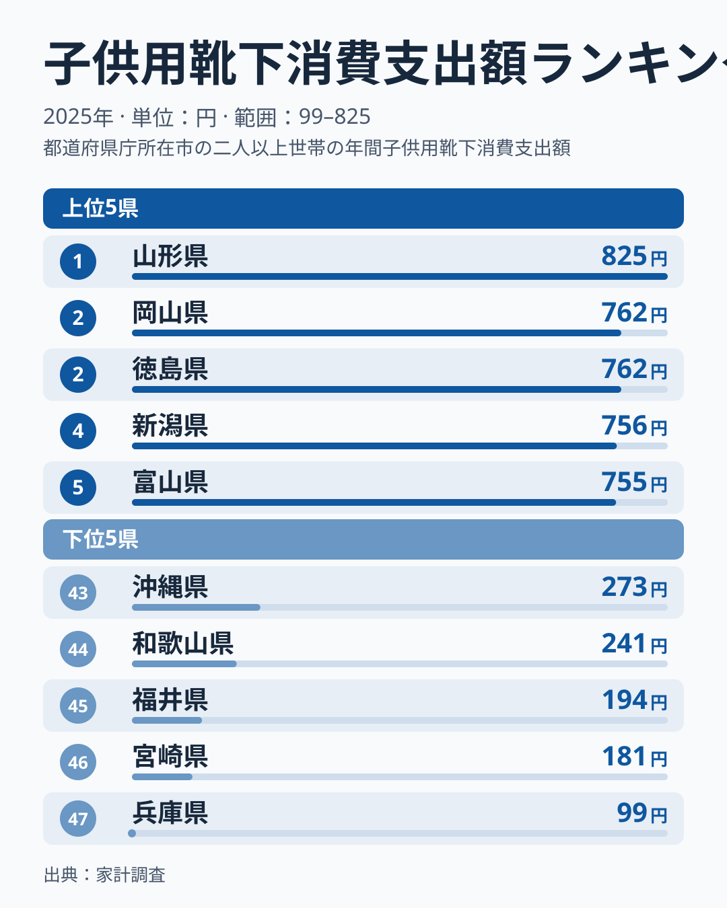
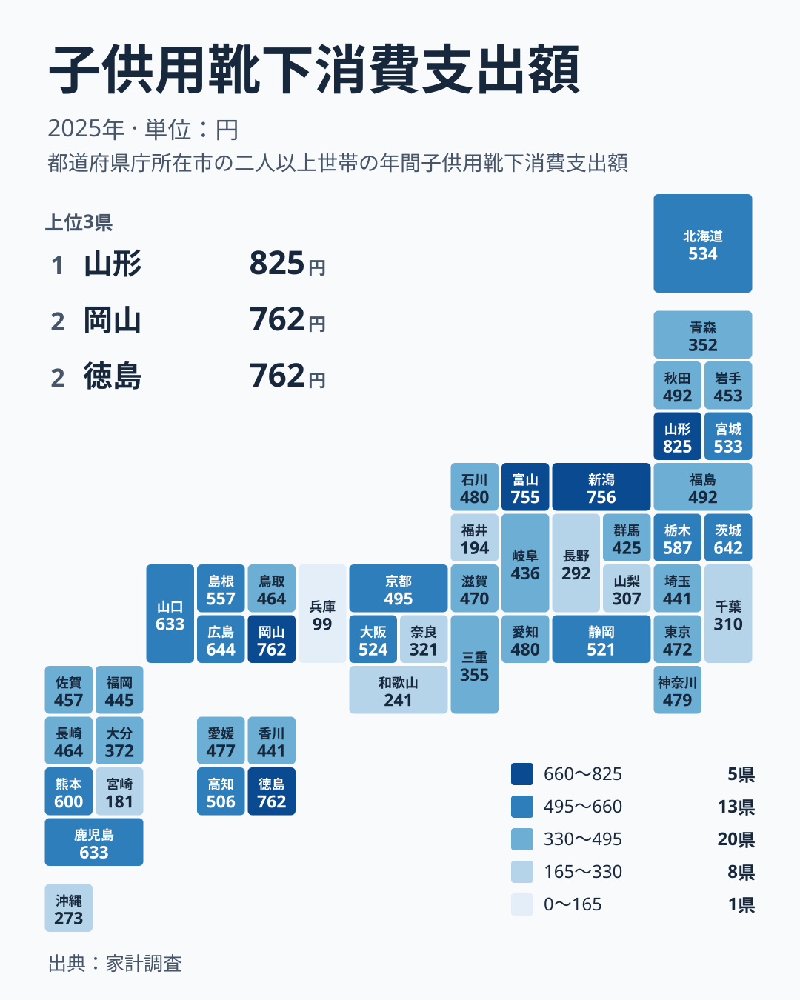

子どもの靴下は、気づくと穴があいたり、片方だけなくなったりする消耗品です。安く買える品なので、家計の中では目立たない存在です。ところが都道府県ごとに支出額を並べると、思いのほか大きな開きが見えてきます。

2025年の家計調査によると、子供用靴下への支出が最も多いのは山形県で825円でした。最も少ないのは兵庫県で99円です。825円を99円で割ると約8.3倍になり、これが実データ上の最大と最小の比です。

この記事では、まず上位と下位の顔ぶれを確かめます。次に地図で地域のまとまりを見て、同じ地方の中でも差が大きいことを確認します。最後に、この数字を家計や暮らしの目線でどう読めばよいかを、仮説として考えます。

## 上位と下位の顔ぶれ

<source-link href="/ranking/childrens-socks-consumption-expenditure">子供用靴下への支出ランキングをもっと見る</source-link>

上位は山形県の825円がトップです。続いて岡山県と徳島県がともに762円で並び、新潟県が756円、富山県が755円です。2位から5位までは差がわずかで、トップの山形県だけが一歩抜けています。

下位は、最下位の兵庫県が99円です。その上に宮崎県の181円、福井県の194円、和歌山県の241円、沖縄県の273円が続きます。上位5県は755円から825円、下位5県は99円から273円に収まっています。ただし6位以下にも広島県の644円、茨城県の642円と続くため、上位と下位の間は途切れず、なだらかにつながっています。

注目したいのは、上位が特定の一地方に偏っていない点です。山形県は北海道・東北、岡山県は中国、徳島県は四国、新潟県と富山県は中部に属します。下位も兵庫県と和歌山県が近畿、宮崎県と沖縄県が九州・沖縄、福井県が中部です。「この地方だから多い、少ない」と単純に言い切れない並びになっています。

> [!NOTE]
> この数値は、家計調査で集計された子供用靴下の支出額で、単位は円です。今回の資料からは、子どもがいない世帯も含めた平均なのか、子育て世帯に限った平均なのかは確認できていません。そのため「子ども1人あたり」の金額としては読めず、意味づけには注意が必要です。

## 地図で見る地域のまとまり

地図にすると、色の濃い県と薄い県が飛び飛びに散らばっていることがわかります。隣り合う県が同じ水準にそろう、という素直な傾向は強くありません。

たとえば中部は、新潟県が756円、富山県が755円と上位に入ります。一方で、福井県は194円と下位から3番目で、長野県は292円、山梨県は307円です。同じ地方の中に、上位と下位の県が同居しています。

近畿も同様です。大阪府が524円で15位、京都府が495円で18位と中位が続く一方、和歌山県は241円、兵庫県は99円と下位に沈みます。この散らばりの大きさは、地域の習慣だけでなく、標本の偏りなど地域以外の要因も関わっている可能性を示唆します。

> [!WARNING]
> 家計調査は標本調査で、都道府県ごとの調査世帯数は多くありません。子供用靴下のように1回の購入額が小さい品目は、数世帯の買い物のタイミングで年間の平均が大きく動く可能性があります。順位の1つや2つの違いに、実態の差があるとは限りません。

## 地方の中の振れ幅

全体の順位だけでは見えにくいので、地方ごとに最大と最小の幅を見てみます。

- 北海道・東北は、山形県の825円から青森県の352円までです。
- 関東は、茨城県の642円から千葉県の310円までです。
- 中部は、新潟県の756円から福井県の194円までです。
- 近畿は、大阪府の524円から兵庫県の99円までです。
- 中国は、岡山県の762円から鳥取県の464円までです。
- 四国は、徳島県の762円から香川県の441円までです。
- 九州・沖縄は、鹿児島県の633円から宮崎県の181円までです。

どの地方でも、域内に数百円の開きがあります。なかでも中部と近畿、九州・沖縄は、域内の最小が200円を下回るか、100円前後にとどまります。一方で中国と四国は最小でも441円以上で、下限が比較的高めです。

大都市圏の東京都は472円で25位、神奈川県は479円で23位、愛知県は480円で22位と、いずれも中位です。「都会だから多く使う」「地方だから少ない」といった図式は、この数字からは読み取れません。

## 家計と暮らしへの含意

ここからは、数字を生活の側から読み替えてみます。以下は実データから直接わかることではなく、考え方の手がかりとしての仮説です。

靴下はサイズアウトと消耗で買い替えが発生する品目です。成長が早い時期の子どもがいる世帯が標本に多く入った県では、平均が高く出ているのかもしれません。逆に、そうした世帯が少なかった県では低く出た可能性があります。

買い方の違いも考えられます。まとめ買いか、少数を選んで買うか、通販か店頭かによって、年間の支出は変わると考えられます。入園・入学や冬支度の時期の買い物が標本に含まれたかどうかも、年間の合計に影響するかもしれません。

生活者としては、順位の高低に一喜一憂するより、自分の家庭の支出の流れを確かめる方が実用的です。成長期に合わせて買い替える時期を決める、必要な枚数を把握しておくといった工夫で、無駄は減らせます。

> [!TIP]
> 都道府県の順位を読むときは、順位そのものより金額の幅を見るのがコツです。この指標では、2位から5位が755円から762円に収まる一方、13位の北海道は534円、25位の東京都は472円です。順位が10上がるごとに金額が大きく変わる区間もあるため、順位より円の差で位置づけると読み違いが減ります。

## 山形県と岡山県を手がかりに

最後に、上位の県の個別データも見てみましょう。トップの山形県の詳しい数字は[山形県のデータ](/areas/06000)で、2位の岡山県は[岡山県のデータ](/areas/33000)で確認できます。靴下以外の暮らしの支出も合わせて見ると、「靴下だけが多いのか、衣類全体にお金をかける傾向なのか」といった違いに気づけます。

ほかの家計関連の指標とも比べたい場合は、[同じカテゴリの統計一覧](/category/economy)が出発点になります。靴下の支出を、他の項目と並べると、子育て世帯の支出の優先順位が見えてきます。

この記事の結論はシンプルです。子供用靴下への支出は、最も多い山形県と最も少ない兵庫県で約8.3倍開いています。同じ地方の中に上位と下位の県が混在し、大都市圏は中位に集まっています。理由はこのデータだけでは特定できないため、数字は目安として受け止めるのが妥当です。

## データについて

この記事で使った統計は、家計調査の「子供用靴下消費支出額」で、2025年の値を円単位で示しています。順位は、この数値が大きい順に付けています。同額の県があり、岡山県と徳島県は762円、山口県と鹿児島県は633円です。

数値は家計調査の標本から得た推計で、世帯の構成や買い物の時期によって変動すると考えられます。そのため、小さな差を取り上げて優劣を論じることはせず、大きな開きがあるかどうかに注目して読むことをおすすめします。
