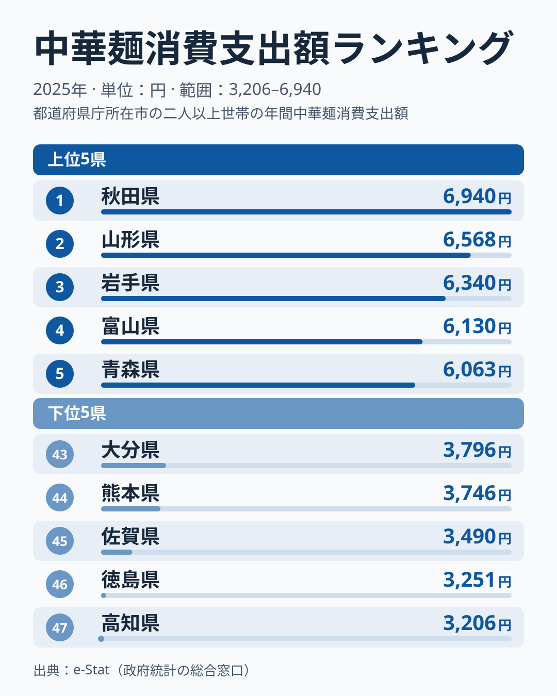

家で作って食べる中華めん──スーパーで買う生めんタイプの中華そばやラーメンの麺のことです。総務省の家計調査によると、2025年の1世帯あたり年間支出額は都道府県ごとに見ると大きな差があります。1位の秋田県は6,940円、最下位の高知県は3,206円で、2.2倍の開きがあります。なお家計調査は県庁所在市の二人以上の世帯の値で、県全体の値ではありません。

この記事で注目したいのは、単なる1位・最下位の対比ではありません。上位6位までを見ると、秋田・山形・岩手・青森という北海道・東北の4県に加え、中部の富山・新潟が並びます。ただし上位10位までに入る北海道・東北の県は4県にとどまり、7位以降は地域がばらけます。「東北が目立つ」といえるのは上位6位までの範囲です。一方で下位5県は四国・九州の県で占められています。家庭の食卓に並ぶ中華めんの支出が、地域の食文化とどう結びついているのかを、データから読み解いていきます。

## 上位と下位の対比

上位5県は秋田6,940円・山形6,568円・岩手6,340円・富山6,130円・青森6,063円です。1位から3位までは秋田・山形・岩手の東北3県が占め、5位までに6,000円を超えたのはこの5県です。6位の新潟は5,961円で、5位の青森との差は102円と小さく、上位5県という線引きは僅差の上に成り立っています。一方、1位の秋田と5位の青森の差は877円あり、上位の中でも1位がやや抜けています。

下位5県は高知3,206円・徳島3,251円・佐賀3,490円・熊本3,746円・大分3,796円で、四国2県と九州3県が並びます。最下位の高知と46位の徳島の差は45円とわずかで、下位は2県が並んで底を作る形です。47位の高知から45位の佐賀までは3,500円に届かず、上位5位の6,000円台とは大きく離れています。

東京都は15位で5,137円と中位の上寄りに入り、大阪府は36位で4,293円、兵庫県は35位で4,328円と、大都市圏の中でも順位は分かれます。

<source-link href="/ranking/chinese-noodles-consumption-expenditure">中華めん消費支出ランキングをもっと見る</source-link>

> [!NOTE]
> 本データは家計調査の「中華めん」費目で、スーパー等で購入する生めん・乾麺タイプの中華そば・ラーメンの麺を指します。外食で食べるラーメン店の「中華そば」とは別費目で集計されており、混同しないよう注意してください。

## 東北を中心に上位が目立つ理由

上位10県の内訳は、東北4県(秋田・山形・岩手・青森)、中部2県(富山・新潟)、九州・沖縄の沖縄、関東2県(栃木・神奈川)、中国の岡山です。上位6県は東北4県と中部2県で、いずれも冬の寒さが厳しいのではないか、という見方もできますが、データに気温は含まれないため[仮説]にとどまります。7位以降は沖縄、栃木、神奈川、岡山と地域がばらけます。東北の福島は5,350円で11位、宮城は5,251円で12位、中部の石川は5,223円で13位、長野は5,167円で14位と、いずれも10位圏外です。寒冷地ほど温かい麺料理を頻繁に食卓に出すという仮説は上位6県には当てはまりそうですが、温暖な沖縄が7位の5,533円に入っていることから、気候だけでは説明しきれないこともわかります。家計調査の値は単年のぶれが大きいため、順位の差が小さい中位以降については、構造として断定せず[仮説]として読む必要があります。

さらに東北勢の上位には、地域ごとの麺料理の食文化が関係している可能性があります。たとえば、ご当地ラーメンなど地域の麺文化が家庭での調理習慣にも影響し、支出額の高さに表れているという見方です。ただしこれは [仮説] であり、本データから確かめられるものではありません。

> [!TIP]
> このデータは「家庭で作る中華めん」の支出額です。外食でラーメンを食べる頻度が高い県が必ずしも上位に来るとは限りません。家庭内調理の習慣が支出額に関係しているかどうかは、このデータだけでは判断できません。

## 下位5県は四国・九州に集中

下位5県(高知・徳島・佐賀・熊本・大分)はいずれも四国・九州です。鹿児島は3,915円で42位、福岡は3,948円で41位と下位に近い一方、長崎は4,833円で25位と中位にあり、九州の中でも差があります。沖縄は5,533円で7位と例外的に高く、九州・沖縄でひとくくりにはできません。温暖な気候により冷たい麺類(そうめん・冷やし中華等)への支出配分が相対的に高くなる可能性や、豚骨ラーメンなど外食でのラーメン消費文化が強く家庭内調理の比重が小さい可能性が考えられますが、これらは家計調査の中華めん費目単体からは検証できない[仮説]です。

九州の中でも[福岡県](/areas/40000)は3,948円で41位と、博多ラーメンの本場でありながら家庭での中華めん支出は低い水準にとどまっています。これは「外食文化が強い地域ほど家庭内調理への支出が相対的に下がる」という仮説の一例とも読めますが、他の食品費目との比較検証が必要で、ここでは断定できません。

> [!WARNING]
> この値は県庁所在市の二人以上の世帯のもので、県全体の傾向とは限りません。また「中華めん」費目は生めんや乾麺などの麺を対象としており、カップ麺などの即席麺は含みません。単年の順位は小さな差で入れ替わりやすい点にも注意してください。

## 関連品目との対比

麺類の関連ランキングとして、[カップ麺消費支出額ランキング](/ranking/cup-noodles-consumption-expenditure)と[即席麺消費支出額ランキング](/ranking/instant-noodles-consumption-expenditure)も公開しています。あわせて見ると、家庭での麺の食べ方の違いを比べられます。

うどん県として知られる[香川県](/areas/37000)は中華めんでは32位の4,458円にとどまっており、必ずしも「めん好きの県=すべてのめんが上位」というわけではないことがわかります。

## まとめ

- 上位は僅差で並ぶ一方、下位は高知と徳島が45円差で底を作り、順位の読み方には幅が必要
- 「東北が目立つ」のは上位6位までで、7位以降は沖縄・栃木・神奈川・岡山と地域がばらける
- 九州・沖縄は一括りにできず、沖縄は7位、長崎は25位と、下位5県の九州3県とは位置が異なる
- 気候や食文化との関係はいずれも [仮説] で、このデータだけでは確かめられない
- 大都市圏も東京15位・大阪36位と分かれ、人口の多さと支出の高さは直結しない

## データについて

総務省統計局「家計調査」(2025年、e-Stat経由で整備)。中華めん(生めん・乾麺)の1世帯あたり年間支出額を都道府県別に集計したものです。
