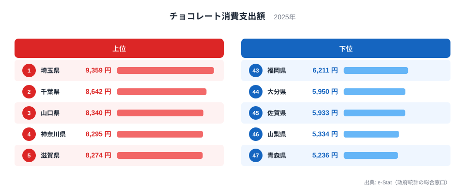

総務省「家計調査」（2025年）で、1世帯あたりの年間チョコレート消費支出額が最も多かったのは埼玉県の9,359円でした。最下位の青森県は5,236円で、その差は1.8倍です。ところが前の年（2024年）の首位は山形県で9,262円、次点は大分県でした。山形県は2025年に7,418円で17位、大分県は5,950円で44位まで下がっています。

この記事では、2025年のランキングを上位5県と下位5県で確認したうえで、「首位がなぜほぼ毎年入れ替わるのか」を2007年から2025年までの19年分の推移で確かめます。1年だけの順位で「○○県はチョコ好き」と言い切れるのか、5年平均にすると誰が残るのかも見ていきます。

なお、この指標の値は県全体ではなく、各都道府県の県庁所在市に住む二人以上世帯の平均です。以下の「山形県」「埼玉県」などは、すべて県庁所在市の世帯の値を指します。

> [!NOTE]
> 家計調査の品目別支出額は、世帯が1年間にその品目へ支出した金額の平均です。購入量ではなく「支出額」なので、高価なチョコレートを選ぶ世帯が多い都市は金額が大きく、安価な大袋を選ぶ都市は小さく出ます。個人の消費額や県民全体の消費額としては読めません。

## 2025年の上位5県と下位5県

上位は、埼玉県が9,359円、千葉県が8,642円、山口県が8,340円、神奈川県が8,295円、滋賀県が8,274円の順です。首都圏の埼玉・千葉・神奈川が3県入り、そこに山口と滋賀が加わっています。下位は、福岡県が6,211円、大分県が5,950円、佐賀県が5,933円、山梨県が5,334円、青森県が5,236円です。

<source-link href="/ranking/chocolate-consumption-expenditure">チョコレート消費支出額ランキングをもっと見る</source-link>

この並びで目を引くのは、前年との落差です。2024年に5位だった石川県は6,921円で29位に、次点だった大分県は44位に下がりました。逆に埼玉県は2024年の19位から首位へ、千葉県は2024年の4位から2位へ上がっています。九州では福岡県、大分県、佐賀県が下位5県のうち3県を占め、2025年は九州北部でそろって低く出ました。ただし、2024年に次点だった大分県が翌年に44位になるほど、順位は1年で大きく動きます。[仮説] この動きは、県庁所在市の二人以上世帯という限られた世帯の平均であるため、年ごとの標本の揺れが大きいことによる可能性があります。この記事のデータには調査世帯数が含まれず、確かめられません。確かなのは、翌年に40位以上動いた県がある以上、1年分の順位だけで気候や食文化を語るのは危うい、という点です。

> [!WARNING]
> 単年の順位は1年で40位以上動くことがあります。「○○県民はチョコ好き」という結論は、複数年の平均を見てから判断してください。

## 首位は19年で11県、ほぼ毎年入れ替わる

2007年から2025年までの各年の1位と47位を見ると、1位の金額は2007年の6,848円から2025年の9,359円へ、47位は2,440円から5,236円へ動いています。ただし金額は名目額で、物価の上昇や品目分類の改定の影響を切り分けていません。2007年の47位（和歌山県2,440円）から2008年の47位（青森県3,510円）へ大きく跳ねる点も含め、2007年前後の連続性は確認していないため、年をまたぐ金額の比較は目安にとどめてください。

19年間で1位になったのは11県で、最多は石川県の8回です。次いで奈良県が2回で、富山・山口・鹿児島・福島・愛知・滋賀・兵庫・山形・埼玉の9県が各1回です。石川県は2008年と2009年、2011年と2012年に2年続けて首位でした。2021年まで首位の常連でしたが、2022年に7位、2023年に9位、2024年に5位と下がり、2025年は29位まで下がりました。首位が3年続いた県は一度もありません。

一方、最下位側は入れ替わりが小さく、19年のうち青森県が10回で47位でした。次いで長崎県が4回、和歌山県が3回、福岡県と鹿児島県が各1回です。上位は顔ぶれが頻繁に変わるのに、下位は同じ県が繰り返し出る形です。

> [!TIP]
> 首位が毎年変わる指標では、「今年の1位」より「何年続けて上位か」が実態に近い手がかりです。次の節で5年平均に直します。

## 5年平均にすると誰が残るか

2021年から2025年までの5年分を単純平均して順位をつけ直すと、上位は埼玉県が8,208円、富山県が7,864円、千葉県が7,681円、石川県が7,668円、山形県が7,612円となります。下位は長崎県が6,038円、和歌山県が5,844円、青森県が5,323円です。

首位は埼玉県のままで、2025年の単年の首位とも一致します。直近5年の埼玉県の順位は2021年は3位、2022年は2位、2023年は3位、2024年は19位、2025年は1位で、1年だけ19位に落ちたものの、残りの4年は3位以内でした。千葉県は2023年に7位、2024年に4位、2025年に2位と、直近3年は上位にいます。つまり埼玉県と千葉県は、単年の揺れを均しても上位に残ります。一方、2024年に首位だった山形県は5年平均でも5位に残りましたが、次点だった大分県は上位5県に入りません。山形県の順位は2021年から2024年にかけて18位、12位、21位、1位と動いており、中位から突然首位に跳ねたあと、2025年は17位に戻っています。

下位側では、青森県と和歌山県が5年平均でも下位2県で、単年の揺れではなく低い水準が続いている可能性が高いといえます。ただし5年分でも標本の揺れは残るので、断定は避けるべきです。

[仮説] 首都圏の埼玉・千葉・神奈川が2025年に上位へそろった背景には、バレンタイン需要に加えて、ギフト用の高価格帯チョコレートを買える店が身近に多いことがあるかもしれません。この仮説を検証するには、チョコレートの購入頻度と1回あたりの購入額を分けて見る必要があり、今回のデータだけでは確かめられません。

> [!NOTE]
> 5年平均は、2021〜2025年の各年の値を単純平均して四捨五入したものです。調査の標本が毎年同じ世帯とは限らないため、公式の集計値ではなく、この記事での比較用の計算値です。

## まとめ

- 2025年の首位は埼玉県で9,359円、次いで千葉県が8,642円、山口県が8,340円。最下位は青森県で5,236円、差は1.8倍
- 2024年に首位だった山形県は17位で7,418円、次点だった大分県は44位で5,950円に下がった
- 2007〜2025年の19年で1位になったのは11県。石川県が8回で最多だが、2025年は29位
- 最下位は青森県が19年中10回。上位は入れ替わりが激しく、下位は同じ県が残りやすい
- 5年平均では埼玉県が8,208円で首位、青森県が5,323円で最下位。単年の順位より複数年で見るのが安全

同じ家計調査の品目別データでは、[カステラ消費支出額](/ranking/castella-consumption-expenditure)のように贈答と結びつく菓子も都道府県別に比べられます。上位に入った[埼玉県](/areas/11000)や[千葉県](/areas/12000)の地域データ、家計消費全般を扱う[経済・所得カテゴリ](/category/economy)もあわせてご覧ください。
