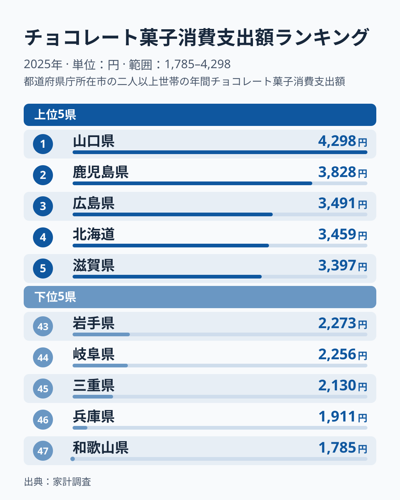
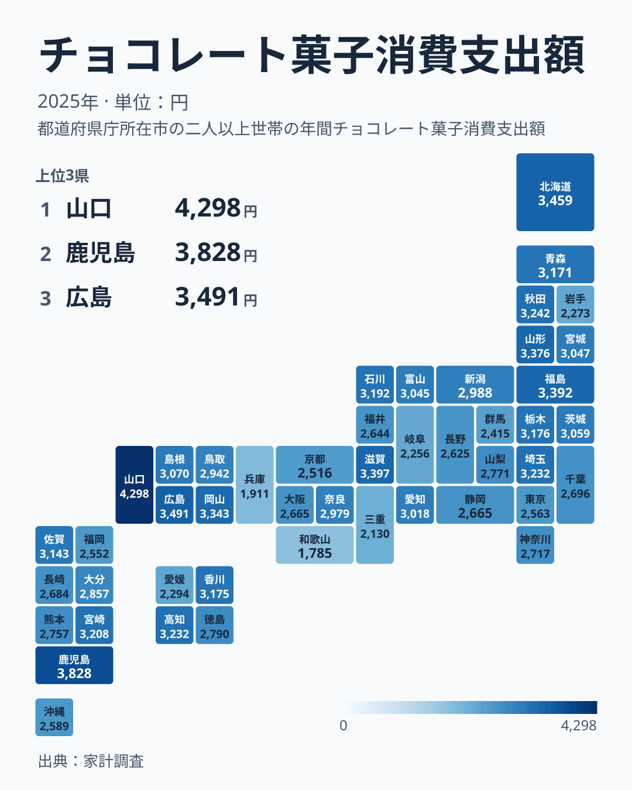

家計調査の2025年の結果で、チョコレート菓子への年間支出が最も多かったのは山口県の4,298円でした。最も少ないのは和歌山県の1,785円で、差は約2.4倍です。山口県は2024年には14位、支出は2,831円でしたから、1年で順位が13位上がり、支出は約52%増えたことになります。一方、2024年に首位だった山形県は3,376円で7位まで下がりました。

「チョコレート菓子の消費は山形がトップ」と読めた前年の景色が、1年でここまで変わるのはなぜでしょうか。この記事では、2025年の上位と下位を確認したうえで、前年から順位がどれだけ動いたのか、動かなかった県はどこか、そして「山口はチョコレート菓子好き」と読んでよいのかを、データが言える範囲に絞って整理します。

> [!NOTE]
> ここでの値は、各都道府県の県庁所在市に住む二人以上の世帯が1年間にチョコレート菓子へ使った金額です。県全体の平均でも、個人1人あたりの金額でもありません。山口県の値は山口市の二人以上世帯の値です。

## 2025年の上位と下位

<source-link href="/ranking/chocolate-snack-consumption-expenditure">チョコレート菓子消費支出額ランキングをもっと見る</source-link>

上位5県は、山口県4,298円、鹿児島県3,828円、広島県3,491円、北海道3,459円、滋賀県3,397円の順です。首位の山口県は2位の鹿児島県を470円上回っています。2位から5位までの4県は3,828円から3,397円の431円の幅に収まっていて、山口県だけが一段上に抜けた形です。6位の福島県は3,392円で、5位の滋賀県とは5円差しかありません。47県の中央値は24位の奈良県の2,979円で、山口県はその約1.4倍にあたります。

下位5県は、岩手県2,273円、岐阜県2,256円、三重県2,130円、兵庫県1,911円、和歌山県1,785円です。最下位の和歌山県と首位の山口県の差は2,513円で、東北、東海、近畿の県が混ざっており、上位のように地域でまとまってはいません。和歌山県は2021年から2025年の5年間、順位が38位、45位、46位、46位、47位と、毎年下位10県に入り続けています。

## 地図で見ると、中国地方がそろって上位に入った

地図に落とすと、2025年は中国地方の5県がすべて25位以内に入っています。山口県が1位、広島県が3位、岡山県が8位で、島根県が18位、鳥取県が25位です。九州では鹿児島県が2位、宮崎県が12位、佐賀県が17位と上位に並び、東北でも福島県6位、山形県7位、秋田県9位と3県が上位10県に入りました。反対に、近畿の兵庫県と和歌山県が最下位の2県を占めています。

ただし、このまとまりは2025年に限った姿です。2024年の中国地方は、岡山県18位、鳥取県21位、広島県30位、島根県40位、山口県は2024年に14位と、同じ5県でも大きくばらけていました。東京都は2024年の20位から2025年の38位へ、大阪府は2024年の10位から2025年の33位へと動いています。地図で見えた地域差が、翌年も同じ形で残るとは限りません。

> [!WARNING]
> 家計調査は県庁所在市の限られた世帯を対象にした標本調査で、1年分の値だけで順位を並べると、わずかな購入の偏りが順位に大きく響きます。「山口の人はチョコレート菓子が好き」「和歌山の人は食べない」と、1年分の順位だけで結論づけることはできません。

## 前年から、順位はどれだけ動いたのか

2024年から2025年にかけて、47県のうち22県が10位以上順位を動かしました。上がった県は、山口県は2024年の14位から2025年の1位へ、鹿児島県は2024年の16位から2025年の2位へ、広島県は2024年の30位から2025年の3位へ上がりました。支出額でみると、鹿児島県は2,770円から3,828円へ約38%、広島県は2,455円から3,491円へ約42%増えています。下がった県は、大分県が2024年の2位から2025年の26位へ、3,658円から2,857円へ約22%減りました。佐賀県は2024年の3位から2025年の17位へ下がっています。前年の順位と今年の順位の順位相関係数は0.53でした。1に近いほど前年と同じ並びを意味する値ですから、前年の順位がおおまかには残るものの、かなり入れ替わった年だったと言えます。なお2025年は全体の水準も上がった年で、47県の単純平均は2024年の2,661円から2,908円へ約9%、中央値は2,594円から2,979円へ約15%増えています。鹿児島県や広島県、山口県の増加の一部は、この全体の底上げを含んでいます。

首位の顔ぶれの入れ替わりも激しい項目です。2014年から2025年の12年間で、首位は山口県が2014年、2015年、2016年、2019年、2020年、2025年の6回、山形県が2017年と2024年の2回、鳥取県が2018年、大分県が2021年、石川県が2022年、福島県が2023年と、6つの県が分け合っています。

ここで目を引くのは山口県です。12年間で6回の首位は、毎年違う県が当たるくじ引きのように入れ替わるだけでは説明しにくい頻度です。[仮説] 山口市の世帯には、チョコレート菓子の支出が大きくなりやすい何らかの傾向があるのかもしれません。ただ、その山口県も2022年から2024年までは12位、11位、14位にとどまり、毎年安定して首位を守る県ではありません。傾向があるとしても、年ごとのぶれがそれを上回るほど大きいのです。この仮説も、2026年分の家計調査が公表されたときに山口県が上位に残るかで確かめられます。

反対に、動きの小さい県もあります。福島県は2021年から2025年の5年間、5位、2位、1位、4位、6位とすべて上位10県に入っています。山口県が2021年から順に2位、12位、11位、14位、1位だったのと比べると、福島県の安定ぶりが目立ちます。

## 「寒い県ほど多い」とは言えない

チョコレート菓子の支出差を、寒さと結びつけて読みたくなるかもしれません。しかし2025年の上位3県は山口県、鹿児島県、広島県と、いずれも西日本の県です。東北の福島県と山形県も上位に入っていますが、気温の低い県が一貫して上位を占めているわけではなく、寒さだけではこの並びを説明できません。

[仮説] 贈答用や行事用の購入が一部の世帯に集中すると、標本の小さい都市では平均が大きく動くため、地域の食習慣の差よりも標本の偏りが順位に出ている可能性があります。この仮説は、2026年分の家計調査が公表されたときに、山口県が上位に残るか、前年に上がった鹿児島県や広島県の支出が維持されるかで確かめられます。数年続けて同じ県が上位に残るなら、地域の習慣として読む根拠が強まり、毎年入れ替わるなら標本のぶれと見る方が自然です。

## まとめ

- 2025年の首位は山口県で、チョコレート菓子への支出は4,298円です。前年は14位でした。
- 最下位は和歌山県の1,785円で、首位との差は約2.4倍です。和歌山県は5年連続で下位10県に入っています。
- 前年首位の山形県は7位に下がりました。47県のうち22県が10位以上順位を動かしています。
- 首位は2014年から2025年の12年間で6つの県が分け合い、山口県が6回を占めます。ただし山口県も2022年から2024年は10位台でした。
- 1年分の順位だけで地域の食習慣を断定せず、複数年の動きと合わせて読むことが大切です。

隣り合う品目の動きは、[チョコレート消費支出額ランキング](/ranking/chocolate-consumption-expenditure)もあわせて見ると比べられます。山口県の他の指標は[山口県のデータ](/areas/35000)、福島県は[福島県のデータ](/areas/07000)から確認できます。ほかの経済分野の指標は[同じカテゴリの統計一覧](/category/economy)からご覧いただけます。
