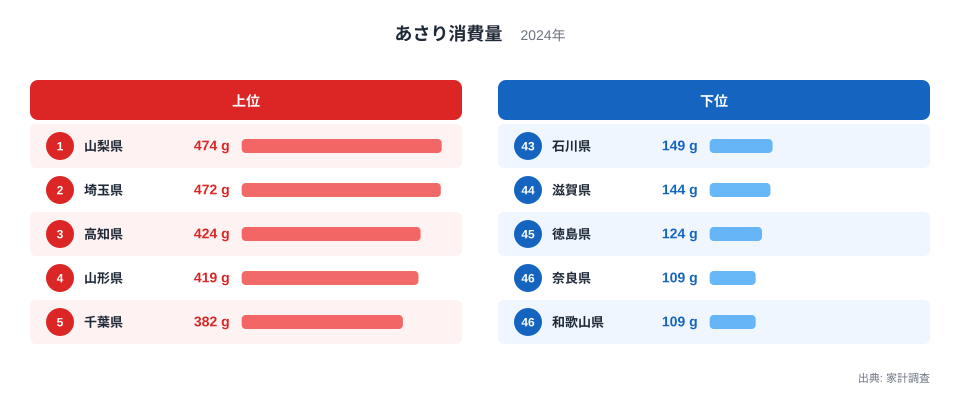
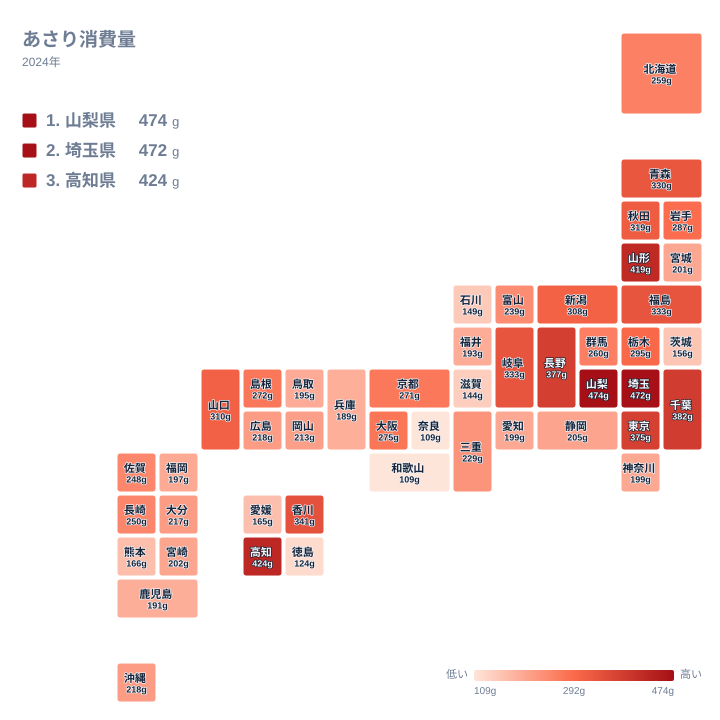

あさりといえば、潮干狩りや海辺の町を思い浮かべる方が多いかもしれません。ところが2024年の家計調査で、あさりの購入量が最も多かったのは海に面していない山梨県でした。2位も同じく海のない埼玉県です。

この記事では、あさり消費量を都道府県別に並べ、上位と下位に分かれる理由を食文化、産地、流通の面から考えます。数値はすべて2024年の家計調査によるもので、単位はグラムです。

## 1位は山梨県、2位は埼玉県

あさり消費量の1位は山梨県で474gでした。2位は埼玉県で472gで、両県はほぼ並んでいます。3位は高知県で424g、4位は山形県で419g、5位は千葉県で382gと続きます。

下位を見ると、奈良県と和歌山県がどちらも109gで並んで最下位です。その上に徳島県が124g、滋賀県が144g、石川県が149gと並びます。最大の山梨県474gと最小の109gの間には、大きな開きがあります。

<source-link href="/ranking/clam-consumption-quantity">あさり消費量ランキングをもっと見る</source-link>

図の上位側には、内陸の県と海に面した県が混ざっています。「海が近いから多く食べる」という単純な構図ではなく、1位と2位は内陸の県が占めました。

上位5県の顔ぶれは、地方でもばらばらです。中部の山梨県、関東の埼玉県と千葉県、四国の高知県、北海道・東北の山形県が入っています。全国一律の傾向ではなく、県ごとの食習慣がそのまま数字に出ていると読むのが自然です。

> [!NOTE]
> この指標は、家計調査で世帯が購入したあさりの量をグラムで示したものです。調査対象は二人以上の世帯で、外食や、もらいもの、潮干狩りで自分で採った分は含まれません。つまり「その県の人が食べたあさりの総量」ではなく、「家庭がお金を出して買ったあさりの量」です。

## 地図で見ると、地方でひとくくりにできない

次に、47都道府県の分布をタイルマップで見てみます。

色の濃い県が特定の地方にまとまっているわけではありません。たとえば関東は、埼玉県が472gで2位なのに対し、茨城県は156gで42位にとどまります。同じ地方の隣り合う県で、これだけ位置が離れています。

四国でも同じ構図が見られます。高知県は424gで3位ですが、徳島県は124gで45位です。同じ地方の中で、上位と下位の両端がそろって現れています。一方、近畿は全体に低めに集まっていて、奈良県と和歌山県が最下位に並びます。

つまり「関東は多い」「四国は少ない」といった地方単位の見方は、このデータには合いません。県ごとの事情を見ないと、実態を取り違えます。

> [!WARNING]
> この数値は購入した重さであり、殻付きの重さなのか、むき身の重さなのかは区別できません。殻付きで買う県が多ければ、同じ「g」でも食べられる身の量は少なくなります。また、あさりは産地や季節によって出回る量が変わる食材なので、購入が特定の時期に偏る県では、年間の平均値の読み方に注意が必要です。

## 内陸県が上位に入る背景を考える

山梨県と埼玉県が上位に入る理由は、統計だけからは断定できません。ただ、手がかりはいくつかあります。

一つは、スーパーで安定して買える貝としてあさりが定着している可能性です。海から離れた県では、鮮魚の種類が限られる分、砂抜きすれば手軽に調理できるあさりが、味噌汁、酒蒸し、パスタ、炊き込みご飯と幅広く使われているのかもしれません。

もう一つは、大消費地との近さです。埼玉県は東京都に隣接しており、東京都も375gで7位に入っています。千葉県は382gで5位で、東京湾に面したあさりの縁の深い県です。流通網の整った首都圏では、あさりが手に入りやすい環境がありそうです。

長野県も377gで6位に入りました。山梨県、埼玉県、長野県と、内陸県が上位に目立ちます。「海辺の県が食べる」というより、「家庭料理にあさりが根づいている県が買う」と見たほうが実態に近いようです。ただし、これは数値から直接確かめられる話ではなく、あくまで考え方の一つです。

> [!TIP]
> 中位は値が詰まっているので、順位ではなくグラムの差で読むのがコツです。たとえば福島県と岐阜県はどちらも333gで9位、次の青森県は330gで11位と、ほとんど差がありません。一方で1位山梨県の474gと16位岩手県の287gなら、はっきりした差です。順位が数個動いても、グラムがほとんど変わらないなら、違いとは見なさないでください。

## 産地や海の近さとは別の型がある

海産物が豊富な県ほどあさりを多く買う、とは限りません。宮城県は水産のイメージが強い県ですが、消費量は201gで32位です。地元で獲れる魚介が豊富であれば、あさりに頼る場面が少ないのかもしれません。

北海道・東北では、山形県が419gで4位と突出する一方、青森県は330gで11位、秋田県は319gで12位です。海に面しているかどうかよりも、日々の食卓に何を並べるかという習慣が、数字を分けているように見えます。

中国・四国にも上位の県があります。香川県は341gで8位、山口県は310gで13位です。ただ、これらを特定の海域や産地と結びつけて一つの理由に絞ることは、今回のデータだけでは難しいでしょう。

## 貝類を食べる文化との対比

あさりは、しじみやはまぐりなどの貝類と並んで、家庭の汁物や行事の料理に使われてきました。しじみは淡水や汽水で獲れ、あさりは干潟の砂地に暮らすなど、産地の条件が異なります。そのため、どの貝をよく食べるかは、地域の水辺の環境や歴史に左右されると考えられます。これは一般的な説明であり、今回の家計調査の数値から読み取ったものではありません。

今回の実データはあさりだけで、ほかの貝との比較はできません。たとえば、あさりの消費が少ない奈良県と和歌山県は、ほかの海産物で補っているのかもしれませんし、貝そのものの消費が少ないのかもしれません。どちらなのかは、別の品目の統計を合わせて見る必要があります。

他の食品の消費量は、[同じカテゴリの統計一覧](/category/economy)から確認できます。あさりの順位とあわせて見ると、県ごとの食卓の特徴が立体的に見えてきます。

また、1位の[山梨県のデータ](/areas/19000)や、2位の[埼玉県のデータ](/areas/11000)のページでは、あさり以外の指標もたどれます。両県の暮らしの特徴と並べると、消費の背景を考える材料が増えます。

## データについて

この記事のあさり消費量は、2024年の家計調査による都道府県別の数値で、単位はグラムです。同じ値の県は同順位として扱っています。福島県と岐阜県は333g、広島県と沖縄県は218g、神奈川県と愛知県は199g、奈良県と和歌山県は109gで、それぞれ同じ値です。

家計調査は標本調査のため、数値には誤差が含まれます。順位の細かな上下を断定せず、大まかな傾向をつかむ指標として使うのが適切です。

## まとめ

あさり消費量の1位は山梨県の474g、2位は埼玉県の472gで、どちらも海のない県でした。海に面した県が必ず上位に来るわけではなく、宮城県のように32位の県もあります。同じ四国でも高知県は3位、徳島県は45位と大きく割れています。

あさりの消費量は、産地との近さだけでなく、家庭の料理の習慣や流通の環境によって決まるようです。ランキングを入り口に、ご自身の県の食卓を見直してみてください。
