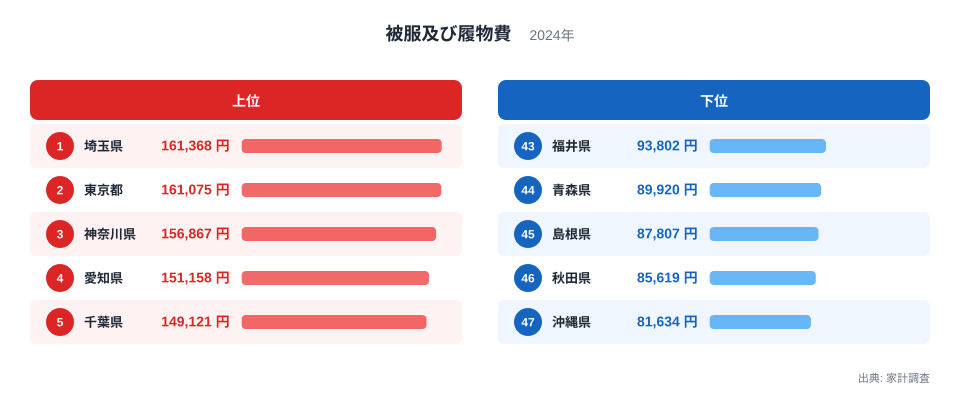
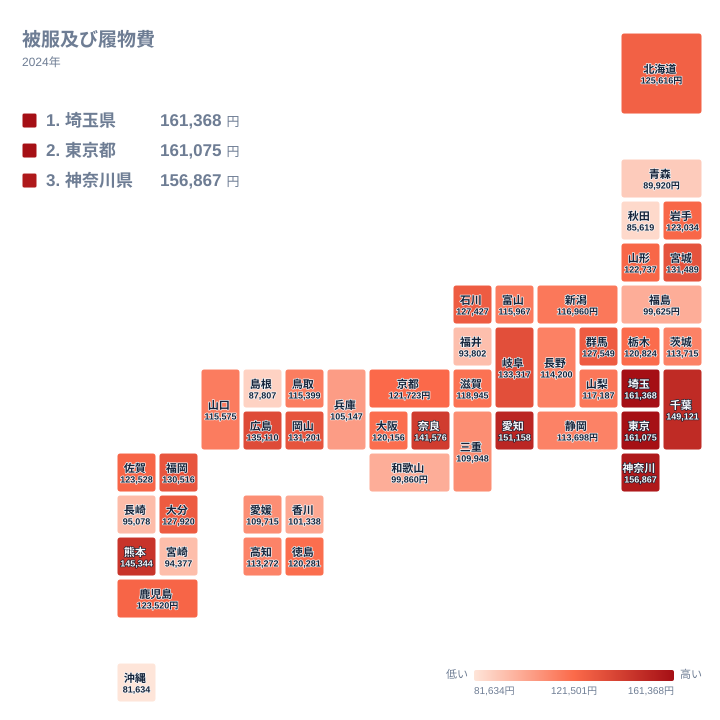

## 埼玉県と東京都がほぼ並んで首位に立つ

服や靴にいくら使うかは、食費や光熱費ほど注目されにくい項目です。それでも都道府県ごとに並べると、はっきりした差が見えてきます。2024年の家計調査で、被服及び履物費が最も多かったのは埼玉県で、161,368円でした。ただし2位の東京都は161,075円で、両者の差は293円しかありません。この差は小さいため、「埼玉県が日本一」と言い切るより、「埼玉県と東京都がほぼ並んで首位」と読むほうが実態に近いといえます。3位は神奈川県で156,867円です。

一方、最も少なかったのは沖縄県の81,634円でした。46位の秋田県は85,619円、45位の島根県は87,807円と続きます。最大の埼玉県と最小の沖縄県を比べると、約2倍の開きがあります。実データで確かめられる範囲では、161,368円と81,634円という二つの値の違いです。

この記事では、上位と下位の顔ぶれを確かめ、地図で地域のまとまりを眺めます。そのうえで、気候や暮らし方、産地といった視点から差の背景を考えます。ただし、これらは仮説であり、この統計だけで原因を断定することはできません。全国の傾向をつかむ入口として、[同じカテゴリの統計一覧](/category/economy)もあわせてご覧ください。

> [!NOTE]
> 被服及び履物費は、家計調査で世帯が衣類や履物などの購入に使った支出を集計した項目です。この金額は1世帯あたりの年間の支出額で、衣類のように買う頻度が低く、1回の購入額にばらつきがある品目が中心です。そのため、食料のように毎月ほぼ一定の額が出ていく項目とは、金額の安定感が異なります。

## ランキングで見る上位5県と下位5県

まず、上位5県と下位5県を並べた図を見てください。

<source-link href="/ranking/clothing-footwear-expenditure-total">被服及び履物費ランキングをもっと見る</source-link>

上位5県は、1位の埼玉県、2位の東京都、3位の神奈川県、4位の愛知県、5位の千葉県です。このうち埼玉県、東京都、神奈川県、千葉県の4都県は関東で、愛知県は中部です。4位の愛知県は151,158円、5位の千葉県は149,121円で、上位3都県の水準からは少し下がります。首都圏とその周辺が上位の大半を占める一方で、1位と2位のあいだには293円しか差がないことも、あらためて押さえておきたい点です。

下位5県は、47位の沖縄県、46位の秋田県、45位の島根県、44位の青森県、43位の福井県です。地方別に見ると、九州・沖縄の沖縄県、北海道・東北の秋田県と青森県、中国の島根県、中部の福井県と、5県が4つの地方に分かれています。青森県は89,920円、福井県は93,802円でした。

下位に寒い地域も暖かい地域も混ざっている点は見逃せません。秋田県と青森県は北海道・東北、沖縄県は九州・沖縄で、気候の条件は大きく異なります。このことから、単純に「寒いか暖かいか」や「都会か地方か」だけでは説明しきれないと考えられます。[埼玉県のデータ](/areas/11000)と[東京都のデータ](/areas/13000)を見比べると、首位を分け合う二つの地域の姿を確かめられます。

> [!TIP]
> 1位と2位の差は293円で、年ごとのぶれで入れ替わってもおかしくない水準です。被服及び履物費は購入頻度が低く、年によって大きな買い物が重なるかどうかで金額が動きやすい品目です。順位の1つ違いより、金額の帯で読むのがコツです。

## 地図で見る地域のまとまり

次に、47都道府県の分布をタイルマップで確認します。

関東では、埼玉県、東京都、神奈川県、千葉県が上位5位以内に入りました。ところが同じ関東でも、群馬県は14位の127,549円、栃木県は22位の120,824円、茨城県は32位の113,715円と、順位が大きく分かれます。中心から遠いほど低いという単純な並びではなく、群馬県が栃木県を上回っています。関東の中でも、都県ごとの事情が混ざっていると見るべきでしょう。

関東以外では、中部の愛知県が4位の151,158円です。同じ中部でも、石川県は15位の127,427円、富山県は28位の115,967円、静岡県は33位の113,698円、福井県は43位の93,802円と大きく散らばります。近畿では、奈良県が7位の141,576円と高く、京都府は21位の121,723円、大阪府は24位の120,156円でした。兵庫県は37位の105,147円、和歌山県は39位の99,860円です。大阪府や京都府より奈良県のほうが高いのは、大都市を抱える府県が必ず上位とは限らないことを示しています。

九州・沖縄では、熊本県が6位の145,344円と目立ちます。福岡県は12位の130,516円、大分県は13位の127,920円です。一方で長崎県は41位の95,078円、宮崎県は42位の94,377円、沖縄県は47位の81,634円と下位に並びます。九州・沖縄は、6位から47位まで幅広く散らばる地方です。

中国も同様に幅があります。広島県は8位の135,110円、岡山県は11位の131,201円ですが、島根県は45位の87,807円です。同じ中国の中で、8位から45位までの開きがあります。地方ごとに一律の傾向が決まるわけではないことが、この図からわかります。

> [!WARNING]
> 家計調査は、限られた数の世帯を対象とした標本調査です。被服及び履物費は購入頻度が低いため、調査に入った世帯がたまたま高額な買い物をしたかどうかで、県の平均が動きやすい特徴があります。1年分の順位の小さな差を、その県の恒常的な傾向と受け取らないよう注意してください。

## 気候・暮らし・産地から考える

差の背景として、まず気候が思い浮かびます。季節の変化が大きい地域では、夏物と冬物の両方をそろえる必要があり、衣類にかかる費用が増える可能性があります。ただし、これは一つの仮説にすぎません。北海道は16位の125,616円で中位の上のほうですが、秋田県は46位、青森県は44位です。寒い地域が必ずしも多く使っているわけではなく、気候だけでは説明がつきません。

次に、仕事や通学のスタイルが考えられます。首都圏や愛知県のように人が集まる地域では、スーツやシャツ、靴を買い替える機会が多いのかもしれません。商業施設の多さが購入のきっかけを増やしている可能性もあります。ただし、今回の実データには購入の場所や頻度を示す値がなく、こうした見方はあくまで想像です。

産地との結びつきも、仮説として考えられます。岡山県は11位の131,201円、広島県は8位の135,110円で、中国の中では上位です。岡山県は国産ジーンズなどで知られる繊維産業の地域として語られます。しかし、福井県や富山県のように繊維産業が話題になる地域でも、福井県は43位、富山県は28位です。産地であることが県民の支出を押し上げるとは、この統計から言えません。

結局のところ、気候、通勤・通学、商業、産業のどれか一つで説明できるわけではありません。複数の要因が県ごとに異なる形で重なっていると考えるのが、無理のない読み方です。

## 関連品目との対比

被服及び履物費は、食料や住居費などと比べて、買い控えのきく支出です。食料は毎日必要で、住居費は固定的ですが、衣類は買う時期や量を調整できます。この性質が、地域差を表に出やすくしている面があるかもしれません。

衣類と履物を分けて見ると、また別の姿が見えるかもしれません。たとえば、徒歩や公共交通での移動が多い地域では靴の買い替えが多いかもしれません。ただし今回の実データには衣類と履物の内訳がないため、これも確かめられない推測にとどまります。内訳のデータが得られれば、どちらが地域差を生んでいるのかを検証できるでしょう。

金額が多いことが、そのまま豊かさを意味するとも限りません。通勤用の服や制服が必要な世帯、子どもの成長で買い替えが多い世帯なども含まれます。支出が多い県は、必要に迫られて購入している面もあることを忘れないでください。

> [!NOTE]
> 家計調査の金額は、世帯が実際に購入した分の合計です。そのため、贈答でもらった衣類は自分の購入として数えられません。被服及び履物費は、購入しなかった年は少なく、まとめ買いの年は多くなるという波がある点も、数字を読むときの前提になります。

## データについて

この記事で使ったのは、家計調査の被服及び履物費で、年は2024年、単位は円です。全47都道府県の値を比較し、順位は金額の多い順に付けています。本文中で地方別に述べるときは、北海道・東北、関東、中部、近畿、中国、四国、九州・沖縄の7区分を使いました。

倍率に触れた箇所は、実データにある最大の埼玉県と最小の沖縄県の比較だけです。そのほかの県の差や割合は、新しく計算していません。気になる地域は、[埼玉県のデータ](/areas/11000)や[東京都のデータ](/areas/13000)で、ほかの統計とあわせて確認してください。

## まとめ

2024年の被服及び履物費は、1位の埼玉県が161,368円、2位の東京都が161,075円で、293円差のほぼ並んだ首位でした。最下位の沖縄県は81,634円です。関東の4都県と愛知県が上位に並び、秋田県、島根県、青森県、福井県、沖縄県が下位に並びます。

同じ地方の中でも、関東の群馬県14位と茨城県32位、中国の広島県8位と島根県45位のように、幅は大きく開いています。気候や暮らし方、産地といった背景は仮説として参考になりますが、この統計だけで原因は断定できません。地図やランキングを手がかりに、気になる県の暮らしを想像してみてください。
