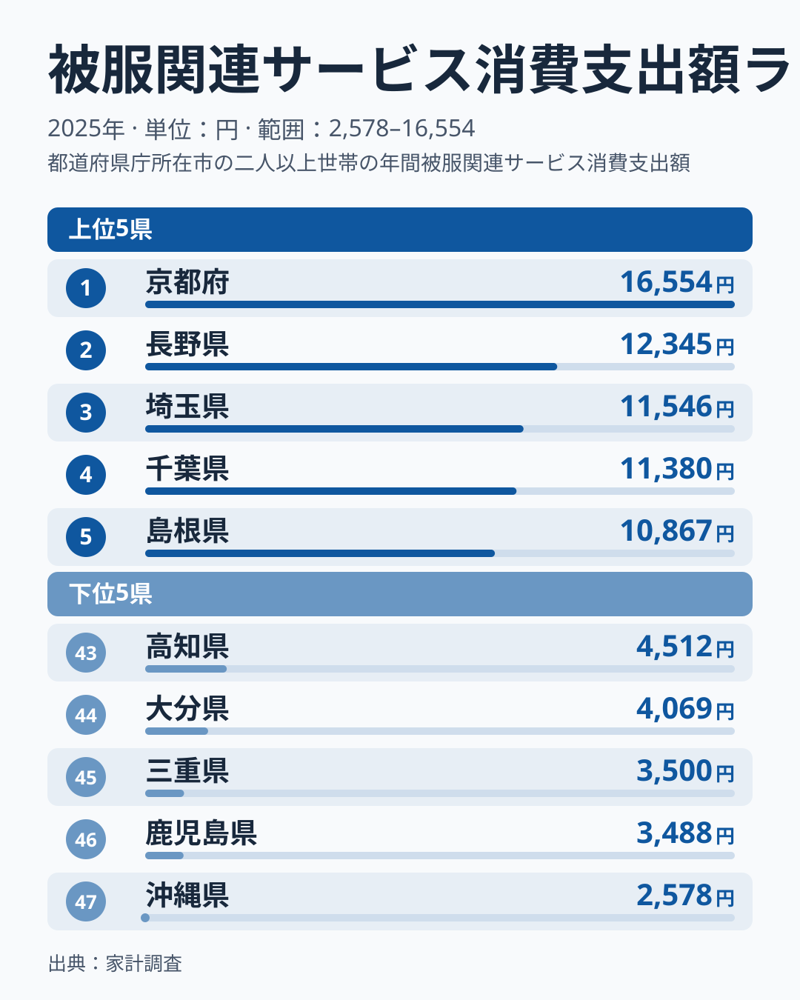
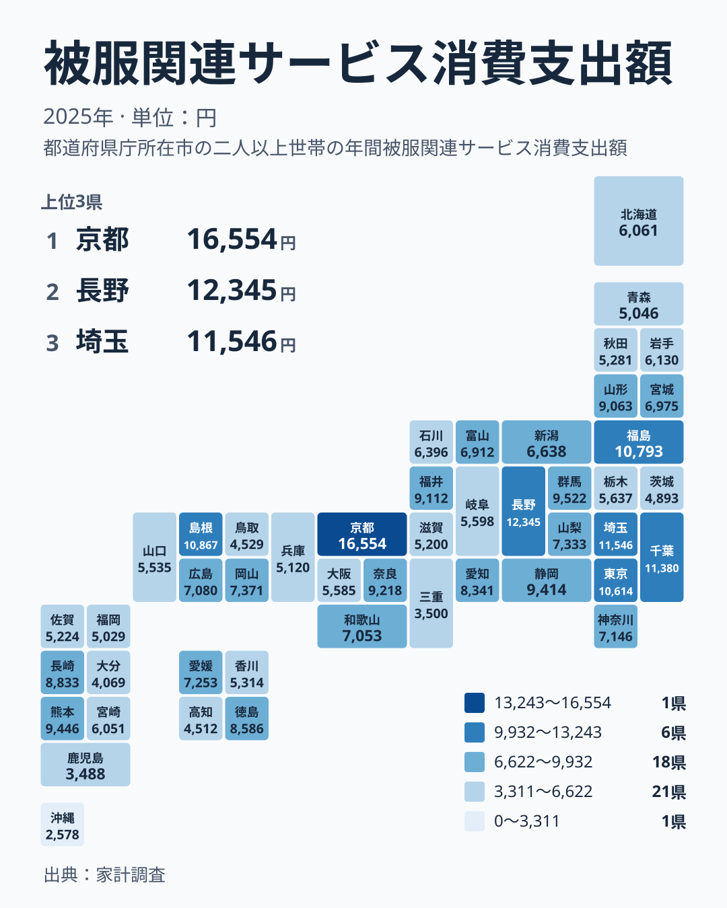

衣類を買うのではなく、仕立てる、直す、洗う、貸す。そうした「服まわりのサービス」にどれだけお金を使うかは、地域の暮らし方をよく映します。2025年の家計調査で、被服関連サービスへの支出が最も多かったのは京都府の16,554円で、最も少なかったのは沖縄県の2,578円でした。この記事では、都道府県ごとの差を見たうえで、なぜこうした差が生まれるのかを生活の側から考えます。

## 被服関連サービスとは何か

> [!NOTE]
> 本記事で扱う指標の正式名称は「被服関連サービス消費支出額」で、出典は家計調査です。服そのものの購入費ではなく、洗濯代、仕立て代、補修代、衣類の賃借料といったサービス部分への支出を指します。単位は円で、2025年の値です。

服にかかる費用というと、シャツやコートを買う代金を思い浮かべがちです。しかしこの指標に入るのは、買った後や着る場面で発生する費用です。クリーニングに出す、裾上げを頼む、着物や礼装を借りる、といった支出が中心になります。

つまりこの数字が高い地域は、服を多く買う地域とは限りません。むしろ「服を手入れして長く着る」「特別な場面で衣装を整える」といった習慣が強い地域だと読むほうが自然です。ここを押さえておくと、後に出てくるランキングの意味が取りやすくなります。

## 上位と下位の顔ぶれ

<source-link href="/ranking/clothing-services-group-consumption-expenditure">被服関連サービスへの支出ランキングをもっと見る</source-link>

上位の5県を並べると、1位が京都府の16,554円、2位が長野県の12,345円、3位が埼玉県の11,546円、4位が千葉県の11,380円、5位が島根県の10,867円です。首位の京都府は2位の長野県と比べても大きく離れており、突出した存在だとわかります。

下位の5県は、43位が高知県の4,512円、44位が大分県の4,069円、45位が三重県の3,500円、46位が鹿児島県の3,488円、47位が沖縄県の2,578円です。最大の京都府と最小の沖縄県を比べると、京都府は沖縄県の約6.4倍にあたります。

上位には関東の埼玉県と千葉県、中部の長野県、中国の島根県、近畿の京都府が並び、特定の地方に偏っていません。大都市圏だけが高いわけでもないため、人口規模や所得だけでは説明しきれない指標だといえます。

## 地理的な分布を見る

タイルマップで全国を眺めると、濃淡は地方ごとにきれいに分かれず、まだら模様になっています。関東では、埼玉県が11,546円で3位、千葉県が11,380円で4位、東京都が10,614円で7位と上位に入る一方、茨城県は4,893円で41位にとどまります。同じ関東でも差が大きいことがわかります。

九州・沖縄を見ると、長崎県が8,833円で14位、熊本県が9,446円で9位と健闘する一方、福岡県は5,029円で40位、大分県は4,069円で44位、鹿児島県は3,488円で46位、沖縄県は2,578円で47位です。地方でひとくくりにして語れないことは、この並びからも明らかです。

近畿も同様で、京都府が16,554円で1位、奈良県が9,218円で11位に対し、三重県は3,500円で45位、兵庫県は5,120円で38位、大阪府は5,585円で32位です。大阪府が中位より下に位置している点は、意外に感じる方もいるでしょう。

> [!TIP]
> 順位だけでなく円の値も一緒に見るのが読み解くコツです。たとえば10位の静岡県は9,414円、11位の奈良県は9,218円と近く、順位が1つ違っても実質的な差は小さい場合があります。一方、1位と2位の間は大きく開いています。

## 真因はどこにあるのか:生活の中身に翻訳する

では、なぜ京都府は群を抜いて高いのでしょうか。ここからは実データに直接現れない部分なので、あくまで生活面からの仮説として考えます。

ひとつ目は、和装や礼装の文化です。着物は洗い張りや仕立て直し、レンタルといったサービスと結びつきやすく、伝統行事や冠婚葬祭が暮らしに根づく地域ほど、服まわりのサービスに支出が向かう可能性があります。京都府の突出は、こうした背景と整合的です。

ふたつ目は、衣類を手入れして長く使う習慣です。長野県は12,345円で2位、島根県は10,867円で5位、福島県は10,793円で6位、山形県は9,063円で13位と、上位には都市部だけでなく地方の県も多く入ります。買い替えるより直して着る暮らしが、支出を押し上げているのかもしれません。

みっつ目は、通勤や服装の事情です。東京都は10,614円で7位、神奈川県は7,146円で20位、愛知県は8,341円で16位です。スーツやワイシャツのクリーニング需要は、勤め人の多い地域で高まりやすいと考えられます。ただし神奈川県が20位にとどまるように、大都市圏なら必ず高いとは言えません。

逆に下位の沖縄県は、気候が温暖で重ね着や厚手の衣類が少なく、クリーニングに出す機会が限られるという事情が想像できます。沖縄県が2,578円で最下位なのは、その暮らし方の表れかもしれません。ただし、こうした理由を裏づける数値は本記事のデータにはありません。

> [!WARNING]
> 家計調査は限られた世帯を対象にした標本調査です。県ごとの標本が小さいため、年による振れや偶然の偏りが出やすく、1位や47位の値を地域の「本質」と断定するのは危険です。また、年間の支出は一世帯あたりの平均であり、個人の支出ではありません。

## 暮らしに引き寄せて読む

この数字を自分の生活に引き寄せると、どう読めるでしょうか。支出が多い県に住む人は、服まわりのサービスを日常的に使う環境にあり、店舗の数や選択肢も豊富だと推測できます。支出が少ない県では、自宅で洗う、自分で手入れするといった形で、お金をかけずに済ませている可能性があります。

また、高い低いは良い悪いを意味しません。京都府の16,554円は文化や習慣の厚みを示す一方、沖縄県の2,578円は気候に合った暮らしの合理性を示すとも読めるからです。数字は優劣ではなく、暮らし方の違いを映す鏡だと捉えるのが適切です。

中位の県も見ておきましょう。北海道は6,061円で28位、宮城県は6,975円で23位、新潟県は6,638円で25位、広島県は7,080円で21位です。このあたりは全国の中ほどに位置し、突出も不足もない水準です。

関心のある方は、[同じカテゴリの統計一覧](/category/economy)で他の家計関連の指標と見比べると、服以外の支出との関係も見えてきます。個別の県については、[京都府のデータ](/areas/26000)や[長野県のデータ](/areas/20000)で、ほかの指標も確認できます。

## データについて

この記事の数値は、2025年の家計調査にもとづく「被服関連サービス消費支出額」で、単位は円です。順位は47都道府県の中での位置を示しています。倍率として示した京都府と沖縄県の比較は、最大値と最小値の比です。

数字を読むときは、服の購入費は含まれないこと、標本調査であること、そして背景の説明はあくまで生活面からの推測であることを念頭に置いてください。それでも、京都府の16,554円と沖縄県の2,578円という大きな開きは、地域ごとの暮らしの違いを考えるきっかけとして十分に興味深いものです。
