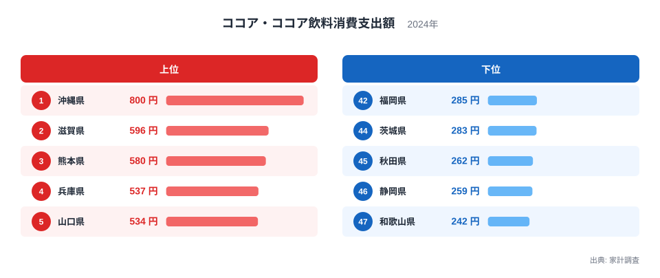
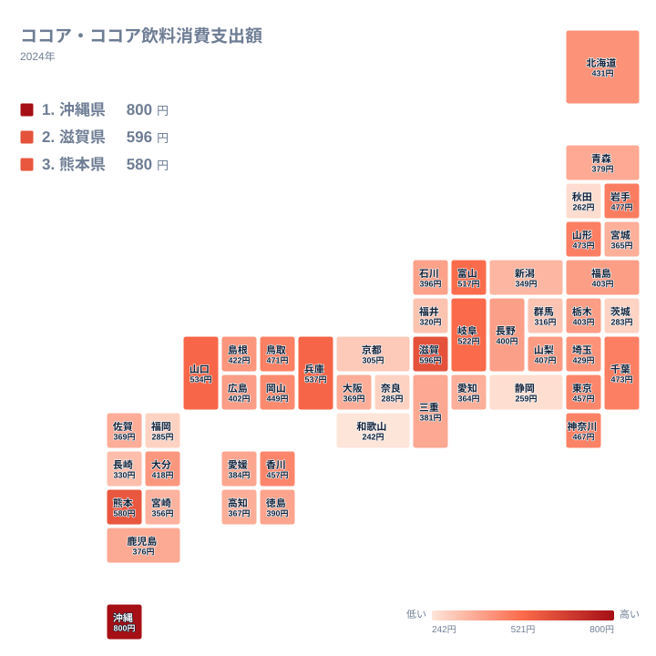

冬の寒い夜に飲みたくなるココアですが、家計の中でどれだけお金をかけているかは、地域によってかなり違います。2024年の家計調査をもとに、ココア・ココア飲料への支出額を都道府県別に並べてみると、トップの沖縄県は800円、最下位の和歌山県は242円でした。この記事では、その差がどこから生まれているのかを、気候や食文化、関連する飲料との対比から考えます。

## ココア支出の上位と下位を見る

まず、上位5県と下位5県を並べた図を見てください。

<source-link href="/ranking/cocoa-consumption-expenditure">ココア・ココア飲料への支出ランキングをもっと見る</source-link>

1位は沖縄県で800円です。2位の滋賀県は596円、3位の熊本県は580円、4位の兵庫県は537円、5位の山口県は534円と続きます。沖縄県と2位の滋賀県の間には204円の開きがあり、上位の中でも沖縄県は頭ひとつ抜けています。2位から5位までは534円から596円の範囲に収まっており、沖縄県だけが別の水準にあることが分かります。

一方、下位は47位の和歌山県が242円、46位の静岡県が259円、45位の秋田県が262円、44位の茨城県が283円、43位の福岡県が285円です。1位と47位を比べると、沖縄県は和歌山県の3倍を超える水準になります。同じ日本の中で、同じ飲料にこれだけ差が出るのは興味深い現象です。

なお、上位に並ぶ県には、西日本の県が目立ちます。ただし、下位にも福岡県や和歌山県のように西日本の県が入っています。単純に東西で線を引けるわけではない点には注意が必要です。

> [!NOTE]
> ここでいう支出額は、家計調査における「ココア・ココア飲料消費支出額」で、1世帯あたりの年間の支出を円で表したものです。粉末のココアだけでなく、ココア飲料も対象に含まれます。チョコレート菓子は別の品目として扱われます。

## 地図で見る地理的な広がり

次に、地理的な分布をタイルマップで確認します。

地図にすると、きれいなブロック状の傾向は見えにくく、高い県と低い県が入り組んでいることが分かります。九州では熊本県が580円で3位に入る一方、福岡県は285円で43位、宮崎県は356円で36位、長崎県は330円で38位です。同じ九州でも、順位は大きく分かれています。

近畿でも同様の傾向があります。滋賀県が596円で2位、兵庫県が537円で4位と高い一方、京都府は305円で41位、奈良県は285円で42位、和歌山県は242円で47位です。隣り合う府県でこれだけ差があるため、地域全体の文化というより、各県ごとの事情が反映されているように見えます。

東日本では、岩手県が477円で8位、山形県が473円で9位、千葉県が473円で10位と、中位から上位に入る県があります。東京都は457円で13位、神奈川県は467円で12位です。大都市圏は上位と中位のあいだに位置しており、突出してはいません。北海道は431円で16位でした。

> [!WARNING]
> 家計調査は標本調査で、都道府県ごとの対象世帯数には限りがあります。ココアのように1世帯あたりの年間支出が数百円の品目は、少数の世帯の購入で順位が動きやすく、1円や数円の差を重く見るのは適切ではありません。

## 気候と食文化から考える

ココアは温かい飲み物というイメージが強く、寒い地域ほど多く飲まれるのではと思われがちです。しかし、実際のデータはそれほど単純ではありません。最も寒い地域のひとつである北海道は431円で16位、秋田県は262円で45位、青森県は379円で29位です。寒冷地が上位を占めているわけではありません。

むしろ、1位が沖縄県の800円という点は意外です。沖縄県は温暖な地域ですが、冷たい飲料として利用される場面や、家庭での飲み物の選び方、朝食や間食の習慣など、気温以外の要因が影響している可能性があります。ただし、今回のデータだけでは、その理由までは特定できません。ここでは、気温が高いからといって支出が少ないとは限らない、という点を確認しておきます。

山口県が534円で5位、岡山県が449円で15位、香川県が457円で14位、鳥取県が471円で11位と、中国・四国にも中位から上位の県があります。一方、高知県は367円で33位、愛媛県は384円で27位、徳島県は390円で26位です。中国・四国の中でも差があり、地域ブロックだけで説明するのは難しいといえます。

飲料の選択は、世帯構成にも左右されると考えられます。子どもがいる世帯では、ココアが朝食や間食で選ばれやすいという見方もあります。ただ、この記事で使っているデータは世帯構成を分けた集計ではないため、そうした要因の大きさは確認できません。

> [!TIP]
> 順位を見るときは、順位の並びだけでなく金額の幅も一緒に確認すると読み違えを防げます。今回、20位の山梨県は407円、30位の鹿児島県は376円で、その間の差は小さく、中位の県は金額が密集しています。順位が数位違っても、実質的な差は小さいことがあります。

## 関連する品目との対比で考える

ココアの支出を考えるとき、コーヒーや紅茶、チョコレート菓子といった関連品目との対比も参考になります。ただし、この記事に載せている実データはココア・ココア飲料の支出のみで、他の品目の数値はありません。そのため、ここでは数値を挙げた比較は行わず、考え方の整理にとどめます。

コーヒーや緑茶は、日常的な飲料として全国で広く消費されます。それに対してココアは、好みが分かれやすく、家庭の習慣や世帯の構成によって購入量が変わりやすい品目だと考えられます。そのため、地域ごとの嗜好の違いが、支出額の差として表れやすいのかもしれません。

同じカテゴリの他の統計と見比べると、ココアの特徴がより分かりやすくなります。[同じカテゴリの統計一覧](/category/economy)から、ほかの品目の都道府県差を確認し、ココアのように順位が地域ブロックと一致しにくい指標か、それとも地域性がはっきり出る指標かを比べてみてください。

## 上位県の個別の姿を見る

上位の県について、もう少し詳しく見てみます。1位の[沖縄県のデータ](/areas/47000)を見ると、ココアへの支出は800円で全国最高です。他の統計とあわせて見ると、沖縄県の家計や食の特徴が分かるかもしれません。

2位の[滋賀県のデータ](/areas/25000)も合わせて確認する価値があります。滋賀県は596円で、近隣の京都府の305円、奈良県の285円とは大きく異なります。同じ近畿でも、ココアの支出はこれだけ違います。

3位の熊本県は580円で、九州の中では際立っています。熊本県を含む九州の県を比べると、佐賀県が369円で32位、大分県が418円で19位、鹿児島県が376円で30位です。熊本県の高さは、地域全体の傾向ではなく、県独自の傾向と考えるほうが自然です。

また、兵庫県が537円で4位、富山県が517円で7位、岐阜県が522円で6位と、上位には様々な地域の県が並びます。共通の気候条件や産地があるわけではなく、むしろ多様な地域が混在している点が、この指標の特徴です。

## 下位県の傾向

下位に目を向けると、和歌山県の242円、静岡県の259円、秋田県の262円が並びます。静岡県はお茶の産地として知られており、飲料の選択が緑茶に偏る可能性も考えられます。ただし、これは仮説にすぎず、データから確かめられるものではありません。

茨城県は283円で44位、福岡県は285円で43位、奈良県も285円で42位でした。群馬県は316円で40位、福井県は320円で39位です。下位の県も、地域的にまとまっているわけではなく、東北、関東、北陸、近畿、九州に散らばっています。

このように、上位にも下位にも全国各地の県が混在しているため、ココアの支出は「どの地方か」よりも、県ごとの暮らし方や購買行動の違いによるところが大きいと考えられます。

## データについて

この記事で使っているのは、家計調査の2024年の結果で、正式な統計名は「ココア・ココア飲料消費支出額」です。単位は円で、全47都道府県の値を使っています。数値は1世帯あたりの支出額を示すもので、全国の総消費量や人口あたりの消費量そのものではありません。

また、この統計は支出額であり、購入した量ではありません。価格の違いや購入する商品の種類によって、同じ量でも支出額は変わります。そのため、支出額が多い県が、必ずしも多くのココアを飲んでいるとは限りません。数字を読むときは、こうした点を頭に置いておくと安心です。

## まとめ

2024年のココア・ココア飲料への支出は、沖縄県が800円で1位、滋賀県が596円で2位、熊本県が580円で3位でした。最下位は和歌山県の242円で、1位と47位には3倍を超える差があります。

上位にも下位にも全国各地の県が混在していて、寒冷地ほど多いという単純な図式は成り立ちません。気候や食文化は手がかりになりますが、それだけで説明できる指標ではなさそうです。順位だけでなく金額の幅にも目を向けながら、ほかの統計とあわせて地域の暮らしを読み解いてみてください。
