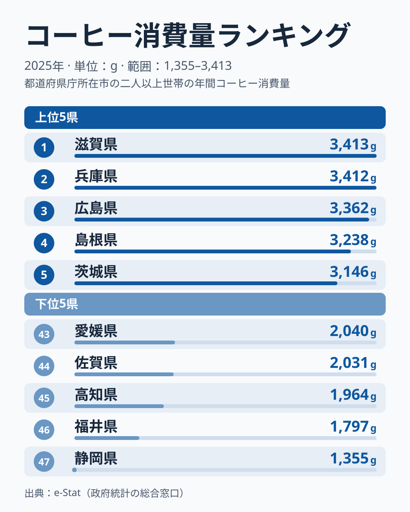

「コーヒーをよく飲むのは、寒い北国だろう」──そう思った人は多いはずです。雪国の喫茶店文化や、寒さで温かい飲み物が欲しくなるイメージから、北海道や東北が消費量トップに来そうに感じます。

ところが、2025年の家計調査(都道府県庁所在市・二人以上世帯の年間コーヒー消費量)を見ると、その直感は裏切られます。最も飲んでいたのは[滋賀県](/areas/25000)の3,413gで、2位の[兵庫県](/areas/28000)の3,412gとはわずか1gの差でした。上位は近畿と中国が中心で、「北国の王者」と目された北海道は2,172gで37位にとどまります。最も少ないのは[静岡県](/areas/22000)の1,355gで、トップとの差は約2.5倍です。

この記事では、47都道府県のコーヒー消費量を実データで並べ、「北国=コーヒー大国」というイメージがなぜ崩れるのか、上位・下位にどんな地域の偏りがあるのかを読み解いていきます。

> [!NOTE]
> 本データは総務省「家計調査」の品目別年間購入数量から得たもので、対象は各都道府県庁所在市の二人以上世帯です。県全体の平均ではなく「県庁所在市の世帯」が母集団である点、また外食(喫茶店)ではなく家庭での購入量(レギュラー・インスタント等)である点に注意してください。

## コーヒー消費量 上位5県と下位5県

2025年の消費量を多い順に並べると、トップは滋賀県、わずか1g差で兵庫県が続き、3位は広島県の3,362g、4位は島根県の3,238gです。その次に茨城県と石川県が同じ3,146gで並びます。下位には静岡・福井・高知・佐賀・愛媛といった県が並びます。

注目すべきは、上位の顔ぶれに北国がほとんど見当たらないことです。1位から4位は滋賀・兵庫の近畿と、広島・島根の中国で占められ、その後に関東の茨城県と北陸の石川県が続きます。寒冷地のイメージが強い北海道は2,172gで、全国の中央値にあたる24位の熊本県は2,419gで、それより約250g少なく、37位に沈んでいます。上位は3,400g台から3,100g台へ緩やかに下がる密集帯で、1位と5位前後の差は270g弱にすぎません。滋賀と兵庫の1g差は、家計調査の標本誤差を考えれば「同率首位」と読むのが妥当です。

これに対し下位5県は1,355gから2,040gに広がっています。愛媛は2,040gで43位、佐賀は2,031gで44位、高知は1,964gで45位、福井は1,797gで46位と続き、最下位の静岡は1,355gで、46位の福井からさらに約440g離れた飛び抜けて少ない値です。上位帯の下端(約3,100g)と下位帯の上端(約2,000g)のあいだには約1,100gの開きがあり、「近畿・中国が多く、四国・九州の一部と静岡が少ない」という大きな傾向が一枚の図から読み取れます。寒さが効いているなら北海道・東北が上位を独占するはずですが、実際の並びはそうなっていません。「寒い地域ほど飲む」という単純な気候仮説では説明がつかないのです。

<source-link href="/ranking/coffee-consumption-quantity">コーヒー消費量ランキングをもっと見る</source-link>

## 最下位グループ:なぜ静岡だけ突出して少ないのか

下位5県を抜き出すと、最も少ない静岡県は1,355gで47位となり、他の4県から大きく離れています。46位の福井県は1,797g、44位の佐賀県は2,031g、43位の愛媛県は2,040gで、この3県は約240gの幅に収まっており、静岡の1,355gはその下にさらに約440g沈んだ水準です。

[静岡県](/areas/22000)は緑茶の名産地として知られ、家庭での飲用習慣が緑茶に寄っている可能性があります。ただしこれは[仮説]であり、本データだけで緑茶との競合を示すことはできません。高知県・佐賀県・愛媛県も西日本の温暖な地域ですが、鹿児島県は2,176gで35位、宮崎県は2,175gで36位と下位5県の外にあり、「南国だから少ない」と一括りにはできません。福井県だけは日本海側の県で、石川県が3,146gで上位に入るのとは対照的です。隣り合う県でこれだけ差が出ることは、気候や地理だけでは説明しきれない要素があることを示します。

> [!TIP]
> 最下位の静岡の値は、2024年の家計調査では1,725gでした。単年のぶれが大きい指標なので、「静岡は恒常的に少ない」と断定するより、「2025年は特に少なく出た」と読む方が安全です。複数年の動きは[コーヒー消費量ランキング](/ranking/coffee-consumption-quantity)の年別データで確認できます。

また、最も少ない静岡ですら年間1,355gを消費しています。トップの滋賀の3,413gとの差は約2.5倍で、極端な「飲む県・飲まない県」に二分されているわけではありません。47都道府県すべてが一定量を消費する、全国的に定着した飲み物だと言えます。

## 発見1:「北国=コーヒー大国」イメージはなぜ崩れるのか

このランキングの最大の意外性は、寒冷地が上位を独占していない点にあります。北海道・東北の位置を整理すると、北国仮説の弱さがはっきりします。

- 岩手県は2,981gで9位:東北で唯一、上位10位以内に入る
- 宮城県は16位、福島県は17位、山形県は20位:中位
- 秋田県は30位、青森県は31位、北海道は37位:中位より下

同じ東北でも岩手は9位、青森は31位と大きく離れ、「北に行くほど多い」という単純な勾配は成立していません。代わりに上位には、近畿・中国・北陸・関東の県が地域を問わず混在しています。

**[仮説]** 上位の共通項は「気温」ではなく「来客文化・在宅消費の習慣」や「世帯あたりの購入頻度」にある可能性があります。家計調査は県庁所在市の世帯購入量を測るため、喫茶店での外飲みが多い地域はむしろ家庭での購入量が抑えられることも考えられます。この仮説を確かめるには、外食(喫茶代)支出データや世帯人数との突き合わせが必要で、本ランキング単体では断定できません。

> [!WARNING]
> 家計調査の品目別データは年ごとのサンプル変動が大きく、単年の順位は大きく入れ替わります。実際、前年の2024年に全国で最も多い3,293gを記録した鳥取県は、2025年は2,158gで38位でした。本記事は2025年単年の数値に基づいており、「滋賀が常に1位」ではありません。トレンドを見るときは複数年の平均的な位置づけで捉えるのが安全です。

## 発見2:トップと最下位の差は約2.5倍にとどまる

地域差を語るとき「○倍の差」という表現がよく使われますが、コーヒー消費量の場合、その倍率は意外に小さいです。

- 最大:滋賀県 3,413g
- 最小:静岡県 1,355g
- 倍率:3,413 ÷ 1,355 ≒ 2.52倍

砂糖や特定の地場食材のように「10倍以上」差がつく品目と比べると、コーヒーは全国的に均質に消費されている飲み物だと分かります。もっとも、最下位の静岡を除けば最小は福井の1,797gで、その場合の倍率は約1.9倍まで縮みます。2.5倍という幅の大部分は、静岡という1県の突出した低さが作っています。地域差は確かに存在しますが、それは「飲む県・飲まない県」という断絶ではなく、「よく飲む県・そこそこ飲む県」というグラデーションです。

それでも、最も飲む県と最も飲まない県では年間2,058g(=3,413−1,355)の差があります。一般的なレギュラーコーヒー1杯あたり約10gとすると、世帯あたり年間で約206杯分の差に相当します。日常の小さな習慣の積み重ねが、県単位では無視できない差として現れているのです。気になった県は、[コーヒー消費量ランキング](/ranking/coffee-consumption-quantity)で47都道府県すべての順位を確認できます。

## まとめ

- 2025年のコーヒー消費量トップは滋賀県で3,413g、わずか1g差で2位は兵庫県の3,412g
- 最も少ないのは静岡県で1,355g、46位の福井県の1,797gからも約440g離れて突出して少ない
- トップと最下位の倍率は約2.5倍で、静岡を除けば約1.9倍。品目としては地域差が小さく全国的に定着
- 「北国=コーヒー大国」のイメージに反し、北海道は37位。上位は近畿・中国が中心で、関東・北陸の県が続く
- 単年の順位は大きく入れ替わる。前年に全国最多だった鳥取県は2025年に38位となり、複数年で見るのが安全
