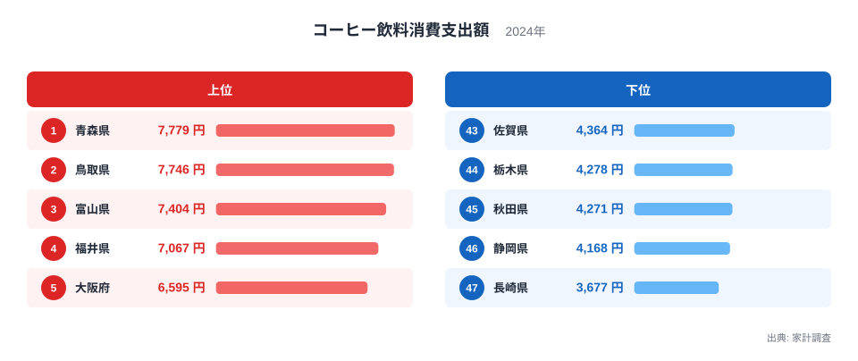
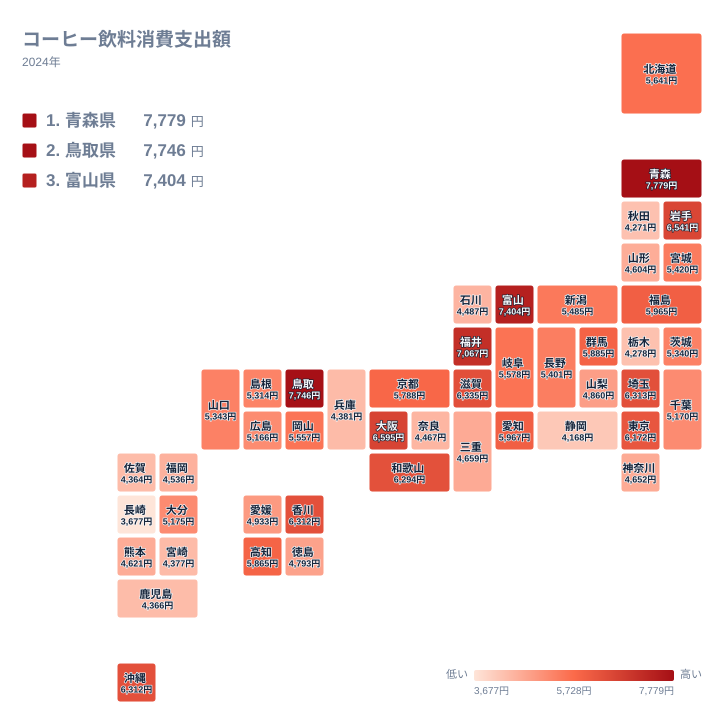

コーヒー飲料への支出で1位だったのは青森県で、年間7,779円でした。2位の鳥取県は7,746円で、その差はわずか33円です。一方、最下位の長崎県は3,677円にとどまりました。1位と最下位の間には4,102円の差があります。この記事では、2024年の家計調査のデータから、この差がどこから生まれるのかを食文化や気候、暮らし方の面から考えます。

コーヒー飲料とは、缶やペットボトル、紙パックなどで売られている、すぐに飲めるコーヒーのことです。豆や粉を買って自宅で淹れるコーヒーとは別の区分になっています。

## 上位と下位を並べると見えるもの

<source-link href="/ranking/coffee-drink-consumption-expenditure">コーヒー飲料への支出ランキングをもっと見る</source-link>

上位5県は、青森県の7,779円、鳥取県の7,746円、富山県の7,404円、福井県の7,067円、大阪府の6,595円です。東北、山陰、北陸という日本海側の県が並んでいるのが目を引きます。大都市の大阪府が5位に入っている点も見逃せません。

下位5県は、長崎県の3,677円、静岡県の4,168円、秋田県の4,271円、栃木県の4,278円、佐賀県の4,364円です。こちらは九州、東海、北関東、東北とばらけていて、地域に共通する傾向は見えにくくなっています。

上位と下位の顔ぶれから分かるのは、「大都市ほど多く飲む」という単純な話ではないということです。東京都は6,172円で12位、神奈川県は4,652円で34位でした。都市部でも順位はかなり違います。

> [!NOTE]
> ここでの支出額は、家計調査における二人以上の世帯が1年間に支出した金額を指します。1人あたりの飲む量ではなく、世帯としてのお金の使い方を表しています。世帯人数の多い県は、それだけで金額が大きく出ることがあります。

## 日本海側に多い理由を考える

青森県と鳥取県が1位と2位に並んだのは興味深い結果です。青森県のデータは[青森県のページ](/areas/02000)で、鳥取県のデータは[鳥取県のページ](/areas/31000)で確認できます。

鳥取県といえば、スターバックスの出店が全国で最後だったことで知られ、一方で喫茶店文化が根づいた土地という印象もあります。コーヒーを日常の飲み物として楽しむ習慣が、缶やボトルのコーヒーにも及んでいる可能性があります。

青森県は冬の寒さが厳しく、雪の日の移動も多い土地です。車で通勤する人が多く、運転の合間に缶コーヒーを買う習慣が根づいていると考えられます。ただし、これは統計から直接言えることではなく、あくまで暮らしぶりからの推測です。

富山県は3位で7,404円、福井県は4位で7,067円でした。北陸は共働き世帯が多い地域として知られます。忙しい朝や仕事の合間に手軽に飲める商品が選ばれやすいのかもしれません。岩手県も6位で6,541円と、東北の北部から日本海側にかけて高い県が続いています。

> [!TIP]
> 順位だけを見ると、1位と2位の差は33円しかなく、ほぼ同水準です。一方で、10位前後は6,312円の香川県、6,312円の沖縄県のように、同額に近い県が密集しています。順位の1つの違いを過大に読まず、金額の近さを見るのがコツです。

## 地理分布で見る地域の傾向

地図にすると、高い県が一か所に固まっているわけではないことが分かります。青森県、岩手県、鳥取県、富山県、福井県、大阪府、滋賀県、和歌山県、香川県、沖縄県と、北から南まで散らばっています。

近畿は比較的高い傾向にあります。大阪府が6,595円で5位、滋賀県が6,335円で7位、和歌山県が6,294円で11位、京都府が5,788円で17位です。一方、兵庫県は4,381円で40位、奈良県は4,467円で39位と、同じ近畿でも差があります。

関東では、埼玉県が6,313円で8位、東京都が6,172円で12位、群馬県が5,885円で15位と高めです。ところが栃木県は4,278円で44位、神奈川県は4,652円で34位でした。隣り合う県でも、これほど違いが出ます。

九州では、大分県が5,175円で27位とやや高めですが、熊本県は4,621円で35位、福岡県は4,536円で37位、宮崎県は4,377円で41位、鹿児島県は4,366円で42位、佐賀県は4,364円で43位、長崎県は3,677円で47位と、全体に低めです。沖縄県だけが6,312円で10位と目立ちます。

> [!WARNING]
> 家計調査は標本調査で、県庁所在地を中心に調べる仕組みです。調査世帯の数も限られるため、県全体の実態を完全に表すものではありません。また、1年だけの値なので、順位の小さな違いは偶然で入れ替わることがあります。

## 関連する飲み物との対比で考える

コーヒー飲料の消費には、ほかの飲み物との選び分けが関わっています。たとえば、緑茶の産地として知られる静岡県は、コーヒー飲料では4,168円で46位でした。お茶を日常的に飲む土地では、缶やボトルのコーヒーよりも茶葉から淹れるお茶が選ばれやすいのかもしれません。

同じ傾向は、石川県の4,487円で38位や、奈良県の4,467円で39位にも当てはまるかもしれませんが、データだけでは断定できません。お茶、紅茶、ジュース、炭酸飲料など、ほかの品目の支出と並べて見ることで、飲み物の好みの全体像がより正確に分かります。

逆に、喫茶店文化が強いとされる地域でも、コーヒー飲料の支出が高いとは限りません。店で飲む習慣が強ければ、家庭で買う缶やボトルの支出は伸びにくいからです。愛知県は5,967円で13位と中位より上ですが、この結果は「喫茶店が多いから低い」「多いから高い」のどちらとも言い切れません。

つまり、コーヒー飲料への支出は、コーヒーを好きかどうかだけでなく、どこでどう飲むかという暮らし方の違いも反映しています。

## 中位の県はどうなっているか

上位と下位の間には、中位の県が多く並びます。北海道は5,641円で18位、岐阜県は5,578円で19位、岡山県は5,557円で20位、新潟県は5,485円で21位、宮城県は5,420円で22位です。

20位台前半から30位前後にかけては、金額がほぼ連続して並んでいます。たとえば長野県は5,401円で23位、山口県は5,343円で24位、茨城県は5,340円で25位、島根県は5,314円で26位です。このあたりは1円から数十円の差で順位が入れ替わる層です。

愛媛県は4,933円で30位、山梨県は4,860円で31位、徳島県は4,793円で32位、三重県は4,659円で33位でした。30位を境に、5,000円を切る県が増えていきます。

全国で見ると、上位の数県が突出しているというより、全体がなだらかに連続しているのが特徴です。極端に多い県と少ない県がいる一方で、大半の県は4,000円台後半から6,000円前後に収まっています。

## 数字をどう受け取ればよいか

この結果から言えるのは、コーヒー飲料への支出には地域差があるものの、その理由を1つの要因で説明するのは難しいということです。気候、車社会の度合い、共働き世帯の多さ、喫茶店やお茶の文化、買い物をする店の種類など、さまざまな要素が重なっているとみられます。

1位の青森県と2位の鳥取県が僅差で並ぶ一方、最下位の長崎県は大きく離れています。上位ほど競り合い、下位は少し孤立しているという構図です。

他の食品や飲料の支出も合わせて見ると、地域ごとの食生活の特徴がより立体的に見えてきます。[同じカテゴリの統計一覧](/category/economy)から、ほかの指標も比べてみてください。

## データについて

この記事で使った指標は、家計調査の「コーヒー飲料消費支出額」です。2024年の、二人以上の世帯における年間の支出額を、円単位で比べています。数値はすべて、この調査で公表された値をそのまま用いています。
