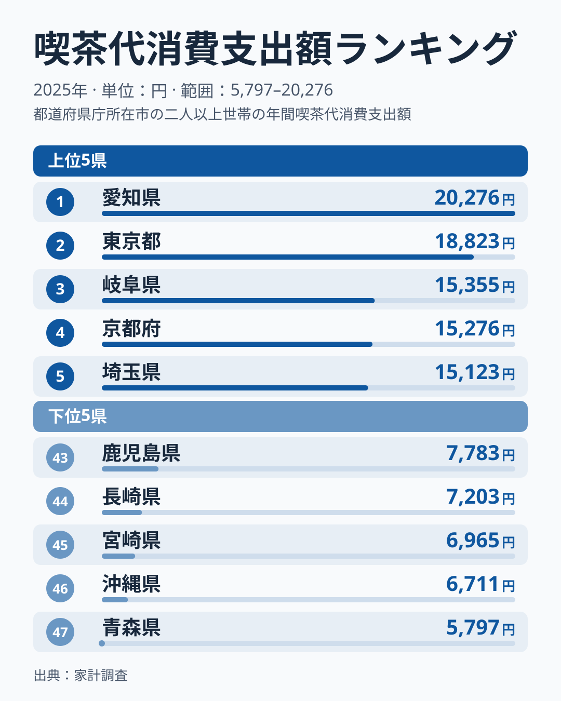
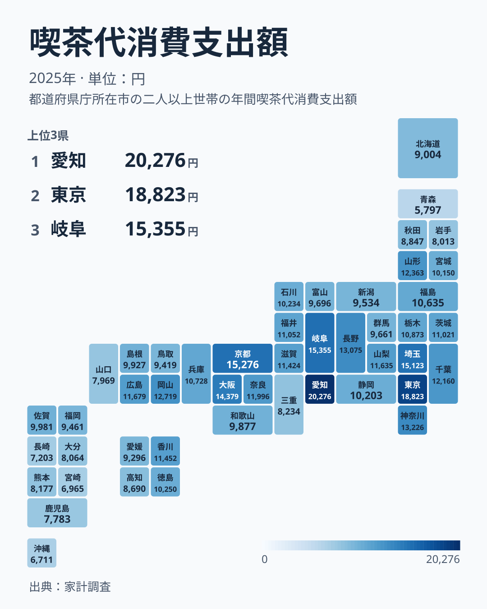

喫茶代消費支出額とは、家計調査で集計される、県庁所在市の二人以上の世帯が喫茶店やカフェでの飲食にかけた1年間の支出額のことです。

2025年の家計調査によると、喫茶代消費支出額は都道府県で大きな差があります。1位は愛知県の20,276円、最下位は青森県の5,797円で、その差は約3.5倍にのぼります。2位の東京都は18,823円で、愛知県が東京都を上回っています。この記事では、差の大きさと順位の並び方を図から読み取ります。ただし、なぜ差が生じるのかは、このデータだけでは断定できません。

## 上位と下位に見る大きな開き

<source-link href="/ranking/coffee-shop-consumption-expenditure">喫茶代消費支出額ランキングをもっと見る</source-link>

上位5県は、愛知県、東京都、岐阜県、京都府、埼玉県の順です。中部が2県、関東が2県、近畿が1県で、3位の岐阜県は15,355円、4位の京都府は15,276円、5位の埼玉県は15,123円と、3位から5位は約230円の範囲に収まっています。一方で、1位の愛知県と3位の岐阜県の間には約4,900円の開きがあります。1位だけが大きく抜け、その後ろに団子状の集団が続く形です。

下位5県は、青森県、沖縄県、宮崎県、長崎県、鹿児島県の順に低くなっています。青森県以外の4県は九州・沖縄です。最下位の青森県は5,797円で、46位の沖縄県は6,711円です。

例外も目立ちます。東北では青森県と岩手県が下位に入る一方、山形県は12,363円で10位、福島県は10,635円で21位です。中部の長野県も13,075円で8位に入っています。同じ地方の中でも順位は大きく分かれており、地方単位のくくりだけでは説明できません。

## 中位の県はどう並ぶか

タイルマップは上位5県と下位5県の外側、つまり中位の県の位置を確かめるのに向いています。上位5県に続くのは、6位の大阪府、7位の神奈川県、8位の長野県、9位の岡山県で、10位の山形県までが12,000円台以上です。中央にあたる24位は静岡県の10,203円で、1位の愛知県はその約2.0倍、最下位の青森県は約57%の水準です。

近畿では、京都府が4位、大阪府が6位、奈良県が12位、滋賀県が16位、兵庫県が20位、和歌山県が28位と、上位から中位の後半まで広がっています。大阪府と隣り合う兵庫県でも、大阪府の14,379円に対して10,728円と、約3,650円の差があります。

中国・四国では、岡山県が9位、広島県が13位、香川県が15位と上半分に入ります。一方で、島根県は27位、鳥取県は33位、愛媛県は34位、高知県は37位、山口県は42位で、同じ地方の中に上半分と下半分の県が混在しています。

愛知県の周辺にも差があります。1位の愛知県と3位の岐阜県が上位に並ぶ一方で、静岡県は24位の10,203円、三重県は38位の8,234円です。愛知県と三重県の間には約2.5倍の開きがあります。低い側は、43位の鹿児島県から46位の沖縄県までが九州・沖縄で、そこに最下位の青森県と、41位の岩手県が加わる形です。

> [!NOTE]
> 喫茶代消費支出額は、家計調査の喫茶代に対する年間の支出金額です。県庁所在市の二人以上の世帯の値であり、県全体の値ではありません。愛知県は名古屋市、岐阜県は岐阜市の世帯の値で、県内の他の市町村の傾向まで同じとは限りません。また、支出金額は利用回数と1回あたりの単価の掛け合わせですが、このデータでは単価か回数かを区別できません。

## 愛知県が東京都を上回る点と、読み方の限界

東京都は大都市ですが、喫茶代では愛知県が東京都を約1,450円上回っています。[仮説] 愛知県や岐阜県で知られるモーニングサービスのような喫茶店の利用習慣が、支出額を押し上げている可能性があります。ただし、この仮説を支えるデータは今回ありません。青森県が最下位になる理由についても、このデータからは説明できません。

仮説を確かめる入口として、同じ家計調査の関連品目が使えます。たとえば、自宅で飲むコーヒーへの支出や、外食全体への支出と順位を比べれば、喫茶店だけが高いのか、飲食全般が高いのかを切り分けられます。

あわせて見る: [コーヒー消費支出額ランキング](/ranking/coffee-consumption-expenditure) / [外食消費支出額ランキング](/ranking/dining-out-consumption-expenditure)

> [!WARNING]
> 標本調査の推計値のため、単年の順位はぶれやすく、特に3位から5位のように値が近い県の順位は入れ替わりやすい点に注意が必要です。

同じ経済分野の他の指標もあわせて確認したい方は、[同じカテゴリの統計一覧](/category/economy)から探すことができます。[愛知県のデータ](/areas/23000)や[東京都のデータ](/areas/13000)では、各地域の統計をまとめて見ることができます。

## まとめ

- 喫茶代消費支出額の1位は愛知県で20,276円、最下位は青森県で5,797円と、約3.5倍の差があります
- 上位5県は愛知県、東京都、岐阜県、京都府、埼玉県で、3位から5位は約230円の範囲に収まっています
- 下位5県は青森県、沖縄県、宮崎県、長崎県、鹿児島県で、青森県を除く4県は九州・沖縄です
- 山形県が10位、長野県が8位、福島県が21位など、同じ地方でも順位は大きく分かれます
- 差の理由はこのデータからは断定できず、モーニング文化などは仮説にとどまります。県庁所在市の値である点にも注意が必要です
