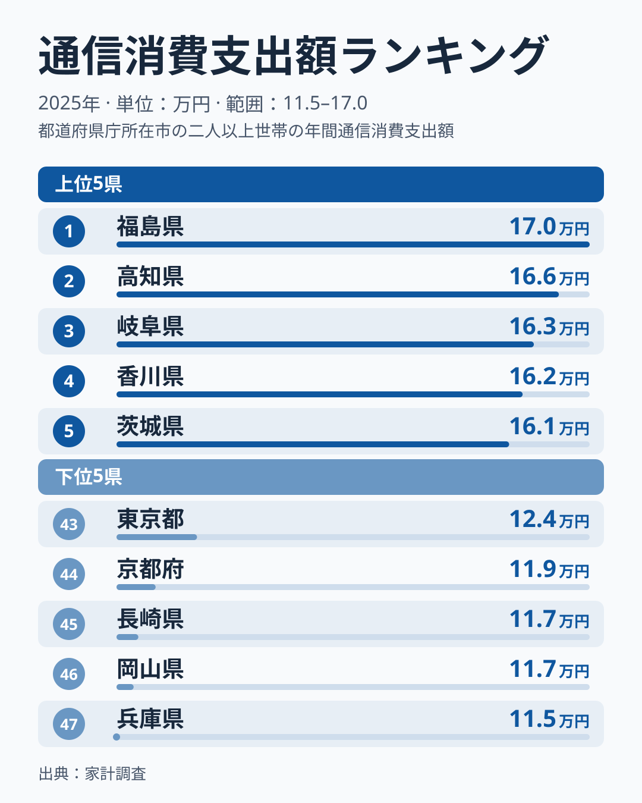
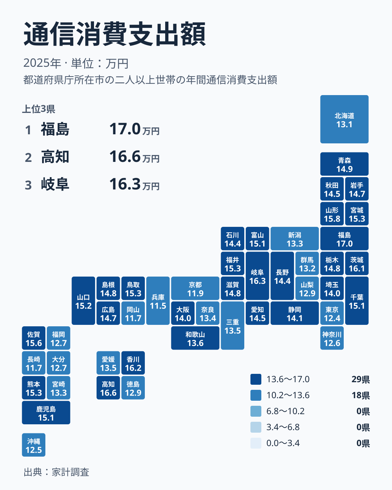

## 通信への支出が多いのは、意外にも地方の県でした

スマートフォンの料金、自宅のインターネット回線、家族それぞれの端末の通信料。通信は毎月かならず出ていく固定費の代表格です。この支出は、住む場所によってどれほど違うのでしょうか。

2025年の家計調査で、通信への支出が最も多かったのは福島県でした。金額は169,904円で、1位です。2位は高知県の166,314円、3位は岐阜県の163,398円、4位は香川県の162,090円、5位は茨城県の160,516円と続きます。

ここで目を引くのは、上位に大都市を抱える県がほとんど入っていないことです。通信が最も発達していそうな東京都は124,141円で43位でした。情報や人が集まる都市ほど通信にお金をかけるという、ありがちな見立ては当てはまりません。

この記事では、福島県の[データ](/areas/07000)や高知県の[データ](/areas/39000)も手がかりにしながら、通信への支出が地域でこれほど違う理由を、暮らし方の違いという切り口で考えます。ほかの暮らしの指標と並べて見たい方は、[同じカテゴリの統計一覧](/category/economy)も参考にしてください。

## 上位5県と下位5県の顔ぶれ

まず、上位と下位の両端を並べて確認します。

<source-link href="/ranking/communication-group-consumption-expenditure">通信への支出ランキングをもっと見る</source-link>

上位5県は福島県、高知県、岐阜県、香川県、茨城県です。地方で区分すると、北海道・東北、四国、中部、四国、関東にまたがっています。特定の地方だけが突出しているわけではなく、地域も人口規模もばらばらな県が並んでいます。

下位5県は、47位の兵庫県が114,756円、46位の岡山県が116,753円、45位の長崎県が117,299円、44位の京都府が119,315円、43位の東京都が124,141円です。こちらも近畿、中国、九州・沖縄、関東と散らばっています。

最大の福島県の169,904円と、最小の兵庫県の114,756円を並べると、同じ国のなかでこれだけの開きがあります。通信は生活必需のサービスなので、ここまで差が出ること自体が興味深い点です。単に使う量の違いだけでなく、契約の形や家族の使い方まで含めた暮らしの違いが映っていると考えられます。

> [!NOTE]
> ここでの通信への支出は、家計調査で集計される通信にかかる消費支出です。電話やインターネットの利用料など、通信サービスに払った金額が中心になります。1人あたりではなく世帯を単位にした支出であることに注意してください。世帯の人数が多い県では、金額が大きくなりやすい面があります。

## 地図で見ると、東西や都市規模では割り切れません

次に、47都道府県の分布を地図で確かめます。

地図に色を重ねると、濃淡は日本列島のなかでまだら模様になります。東北では、福島県が1位、山形県が6位の158,003円、宮城県が9位の153,103円と上位に集まります。一方で、青森県は16位の149,115円、岩手県は20位の147,386円、秋田県は23位の144,535円と中位です。北海道・東北のなかでも、北海道は36位の131,488円にとどまっています。

関東の内部でも差があります。茨城県が5位の160,516円、千葉県が14位の151,176円と高めなのに対し、埼玉県は27位の139,806円、神奈川県は41位の125,801円、東京都は43位の124,141円でした。同じ関東でも、都心に近づくほど通信への支出が小さくなる傾向がうかがえます。

大阪府は28位の139,722円で、ちょうど中位です。近畿では兵庫県が47位、京都府が44位と下位に沈みました。九州・沖縄では、熊本県が8位の153,237円、佐賀県が7位の155,721円と上位にある一方で、長崎県は45位、沖縄県は42位の125,177円、福岡県は39位の126,997円と下位に寄っています。つまり、地方の県だから高い、都会だから低いと一律には言えず、県ごとの暮らし方の差が反映されていると読むのが自然です。

> [!TIP]
> 県を地方ごとにまとめて眺めると、地方内でのばらつきの大きさに気づきます。たとえば四国では、高知県が2位、香川県が4位と上位に並ぶ一方、徳島県は37位の129,209円でした。地方の平均像で語らず、県ごとの順位と金額を見るのが読み解きのコツです。

## 生活への含意:なぜ地方で通信費がかさむのか

通信への支出が地方で高めに出る背景には、いくつかの暮らし方の違いが考えられます。ここからは、実データで裏づけられた事実と、あくまで有力な仮説とを分けて整理します。

事実として言えるのは、通信への支出が少ない県に、都市部と呼ばれる地域が多く含まれる点です。東京都は43位、京都府は44位、兵庫県は47位でした。神奈川県も41位です。

仮説の1つ目は、移動手段の違いです。地方では自家用車への依存度が高く、車での移動が日常の中心になります。国土交通白書などが指摘するように、地方部は自動車に頼る暮らしが基本で、大都市圏では鉄道やバスなどの公共交通網が発達しています。この違いが、家族それぞれが自分の端末を持ち、通信でつながる必要性を高めている可能性があります。離れて暮らす家族や、広い地域に散らばる友人や職場との連絡で、通信の出番が増えるからです。

仮説の2つ目は、娯楽や情報収集の形です。都市では、街に出れば映画館や商業施設、書店などの選択肢が身近にあります。地方では、自宅で動画配信や情報サイトを楽しむ時間が相対的に長くなり、回線や端末にかける費用が膨らみやすいという見方です。

仮説の3つ目は、契約の選び方です。都市部では格安の通信サービスや、回線の比較検討が進みやすく、支出を抑える工夫が広まっている可能性があります。ただし、これは今回の実データだけでは確かめられません。

> [!WARNING]
> この数字は、地域差の原因を直接示したものではありません。家計調査は標本調査で、都道府県ごとの調査世帯数は限られます。その年の調査にたまたま含まれた世帯の特徴が、順位に影響することがあります。小さな順位の差を過大に解釈せず、おおまかな傾向を見るための資料として使ってください。

## 暮らしの設計に活かす視点

では、この結果を私たちの暮らしにどう活かせるでしょうか。

高知県のように、2位で166,314円と上位に入る県に住む方は、通信を暮らしのインフラとして使い込んでいる面があるはずです。その分、契約内容を見直す余地も大きいかもしれません。家族の端末ごとの料金プラン、自宅の回線との重複契約、使っていない付加サービスなどを一度洗い出すだけで、支出を整えられる可能性があります。

反対に、兵庫県のように通信への支出が最も少ない県に住む方は、すでに支出を抑える工夫ができているとも言えますし、そもそも通信を使う場面が少ない暮らしとも言えます。どちらなのかは数字だけでは分かりません。大切なのは、全国の順位に一喜一憂するよりも、自分の世帯が通信にどのくらい払っていて、その中身が納得できるものかを確かめることです。

福島県が1位で、岐阜県が3位、茨城県が5位という並びを見ると、通信費の多さが豊かさや不便さを単純に表すわけではないことも分かります。選べるサービスが多いから多く使っているのか、選択肢が少なくて割高なまま払っているのか。その見極めが、家計の見直しの出発点になります。

通信は、住む場所を選ぶときの条件にもなりつつあります。在宅勤務やオンライン授業が広がるほど、回線の品質と料金は暮らしやすさの一部です。地域ごとの通信費の違いを知っておくと、移住や転勤を考えるときの家計の見通しにも役立ちます。

## データについて

この記事で使った統計は、家計調査の通信消費支出額です。2025年の値を、単位は円で比較しています。順位は金額の高い順に付けています。

家計調査は、世帯を対象に支出を継続して記録してもらう調査です。都道府県別の値は、調査対象となった世帯の状況に左右されます。そのため、わずかな順位の違いは誤差の範囲に収まることがあります。数字をきっかけに地域の暮らし方を考える材料としてお使いください。
