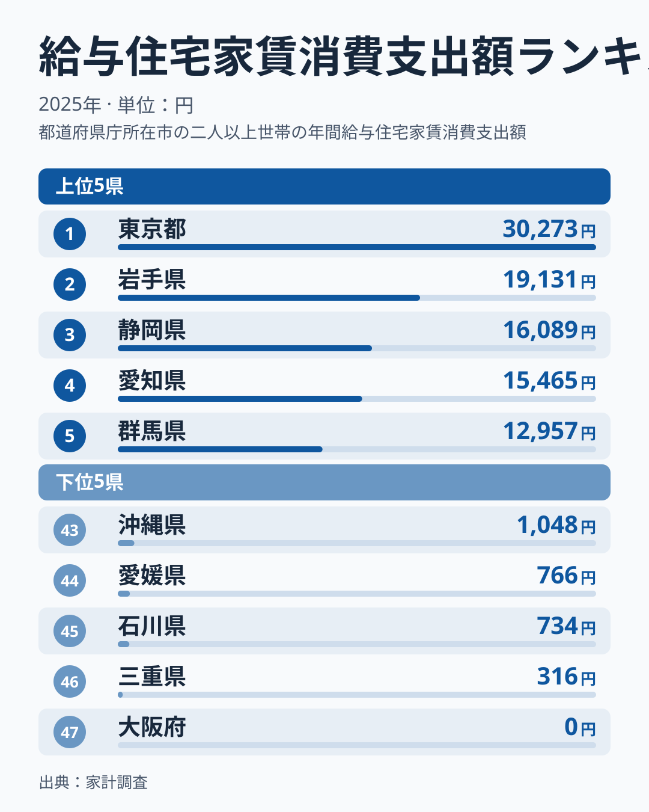
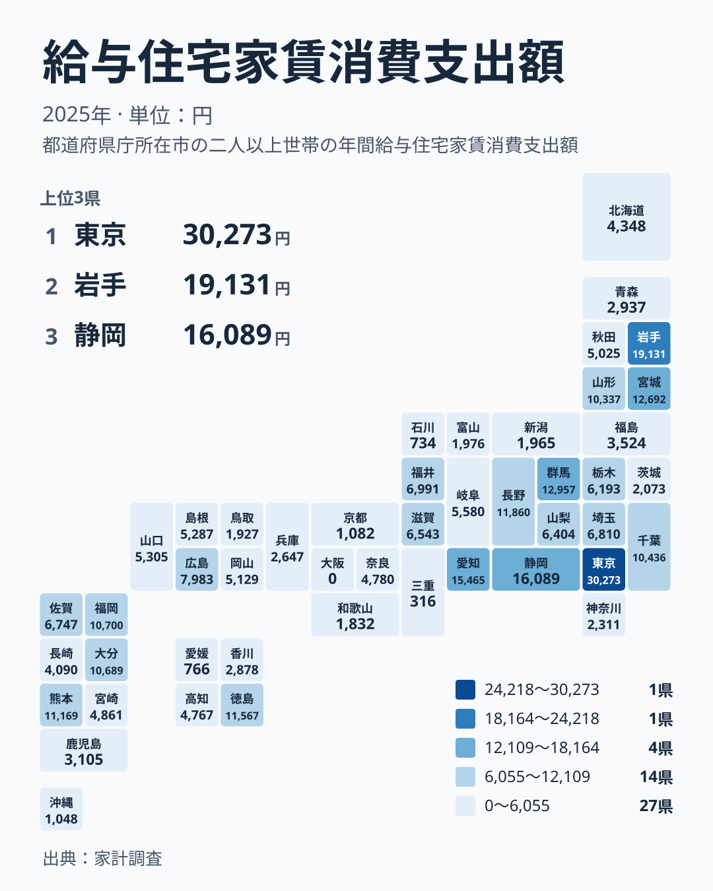

## 社宅や官舎の家賃は、地域によってこれほど違います

勤め先が用意する社宅や官舎に住む世帯は、家賃を給与から差し引かれる形で払うことが少なくありません。家計調査では、こうした住宅の家賃を「給与住宅家賃への支出」として別に集計しています。民間の賃貸住宅や持ち家とは違い、会社や役所の制度に左右される支出です。

2025年の結果を見ると、都道府県の差は大きく開いています。最も多いのは東京都の30,273円で、2位は岩手県の19,131円です。一方、最下位の大阪府は0円で、三重県も316円にとどまります。同じ国内で、給与住宅の家賃にかける金額がここまで違うのは意外です。

この記事では、まずランキングの上位と下位を確認します。次に地方ごとの並びを見て、数字が暮らしに何を意味するのかを考えます。[同じカテゴリの統計一覧](/category/economy)にも、家計や経済に関する指標がまとまっています。あわせてご覧ください。

> [!NOTE]
> ここでの給与住宅家賃は、勤め先が提供する住宅に住む世帯が支払う家賃の支出額です。家計調査の対象は、調査に協力した世帯の平均的な支出です。給与住宅に住んでいない世帯も含めた平均なので、住んでいる人が実際に払う家賃そのものではありません。

## 上位と下位を並べてみます

<source-link href="/ranking/company-housing-rent-consumption-expenditure">給与住宅家賃への支出ランキングをもっと見る</source-link>

上位には、東京都、岩手県、静岡県、愛知県、群馬県が並びます。値は東京都が30,273円、岩手県が19,131円、静岡県が16,089円、愛知県が15,465円、群馬県が12,957円です。大都市圏だけが上位を占めるわけではなく、東北の岩手県が2位に入っている点が目を引きます。

下位は、大阪府の0円、三重県の316円、石川県の734円、愛媛県の766円、沖縄県の1,048円です。京都府の1,082円も、この少ない側のグループに近い水準です。大都市の大阪府が最下位で、東京都が最上位という対照は、「都市部ほど社宅の家賃が高い」という単純な見方では説明できません。

東京都の値は2位の岩手県と比べても大きく、順位表の中で抜けています。ただし、この数字は家賃の水準そのものではなく、調査世帯の平均です。たまたま給与住宅に住む世帯が多く含まれた地域では高く出ます。逆に、該当世帯がほとんどいない地域では低く出ます。読むときは、この性質を頭に置く必要があります。

## 地方別に分けると、見え方が変わります

都道府県を地方でまとめ直すと、順位表では見えにくい特徴が出てきます。以下は各地方に含まれる県の値です。

- 北海道・東北: 岩手県19,131円、宮城県12,692円、山形県10,337円、秋田県5,025円、北海道4,348円、福島県3,524円、青森県2,937円
- 関東: 東京都30,273円、群馬県12,957円、千葉県10,436円、埼玉県6,810円、栃木県6,193円、神奈川県2,311円、茨城県2,073円
- 中部: 静岡県16,089円、愛知県15,465円、長野県11,860円、福井県6,991円、山梨県6,404円、岐阜県5,580円、富山県1,976円、新潟県1,965円、石川県734円
- 近畿: 滋賀県6,543円、奈良県4,780円、兵庫県2,647円、和歌山県1,832円、京都府1,082円、三重県316円、大阪府0円
- 中国: 広島県7,983円、山口県5,305円、島根県5,287円、岡山県5,129円、鳥取県1,927円
- 四国: 徳島県11,567円、高知県4,767円、香川県2,878円、愛媛県766円
- 九州・沖縄: 熊本県11,169円、福岡県10,700円、大分県10,689円、佐賀県6,747円、宮崎県4,861円、長崎県4,090円、鹿児島県3,105円、沖縄県1,048円

注目したいのは、同じ地方の中でも差が非常に大きいことです。関東では東京都が30,273円なのに対し、茨城県は2,073円です。近畿では滋賀県が6,543円ですが、大阪府は0円です。四国でも、徳島県の11,567円と愛媛県の766円が並びます。「関東は高い」「近畿は低い」とは言い切れず、地方という単位で語るのは危うい指標です。

## 地理分布で見える傾向

タイルマップで全体を眺めると、濃い色が一か所に固まらず、各地に点在していることが分かります。東京都を中心とした関東だけでなく、東北の岩手県と宮城県、中部の静岡県と愛知県、九州の熊本県、福岡県、大分県も上位に入っています。

ここから読み取れるのは、給与住宅の家賃が「地価の高さ」だけでなく、「その地域にどんな勤め先があるか」に左右されているらしい、ということです。静岡県や愛知県は、製造業の大きな事業所が多い地域として知られます。社宅や寮を整える企業が多ければ、給与住宅に住む世帯の割合が高まり、平均の支出額も大きくなると考えられます。ただし、この記事のデータだけでは産業との関係までは確かめられません。あくまで読み解きの仮説です。

> [!WARNING]
> 家計調査は全世帯を調べるものではなく、抽出した世帯の結果です。給与住宅に住む世帯は全体の一部なので、地域によっては該当世帯がごく少数になります。大阪府の0円は、家賃が無料という意味ではなく、調査対象の世帯に支出が現れなかったことを示す可能性があります。個別の順位の細かな上下は、誤差の範囲かもしれません。

## 東京都と岩手県、二つの上位を読み解きます

最上位の東京都は、民間の賃貸相場が高い地域です。そのため、同じ社宅でも家賃が高めになりやすいと考えられます。[東京都のデータ](/areas/13000)で、他の暮らしの指標もあわせて見ると、住まいにかかる負担の背景が分かります。

一方、2位の岩手県は少し事情が違います。民間の家賃相場だけでは説明が難しく、公務員宿舎や企業の寮に住む世帯が調査に多く含まれた可能性があります。[岩手県のデータ](/areas/03000)を見ると、地域の産業や暮らしの特徴が分かり、手がかりになります。ここで大切なのは、同じ「上位」でも、東京都は家賃水準の高さ、岩手県は該当世帯の多さと、理由が違うかもしれないという点です。

つまり、この指標は一本の軸で並べた順位に見えて、実は二つの要素が混ざっています。一つは「家賃そのものの高さ」、もう一つは「給与住宅に住む世帯がどれだけ調査に含まれたか」です。この二つを分けて考えると、上位県の顔ぶれが納得しやすくなります。

## 暮らしにとって何を意味するのか

この数字を、暮らしの判断にどう生かせるでしょうか。転勤や就職で住む場所を考えるときは、社宅の家賃が安いかどうかだけでなく、制度の有無が重要です。給与住宅の制度が広く使われている地域では、住居費の負担を会社が軽くしている場合があります。逆に、制度を使う世帯が少ない地域では、自分で賃貸を探す前提で家計を組むことになります。

たとえば、静岡県の16,089円や愛知県の15,465円は、制度を利用する世帯が一定数いる地域として読めます。一方、大阪府の0円や三重県の316円は、少なくとも調査の中では給与住宅の家賃が家計の主要な項目になっていないことを示します。ただし、これを「大阪府は住居費が安い」と読み替えるのは誤りです。給与住宅の家賃だけを切り出した指標なので、民間の賃貸や持ち家の費用は含まれていません。

住まいの費用を比べたい場合は、給与住宅の家賃だけでなく、民間賃貸の家賃や持ち家の費用もあわせて見る必要があります。この記事の指標は、その中の一つの断面にすぎません。数字の大小をそのまま「得か損か」に結びつけず、制度の使われ方を映すものとして受け止めるのが、読み違いを避けるコツです。

> [!TIP]
> 順位の近い県どうしの差はあまり気にせず、「東京都のように突出している」「大阪府のようにほぼ見られない」といった大きな差に注目すると、傾向をつかみやすくなります。さらに、同じ地方の中で値が離れている県を見つけたら、その県の産業や住宅制度を調べてみると、背景が見えてきます。

## データについて

この記事の数値は、家計調査の2025年の結果にある「給与住宅家賃消費支出額」を使っています。単位は円で、調査世帯の平均的な支出額にあたります。文中の順位は、この数値を大きい順に並べたものです。

給与住宅は、勤め先が従業員に提供する住宅を指します。社宅、寮、官舎などが含まれると考えられます。全国一律の制度ではなく、企業や官公庁ごとの運用で家賃の決め方が異なります。そのため、地域間の差には、地価のような市場要因だけでなく、各組織の制度の違いも含まれます。

## まとめ

給与住宅の家賃支出は、東京都が30,273円で最も多く、岩手県の19,131円、静岡県の16,089円、愛知県の15,465円、群馬県の12,957円が続きます。最下位は大阪府の0円で、三重県の316円、石川県の734円、愛媛県の766円、沖縄県の1,048円も少ない側にあります。

地方別に見ても、同じ地方の中で値が大きく分かれており、地方という単位では特徴をつかみきれません。東京都のような家賃水準の高さと、岩手県のような該当世帯の多さが混ざっている可能性を意識すると、数字の意味がつかみやすくなります。住まいの費用を比べるときは、この指標を一つの断面として、他の指標とあわせて見ることをおすすめします。
