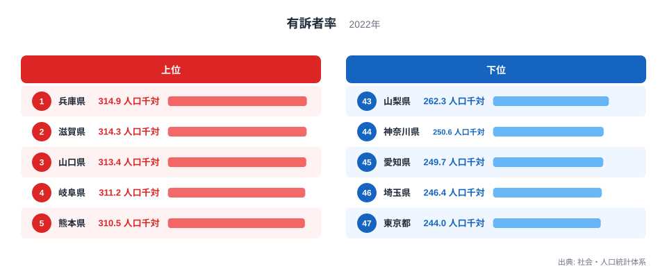
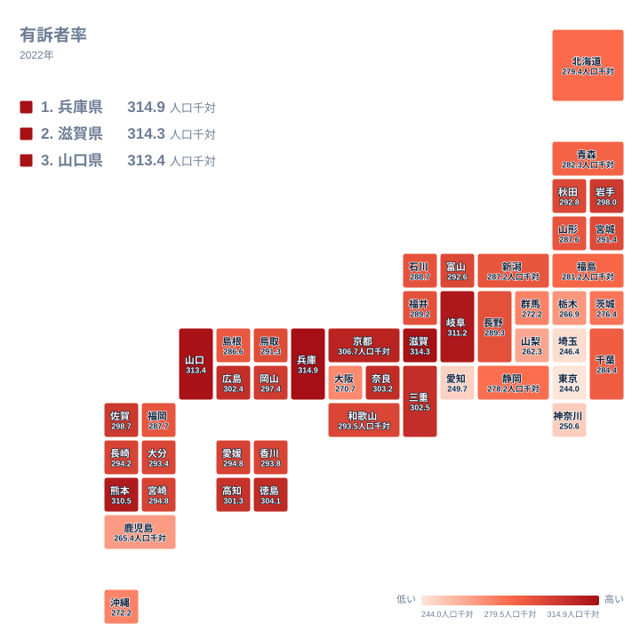

病気やけがなどで自覚症状がある人は、住んでいる県によってどれだけ違うのでしょうか。2022年の有訴者率で最も高いのは兵庫県で、人口千対314.9です。最も低いのは東京都で、人口千対244です。同じ国の中で、これだけの開きがあります。

この記事では、有訴者率が高い県と低い県の顔ぶれを確かめます。そのうえで、順位の背景として考えられることを、データで言える範囲と仮説とに分けて整理します。

## 有訴者率が最も高い県はどこか

有訴者率が最も高い県は兵庫県で、2位は滋賀県、3位は山口県、4位は岐阜県、5位は熊本県です。下位は47位の東京都、46位の埼玉県、45位の愛知県、44位の神奈川県、43位の山梨県の順です。

<source-link href="/ranking/complainant-count">有訴者率ランキングをもっと見る</source-link>

この図から読み取れる大きな点は、上位群と下位群の距離です。1位の兵庫県は人口千対314.9、最下位の東京都は244で、倍率にすると1位は最下位の約1.3倍にあたります。千人あたりで見れば、70人ほどの開きです。一方で、上位5県の中だけを見ると、1位の兵庫県と2位の滋賀県は人口千対で0.6しか離れていません。わずかな差で順位が入れ替わる水準です。

下位側も同じです。東京都の244と埼玉県の246.4は近い値で、愛知県の249.7、神奈川県の250.6まで、4県が狭い範囲に固まっています。山梨県の262.3になると、そこから少し距離が開きます。1位か2位かといった細かな順位より、上位の群と下位の群のあいだに大きな隔たりがあることに注目すると、実態に近い読み方になります。

上位5県の地方を表で確かめると、兵庫県と滋賀県が近畿、山口県が中国、岐阜県が中部、熊本県が九州・沖縄です。特定の一地方に偏らず、西日本が多いという傾向にとどまります。下位5県は、東京都、埼玉県、神奈川県が関東、愛知県と山梨県が中部です。関東と中部の県が並び、首都圏とその周辺が目立ちます。

> [!NOTE]
> 有訴者とは、病気やけがなどで自覚症状がある人のことです。診断された病名や通院の有無とは別の概念で、「通院者率」とは異なる指標です。症状が気になっていても通院していない人は有訴者に数えられ、逆に通院していても自覚症状がなければ数えられません。調査では本人の申告をもとにしています。

## 上位の県に見られること

上位の県に共通するものを、データで言える範囲から探してみます。まず、上位十位には近畿・中国・四国・九州の県が多く並びます。10位までを順に挙げると、兵庫県、滋賀県、山口県、岐阜県、熊本県、京都府、徳島県、奈良県、三重県、広島県です。西日本の県が大半を占めており、東日本からは中部の岐阜県が入っているだけです。

ただし、この共通点の理由までは、今回のデータでは示せません。一般に、自覚症状を訴える人は年齢が高いほど増えると言われます。そのため、高齢者の多い県で率が高く出ている可能性はあります。ただし、この記事では年齢構成のデータを扱っていないため、あくまで仮説です。

兵庫県と滋賀県は、いずれも大都市圏に隣接しながら上位に入っています。兵庫県は1位、滋賀県は2位で、大阪府の40位とは大きく離れています。都市圏に近いかどうかだけでは、順位は説明できません。兵庫県の他の指標は[兵庫県のデータ](/areas/28000)、滋賀県は[滋賀県のデータ](/areas/25000)で確かめられます。

> [!WARNING]
> 有訴者率は、年齢構成の違いを調整していない値です。高齢者の多い県は高く、若い世代の多い県は低く出やすいと考えられるため、県ごとの医療の質や住民の健康水準をそのまま比べる材料にはなりません。順位の差が、そのまま「健康かどうか」の差を意味するわけではありません。

## 下位の県に見られること

最も低い東京都は人口千対244で、46位の埼玉県は246.4、44位の神奈川県は250.6です。関東の3都県が下位に並びます。いずれも大都市圏に位置する県です。45位の愛知県は249.7、43位の山梨県は262.3で、これらの県を含めて、下位には首都圏とその周辺、そして中部の大都市圏の県が多く見られます。

山梨県は、下位の五県に入る一方で、値は262.3と他の下位4県より少し高くなっています。山梨県は関東ではなく中部に属する県で、この記事では、下位の顔ぶれを「関東と中部の県」と整理します。山梨県がなぜ低めなのかは、このデータだけでは分かりません。

大都市圏の県が低い理由として、若い世代が多い人口構成が影響しているのではないか、という見方はあり得ます。ただし、年齢構成のデータがない以上、これは仮説にとどまります。同様に、都市部では忙しさから不調を意識しにくい、あるいは申告しにくいという見方も考えられますが、確かめる材料はありません。

愛知県は製造業が盛んな県として知られますが、有訴者率は45位と低い水準です。このことから、産業の種類だけで順位が決まるわけではない、とは言えそうです。産業と有訴者率の関係は、このデータからは読み取れません。

## 地理分布で見る有訴者率の地域差

次の図は、47都道府県の有訴者率を地図の形に並べたものです。色の濃淡から、どの地方に高い県や低い県が集まっているかを確かめられます。

図を見ると、近畿、中国、九州・沖縄の一部に高い値の県が目立ちます。近畿では兵庫県が1位、滋賀県が2位、京都府が6位、奈良県が8位、三重県が9位です。この記事では、三重県を含む近畿として数えると、上位十位の中に五県が入っています。ただし同じ近畿でも、大阪府は人口千対270.7で40位と、大きく離れています。和歌山県は293.5で19位で、中位です。

中国では山口県が3位、広島県が10位と上位に入り、岡山県は14位です。四国では徳島県が7位、高知県が11位で、こちらも比較的高めです。西日本には、高い値の県が集まる傾向が見られます。

一方、関東は東京都、埼玉県、神奈川県が下位に並びます。ただし関東の中でも、千葉県は人口千対284.4で32位、茨城県は276.4で37位、栃木県は266.9で41位と、県によって位置が異なります。同じ地方でも一様ではありません。

北海道・東北を見ると、岩手県が13位で人口千対298と比較的高く、秋田県は21位、北海道は35位で279.4です。同じ地方の中でも順位が大きく異なります。

> [!TIP]
> 順位表を読むときは、順位そのものよりも値の差に注目してください。中位の県同士は値が近く、順位が一つ違っても実態はほぼ同じことがあります。群馬県と沖縄県が、ともに人口千対272.2で並んでいるのもその一例です。地図で色の濃淡を見るときも、隣り合う県の差が小さいことを意識すると、読み違いが減ります。

## 近畿の県を比べると見えること

ここでも、三重県を含む近畿として比べます。兵庫県が314.9、滋賀県が314.3、京都府が306.7、奈良県が303.2、三重県が302.5と、上位に並びます。和歌山県は293.5で19位です。大阪府は270.7で40位です。

同じ近畿の七県でも、1位から40位まで大きく分かれます。大阪府だけが大きく低い理由は、このデータでは説明できません。大都市として若い世代の流入が多いことが背景にあるという見方もありますが、仮説の域を出ません。

このように、近畿の中でも大きな開きがあることは、地方という単位だけで順位を語ることの限界を示しています。地方ごとの傾向は確かにありますが、その中にも大きな幅があります。県ごとの値と順位を、一つずつ確かめることが大切です。

## データについて

この記事で扱った有訴者率は、社会・人口統計体系に収録された2022年の値で、単位は人口千対です。調査は世帯員への聞き取りによって行われ、入院中の人は対象に含まれません。そのため、入院している人の割合が県によって違う場合、単純な比較が難しくなります。

同じカテゴリの他の指標と合わせて読むと、地域の姿をより立体的に捉えられます。[同じカテゴリの統計一覧](/category/socialsecurity)から、医療や福祉に関する指標を探してみてください。

有訴者率は、県の優劣を決める数字ではありません。上位だから不健康、下位だから健康と決めつけず、値の差と、その背景にありうる事情とを分けて読むことが、この指標を役立てる近道です。
