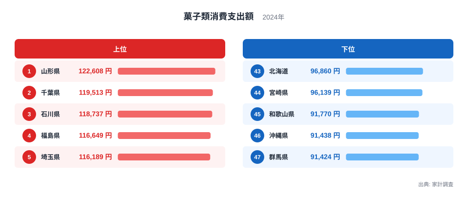
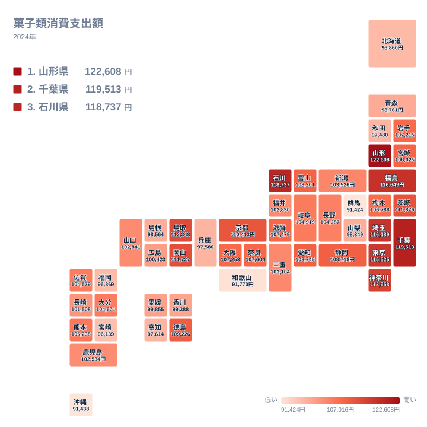

## 菓子類への支出で1位になったのは山形県

甘いものにどれだけお金を使うかは、地域によってかなり違います。2024年の家計調査で菓子類への年間支出を比べると、1位は山形県で122,608円でした。2位は千葉県の119,513円、3位は石川県の118,737円です。

一方、最も少なかったのは47位の群馬県で91,424円でした。46位の沖縄県は91,438円、45位の和歌山県は91,770円で、下位は小さな差で並んでいます。

菓子類は日用品のように毎日買うとは限らず、贈答や来客、季節の行事、観光土産とも結びつく品目です。そのため、地域の食習慣や暮らし方が出やすいと考えられます。ただし、この記事で使えるのは金額と順位だけです。背景にありそうな食文化や産地との関係は、確かめられた事実ではなく、あくまで読み解きの手がかりとして整理します。

> [!NOTE]
> ここでの菓子類は、家計調査の「菓子類」に分類される品目への年間支出額です。和菓子や洋菓子、せんべいなどの菓子が対象で、パンや飲料、外食でのデザートは別の分類です。金額は支出額であり、食べた量(重さや個数)ではありません。

## 上位と下位の顔ぶれを見る

まず、上位と下位をひとつの図にまとめて確認します。

<source-link href="/ranking/confectionery-consumption-expenditure">菓子類への支出ランキングをもっと見る</source-link>

上位5県は東北から2県、北陸から1県、首都圏から2県という構成です。「寒い地域」か「大都市圏」のどちらか一方に偏っているわけではなく、地域の性格がばらばらな県が並んでいる点が特徴です。

注目したいのは、上位と下位の開きです。1位の山形県と47位の群馬県の差は31,184円あります。山形県の支出は、群馬県より3割ほど多い水準です。一方で下位の3県、群馬県、沖縄県、和歌山県は91,000円台に固まっています。下位は僅差の争いで、順位の差がそのまま暮らしぶりの差を表すわけではありません。

中位も同様で、20位の岩手県は107,215円、21位の栃木県は106,788円と近く、順位が一つ違うだけでは実態に大差がない県が多くなっています。順位より金額の帯を見るほうが、実態に近い読み方です。

> [!TIP]
> 順位は一つ違うだけで入れ替わることがあります。たとえば10位の茨城県は110,876円、11位の京都府は110,413円で、ごく小さな差です。順位そのものより、金額の帯のなかでどのあたりに位置するかを見ると、読み違えにくくなります。

## 食文化と産地から考える

山形県が1位になった理由は、統計だけでは断定できません。山形県は果物の産地として知られ、地元の素材を生かした菓子や郷土料理とともに甘いものを楽しむ文化がある、という見方はできます。ただし、これは仮説であり、この統計では確認できません。

石川県が3位の118,737円であることについても、茶の湯の文化や和菓子の贈答習慣と結びつけて語られることがあります。そうした見方もできますが、この統計から習慣の強さを測ることはできません。京都府は11位の110,413円で、和菓子の老舗が多い土地柄と重ねたくなりますが、これも同様に、金額だけで裏づけられるものではありません。

首都圏の千葉県、埼玉県、東京都が上位に並ぶことについては、店舗の選択肢が多いことや手土産の機会が多いことが関係している可能性があります。これも推測の域を出ません。

下位についても、群馬県で小麦を使った粉食が盛んなことが背景にあるのではないか、という仮説は語られます。しかし、この統計からは確認できません。沖縄県についても、家庭で作る菓子や市場での購入が調査に十分表れていない可能性が考えられる、という程度にとどめるべきです。

> [!WARNING]
> 家計調査は標本調査で、都道府県別の数値は主に県庁所在市の世帯が対象です。県全体の平均ではなく、調査対象の世帯数も限られるため、年によって順位が入れ替わりやすい点に注意してください。1年分の順位だけで地域の菓子好きを断定することはできません。

## 地理分布のタイルマップで見る

次に、全国での広がりを確認します。

地図で見ると、特定の地方だけが突出しているわけではないことがわかります。高い県と低い県が、地方をまたいで入り混じっています。

地方内の差を二つ見てみます。東北では、1位の山形県が122,608円、41位の秋田県が97,480円で、同じ東北でも25,128円の開きがあります。関東でも、5位の埼玉県が116,189円であるのに対し、群馬県は47位の91,424円で、隣り合う県の間に大きな差があります。

こうした例から、地方単位で「この地方は菓子に支出する」と一括りにしにくいことがわかります。近い県が似た水準になるとは限らないというのが、この指標を地図で見たときの印象です。

> [!NOTE]
> 都道府県別の値は県庁所在市の世帯だけを集計した数字です。そのため、同じ県内でも、都市部と郊外、あるいは県庁所在市以外の地域とでは支出の水準が違う可能性があります。県の数字は「県庁所在市の暮らし方」を映したものとして読んでください。

## 関連品目との対比は、この記事では判断できない

菓子類への支出を、パンや米、外食、和菓子と洋菓子の違いなどと並べれば、より立体的に読めるかもしれません。ただし、この記事で使っているのは菓子類の支出額だけで、他の品目との関係はここからは判断できません。自分の県の特徴を考えるときは、他の食料品の統計とあわせて確認するのがおすすめです。同じカテゴリの統計は[同じカテゴリの統計一覧](/category/economy)から探せます。

## 山形県と千葉県をどう読むか

1位の山形県と2位の千葉県は、地域の性格が大きく異なる二つの県です。山形県は果物の産地という側面があり、千葉県は東京圏に隣接する人口の多い県という側面があります。両県の差は、122,608円と119,513円で、わずかです。詳しい数値は[山形県のデータ](/areas/06000)と[千葉県のデータ](/areas/12000)で確認できます。

性格の異なる二つの県が近い水準で並んでいる事実から、食文化や都市の利便性など複数の要因が背景にある可能性は考えられます。ただし、この統計だけではそれを確かめられません。順位の背景は、あくまで仮説として受け止めてください。

## データについて

この記事で使った統計は、家計調査の菓子類消費支出額です。対象年は2024年で、単位は円、年間の支出額です。順位は、この金額を大きい順に並べたものです。

家計調査は標本調査のため、実際の消費行動と完全には一致しません。また、都道府県別の値は県庁所在市などを基にしているため、県全体の傾向とずれる場合があります。数字は目安として扱い、背景の説明はあくまで可能性として読んでください。
