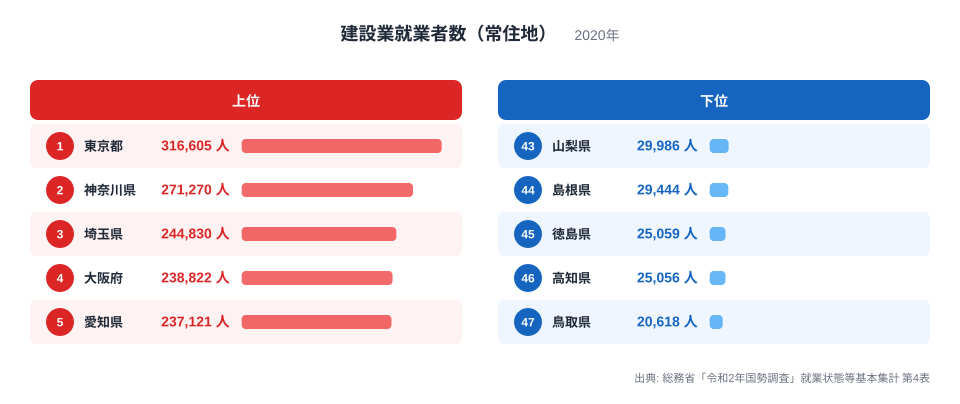
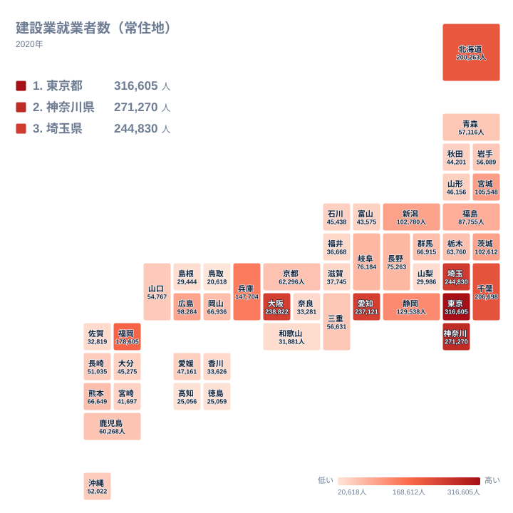

建設業の現場を支える人は、日本のどこに住んでいるのでしょうか。住宅やビル、道路、橋、堤防など、暮らしの土台をつくる仕事は全国どこにもありますが、働く人が住んでいる数は都道府県ごとに大きく違います。この記事では、2020年の国勢調査で集計された建設業で働く人の数を、住んでいる場所ごとに並べ、上位と下位がどのような並びになっているかをデータから確かめます。

最も多いのは東京都の316,605人で、最も少ないのは鳥取県の20,618人です。最大と最小の比は約15倍になります。ただし、ここで確認できるのは順位と人数の並びまでです。なぜそうなるのかは、データから言える範囲と、仮説にとどまる部分を分けて書いていきます。

> [!NOTE]
> この指標は「常住地」ベースです。働いている場所ではなく、住んでいる場所で数えた建設業の就業者数です。埼玉県や神奈川県に住んで東京都の現場へ通う人は、東京都ではなく住んでいる県の数字に入ります。したがって、東京都の316,605人は、東京都内の現場で働く人の数ではありません。

## 上位と下位をひと目で見る

まず、上位5県と下位5県を並べた図を見ます。

<source-link href="/ranking/construction-employed-residents">建設業就業者数（常住地）ランキングをもっと見る</source-link>

上位で目を引くのは、2位以下の詰まり方です。2位の神奈川県は271,270人、3位の埼玉県は244,830人で、1位の東京都とは大きく離れています。一方、4位の大阪府は238,822人、5位の愛知県は237,121人で、3位の埼玉県から5位の愛知県まで、数字がかなり接近しています。トップの東京都だけが抜けていて、その下に4県が密集する形です。

下位は、さらに詰まっています。45位の徳島県は25,059人、46位の高知県は25,056人で、差はわずか3人です。47位の鳥取県は20,618人で、この2県からは離れています。つまり下位では、鳥取県だけが一段低く、その上に徳島県と高知県が並ぶ構図です。

上位の1位から5位は、東京都、神奈川県、埼玉県、大阪府、愛知県です。このうち3都県が関東にあります。千葉県も206,698人で6位に入るので、関東の1都3県が上位6位のうち4つを占めます。首都圏に集まっているかどうかを全国比で示すことは、この記事では行いません。ここでは、上位に並ぶ県の顔ぶれが大都市圏に偏っていることまでを事実として押さえます。

## 首都圏の並びをどう読むか

東京都が1位、神奈川県が2位、埼玉県が3位で、千葉県が6位です。この4都県は、いずれも関東に属します。常住地の数え方では、都内の現場に通う人は、住んでいる県に計上されます。そのため、神奈川県や埼玉県、千葉県の人数には、東京都内で働く人が含まれている可能性があります。ただし、この指標は通勤先を区別していないため、含まれる人数は実データからは分かりません。

東京都のデータは[東京都のデータ](/areas/13000)、神奈川県の詳しい状況は[神奈川県のデータ](/areas/14000)で確認できます。2県の数字を並べると、東京都の316,605人と神奈川県の271,270人の関係がよく見えます。

> [!WARNING]
> この数字は建設業で働く人の「人数」であり、工事の量や売上、生産性を示すものではありません。また、国勢調査は産業で分類するため、建設業に属する事務や営業など、現場作業以外の仕事の人も含まれる可能性があります。現場で作業する人だけの数ではない点に注意が必要です。

## 地理分布で見る地方ごとの違い

次に、地理分布を見ます。

地図で見ると、関東から中部、近畿、北部九州にかけての都市圏に、人数の多い県が集まっています。愛知県の237,121人、大阪府の238,822人、福岡県の178,605人、兵庫県の147,704人、静岡県の129,538人などが代表例です。北海道も200,263人で7位に入り、地方の中では突出した数字です。

同じ北海道・東北の中でも、県ごとの違いは大きく表れます。宮城県は105,548人で11位、福島県は87,755人で15位です。一方、青森県は57,116人で24位、岩手県は56,089人で26位、山形県は46,156人で31位、秋田県は44,201人で34位です。東北の中では、宮城県が頭一つ抜けています。

中国地方では、広島県が98,284人で14位、岡山県が66,936人で18位です。一方で、山口県は54,767人で27位、島根県は29,444人で44位、鳥取県は20,618人で47位と、県ごとの差がはっきり出ています。四国では愛媛県が47,161人で30位、香川県が33,626人で39位、徳島県が25,059人で45位、高知県が25,056人で46位です。

下位に並ぶ県が地方に偏っているのは、データから読み取れます。理由としては、山がちな地形や住宅需要の小ささが関係するかもしれませんが、これは仮説であり、この表からは確かめられません。

> [!TIP]
> 地方の順位を読むときは、県内の建設現場の多さと結びつけないことが大切です。この指標は住んでいる場所で数えているので、県内の現場の数や工事量とは別物です。近隣の大きな県に通う人が多い県では、現場の多さとは異なる順位になりえます。

## 中位の県に見える違い

中位には、人数が近い県が並びます。新潟県は102,780人で12位、茨城県は102,612人で13位で、両県の差は168人です。岐阜県は76,184人で16位、長野県は75,263人で17位で、こちらも接近しています。群馬県は66,915人で19位、熊本県は66,649人で20位、岡山県は66,936人で18位で、この3県は数百人の範囲に収まっています。

九州では、熊本県が66,649人で20位、鹿児島県が60,268人で23位、長崎県が51,035人で29位です。東北では岩手県が56,089人で26位、近畿では京都府が62,296人で22位、三重県が56,631人で25位です。沖縄県は52,022人で28位です。

京都府は大阪府の238,822人、兵庫県の147,704人と比べると、近畿の中では控えめな数字です。理由は、このデータだけでは分かりません。

[同じカテゴリの統計一覧](/category/construction)では、建設に関するほかの指標も見られます。複数の指標を並べることで、人数の多さの背景を確かめやすくなります。

## 上位と下位の差をどう受け止めるか

最大の東京都は316,605人、最小の鳥取県は20,618人です。この比は約15倍で、47都道府県の間には大きな開きがあります。一方で、その間の並びを見ると、大きな開きは均等に広がっているわけではありません。

10位の静岡県は129,538人、11位の宮城県は105,548人です。上位10県は、129,538人から316,605人までの範囲に入っています。30位の愛媛県は47,161人で、下位の20県近くは、20,618人から50,000人に満たない範囲に集まっています。つまり、全国の分布は、上位に少数の大きな県があり、その下に多数の小さな県が並ぶ形です。

人数が少ないことは、建設業の重要性が低いことを意味しません。この記事で示せるのは、住んでいる人の数としての分布です。なぜその分布になったのかは、人口の規模や産業構造など、別の指標とあわせて確かめる必要があります。

## データについて

この記事で使った統計名は「建設業就業者数（常住地）」です。出典は総務省「令和2年国勢調査」就業状態等基本集計 第4表で、調査年は2020年、単位は人です。都道府県ごとに、その県に住んでいる就業者のうち、建設業に従事している人を数えています。

勤務地ベースの数字とは異なります。昼間に多くの人が働きに来る地域と、夜間に多くの人が暮らす地域とでは、順位の見え方が変わります。本記事の順位や数値は、すべて常住地ベースの値にもとづいています。
