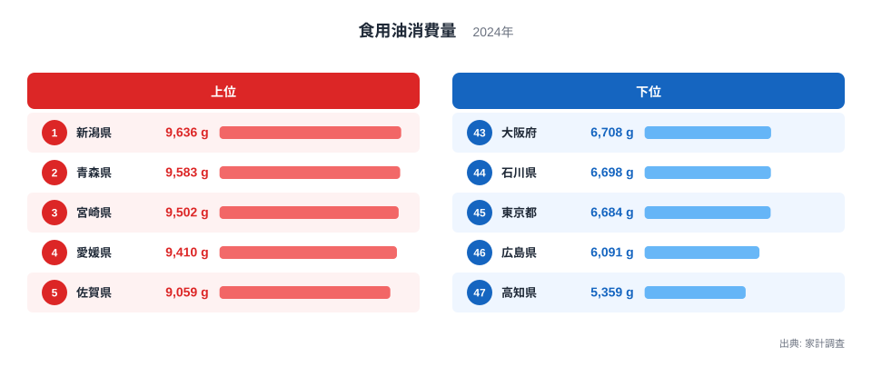
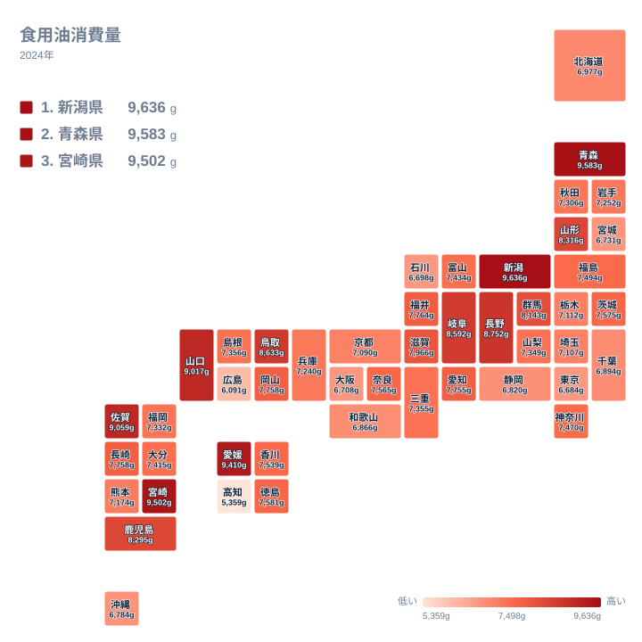

## 食用油の消費量が最も多いのは新潟県です

毎日の台所で使う食用油は、地味ながら家庭の食べ方がよく表れる品目です。炒め物、揚げ物、ドレッシングやマヨネーズの原料など、使われ方が幅広いため、消費量の差には食習慣の違いが映ると考えられます。

2024年の家計調査で食用油の消費量が最も多かったのは、新潟県の9,636gです。2位は青森県の9,583gで、首位との差はごくわずかでした。最も少なかったのは高知県の5,359gで、首位と最下位の間には9,636gと5,359gという大きな開きがあります。同じ日本の家庭でも、台所で使う油の量がこれだけ違うことになります。

この記事では、上位と下位の顔ぶれを確認したうえで、地域ごとの傾向と、食文化や暮らし方との結びつきを整理します。

<source-link href="/ranking/cooking-oil-consumption-quantity">食用油消費量ランキングをもっと見る</source-link>

上位5県は、新潟県、青森県、宮崎県、愛媛県、佐賀県です。下位5県は、東京都、石川県、大阪府、広島県、高知県のように、大都市圏を含む顔ぶれが並びます。ここで注目したいのは、顔ぶれそのものより、所属する地方がばらばらだという点です。

上位は中部、北海道・東北、九州・沖縄、四国が入り交じり、下位も関東、中部、近畿、中国、四国に分かれます。「どこの地方が多い」と一言でまとめにくい指標だと分かります。

図の見方としては、棒の長さの差にも目を向けてください。1位と2位の差が小さい一方、最下位の高知県は46位の広島県6,091gからも離れています。上位は接戦、下位の端は独走という形です。

> [!NOTE]
> この指標の正式な統計名は「食用油消費量」で、出典は家計調査です。単位はグラムで、容量ではなく重量で示されます。外食や惣菜、加工食品に含まれる油は入らず、家庭で食用油として購入した分だけが対象です。

## 上位に並ぶ県の顔ぶれを読み解く

上位10県には、新潟県、青森県、宮崎県、愛媛県、佐賀県に続き、山口県、長野県、鳥取県、岐阜県、山形県が入ります。中部が3県、北海道・東北が2県、九州・沖縄が2県、中国が2県、四国が1県で、関東と近畿は上位10県に入っていません。

首位の新潟県は、米どころとして知られます。ご飯を中心にした食卓では、おかずに炒め物や揚げ物を添える場面が多いと想像できます。ただし、これは仮説で、統計だけで因果までは断定できません。[新潟県のデータ](/areas/15000)や[青森県のデータ](/areas/02000)をあわせて見ると、地域の特徴をつかみやすくなります。

寒冷な気候や雪との結びつきを考えたくなりますが、データはそれを支持しません。上位には宮崎県、愛媛県、佐賀県といった西日本の県も入り、北海道は37位の6,977g、宮城県は42位の6,731gと下位寄りです。気候だけで説明するのは無理があります。

九州・沖縄の中でも幅があります。宮崎県が3位、佐賀県が5位、鹿児島県が11位に入る一方、福岡県は29位の7,332g、沖縄県は41位の6,784gです。同じ地方の中でも、順位には大きな幅があります。

> [!TIP]
> 同じ値の県は同順位として扱われます。岡山県と長崎県はどちらも7,758gで、15位が同順位となり、次は17位の愛知県です。中位は値が密集しているため、順位が1つ違うだけの差は小さいと考え、値そのものも見比べてください。

## 下位の県は何が違うのか

最下位の高知県は5,359gで、全国で最も控えめな購入量です。46位の広島県との間にも隔たりがあり、下位の端は他の県から離れた位置にいます。

東京都は45位の6,684g、大阪府は43位の6,708gです。都市部で少ない背景として考えられるのは、外食や中食を利用する機会の多さです。惣菜や弁当で揚げ物や炒め物を食べても、その油は家庭の購入量に表れません。つまり、少ないからといって油を使う料理が少ないとは限りません。

石川県は44位の6,698gです。同じ中部でも、新潟県は1位、長野県は7位、岐阜県は9位と上位に入っています。中部の中に1位と44位が同居している点は、地方という大きなくくりでは県ごとの違いをつかみきれないことをよく示しています。

> [!WARNING]
> この指標は重量(g)で、食用油の容量や銘柄、価格は区別されません。大容量のボトルを買い置きした世帯や、まとめ買いのタイミングが調査期間に重なった世帯があると、購入量が一時的に増減します。サラダ油、オリーブオイル、ごま油など油の種類による違いも、この数字からは読み取れません。

## 地理分布で見る地域の偏り

タイルマップで全体を眺めると、濃い色の県と薄い色の県が、地方をまたいで入り交じっています。西日本では宮崎県、愛媛県、佐賀県、山口県、鳥取県が上位に入り、東日本では新潟県、青森県、長野県、岐阜県、山形県が目立ちます。東西や日本海側・太平洋側といった単純な線引きでは、分布を説明できません。

関東は、内陸と大都市圏で開きがあります。群馬県は12位の8,143gと上位に近い一方、東京都は45位です。近畿は、上位10県に入る府県がなく、中位から下位に集まっています。

中国と四国は両極端です。山口県が6位、鳥取県が8位、愛媛県が4位と上位に入る一方、広島県は46位、高知県は47位です。隣り合う県でも大きく違うため、気候や地理だけでなく、家庭の料理の習慣や買い物の仕方が影響している可能性があります。

## 食文化・気候・暮らし方との結びつき

食用油の消費量を左右しそうな要因を整理します。いずれも仮説で、この記事のデータだけでは検証できません。

- 主食と副菜の組み合わせ: 米を中心にした食卓で、炒め物や揚げ物を副菜に添える習慣があるか
- 外食・中食の利用: 都市部で外食や惣菜の利用が多いほど、家庭での購入量は減りやすいか
- 世帯の暮らし方: 家庭で調理する頻度が高いほど、油の購入量は増えやすいか
- 産地や歴史: 油を使う郷土料理が根づいているか

上位の県には、米や野菜を中心にした家庭料理が根づく地域が含まれると考えられます。ただし、この記事が使えるのは購入量の数字だけで、料理名や調理法までは分かりません。

関連する品目と比べると、より立体的に見えてきます。マヨネーズやドレッシングのように油を原料に使う品目と食用油が近い動きを見せるのか、異なる動きを見せるのかは、気になる点です。食用油は「家庭で油を使って調理する量」、加工食品は「すでに油が使われた食品を買う量」を表すため、両者を並べると家庭の調理スタイルの違いが浮かび上がります。[同じカテゴリの統計一覧](/category/economy)から、関連する指標をあわせて確認してみてください。

## データについて

この記事で使ったのは、家計調査の2024年のデータで、単位はグラムです。47都道府県すべての値がそろっています。値は世帯が購入した食用油の量にもとづくため、外食や加工食品に含まれる油は反映されません。

同じ値の県は同順位とし、次の順位は飛ばして数えます。岡山県と長崎県は7,758gで同じ値のため、どちらも15位となり、次の愛知県が17位です。

## まとめ

食用油の消費量は、新潟県が9,636gで1位、青森県が9,583gで2位、宮崎県が9,502gで3位でした。最下位は高知県の5,359gで、上位と下位の間には大きな差があります。

上位も下位も地方がばらばらで、気候や地方による単純な説明は当てはまりません。大都市圏の少なさには、外食や中食の利用との関係も想像されます。

数字は家庭の台所の違いを映す一方、重量で測った購入量という限界も抱えています。順位だけでなく値や周辺の県との比較、食文化の背景とあわせて読むことで、各県の食卓がよりはっきりと見えてきます。
