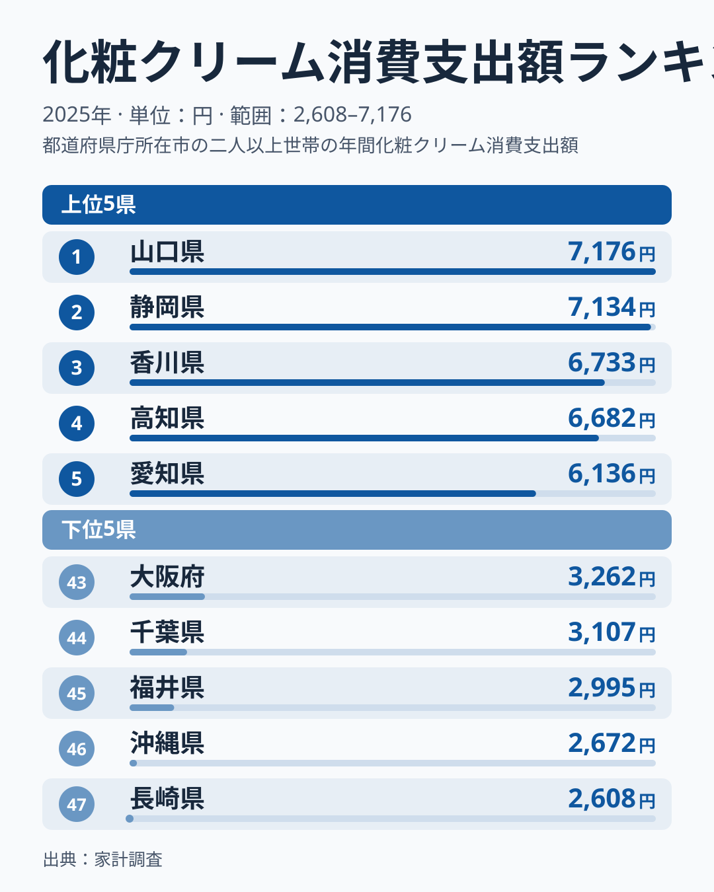
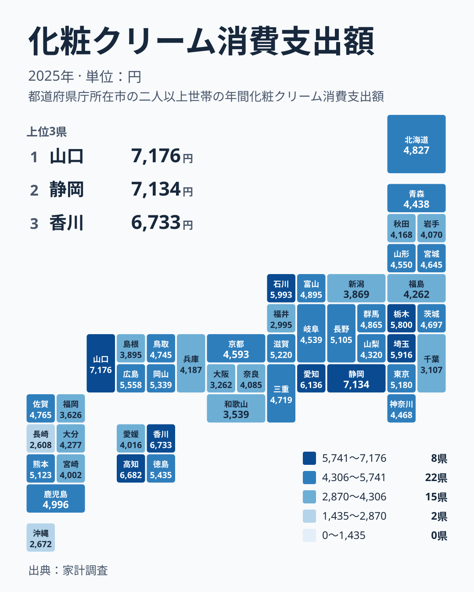

化粧クリームにいちばん多くのお金を使っているのは、東京や大阪のような大都市でしょうか。2025年の家計調査で1位になったのは山口県でした。年間の支出額は7,176円です。2位は静岡県の7,134円で、わずかな差で続いています。

この記事では、化粧クリームへの支出を都道府県ごとに並べ、上位と下位の顔ぶれから暮らしの違いを考えます。数字の大小だけでなく、地方ごとの並び方や、順位を読むときの注意点にも触れます。

## 上位と下位の顔ぶれ

まず、上位5県と下位5県を図で確認します。

<source-link href="/ranking/cosmetic-cream-consumption-expenditure">化粧クリームへの支出ランキングをもっと見る</source-link>

上位は、山口県が7,176円で1位、静岡県が7,134円で2位、香川県が6,733円で3位、高知県が6,682円で4位、愛知県が6,136円で5位です。1位と2位はほぼ並んでおり、3位と4位も近い水準です。5位の愛知県からは少し間が開きます。

下位は、長崎県が2,608円で47位、沖縄県が2,672円で46位、福井県が2,995円で45位、千葉県が3,107円で44位、大阪府が3,262円で43位です。最大の山口県と最小の長崎県を比べると、7,176円と2,608円という大きな開きがあります。

注目したいのは、人口の多い大阪府や千葉県が下位に入っている点です。人口が多く店も多い地域ほど化粧品にお金を使う、という単純な図式は成り立っていません。東京都も5,180円で13位にとどまり、上位には入っていません。

> [!NOTE]
> この指標は家計調査の「化粧クリーム」への年間支出額で、1世帯あたりの金額です。化粧水や乳液、ファンデーションなどは別の品目です。スキンケア全体の支出額ではない点に注意してください。

## 地方ごとに分けて見ると

次に、地方という別の切り口で並べ直します。上位5県の顔ぶれは、中国の山口県、中部の静岡県と愛知県、四国の香川県と高知県です。関東や近畿、北海道・東北の県は、上位5県に入っていません。

中国地方を見ると、山口県が1位、広島県が5,558円で9位、岡山県が5,339円で11位です。鳥取県は4,745円で21位、島根県は3,895円で39位となっています。同じ地方でも、西側の県ほど上位に寄り、島根県で大きく下がる形です。

四国地方は、香川県が3位、高知県が4位、徳島県が5,435円で10位と、上位に3県が入っています。一方で愛媛県は4,016円で37位です。四国の中でも一様ではなく、愛媛県だけが下位寄りに位置しています。

中部地方は振れ幅がもっとも大きい地方です。静岡県が2位、愛知県が5位、石川県が5,993円で6位と上位に並びます。ところが福井県は45位、新潟県は3,869円で40位です。同じ地方に上位と下位の県が同居しています。

関東地方では、埼玉県が5,916円で7位、栃木県が5,800円で8位、東京都が13位です。群馬県は4,865円で18位、茨城県は4,697円で23位、神奈川県は4,468円で28位、千葉県は44位でした。首都圏の中でも順位はばらばらです。

近畿地方は、滋賀県が5,220円で12位と最上位です。三重県は22位、京都府は4,593円で25位、兵庫県は4,187円で33位、奈良県は4,085円で35位、和歌山県は3,539円で42位、大阪府は43位となっています。

## 地理分布で見る偏り

続いて、47都道府県の分布をタイルマップで見ます。

地図にすると、色の濃い地域は一か所に固まっているわけではなく、中国・四国から中部にかけて点在していることが分かります。山口県、香川県、高知県、静岡県、愛知県という上位県は、日本列島の西から中央にかけて並んでいます。

反対に、九州・沖縄では長崎県が47位、沖縄県が46位、福岡県が3,626円で41位と、下位が目立ちます。ただし熊本県は5,123円で14位、鹿児島県は4,996円で16位と中位より上です。九州・沖縄を一括りにして「少ない地方」と言い切ることはできません。

北海道・東北は、北海道が4,827円で19位、宮城県が4,645円で24位、山形県が4,550円で26位と中位に集まっています。青森県は4,438円で29位、福島県は4,262円で32位、秋田県は4,168円で34位、岩手県は4,070円で36位と、中位から下位寄りに並びます。極端に高い県も低い県もない地方です。

> [!WARNING]
> 家計調査は標本調査で、都道府県別の数字は都道府県庁所在市などの調査世帯にもとづきます。化粧クリームは購入頻度が低く、少ない世帯数の影響で年ごとに順位が入れ替わりやすい品目です。1年の順位だけで県民性を断定することはできません。

## 暮らしへの含意

では、この差は私たちの暮らしにどう結びつくのでしょうか。データから確実に言えるのは、化粧クリームへの支出は人口規模や都市の大きさとは一致しない、ということです。大阪府や千葉県が下位にあり、山口県や高知県が上位にあるのがその例です。

考えられる背景はいくつかありますが、今回のデータだけでは原因を特定できません。気候や乾燥への備え、購入する店の種類、通信販売の利用、世帯の年齢構成などが関わる可能性はあります。ただし、これらは実データに含まれていないため、断定は避けます。

読者の暮らしに引き寄せて言えば、自分の県の順位は「平均的な家計の目安」にすぎません。たとえば山口県の7,176円と、自分の1年の支出を比べてみるのは一つの方法です。上位の県の水準が、そのまま正しい支出額というわけではありません。

家計の見直しをする場合も、全国の順位より、自分の世帯の使い方を基準にするほうが現実的です。そのうえで、地域の水準を知っておくと、自分の支出が多いのか少ないのかを大まかにつかめます。

> [!TIP]
> 順位の隣り合う県の差は小さいことがあります。山口県と静岡県は、7,176円と7,134円で、ほぼ同水準です。順位の数字より、金額の差を見て「ほぼ同じ」か「大きく違う」かを判断すると、読み違いを防げます。

## 自分の県を調べるには

最後に、身近な県の位置を確かめる方法を紹介します。上位に入った県の詳しい数値は、[山口県のデータ](/areas/35000)や[静岡県のデータ](/areas/22000)で確認できます。ほかの家計関連の統計と並べて見たいときは、[同じカテゴリの統計一覧](/category/economy)も役立ちます。

また、同じ化粧クリームでも、年を変えれば順位は入れ替わる可能性があります。今回の2025年の結果は、あくまで一年分の姿です。複数の年や、ほかの品目と合わせて見ることで、より確かな傾向が見えてきます。

## データについて

この記事の数値は、家計調査の「化粧クリーム消費支出額」の2025年の結果です。単位は円で、全47都道府県の値を使っています。順位は金額の大きい順です。本文中の地方の区分は、北海道・東北、関東、中部、近畿、中国、四国、九州・沖縄の7区分にそろえました。

記事中で触れた金額と順位はすべて、この統計に載っている値です。新たに計算した平均や差は使っていません。
