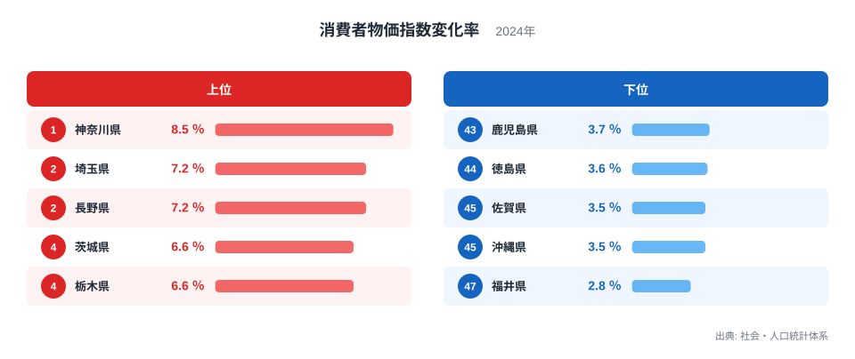
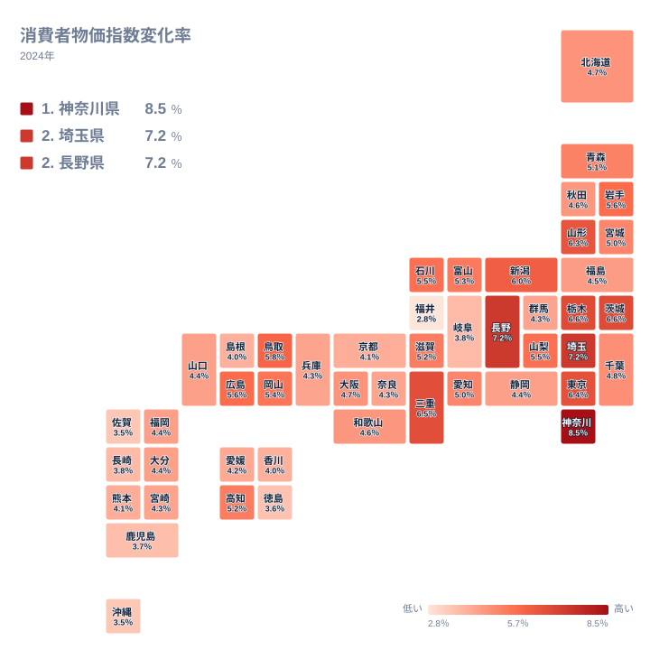

## 物価の上がり方は県でここまで違う

物価の上昇は、日本全国どこでも同じ速さで進んでいるわけではありません。2024年の物価上昇率を都道府県別に並べると、最も高い神奈川県は8.5％で1位です。一方、最も低い福井県は2.8％で47位にとどまります。最高と最低の比は、8.5％を2.8％で割った値にあたり、およそ3倍という大きな開きです。

家計にとって、物価の上昇は食費や光熱費、住まいの費用、娯楽や教養にかかるお金に響きます。この記事では、食文化・気候・産地・暮らし方といった地域の事情に目を配りながら、どの県で物価が上がりやすかったのかを読み解きます。ただし、ここで扱う数値は一つの総合的な変化率です。地域の事情との結びつきは、あくまで読み解くための仮説として扱います。

> [!NOTE]
> この指標は、前年と比べて消費者が購入する商品やサービスの価格がどれだけ変わったかを示します。「物価が高い県」ではなく「物価が上がった県」を表す数字です。また、総合的な変化率なので、食料や住居、光熱、教養娯楽といった品目ごとの寄与は分かりません。順位の理由を特定の品目に結びつけるには、品目別の統計で別に確かめる必要があります。

## 上位5県と下位5県の顔ぶれ

まず、上位と下位の顔ぶれを図で確認します。

<source-link href="/ranking/cpi-change-rate-culture-recreation">消費者物価指数変化率ランキングをもっと見る</source-link>

上位は、1位の神奈川県が8.5％、2位の埼玉県が7.2％、3位の長野県も7.2％です。4位の茨城県と5位の栃木県はともに6.6％でした。上位5県のうち神奈川県、埼玉県、茨城県、栃木県の4県が関東で、残る長野県は中部です。首都圏とその周辺で上昇率が高かったことが読み取れます。

下位は、47位の福井県が2.8％、46位の沖縄県と45位の佐賀県がともに3.5％、44位の徳島県が3.6％、43位の鹿児島県が3.7％です。福井県は中部、沖縄県と佐賀県と鹿児島県は九州・沖縄、徳島県は四国にあたります。上位が関東に集まっていたのに対し、下位は三つの地方に散らばっています。

神奈川県の詳しい数値は[神奈川県のデータ](/areas/14000)で、埼玉県の状況は[埼玉県のデータ](/areas/11000)で確認できます。

## 関東の高さをどう読むか

関東の7都県は、神奈川県が1位、埼玉県が2位、茨城県が4位、栃木県が5位、東京都が7位と、上位に五つが集まっています。ところが千葉県は4.8％で22位、群馬県は4.3％で32位です。関東の中だけで見ても、最高の神奈川県と最低の群馬県では順位が31も離れています。関東全体が一律に高いわけではなく、首都圏の中心に近い県と北関東の一部が上位に入り、残る県は中位にとどまっています。

背景として、住まいや外食、サービス価格の上がり方が関わっている可能性は考えられます。ただし、今回の実データだけでは、どの品目が押し上げたのかを確かめられません。ここでは、関東が高めに出たという事実の確認にとどめておくのが安全です。

> [!WARNING]
> 同じ値の県が複数あり、たとえば埼玉県と長野県はともに7.2％、茨城県と栃木県はともに6.6％です。順位は表示上の並びで、同率の県どうしの優劣を示すものではありません。また、調査の対象品目や調査地点の違いが県別の結果に影響することがあります。

## 地理分布で見る全国の傾向

次に、全国の分布をタイルマップで見ます。

地図で目立つのは、関東から中部、近畿東部にかけて高い値が連なる点です。一方、四国や九州・沖縄では色の薄い県が多くなります。ただし、地方の内部にも大きな差があります。

中部は9県のうち、長野県が3位、新潟県が9位、石川県が13位、山梨県が14位、富山県が16位と上位から中位前半に並びます。その一方で、愛知県は5％で21位、静岡県は4.4％で28位、岐阜県は3.8％で41位、福井県は2.8％で47位です。中部だけで見ても、最高の長野県は7.2％、最低の福井県は2.8％で、全国の最高と最低に近い開きがあります。

近畿でも、三重県が6.5％で6位と高い一方、京都府は4.1％で37位です。東北では山形県が6.3％で8位、福島県が4.5％で27位です。同じ地方でも一様ではなく、地方単位の平均的なイメージだけで県の状況を決めつけるのは危険です。

## 西日本と九州・沖縄の低めの動き

中国では、鳥取県が5.8％で10位と高く、島根県は4％で39位と低くなっています。中国5県の中だけで、順位は29も開いています。四国は、高知県が5.2％で18位ですが、徳島県は3.6％で44位です。四国の4県のうち、全国の上位寄りといえるのは高知県だけです。

九州・沖縄の8県は全体に低めです。最も高い福岡県と大分県でも4.4％で、30位と31位にとどまります。宮崎県が35位、熊本県が38位、長崎県が42位、鹿児島県が43位、佐賀県が45位、沖縄県が46位と続きます。8県の最高と最低の差は、福岡県の4.4％と沖縄県の3.5％で、他の地方と比べて幅は小さめです。

> [!TIP]
> 順位だけでなく値の近さにも注目すると、読み違いを防げます。たとえば30位から35位までは4.4％から4.3％の間に収まり、佐賀県と沖縄県は3.5％で並びます。中位から下位は数位違っても実際の差が小さいので、順位より「上位・中位・下位」の層で捉えるのがコツです。

## 食文化・産地・気候との結びつき

物価の上がり方は、食文化や産地、気候とも関わるかもしれません。ただし、今回の数値は総合的な変化率だけで、これらの要因を検証する材料は含まれていません。以下は読み解きの仮説です。

たとえば、地元で米や野菜、魚介を調達しやすい地域では、食料の輸送費の影響を受けにくいという見方があります。九州・沖縄が低めに出たことと矛盾はしませんが、福岡県の30位という位置や、他地方の産地県の順位が高いことを考えると、これだけで説明するのは難しいです。

気候についても、寒冷地ではエネルギー価格の変動を受けやすいという仮説があります。長野県は3位、山形県は8位、新潟県は9位と高い一方、北海道は4.7％で23位、秋田県は4.6％で25位と中位です。寒さだけでは説明できないことが、実データから分かります。地域ごとの価格の動きは、複数の要因が重なった結果と考えるのが妥当です。

## 暮らしへの影響と見方の整理

上昇率が高い県に住む世帯は、同じ収入でも購入できる量が目減りしやすくなります。ただし、もともとの物価水準が低い県で上昇率が高くなることもあれば、水準が高い県で低くなることもあります。上昇率の順位は、そのまま生活のしにくさを意味しません。

整理すると、次のようになります。

- 最高は神奈川県の8.5％、最低は福井県の2.8％で、およそ3倍の開きがあります
- 上位5県のうち4県が関東で、首都圏周辺の上昇が目立ちます
- 下位5県は中部、四国、九州・沖縄にまたがり、特定の地方に偏りません
- 九州・沖縄では、最も高い福岡県でも30位です
- 中部、近畿、中国、四国のように、同じ地方の中でも県ごとの差が大きい地域があります

ほかの経済関連の統計と合わせて見ると、物価の動きをより立体的に捉えられます。[同じカテゴリの統計一覧](/category/economy)から、所得や消費に関する指標もあわせて確認してみてください。

## データについて

ここで用いたのは、社会・人口統計体系に収録された2024年の消費者物価指数変化率です。単位は％で、全47都道府県の値が公表されています。この指標は前年からの変化の大きさを表すもので、物価の高さを示す地域差指数とは異なります。数値を引用するときは、年と単位をあわせて記すと誤解を避けられます。
