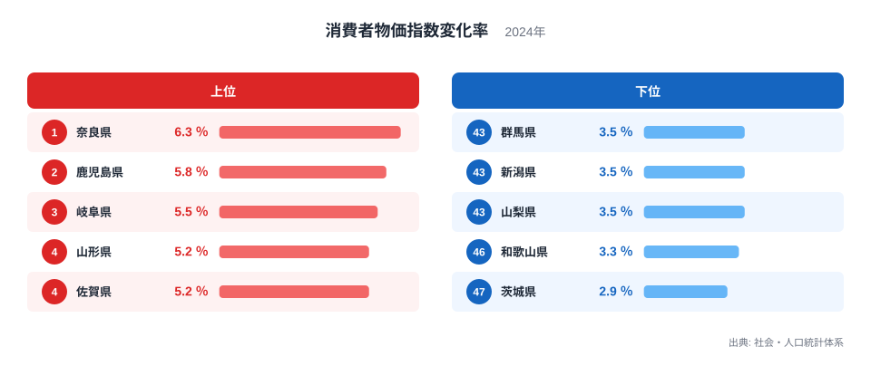
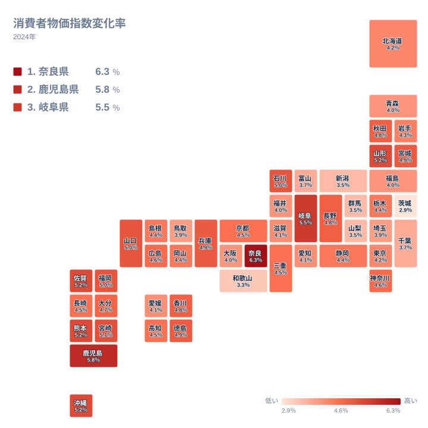

## 物価の上がり方は県ごとにこれほど違います

物価の上昇は全国一律に起きているように感じられます。ところが2024年の物価の変化率を都道府県別に並べると、上がり方にははっきりした地域差があります。最も高いのは奈良県の6.3％で、最も低いのは茨城県の2.9％です。同じ年に同じ国の中で、ここまで開きがあります。

この記事では、47都道府県の変化率を順位と値で追い、どの地域で上昇が大きく、どの地域で穏やかだったのかを整理します。あわせて、食文化や気候、産地、大都市圏と地方の対比といった切り口から、差の背景を考えます。ただし、この指標だけで原因を特定することはできません。ここで述べる背景は、あくまで仮説として受け取ってください。

他の経済指標も確かめたい方は、[同じカテゴリの統計一覧](/category/economy)も参考になります。

> [!NOTE]
> 変化率は、物価の水準そのものではなく、ある時点から次の時点までに物価がどれだけ動いたかを表します。値が高い県は物価が高い県とは限りません。もともと安かった県でも、上がり方が大きければ上位に入ります。

## 上位と下位の顔ぶれ

まず、上位5県と下位5県を図で確認します。

<source-link href="/ranking/cpi-change-rate-food">消費者物価指数変化率ランキングをもっと見る</source-link>

1位は奈良県で6.3％です。2位は鹿児島県の5.8％、3位は岐阜県の5.5％と続きます。4位は山形県の5.2％で、5位の佐賀県、6位の熊本県、7位の沖縄県も表示上は同じ5.2％です。表示値が同じでも、小数第2位以下の差で順位は分かれています。上位は1位から3位までに一定の間隔があり、4位以降は小数点以下の差で団子状に連なる形です。

下位を見ると、47位は茨城県の2.9％、46位は和歌山県の3.3％です。43位の群馬県、44位の新潟県、45位の山梨県は、いずれも3.5％で並んでいます。1位の奈良県と47位の茨城県を比べると、値は6.3％と2.9％で、上がり方には大きな隔たりがあることが分かります。

注目したいのは、同じ近畿の中で奈良県が1位、和歌山県が46位に位置していることです。隣り合う県でも、物価の動きが似るとは限りません。地方という大きなくくりだけでは説明しきれない事情が、県ごとにあるのかもしれません。[奈良県のデータ](/areas/29000)もあわせて見ると、地域の特徴をつかみやすくなります。

## 九州・沖縄に高い県が集まります

次に、地理的な分布を見てみます。

九州・沖縄の県は、上位に目立ちます。鹿児島県は2位の5.8％、佐賀県は5位、熊本県は6位、沖縄県は7位で、いずれも5.2％です。宮崎県は8位の5.1％、福岡県は11位の5％です。大分県は18位で4.7％、長崎県は24位で4.5％と、この2県は上位ほどではありませんが、全国の中位より上に位置しています。

東北には高めの県と低めの県が混在します。山形県は4位の5.2％、宮城県は12位の4.9％、秋田県は15位の4.8％です。一方で、青森県は35位、福島県は36位で、いずれも4％です。岩手県は29位の4.3％でした。北海道は30位で4.2％です。同じ東北の中でも差が大きいため、地方単位でひとまとめに語るのは難しいと言えます。

反対に、低い側には関東と中部の県が目立ちます。関東では茨城県が47位、群馬県が43位、千葉県が41位、埼玉県が39位です。中部では山梨県が45位、新潟県が44位、富山県が42位です。ただし、関東でも神奈川県は19位の4.6％と比較的高く、同じ地方でも位置が分かれます。中部にも、岐阜県は3位の5.5％、石川県は9位の5％という高い県があります。

つまり、分布としては九州・沖縄に高い県が集まり、関東と中部には低めの県が多いという傾向です。ただし、きれいな東西の線では割り切れない点に注意が必要です。

> [!WARNING]
> 4位の山形県から7位の沖縄県までは、表示値がどれも5.2％で、順位の差は小数点以下のわずかな違いです。中位帯でも同様に、順位の違いを厳密な優劣として読むのは避けてください。また、この指標は品目別の内訳を持たないため、何の価格が動いたのかは数字から分かりません。

## 食文化・気候・産地との結びつき

物価の上がり方が地域で異なる理由として、まず考えられるのは、暮らしの中で占める品目の比重の違いです。物価指数は、品目ごとの値動きに家計での重みを掛けて合成します。食料、光熱、交通、住居などのうち、どの費目が大きく動いたかによって、地域ごとの変化率は変わりえます。これは要因の一例として考えられるものですが、この指標からは特定できません。

食文化との結びつきも、想像の余地があります。魚介や米、肉類、野菜など、地域で好まれる食材は異なります。ある食材の価格が大きく動けば、その食材を多く消費する地域ほど家計への影響は大きくなるはずです。九州では畜産物や水産物が身近な県が多く、鹿児島県の2位や宮崎県の8位といった結果と関わる可能性はあります。もっとも、これは仮説にとどまり、データで裏づけられたわけではありません。

気候についても、同じ注意が必要です。寒い地域では暖房、暑い地域では冷房にエネルギーを使うため、燃料や電気の価格が動いた年には影響の出方が違うと考えられます。ただし、東北の山形県が4位、宮城県が12位と高めである一方、同じ東北の青森県は35位、福島県は36位です。気候だけで高低を説明しようとすると、東北の中でも筋が通りません。

産地との関係も一筋縄ではいきません。産地に近い地域は輸送費が小さいと思われがちですが、収穫量や天候で価格が動けば、そのまま店頭の価格に響きます。産地であることが、物価の安定を保証するわけではありません。

[鹿児島県のデータ](/areas/46000)では、地域の産業や暮らしの特徴を確認できます。物価の動きと併せて眺めると、数字の裏にある事情を想像しやすくなります。

> [!TIP]
> この指標を読むときは、近畿の奈良県と和歌山県に注目してください。奈良県は1位の6.3％、和歌山県は46位の3.3％で、同じ地方の中で両極に位置しています。地方ごとの平均像では見えない差が、隣り合う県の間にも現れる指標です。

## 大都市圏と地方を対比します

次に、大都市圏との対比を見ます。東京都は31位で4.2％、愛知県は32位で4.1％、大阪府は38位で4％です。神奈川県は19位の4.6％で、やや高めです。変化率が突出して高い大都市圏の県はなく、神奈川県を除けば全国の中位から下位寄りに並んでいます。

この背景として、大都市圏では小売の競争が激しく、価格の引き上げが抑えられやすいのではないか、という見方があります。反対に地方では、店舗数や輸送距離の事情からコスト上昇が価格に表れやすいのではないか、という見方もあります。上位に九州・沖縄や東北の一部が並ぶ結果は、この見方と矛盾しません。ただし、いずれも水準や店舗数、輸送費のデータで確かめたものではなく、仮説にとどまります。

実際、地方だからといって高いとは限りません。茨城県は47位、群馬県は43位、新潟県は44位と、地方に分類される県にも低い県があります。都市か地方かという単純な二分法では、全体を説明できません。

近畿の中で対照的な奈良県と和歌山県も、この点を示しています。奈良県が6.3％で1位、和歌山県が3.3％で46位と、隣県でありながら両極にあります。県ごとの消費の中身や品目の価格の動きが、差を生んだ要因の一例として考えられます。ただし、この指標からは特定できません。

## データについて

ここで使った値は、社会・人口統計体系に掲載されている2024年の消費者物価指数変化率で、単位は％です。47都道府県すべての値が揃っています。変化率は、物価が動いた割合を示すもので、金額の大小を示すものではありません。

記事中で地方別に触れた県は、北海道・東北、関東、中部、近畿、中国、四国、九州・沖縄の区分に沿って整理しています。表示上の値が同じ県が並ぶ場合も、順位はデータに記載のとおりに示しています。値の近さに注意して読んでください。

## 数字の読み方と、これから見るべきこと

2024年の変化率は、奈良県の6.3％が1位、鹿児島県の5.8％が2位、岐阜県の5.5％が3位でした。最も低いのは茨城県の2.9％で、次いで和歌山県が3.3％です。九州・沖縄の県が上位に多く、関東や中部の県が下位に多いという傾向が、データから読み取れます。

一方で、同じ地方の中でも県ごとに差があり、食文化や気候、産地、市場環境が複雑に絡み合っている可能性があります。順位だけを見て、特定の県で暮らしが厳しいと決めつけるのは適切ではありません。

自分の住む県が全国の中でどこに位置するのかを知ることは、家計を考える第一歩になります。気になる県の順位や、ほかの経済指標は、[同じカテゴリの統計一覧](/category/economy)から確認できます。数字の背景に目を向けて、地域ごとの物価の動きを読み解いてみてください。
