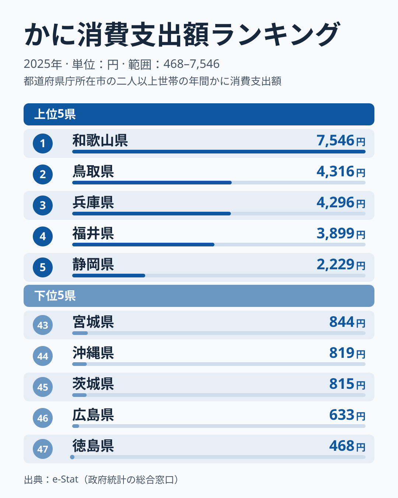
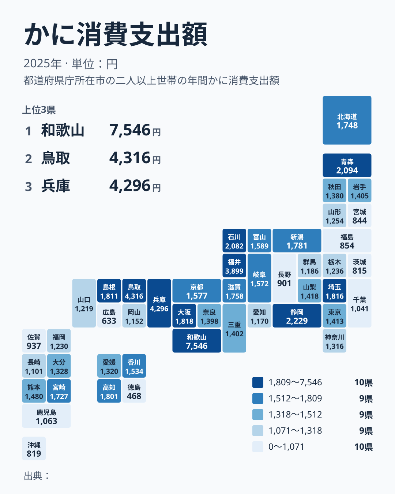

「かに」と聞いて多くの人が思い浮かべるのは、冬の日本海で水揚げされる松葉ガニや越前ガニではないでしょうか。総務省の家計調査によると、2025年の県庁所在市の1世帯あたりかに消費支出額は、最大の和歌山県7,546円と最小の徳島県468円で16.1倍の差があります。

首位は和歌山県で、2位が鳥取県4,316円、3位が兵庫県4,296円、4位が福井県3,899円です。かにの産地として知られる鳥取県や福井県は上位に入りましたが、首位ではありません。この記事ではその順位を、家計調査の単年のぶれという視点から読み解きます。

> [!NOTE]
> この統計は家計調査（総務省統計局）の、都道府県庁所在市の二人以上世帯における年間のかに消費支出額です。県全体の消費実態ではなく、県庁所在市の家計の平均である点に注意してください。

## 上位と下位の顔ぶれ

<source-link href="/ranking/crab-consumption-expenditure">かに消費支出額ランキングをもっと見る</source-link>

注目したいのは、首位の突出と2位以下の接戦の対比です。2位鳥取県4,316円と3位兵庫県4,296円の差はわずか20円で、4位福井県3,899円までを含めても、2位から4位は小さな幅に収まっています。これに対して1位の和歌山県7,546円は、2位の鳥取県を3,230円上回っています。

鳥取県と福井県は、松葉ガニ（ズワイガニ）や越前ガニの産地として知られています。産地として知られる県が上位に並んでおり、産地での消費の多さが一因かもしれません。ただし、今回のデータだけでは裏付けられない [仮説] です。魚介類全般の消費傾向は[かつお・かき消費量の地域差を扱った記事](/blog/bonito-vs-oyster-fish-map)でも詳しく取り上げています。

下位5県は、徳島県468円、広島県633円、茨城県815円、沖縄県819円、宮城県844円です。かには寒海性のズワイガニが中心の「冬の味覚」なので、沖縄県のように産地から遠く、気候的にも結びつきが弱い地域が下位に並ぶのは理解しやすい結果です。一方で徳島県、広島県、茨城県は海に面した県でありながら最下位グループに入っており、かにの消費は海の近さだけでは決まらないことがうかがえます。

## 和歌山の首位をどう読むか

和歌山県が首位になった理由を、データだけから断定することはできません。ここでは確かめられる事実と、確かめられていない仮説を分けて整理します。

確かめられる事実は、2025年の和歌山市の値が7,546円と、2位以下から大きく離れていることです。ただし、これは単年の値です。今回のデータだけでは、和歌山市が継続的に首位を保っているのか、この年だけ支出が膨らんだのかを区別できません。

[仮説] 単年の値が大きくぶれる理由の一つは、家計調査の標本の小ささです。県庁所在市ごとの調査世帯は限られており、かにのように「年に数回、まとめて買う」高額な品目は、数世帯の購入が平均を大きく動かします。2025年に和歌山市が突出した理由までは、今回のデータでは切り分けられません。検証には、同じ品目を複数年で平均した値と、月別の購入頻度を確認する必要があります。

> [!TIP]
> 家計調査の市別の値を読むときは、単年の順位より「何年も上位に残っているか」を見るのがコツです。和歌山県や兵庫県のように、単年で大きく上位に出た県は、その順位だけでかに文化の強さを語ると外れる可能性があります。

## 上位10県の顔ぶれと大都市圏

地図にすると、上位10県は近畿3県（和歌山県、兵庫県、大阪府）、中部3県（福井県、静岡県、石川県）、中国2県（鳥取県、島根県）、北海道・東北1県（青森県）、関東1県（埼玉県）と、地方をまたいで並んでいます。

大消費地を見ると、大阪府は8位1,818円、埼玉県は9位1,816円と上位に入っています。一方で東京都は22位1,413円、神奈川県は29位1,316円、愛知県は35位1,170円と中位から下位です。人口の多い都市圏でも、かにの消費に差があることは分かります。ただし1位と2位の差に比べると、8位の1,818円から35位の1,170円までの幅は小さく、中位は数百円の範囲に密集しています。

[北海道](/areas/01000)は14位1,748円で、毛ガニやタラバガニの産地でありながら上位10位には入りませんでした。[仮説] 北海道は地元で水揚げされたかにを、家計調査に表れにくい形で入手している場合や、道外への出荷・贈答に回る量が多い場合があり、県庁所在市である札幌市の家計の支出額としては突出しないのかもしれません。この点も、今回のデータでは検証できません。食に関する他の統計は[家計消費のカテゴリ一覧](/category/economy)でも横断的に確認できます。

> [!WARNING]
> 家計調査は都道府県庁所在市を対象にするため、産地であっても県庁所在市から離れた漁村部の消費実態は反映されません。北海道のように漁業拠点が広域に分散する地域は、県庁所在市の数値だけで「かに文化の強さ」を測ると、実態からずれる場合があります。

## この記事でわかったこと

- 全国1位は和歌山県7,546円、最下位は徳島県468円で、16.1倍の差がある
- 2位鳥取県4,316円、3位兵庫県4,296円は20円差の接戦で、4位福井県3,899円が続く
- 和歌山市の値は単年のもので、2025年の首位を構造的な強さと読むのは早計
- 上位10県は近畿3県、中部3県、中国2県、北海道・東北1県、関東1県で、東京都22位、神奈川県29位、愛知県35位と大都市圏は中位から下位
- 北海道は産地でありながら14位にとどまるが、その理由は今回のデータでは確かめられない

## データについて

総務省統計局「家計調査（家計収支編）」の都道府県庁所在市別データ、2025年（暦年）の二人以上世帯のかに年間支出額を使っています。市別の値は標本が小さく、単年のぶれが大きい点に留意してください。
