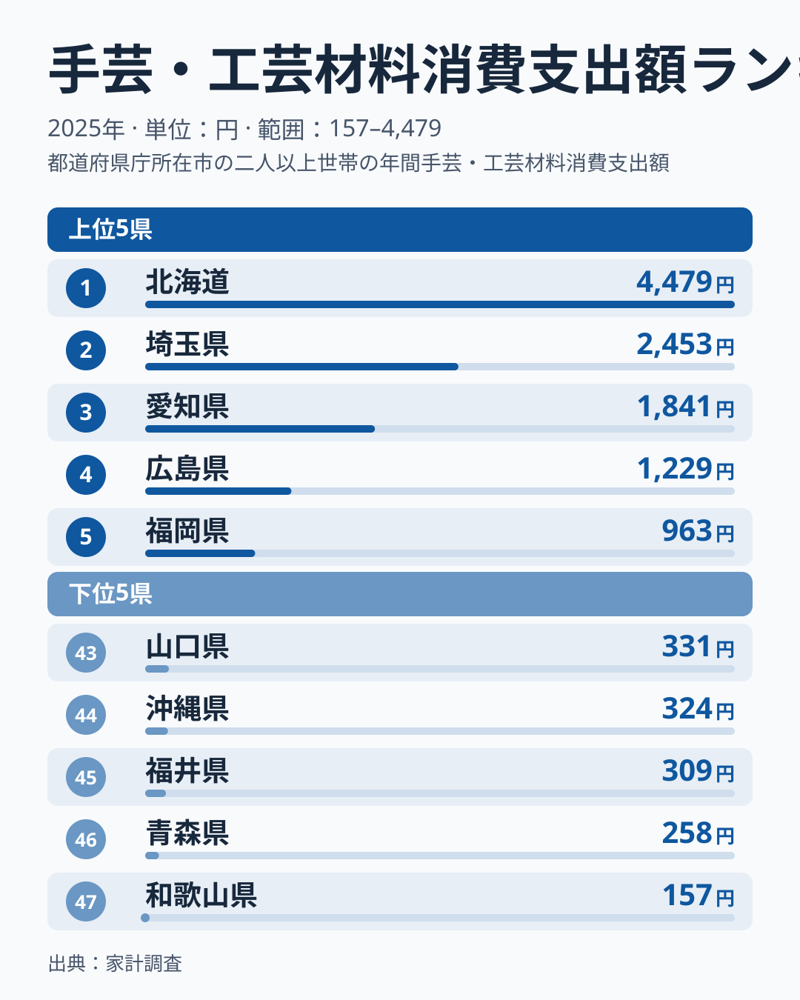
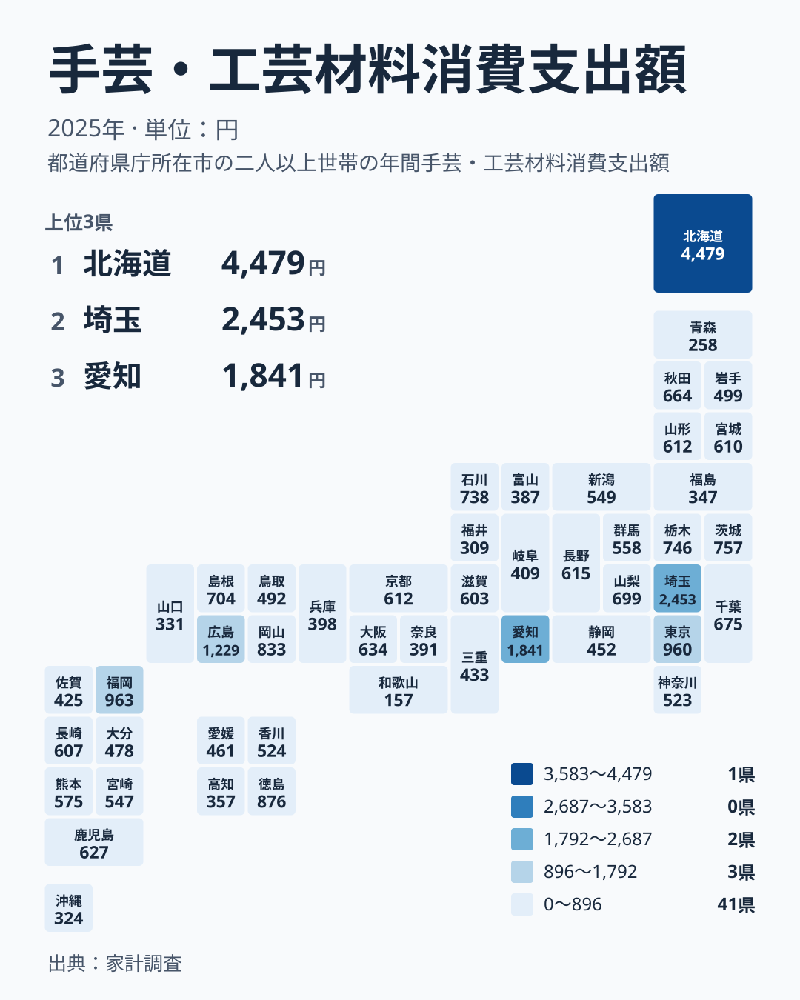

毛糸、布、ビーズ、木工の材料。手芸や工芸の材料に、家庭はどれくらいお金を使っているのでしょうか。2025年の家計調査では、この支出額が都道府県によって大きく開いていました。

この記事では、支出額の順位を地方ごとに見直し、数字の裏にある暮らしの違いを考えます。趣味の支出は生活必需品と違い、気候、住まい、世帯の過ごし方がそのまま表れやすい項目です。

## 1位の北海道と最下位の和歌山県に、大きな開きがあります

まずランキングの両端を確認します。上位5と下位5を並べた図が次のものです。

<source-link href="/ranking/craft-materials-consumption-expenditure">手芸・工芸材料への支出ランキングをもっと見る</source-link>

1位は北海道で4,479円です。2位の埼玉県は2,453円、3位の愛知県は1,841円、4位の広島県は1,229円、5位の福岡県は963円と続きます。北海道は2位の埼玉県に対しても大きく離れており、ひとつだけ突き抜けた存在です。

一方、下位は和歌山県が157円で47位です。46位の青森県は258円、45位の福井県は309円、44位の沖縄県は324円、43位の山口県は331円でした。1位の北海道と47位の和歌山県を比べると、4,479円と157円という大きな差があります。

上位5県の顔ぶれは、北海道・東北、関東、中部、中国、九州・沖縄とすべて別の地方に属しています。下位5県も東北、中部、九州・沖縄、中国、近畿に散らばっています。つまり「西日本が多い」「東日本が少ない」といった単純な構図ではありません。地方ごとに分けて見ていく必要があります。

> [!NOTE]
> ここで扱う「手芸・工芸材料への支出」は、家計調査の「手芸・工芸材料消費支出額」です。毛糸や布地、手芸用品、工芸の材料などへの年間の支出額を、1世帯あたりの円で示したものです。完成品の衣類や雑貨の購入は含みません。「作るための材料」だけを見ている点に注意してください。

## 地方ごとに見ると、順位の並びが変わります

全体の順位を、地方のくくりで読み直してみます。

北海道・東北では、北海道が1位と突出しています。その一方で、秋田県は664円で15位、山形県は612円で19位、宮城県は610円で21位と中位に収まります。岩手県は499円で30位、福島県は347円で42位、青森県は258円で46位です。同じ地方の中で、1位と46位が同居しています。

関東では、埼玉県が2,453円で2位、東京都が960円で6位です。茨城県は757円で9位、栃木県は746円で10位、千葉県は675円で14位と、上位から中位に並びます。群馬県は558円で25位、神奈川県は523円で29位でした。全体として、関東は上位寄りに位置する地方です。

中部は振れ幅が大きい地方です。愛知県が1,841円で3位、石川県が738円で11位、山梨県が699円で13位です。長野県は615円で18位、新潟県は549円で26位、静岡県は452円で34位、岐阜県は409円で37位、富山県は387円で40位でした。福井県は309円で45位です。

近畿は全体に控えめです。大阪府は634円で16位、京都府は612円で20位、滋賀県は603円で23位と中位ですが、三重県は433円で35位、兵庫県は398円で38位、奈良県は391円で39位です。そして和歌山県が157円で最下位です。

中国は、広島県が1,229円で4位、岡山県が833円で8位、島根県が704円で12位と上位に集まります。鳥取県は492円で31位、山口県は331円で43位でした。

四国は、徳島県が876円で7位と健闘し、香川県は524円で28位、愛媛県は461円で33位、高知県は357円で41位です。九州・沖縄は、福岡県が963円で5位、鹿児島県が627円で17位、長崎県が607円で22位、熊本県が575円で24位、宮崎県が547円で27位です。大分県は478円で32位、佐賀県は425円で36位、沖縄県は324円で44位でした。

## 地理分布で見ると、きれいな地域差は出ません

都道府県の位置関係を、タイルマップで確認します。

地図にすると、色の濃い県が一箇所に固まっていないことが分かります。北海道、埼玉県、愛知県、広島県、福岡県という上位の県が、列島に点々と散らばっています。気候や地方で一括りにできる分布ではないということです。

この散らばり方は、読み方を少し変える手がかりになります。「寒い地方だから編み物が盛ん」といった説明を当てはめたくなりますが、東北の青森県は46位、福島県は42位です。寒さだけでは説明がつきません。むしろ、大きな都市圏や手芸店が身近にある地域、教室や講座など趣味の場が整っている地域が上位に出やすい可能性があります。ただし、この仮説を今回のデータだけで確かめることはできません。

もうひとつの見方は、上位県の中でも性格が違うという点です。北海道は水準が飛び抜けていますが、これは少数の世帯が大きな買い物をした影響を受けている可能性があります。広島県や徳島県、岡山県のように、大都市圏でなくても上位に入る県もあります。生活に近い趣味として根づいている地域があるのかもしれません。

> [!WARNING]
> 家計調査は全国の世帯から抽出した限られた標本を対象にしています。手芸・工芸材料のように、買う世帯と買わない世帯の差が大きい項目は、年ごとの変動が出やすい性質があります。2025年だけの順位をそのまま「その県の恒常的な性格」と読むのは避けてください。特に1位の北海道と最下位の和歌山県の数字は、標本の影響を受けている可能性があります。

## 暮らしの側から読むと、何が見えるか

数字を生活の側に引き寄せて考えてみます。手芸や工芸の材料費は、生活に必須の支出ではありません。だからこそ、世帯に時間と気持ちの余裕があるか、家の中で作る習慣があるか、近くに材料を買える店があるかといった条件が、そのまま表れやすい項目です。

材料費が多い地域では、家庭で衣類や小物を作ったり、趣味として続けたりする人が相対的に多いと想像できます。逆に和歌山県のように低い地域でも、手芸をしていないとは限りません。既にある材料を使い回している、あるいは別の場所で購入しているといった事情も考えられます。支出額が低いことは、関心が低いことと同じ意味ではありません。

住んでいる地域の水準を知ると、自分の暮らしの見直しにも役立ちます。手芸を始めたい人にとっては、材料の入手しやすさや教室の有無を調べる際の目安になります。店や講座を考える立場では、支出水準が高い地域の方が需要を見込みやすいという判断材料にもなります。

> [!TIP]
> 順位の差を読むときは、1位との差だけでなく、中位がどれだけ固まっているかも見てください。この指標では、15位の秋田県が664円、19位の山形県が612円、20位の京都府が612円、21位の宮城県が610円と、中位は数円から数十円の差で密集しています。上位と下位の端だけが極端に離れており、中位同士の順位の入れ替わりは誤差の範囲かもしれません。

## 上位の県から見える手がかり

上位に入った県を、もう一度見てみます。

- 北海道は4,479円で1位です。水準が突出しており、地方の中でも特別な位置にあります。
- 埼玉県は2,453円で2位です。東京都の960円で6位を大きく上回っています。同じ首都圏でも、順位に大きな違いがあります。
- 愛知県は1,841円で3位です。中部の中で飛び抜けており、同じ中部の石川県は738円で11位でした。
- 広島県は1,229円で4位です。中国の中で最も高く、2位の岡山県は833円で8位でした。
- 福岡県は963円で5位です。九州・沖縄の中では最も高い水準でした。

ここから言えるのは、各地方に「その地方の代表格」が一つずつ存在する、という点です。地方の平均的な傾向というより、特定の県が強く押し上げている構図に見えます。

首都圏の中で埼玉県と東京都、神奈川県の水準が異なる点も見逃せません。東京都は960円で6位、神奈川県は523円で29位で、同じ人口の多い都市圏でも差が出ました。人口の多さが、そのまま支出額の多さにつながるわけではありません。住まいの広さや、家で過ごす時間、趣味への向き合い方の違いが影響していると考えられます。

## 今後の注目点

今回の結果から、次の点を押さえておくと便利です。

- 地方単位で一括りにせず、県ごとの違いを見ることが大切です。
- 上位と下位の両端は標本の影響を受けやすいため、複数年で確認する必要があります。
- 同じ地方の中でも、順位が大きく離れる県があります。

同じカテゴリの他の統計も合わせて確認すると、暮らしのどの面が地域差を生んでいるのかが見えてきます。[同じカテゴリの統計一覧](/category/economy)も参考にしてください。個別の県の詳しい数字は、[北海道のデータ](/areas/01000)と[埼玉県のデータ](/areas/11000)で確認できます。

## データについて

この記事で使った統計は、家計調査の「手芸・工芸材料消費支出額」の2025年の値で、単位は円です。家計調査は、世帯の収入と支出を継続的に調べる統計で、都道府県別の値は主に県庁所在市などを単位に集計されています。そのため、県全体の平均ではなく、都市部の世帯の様子が強く反映される点に注意が必要です。

本文中の順位と金額は、すべて上記の実データに掲載された値をそのまま使っています。平均や倍率などの追加の計算は行っていません。
