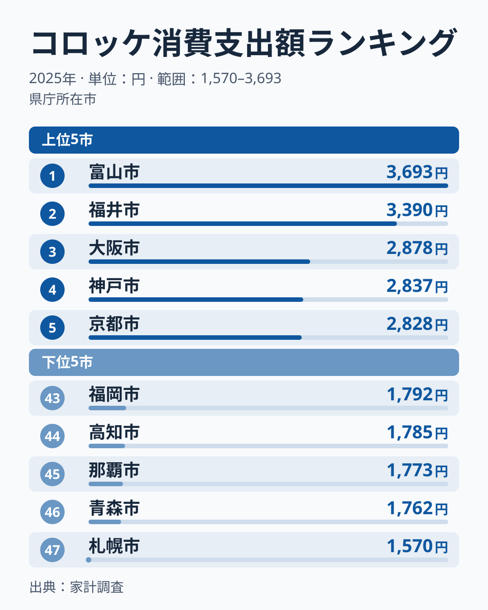
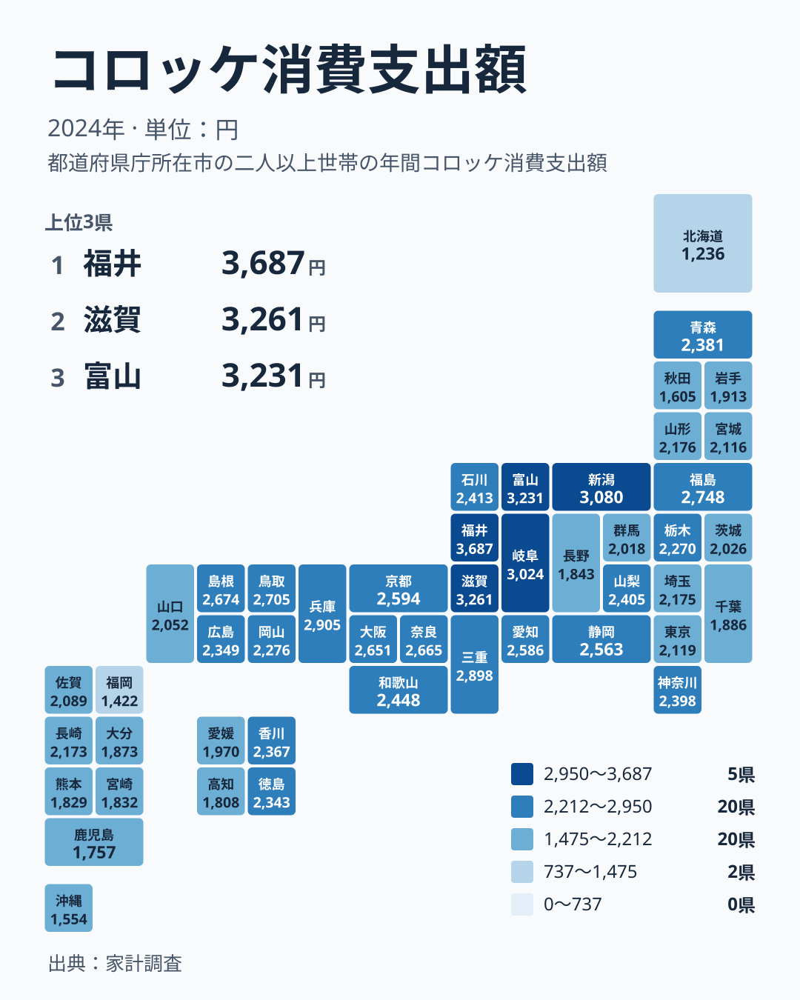

総菜売り場の定番であるコロッケも、1年に買う金額は住む都市でかなり違います。家計調査の2025年の値では、富山市の世帯が年3,693円で最も多く、最も少ない北海道の札幌市の1,570円と比べると約2.4倍です。

この記事の値は、家計調査の二人以上の世帯について、都道府県庁所在市ごとに集計した1世帯当たりの年間支出額です。県全体の値ではないため、本文では「富山市の世帯」のように都市の名前で書きます。東京都の値は東京都区部の値です。

上位には北陸と近畿の都市が並びますが、前年の2024年と比べると順位が20以上動いた都市もあります。この記事では、2025年のランキングと地図で差の大きさを確かめたうえで、2020年から2025年までの6年分の順位を並べ、毎年変わらない傾向と、その年だけの上下を分けて読みます。

## 2025年の上位と下位

<source-link href="/ranking/croquette-consumption-expenditure">コロッケ消費支出額ランキングをもっと見る</source-link>

2025年の1位は富山市で3,693円、2位は福井市で3,390円です。3位の大阪市は2,878円で、2位の福井市との間には512円の開きがあります。その後は神戸市（兵庫県）が2,837円、京都市が2,828円、大津市（滋賀県）が2,813円と近畿の都市が続き、10位の岐阜市は2,634円です。3位から10位までの8都市の差は合わせて244円しかなく、富山市と福井市の2都市だけが一段高い形になっています。

下位を見ると、最も少ないのは札幌市（北海道）の1,570円で、46位は青森市の1,762円、45位は那覇市（沖縄県）の1,773円、44位は高知市の1,785円、43位は福岡市の1,792円です。43位から46位までの4都市の差は30円しかなく、札幌市だけがそこから192円低い位置にあります。上位の富山市・福井市と下位の札幌市が、それぞれ全体の並びから外れた端にいることが、2.4倍という差の大部分を作っています。

大都市どうしを比べると、大阪市は3位ですが、東京都区部は2,067円で33位です。人口の大きい都市がそろって多いわけでも少ないわけでもなく、都市の規模だけではこの並びを説明できません。上位と下位のどちらにも、規模の大きい都市と小さい都市が混ざっています。

## 地図で見る分布

地図で色が濃いのは、北陸から近畿にかけての一帯です。近畿の7府県の県庁所在市は、3位の大阪市から18位の和歌山市まで、すべて上位18都市に入っています。北陸3県（富山・石川・福井）の県庁所在市も、1位、2位、7位と上位にそろっています。

ただし、同じ中部地方でも内陸の都市は違う位置にあります。甲府市（山梨県）は34位、長野市は36位で、北陸の3市とは大きく離れています。中部地方をひとまとめにして「コロッケに多く支出する地域」と書くことはできず、濃い色は北陸と近畿に限られます。上位10都市には、ほかに8位の高松市（香川県）と9位の宇都宮市（栃木県）も入っており、北陸と近畿だけで上位が埋まっているわけでもありません。

色が薄い側では、下位10都市のうち5都市が九州・沖縄の県庁所在市です。福岡市、佐賀市、大分市、鹿児島市、那覇市がここに入ります。一方で東北の6市は、13位の仙台市（宮城県）から46位の青森市まで広く散らばっています。福島市は20位、山形市は19位と中位にあり、東北をひとくくりにして少ない地域と呼ぶことはできません。地方の名前でまとめるより、都市ごとに位置を見るほうが実態に近い分布です。

## 6年分の順位で見る、変わらない差と揺れ

2025年の顔ぶれは、前年の2024年とかなり違います。福井市は2024年には1位、大津市（滋賀県）は2024年に2位、富山市は2024年に3位で、2025年に3位だった大阪市は2024年には12位でした。逆に青森市は2024年の20位から2025年の46位へ、鳥取市は9位から29位へと大きく順位を下げています。上位5都市のうち2年続けて入ったのは、富山市と福井市の2都市だけです。

そこで2020年から2025年までの6年分の順位を並べると、毎年変わらない部分が見えてきます。福井市は6年とも3位以内に入り、富山市も6年とも4位以内です。下位の側では、札幌市が6年とも43位以下で、2020年、2024年、2025年は最下位でした。那覇市も6年とも45位か46位にいます。この4都市の位置は、1年だけの偶然ではなく、6年続けて同じ側にある差です。

反対に、大阪市が12位から3位へ、青森市が20位から46位へ動いたように、1年で大きく動いた都市は、その年の順位だけで「多い都市」「少ない都市」と決めると読み違えます。家計調査は各都市の一部の世帯を調べる標本調査なので、1年だけの値には、その年に調べた世帯の違いによる揺れが含まれえます。ある都市の順位を引用するときは、前後の年も確かめてから使うのが安全です。

> [!NOTE]
> 家計調査の品目分類で、コロッケは「調理食品」のうちの「他の調理食品」に入る品目です。数えているのは出来上がったコロッケを買った金額で、冷凍の調理食品は「冷凍調理食品」という別の品目、外食は「外食」という別の費目で集計されます。材料を買って家で作った分は、この品目には入りません。

## なぜ北陸と近畿で多いのかは、この統計では決められない

富山市と福井市が6年続けて上位にいることは確かですが、その理由はこの統計からは決められません。この品目は買った金額だけを数えるので、総菜をよく買う習慣があるのか、1個の値段が高いのか、家で作る家庭が少ないのかを区別できないためです。同じ家計調査で揚げ物や総菜全体への支出を並べれば、コロッケだけが多いのか、総菜全体が多いのかは確かめられます。

札幌市の少なさも同じで、コロッケを食べる量が少ないのか、出来上がったものを買わずに作っているのかは、この支出額だけでは分かりません。原料のじゃがいもの産地であることと結びつけたくなりますが、この記事のデータにはその関係を確かめる値がないため、理由としては挙げません。

コロッケ以外の家計の支出を見比べたい場合は[経済の統計一覧](/category/economy)が参考になります。1位の[富山県のデータ](/areas/16000)や、2位の[福井県のデータ](/areas/18000)もあわせてご覧ください。

## まとめ

2025年のコロッケ消費支出額は、富山市の3,693円から札幌市の1,570円まで、約2.4倍の開きがあります。上位は富山市と福井市が一段高く、近畿の7府県の県庁所在市はすべて上位18都市に入りました。下位10都市の半分は九州・沖縄の都市で、東北の都市は上位から下位まで散らばっています。

6年分の順位を並べると、福井市と富山市が毎年上位、札幌市と那覇市が毎年下位という形は変わりません。一方で青森市や鳥取市のように1年で20位以上動く都市もあるため、1年の順位だけで都市の特徴を語らず、続いている差と揺れを分けて読むことが大切です。
