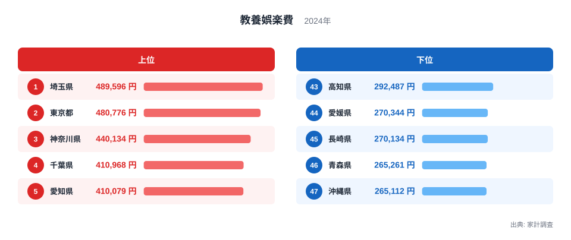
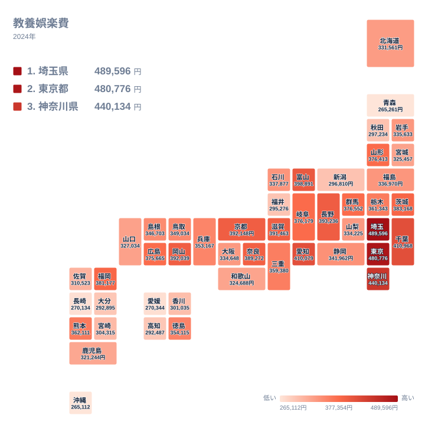

## 教養娯楽費で首位に立つのはどこか

書籍、映画、習い事、ゲーム、スポーツ用品など、暮らしを楽しむための支出は、地域の個性が出やすい分野です。2024年の家計調査で、教養娯楽費が最も多かったのは埼玉県で、489,596円でした。2位は東京都の480,776円、3位は神奈川県の440,134円です。上位3位までを関東の都県が占めています。

最下位の47位は沖縄県の265,112円です。首位の埼玉県との比は約1.85倍で、金額の差は224,484円になります。46位の青森県が265,261円、45位の長崎県が270,134円と続き、下位は互いに近い水準で並んでいます。

この記事では、実データから確かめられる範囲で、上位と下位の顔ぶれ、地域ごとの散らばりを整理します。理由については、データだけでは確かめられない部分を仮説として区別しながら考えます。最初に、上位5県と下位5県を図で確認します。

<source-link href="/ranking/culture-recreation-expenditure-total">教養娯楽費ランキングをもっと見る</source-link>

上位5県は、埼玉県、東京都、神奈川県、千葉県、愛知県の順です。4位の千葉県は410,968円、5位の愛知県は410,079円で、この2県はほぼ並んでいます。一方、3位の神奈川県は440,134円なので、3位と4位のあいだには比較的大きな段差があります。

下位5県は、高知県、愛媛県、長崎県、青森県、沖縄県です。高知県は43位で292,487円、愛媛県は44位で270,344円でした。所在する地方は、四国、九州・沖縄、北海道・東北に分かれており、下位の顔ぶれに共通項は見いだしにくいと言えます。四国の中でも、徳島県は21位の354,115円、香川県は38位の301,035円と、県ごとの差は小さくありません。

> [!NOTE]
> 教養娯楽費は、家計調査の支出区分のひとつです。学校の授業料などの教育費は別の項目で、この数字には入りません。一方、旅行や宿泊に関わる費用がどの区分に入るかは、調査の区分表によって扱いが異なります。自分が思い浮かべる「娯楽費」と範囲が違うことがあるので、含まれる範囲は調査の区分表で確認してから読んでください。

## 首都圏が上位に並ぶ背景を考える

首位の埼玉県と2位の東京都の詳細は、[埼玉県のデータ](/areas/11000)と[東京都のデータ](/areas/13000)で確認できます。東京都には劇場、映画館、書店、スポーツ施設などが集まっており、選択肢の多さが支出を押し上げているかもしれません。ただし、この記事のデータだけでは確かめられません。

注目したいのは、東京都より埼玉県のほうが上にある点です。都心から離れた郊外で、習い事やレジャー、趣味の道具に支出が厚くなっている可能性はありますが、これは実データから言える話ではなく、仮説にとどまります。

食文化や気候との結びつきについても、教養娯楽費そのものを使った裏付けは、この記事のデータにはありません。外食や食料品など関連する品目と並べて比べるには、別の統計が必要です。関連する統計は[同じカテゴリの統計一覧](/category/economy)から探せます。この記事で言えるのは、首位から3位までが関東に集まっているという事実までです。

## 地理分布で見る地域の偏り

次に、47都道府県の分布を地図で確認します。

地図から読み取れる結論は、同じ地方の中でも順位が大きく割れるということです。「関東は高い」「近畿は低い」といった地方単位の整理は、この指標ではうまく当てはまりません。

最も分かりやすいのは近畿です。京都府は8位の392,148円で、上位に入っています。ところが、同じ近畿の和歌山県は34位の324,688円で、順位は大きく離れています。同じ地方でも、これだけ位置が違います。

中部にも同じ傾向があります。富山県は6位の398,891円ですが、福井県は41位の295,276円です。地図の上では隣り合う地域でも、金額の水準はまったく違います。地方という大きなくくりでは、この散らばりを説明できません。

この指標を地図で眺めるときは、色の濃い地方を探すより、県ごとの差に目を向けるほうが実態に近づけます。

> [!TIP]
> 地図の濃淡を読むときは、順位の差だけでなく金額の差にも目を向けてください。たとえば8位の京都府は392,148円、9位の岡山県は392,039円で、順位は違ってもほとんど差がありません。順位の小さな入れ替わりに注目しすぎず、まとまりで眺めるのが読み解くコツです。

## 大都市なのに低い大阪府と、地方で高い県たち

この指標で目を引くのは、大阪府の位置です。大阪府は29位の334,648円で、同じ近畿の兵庫県の22位、353,167円よりも下にあります。京都府、奈良県、滋賀県が上位に入っていることを考えると、近畿の中で大阪府は低めに見えます。理由は、このデータだけでは分かりません。

一方で、地方にも上位に入る県があります。岡山県は9位の392,039円、山形県は15位の376,413円、広島県は17位の375,665円、熊本県は18位の362,111円です。福岡県は13位の381,177円で、九州・沖縄では最も高い順位です。

つまり、教養娯楽費は大都市だけで決まる指標ではないようです。住まいの広さや地域の行楽、スポーツの文化が関わっているかもしれませんが、この記事のデータからは確かめられません。順位だけを根拠に、暮らしの豊かさを断定することは避けたいところです。

> [!WARNING]
> 下位は順位より水準で読んでください。45位の長崎県は270,134円、46位の青森県は265,261円、47位の沖縄県は265,112円で、下位3県は270,000円から265,000円ほどの狭い範囲に集まっています。とくに青森県と沖縄県は金額がほとんど同じで、1円刻みの順位に意味を持たせるのは危険です。最下位だからといって、沖縄県だけが特別に低いとは読めません。

## 下位の県を見るときの注意点

下位の県を地方で見ると、九州・沖縄の長崎県と沖縄県、北海道・東北の青森県、四国の高知県と愛媛県です。5県は離れた地方に散らばっており、同じ地理的条件でくくることはできません。

沖縄県は最下位ですが、これは娯楽を楽しんでいないという意味ではありません。海や自然の中で過ごす時間が長く、費用のかからない楽しみ方が中心のため支出に表れにくい、という可能性も考えられます。ただし、この記事のデータだけでは確かめられません。

北海道・東北を見ると、北海道は31位の331,561円、宮城県は33位の325,457円、秋田県は39位の297,234円、青森県は46位の265,261円です。同じ地方でも、岩手県は28位の335,633円、山形県は15位の376,413円と差がついています。寒さや雪の影響を想像したくなりますが、地方内の散らばりが大きく、地方ごとに一括りで説明するのは難しそうです。

## まとめ 数字の差と読み方

2024年の教養娯楽費は、首位が埼玉県の489,596円、最下位が沖縄県の265,112円で、その比は約1.85倍でした。上位には関東の4都県に加えて愛知県、富山県、長野県、京都府などが並び、下位には長崎県、青森県、沖縄県などが入っています。

ただし、都市部が高く地方が低いという単純な図式では収まりません。大阪府が29位、岡山県が9位、山形県が15位という結果は、順位が大都市かどうかだけでは説明しにくいことを示しています。背景として、住まい、交通環境、地域の文化などが関わる可能性はありますが、確かめるには別の統計が必要です。

この指標は、各県の豊かさをそのまま測るものではありません。教養娯楽にいくら支出したかを示す数字として、含まれる範囲や、下位で金額が近接している点を踏まえて読むのが適切です。

## データについて

この記事は、家計調査における2024年の「教養娯楽費」を使っています。単位は円で、順位は金額の大きい順に付けています。値は名目額であり、物価の変動による影響は調整されていません。首位と最下位の比は、埼玉県の489,596円を沖縄県の265,112円で割った値です。
