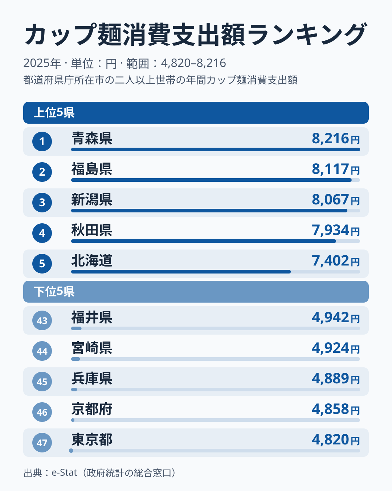

1世帯あたりのカップ麺消費支出額は、都道府県によって最大1.7倍の差があります。総務省家計調査(2025年)によると、1位の青森県は年間8,216円、最下位の東京都は4,820円でした。

とくに目を引くのは、上位5位が青森・福島・新潟・秋田・北海道という雪の多い寒冷な地域で占められている点です。ただし、この並びの理由をデータだけで断定することはできません。この記事では、家計調査のデータから見える構造と、気候だけでは説明できない点を整理します。

## 上位と下位の県

図で目立つのは、5位の北海道7,402円と6位の鳥取6,891円のあいだにある511円の段差です。1位青森8,216円から4位秋田7,934円までは差が282円に収まっており、上位5位はひとかたまりで、6位以下とは水準が分かれています。10位以内には、青森・福島・秋田・北海道・山形・宮城の6道県が入っています。この6道県は、すべて北海道・東北の道県です。一方、3位の新潟は中部に含まれるため、この6道県には数えていません。

> [!NOTE]
> この統計は「消費支出額」であり「消費量(個数)」ではありません。価格差や購入する商品の単価差も含むため、支出額の差が購入量の差とは限りません。

一方で下位を見ると、47位東京4,820円、46位京都4,858円、45位兵庫4,889円、44位宮崎4,924円、43位福井4,942円と、下位5県の差はわずか122円に収まっています。東京・京都・兵庫は人口の多い都市部を抱え、外食・中食の選択肢が豊富なためと推測されますが、データで確かめたものではありません。また宮崎・福井も下位にあり、都市部という要因だけでは足りません。全県の順位は[カップ麺消費支出額ランキング](/ranking/cup-noodles-consumption-expenditure)で確認できます。

<source-link href="/ranking/cup-noodles-consumption-expenditure">カップ麺消費支出額ランキングをもっと見る</source-link>

## 寒冷地に集中する理由

上位5位を寒冷地が占める偏りは、偶然とは言い切れません。[仮説]として考えられるのは、冬季の厳しい寒さです。カップ麺は熱湯を注ぐだけで温かい食事が短時間で用意でき、雪や凍結で外出が難しい日でも自宅で完結します。積雪期間が長い青森・新潟・福島・秋田・北海道といった地域で支出額が高いのは、この即時性・保存性の価値が反映されている可能性がありますが、この記事のデータで検証できるものではありません。

> [!TIP]
> 気候と即席麺の関係を見るなら、[即席麺の消費量ランキング](/blog/instant-noodles-consumption-prefecture-gap)も合わせて確認すると、同じ寒冷地パターンが再現されるかどうかを比較できます。

<source-link href="/blog/instant-noodles-consumption-prefecture-gap">即席麺の消費量ランキングの記事を読む</source-link>

もう一つの視点は価格と利便性です。カップ麺は調理の手間がほとんどかからず、必要な分だけをすぐ用意できます。[仮説]として、単身世帯や高齢者世帯の比率が高い地方では、大量の食材をまとめ買いして調理するより、この利便性が評価されやすいとも考えられます。家計全体の支出水準との関係も同様に[仮説]の域を出ず、この記事のデータでは確かめられません。

> [!WARNING]
> 世帯構成(単身世帯の割合)や共働き率、外食産業の集積度など、さまざまな要因が絡んでいる可能性があります。ここで挙げた理由はいずれも[仮説]として捉えてください。厳密な検証には世帯属性別のクロス集計が必要です。

## 寒冷地だけでは説明できない上位と、東北内の差

「寒冷地=カップ麺消費が多い」という仮説だけでは、2025年の順位の全体像には届きません。6位の鳥取は6,891円、7位の佐賀は6,802円、10位の長崎は6,730円で、鳥取は中国、佐賀と長崎は九州・沖縄の県です。また同じ東北でも、岩手は13位の6,452円で、1位の青森と1,764円の差があります。

家計調査の都道府県別の値は、県庁所在市の二人以上の世帯を対象にした標本調査の集計で、県全体の値ではありません。単年では標本のぶれの影響を受けやすい数字です。そのため、鳥取・佐賀・長崎の高さを地域の食習慣と決めつけるのは避けます。[仮説]として、気候以外に、世帯構成や、カップ麺の購入が多い小売チャネルの違いが影響している可能性がありますが、検証には複数年の推移と世帯属性別の集計が必要です。

家計全体の消費支出額の地域差を見たい場合は、関連記事の[生活費が高い県ランキング](/blog/household-consumption-expenditure-ranking)も参考になります。カップ麺だけでなく食料費全体の傾向を照らし合わせることで、地域ごとの家計構造がより立体的に見えてきます。

## まとめ

- 1位は青森県 8,216円、47位は東京都 4,820円で、1.7倍の差
- 上位5位は青森・福島・新潟・秋田・北海道で、寒冷地への偏りが見られるが、理由は断定できない
- 5位北海道7,402円と6位鳥取6,891円のあいだに511円の段差がある
- 下位は東京・京都・兵庫など都市部の県が中心だが、宮崎・福井も含まれる
- 積雪・寒冷という気候要因に加え、世帯構成や食文化の違いも背景にあると考えられる[仮説]
- 鳥取が6位、佐賀が7位、長崎が10位のように寒冷地以外も上位に入り、単年の順位から構造は断定できない

## データについて

総務省統計局「家計調査」(2025年、都道府県庁所在市および政令指定都市)をもとに、e-Stat(政府統計の総合窓口)経由で集計しました。
