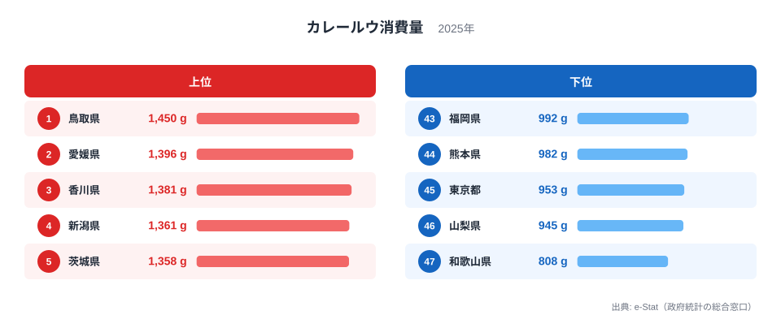

「国民食」と呼ばれるカレー。どの家の食卓にも並ぶ料理だからこそ、買うルウの量に県ごとの差があるとは想像しにくいものです。2025年の家計調査で、カレールウの年間購入数量(県庁所在市の二人以上世帯)を47都道府県で並べると、1位は鳥取県の1,450gでした。最下位は和歌山県の808gで、差は642g、倍率は**1.79倍**です。

注目したいのは、上位の並びの詰まり方です。1位から5位までの差は92gしかなく、順位の細かな違いをそのまま食文化の差と読むのは危険です。この記事では2025年の順位を示したうえで、標本調査の数字をどう読めばよいかを考えます。

> [!NOTE]
> ここでの「カレールウ消費量」は、家計調査における**都道府県庁所在市の二人以上世帯**が1年間に購入したルウの**数量(g)**です。支出額ではありません。県全体の値でも、外食やレトルトカレーを含む値でもなく、「家でルウを買って作る量」を測る指標です。

## カレールウ購入数量ランキング──上位5県と下位5県

2025年の首位は鳥取県の1,450gで、愛媛県が1,396g、香川県が1,381g、新潟県が1,361g、茨城県が1,358gと続きます。首位から5番目までの差は92gにとどまり、突出した県がない横並びの上位です。顔ぶれは山陰の鳥取県、四国の愛媛県・香川県、そして新潟県・茨城県と地域が散らばっており、「雪国が多い」「西日本が多い」と一言で括れる並びではありません。

6位以下にも富山県が1,335g、群馬県が1,329g、徳島県が1,323g、鹿児島県が1,312g、石川県が1,311gと続き、10位までが1,311g以上の狭い範囲に収まっています。順位が1つ違うだけで値の差は数gから数十gしかない箇所が多く、標本調査である家計調査では、カレールウ消費量のこの差が実際の消費習慣の違いを表すとは限りません。

<source-link href="/ranking/curry-roux-consumption-quantity">カレールウ消費量ランキングをもっと見る</source-link>

## 下位グループ──和歌山が808gで最下位、東京も45位

図の下半分では、最下位が和歌山県の808gです。その上に山梨県が945g、東京都が953g、熊本県が982g、福岡県が992gで並びます。首位の鳥取県と比べると、和歌山県は約56%の量にとどまります。

和歌山県の808gは、一つ上の山梨県945gより137g低く、下位グループの中でも一段離れた外れ値です。上位5県の差が92gしかないことを考えると、この137gの開きは小さくありません。ただし家計調査は県庁所在市の限られた標本に基づくため、和歌山市の標本に購入量の少ない世帯が偶然多く含まれた可能性を排除できません。実際の食習慣の違いなのか標本のぶれなのかは、1年分の値からは判断できず、複数年で同じ位置にいるかの確認が必要です。

> [!TIP]
> 家計調査の県庁所在市は、限られた標本で調べる調査です。数gから数十g程度の差は、購入のタイミングや特売など偶然の要因でも動きます。順位の1つ2つの違いより、「上位帯・中位帯・下位帯のどこにいるか」と、複数年で同じ位置にいるかを見るほうが安全です。

## 発見：雪国・大都市圏の単純な図式は当てはまらない

「雪国や米どころでカレールウが多く、大都市圏で少ない」という見方は、直感的にはもっともらしく聞こえます。2025年の値で確かめてみます。

- 山形県は13位の1,266gです。
- 北海道は19位の1,178gです。
- 秋田県は26位の1,134g、宮城県は35位の1,059gで、東北が一様に多いわけではありません。
- 愛知県は20位の1,176gで中位です。
- 兵庫県は37位の1,028g、京都府は41位の1,005gで下位寄りです。

新潟県は4位ですが、同じ雪国でも秋田県は26位にとどまります。積雪や寒さだけでは並びを説明できません。

> [!NOTE]
> [仮説] 2025年の並びは、気候や都市度よりも、県庁所在市の標本に含まれる世帯構成や購入のタイミングといった偶然の要因の影響が大きい可能性があります。検証コマンドは、`curl -s https://storage.stats47.jp/app/ranking/curry-roux-consumption-quantity/values.json` で取得した値を、翌年以降の partition と照合することです。検証期日は2027年3月31日とし、その時点で2026年分が公表されていれば、2025年の上位5県のうち3県以上が2026年も10位以内に残る場合は地域性の仮説を支持し、2県以下しか残らない場合は標本のぶれの仮説を支持すると判定します。2026年分が未公表なら、期日を公表後に延ばします。

鳥取県の他の指標は、[鳥取県の地域プロフィール](/areas/31000)から確かめられます。カレールウの購入量だけで県の食習慣を断定してはいけないことがわかります。

## まとめ

- 2025年のカレールウ購入数量は、1位が**鳥取県の1,450g**、最下位が**和歌山県の808g**で、倍率は**1.79倍**です。
- 上位5県の差は1位から5位まで92gと小さく、順位の細かな差は標本のぶれを含みます。
- 和歌山県は次点の山梨県より137g低く、下位の中でも外れ値ですが、単年では実態かぶれかを区別できません。
- 東京都は45位、山梨県は46位、和歌山県は47位と、下位に並びます。

カレールウのような身近な品目でも、単年の順位は標本のぶれを含みます。数年分を重ねて読むことで、本当の地域差が見えてきます。ほかの食料品の傾向は、[食料消費に関する経済カテゴリ](/category/economy)のランキング群と並べて確かめてみてください。
