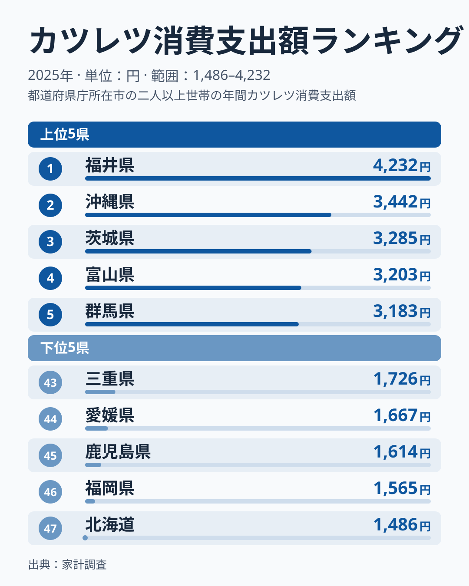
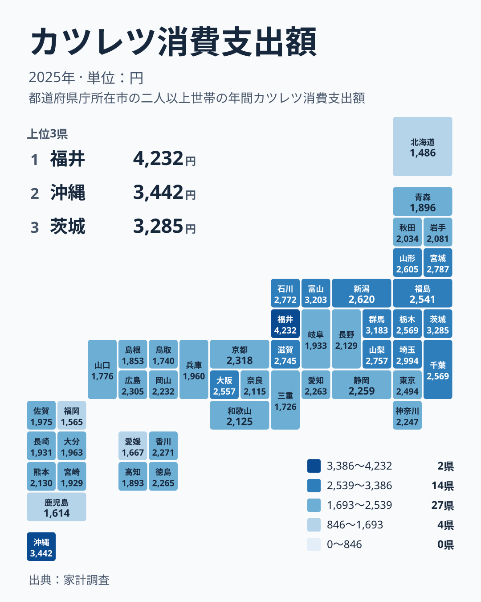

## カツレツへの支出に表れた地域差

カツレツは、肉に衣をつけて揚げる洋食です。食卓にすっかり定着していますが、家計が1年間にカツレツへ使う金額は、都道府県によって大きく異なります。

2025年の家計調査で首位になったのは福井県で、4,232円でした。沖縄県は3,442円で2位、茨城県は3,285円で3位、富山県は3,203円で4位、群馬県は3,183円で5位です。3位から5位までは金額がほとんど変わらず、先頭の福井県だけが一段高い位置にいます。

反対に、最も少なかったのは北海道の1,486円です。福岡県は1,565円で46位、鹿児島県は1,614円で45位でした。両端を比べると、4,232円と1,486円という大きな開きがあります。

この記事では、まず順位と金額の分布の形を確認し、次に地方ごとの散らばり方を見ます。そのうえで、福井県や沖縄県の高さについて、食文化に関する仮説をどこまで語れるかを整理します。ほかの経済系の統計と見比べたいときは、[同じカテゴリの統計一覧](/category/economy)も参照してください。

> [!NOTE]
> この指標は、家計が購入したカツレツへの支出額です。調査の対象は家計での購入で、外食の支出とは別に扱われます。「その県の人がカツレツをどれだけ食べているか」ではなく、「家計からどれだけ買われたか」を示す数字です。

## 上位と下位の顔ぶれ

上位5県と下位5県を、図で確認します。

<source-link href="/ranking/cutlet-consumption-expenditure">カツレツへの支出ランキングをもっと見る</source-link>

上位5県は、福井県、沖縄県、茨城県、富山県、群馬県です。このサイトの7区分で見ると、中部が福井県と富山県、関東が茨城県と群馬県、九州・沖縄が沖縄県です。上位は特定の一地方に集中していません。

下位5県は、北海道、福岡県、鹿児島県、愛媛県、三重県です。区分では北海道・東北が1県、九州・沖縄が2県、四国が1県、近畿が1県になります。こちらも地方の偏りは見られません。

注目したいのは分布の形です。下位は1,486円、1,565円、1,614円、1,667円、1,726円と、なだらかに続いています。最下位の北海道だけが飛び抜けて低いわけではありません。一方、上位は先頭の福井県と次の沖縄県のあいだに大きな段差があります。分布は、上が「首位だけが抜けている」形、下が「なだらかに続く」形と言えます。

## 福井県の突出をどう読むか

福井県の高さの理由は、この統計だけでは説明できません。家計調査が示すのは支出額で、どの料理のために使われたかまでは記録されていないからです。

そのうえで、ひとつの仮説を挙げます。福井県には、カツをご飯にのせて食べる名物の丼があることで知られています。こうした食べ方が日常にあれば、家庭でのカツレツ購入が増える、という筋書きは考えられます。ただし、これはデータで裏づけられた結論ではなく、あくまで仮説です。名物料理の存在と今回の金額を結びつける数字は、手元にありません。

> [!WARNING]
> カツレツは1品目だけの支出なので、1世帯あたりの年間額は小さくなります。調査対象の世帯数が限られる県では、購入の多い世帯が数世帯入るかどうかで平均が動き、順位にも響きやすくなります。とくに中位の県どうしは金額が詰まっているため、少しの誤差で順位が入れ替わります。順位の差より、金額の水準で読むほうが安全です。

福井県の背景を調べたいときは、[福井県のデータ](/areas/18000)で、ほかの指標と並べて県の特徴を確認できます。食や家計に関する指標を並べると、仮説を具体的に検討する手がかりになります。

## 地理分布に見る地方内のばらつき

続いて、地図上での分布を図で確認します。

地図で目を引くのは、色の濃い県と薄い県が、地方の境目できれいに分かれていないことです。同じ地方のなかでも、最高位の県と最低位の県のあいだに大きな開きがあります。

地方内の最高位と最低位を並べてみます。

- 関東は、茨城県が3位、神奈川県が24位です。
- 中部は、福井県が1位、岐阜県が35位です。
- 近畿は、滋賀県が10位、三重県が43位です。
- 中国は、広島県が19位、鳥取県が42位です。
- 四国は、香川県が20位、愛媛県が44位です。
- 九州・沖縄は、沖縄県が2位、福岡県が46位です。
- 北海道・東北は、宮城県が7位、北海道が47位です。

どの地方でも、最高位と最低位のあいだに20位以上の差があり、中部や九州・沖縄では40位近く離れています。関東は差がもっとも小さい部類ですが、それでも茨城県と神奈川県は金額で大きく開いています。「この地方だから高い」「この地方だから低い」とまとめることは、データからはできません。

東北に限ると、宮城県が7位、山形県が12位と上位に入る一方、青森県は38位まで下がります。同じ東北でも、県によって位置がまったく異なります。

## 沖縄県と、関連品目との対比

沖縄県は2位の3,442円です。沖縄県では豚肉料理が広く親しまれていることから、肉を使った惣菜の購入が多いのではないか、という見方があります。ただし、これも今回の統計から確かめられる内容ではなく、仮説にとどまります。同じ九州・沖縄でも、福岡県は46位、鹿児島県は45位であり、地方全体で説明できる話ではありません。[沖縄県のデータ](/areas/47000)を見ると、ほかの指標との関係も調べられます。

関連品目との対比もしておきます。カツレツは、とんかつやメンチカツ、コロッケなどと同じ揚げ物の仲間です。ただし、この記事で使っているデータはカツレツ1品目だけなので、ほかの揚げ物と数字で比べることはできません。カツレツの順位が高い県で、ほかの揚げ物も多く買われているかどうかは、品目ごとのランキングを並べて確かめる必要があります。

> [!TIP]
> 順位だけでなく、金額の差を見てください。栃木県と千葉県はどちらも2,569円で同額です。順位が隣り合っていても、実質的な差がない場合があります。逆に、首位の福井県と沖縄県のように、順位が隣でも金額が大きく離れていることもあります。順位は「並び」、金額は「距離」を示すと考えると読み違えません。

## 結果をどう受け止めるか

ここまでの内容を整理します。データから確かに言えるのは、次の3点です。

- 福井県が4,232円で首位、北海道が1,486円で最下位であること。
- 上位は先頭だけが抜けた形、下位はなだらかに続く形であること。
- 同じ地方の中でも、最高位と最低位が大きく離れる例が多いこと。

一方で、「なぜその県が高いのか」「なぜ別の県が低いのか」は、この統計だけでは答えられません。食文化や産地の影響を想像することはできますが、検証には別の資料が必要です。この記事で挙げた名物料理や肉料理の話は、読み解きの手がかりとして置いた仮説です。

また、家庭での購入に限られるため、外食でとんかつを好む県と、家庭で調理品を買うことが多い県とでは、数字の意味が異なります。順位が低いことは、カツレツを食べていないことを意味しません。

## データについて

この記事で使った数字は、家計調査の2025年の結果にもとづく、カツレツ消費支出額です。単位は円で、1世帯あたりの年間の支出額です。都道府県別の値は調査対象となった世帯の傾向を示す数字で、県全体の消費をそのまま表すものではありません。

順位は金額の大きい順に付けています。同額の県がある場合は、順位の差を実質的な違いとみなさないでください。福井県の高さと北海道の低さは、2025年という一つの年の結果です。年ごとの推移を追うことで、はじめて安定した地域差かどうかが見えてきます。
