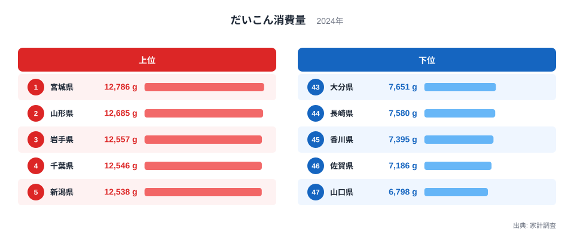
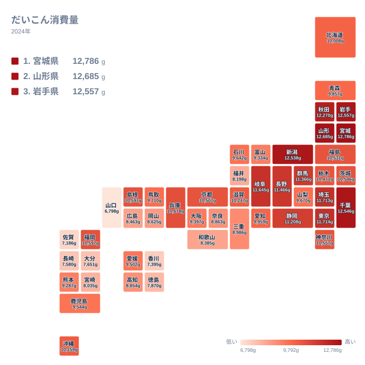

## だいこん消費量が最も多い県は？

冬の食卓に欠かせないだいこんは、煮物、おでん、味噌汁、漬物、大根おろしと、使い道の幅がとても広い野菜です。そのぶん家庭ごとの食べ方の違いが出やすく、県ごとの消費量にも差が現れます。2024年の家計調査で1位になったのは宮城県で、12,786gでした。2位は山形県の12,685g、3位は岩手県の12,557gで、上位3県を東北の県が占めています。

一方、最も少ないのは47位の山口県で、6,798gでした。1位の宮城県と47位の山口県の間には、1万2千g台と6千g台という大きな開きがあります。この記事では、実データにある値と順位を並べながら、どこに差があり、どう読めばよいのかを整理します。

> [!NOTE]
> ここでいう消費量は、家計調査で調べられた1世帯あたりの年間購入数量で、単位はgです。家庭で買って調理する量を見る指標なので、外食や給食で食べただいこんは含まれません。「県民がだいこんをどれだけ食べているか」そのものではなく、「家庭の買い物でどれだけ買われているか」を表している点に注意してください。

## 上位5県と下位5県を見る

まず、上位5県と下位5県を図で確認します。

<source-link href="/ranking/daikon-consumption-quantity">だいこん消費量ランキングをもっと見る</source-link>

上位5県は、1位の宮城県が12,786g、2位の山形県が12,685g、3位の岩手県が12,557g、4位の千葉県が12,546g、5位の新潟県が12,538gです。5県の値は12,538gから12,786gの範囲に収まっていて、団子のように固まっています。とくに3位の岩手県、4位の千葉県、5位の新潟県は、百gにも満たない間隔で並んでいます。この水準では、順位が1つ違うことに大きな意味を読み取るのは難しいといえます。

下位5県は、47位の山口県が6,798g、46位の佐賀県が7,186g、45位の香川県が7,395g、44位の長崎県が7,580g、43位の大分県が7,651gです。値は6,798gから7,651gまで広がっていて、上位5県の固まり方と比べると散らばりが大きく見えます。つまり、上位は「どの県も似たような高さ」であるのに対し、下位は「県ごとに低さの度合いが違う」という対照的な形です。

上位5県の最小値である12,538gと、下位5県の最大値である7,651gの間には、はっきりとした層の切れ目があります。この間に何県が入るかは、後の節で見ていきます。各県の詳しい数字は、[宮城県のデータ](/areas/04000)や[山形県のデータ](/areas/06000)のページでも確認できます。ほかの統計とあわせて読みたい方は、[同じカテゴリの統計一覧](/category/economy)も参考になります。

## 地理分布で見える東高西低の傾向

次に、47都道府県の分布を地図で見ます。

地図で目立つのは、東日本に濃い色が多いことです。上位10位までの県を順位つきで挙げます。

- 1位 宮城県(北海道・東北)
- 2位 山形県(北海道・東北)
- 3位 岩手県(北海道・東北)
- 4位 千葉県(関東)
- 5位 新潟県(中部)
- 6位 秋田県(北海道・東北)
- 7位 東京都(関東)
- 8位 埼玉県(関東)
- 9位 岐阜県(中部)
- 10位 長野県(中部)

地方ごとに数えると、北海道・東北が宮城県、山形県、岩手県、秋田県の4県、関東が千葉県、東京都、埼玉県の3県、中部が新潟県、岐阜県、長野県の3県です。合計は4県、3県、3県で10県になります。上位10県は、この3つの地方に収まっています。なお、すぐ下の11位は群馬県の11,366gで、関東にあたります。

下位10県は、38位から47位までを順に並べると次のとおりです。

- 38位 広島県(中国)
- 39位 和歌山県(近畿)
- 40位 福井県(中部)
- 41位 宮崎県(九州・沖縄)
- 42位 徳島県(四国)
- 43位 大分県(九州・沖縄)
- 44位 長崎県(九州・沖縄)
- 45位 香川県(四国)
- 46位 佐賀県(九州・沖縄)
- 47位 山口県(中国)

地方別では、九州・沖縄が宮崎県、大分県、長崎県、佐賀県の4県、中国が広島県と山口県の2県、四国が徳島県と香川県の2県、近畿が和歌山県の1県、中部が福井県の1県です。合計で10県になります。福井県は中部の県ですが、それ以外の9県は西日本にあたります。下位に目立つのは九州・沖縄、中国、四国の県で、中でも下位5県は全て西日本の県です。

ただし、例外もあります。島根県は14位で10,597g、福岡県は15位で同じく10,597gと、西日本でも上位半分に入っています。沖縄県も21位で10,259gです。東高西低は大づかみな見取り図であり、全ての県に当てはまるわけではありません。

> [!TIP]
> 順位表は、値の間隔とあわせて読むと誤読を避けられます。たとえば上位5県は12,538gから12,786gの範囲に収まっているため、4位と5位の入れ替わりは小さな違いで起こりえます。島根県と福岡県のように、順位が違っても表示された値が同じ10,597gの例もあります。順位の数字だけで優劣をつけず、値が近い県は「同じグループ」と考えるのがコツです。

## 食文化と気候から考える

では、なぜ東北の県が上位に並ぶのでしょうか。実データだけでは理由を確かめられませんが、仮説として考えられるのは、冬が長い地域で保存食の文化が育ってきたことです。だいこんは貯蔵がきき、干し大根、たくあん、各種の漬物、鍋物や煮物など、寒い季節の食べ方が多い野菜です。こうした食習慣が家庭の購入量を押し上げている可能性があります。

新潟県が5位の12,538g、長野県が10位の11,466gと、雪の多い地域や冷涼な内陸の県が上位に入っている点も気になります。寒冷な気候がだいこんの栽培や貯蔵と結びついているのかもしれませんが、これも推測の域を出ません。

千葉県が4位の12,546gである点も印象的です。野菜の産地が近いことが消費を支えている可能性はありますが、産地との関係を示す数値は今回の実データにはありません。東京都は7位の11,714g、埼玉県は8位の11,713gで、大消費地の周辺でも高い水準です。産地や食文化についての説明はいずれも仮説であり、データだけで因果関係を証明できるものではありません。

> [!WARNING]
> だいこんの購入量は、季節による値動きの大きい品目です。冬に集中して買われ、夏は少なくなる傾向があるため、年間の合計は気候や作柄で買いやすい時期の長さが変わると上下しやすくなります。また、家庭菜園の収穫や親戚・近所からのもらい物は、買い物の記録に残らず、購入量には含まれにくい点にも注意が必要です。自家消費の多い地域では、実際に食べている量より購入量が低く出る可能性があります。

## 西日本の低さをどう読むか

下位5県の山口県、佐賀県、香川県、長崎県、大分県は、いずれも西日本の県です。本記事の区分では、山口県は中国、香川県は四国、佐賀県、長崎県、大分県は九州・沖縄にあたります。

低い理由についても、実データからは断定できません。仮説としては、だいこんの代わりに地域に根づいた別の食材が使われている可能性や、温暖な地域では冬場でも別の野菜が手に入りやすい可能性が考えられます。漬物や煮物の文化の違いも関わっているかもしれません。

関連品目との対比も有効な視点です。たとえば、はくさい、にんじん、キャベツといった他の野菜と並べれば、「だいこんだけが特別なのか、野菜全体の購入量が多いのか」を見分けられます。今回の実データはだいこんのみなので、ここでは比較せず、見方だけをお伝えします。別の野菜のランキングを見るときは、同じ県が複数の野菜で上位に入るのか、だいこんだけで突出しているのかを確かめてみてください。

## 中位の県が示すもの

上位と下位の間には、10,000g前後の厚い中間層があります。23位の北海道は10,008g、24位の愛知県は9,959g、25位の青森県は9,857gです。北海道や青森県は寒冷な地域ですが、順位は中位にとどまります。寒い地域が必ず上位になるわけではない点は、押さえておきたいところです。

近畿の県を見ると、13位の兵庫県が10,678g、19位の京都府が10,507g、22位の滋賀県が10,247gと中位から上位寄りです。一方、31位の大阪府は9,397g、34位の三重県は8,986g、35位の奈良県は8,863g、39位の和歌山県は8,385gと、同じ近畿でも幅があります。同じ地方でも県ごとに差があるため、地方単位でひとくくりに語るのは危険です。

関東でも、4位の千葉県、7位の東京都、8位の埼玉県、11位の群馬県が高い一方、16位の神奈川県は10,557g、17位の茨城県は10,546g、20位の栃木県は10,471gです。順位は散らばっていますが、値はおおむね1万g前後に集まっています。

## データについて

この記事で使うのは、2024年の家計調査によるだいこん消費量です。単位はgで、順位は値の大きい順に付いています。表示された値が同じでも順位が分かれている県があるため、値の近い県どうしの順位は参考程度に見てください。

また、単年の順位だけで県民性や食文化を断定するのは避けたほうがよいでしょう。複数年の推移や他の食品の指標とあわせて読むと、より確かな理解につながります。

## まとめ

2024年のだいこん消費量は、1位が宮城県の12,786g、2位が山形県の12,685g、3位が岩手県の12,557gで、東北勢が上位を占めました。最下位の47位は山口県の6,798gです。

上位10県は北海道・東北が4県、関東が3県、中部が3県という内訳で、東日本に偏っています。下位10県は九州・沖縄が4県、中国が2県、四国が2県、近畿が1県、中部が1県で、ほとんどが西日本です。ただし、島根県や福岡県のように西日本でも上位半分に入る県があり、北海道や青森県のように寒冷でも中位の県もあります。

数字の背景には、気候、保存食の文化、産地との近さなどが関わっているかもしれませんが、実データから確かめられるのは順位と値の差までです。ランキングを見るときは、値の近さや購入量という指標の性質にも目を向けてみてください。
