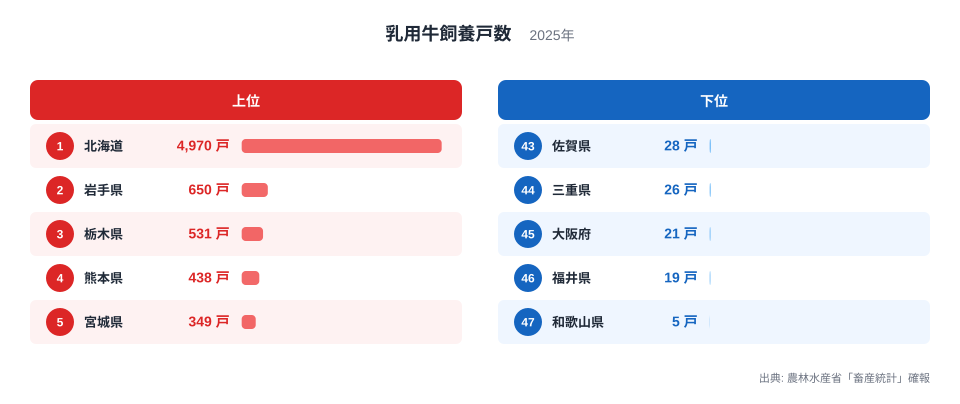
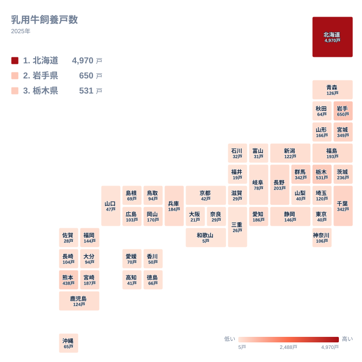

牛乳やバター、チーズの原料となる生乳を生み出す乳用牛。その飼養戸数を都道府県別に並べると、北海道が圧倒的な1位に立ち、その後ろに大きな空白が広がります。2025年の最大は北海道の4,970戸、最小は和歌山県の5戸です。この記事では、この開きがなぜ生まれるのかを、地理・産業構造・歴史の視点から、データで確かめられる範囲と仮説とを分けながら読み解きます。

## 北海道が4,970戸で1位、2位以下とは桁が違う

乳用牛を飼う農家の数を都道府県別に見ると、1位は北海道の4,970戸です。2位は岩手県の650戸で、3位の栃木県、4位の熊本県、5位の宮城県が続きます。下位では47位の和歌山県が5戸、46位の福井県が19戸、45位の大阪府が21戸です。

<source-link href="/ranking/dairy-cattle-holdings">乳用牛飼養戸数ランキングをもっと見る</source-link>

この図で注目したいのは、順位の並びよりも分布の形です。北海道を除くと、2位から5位までは349戸から650戸の範囲に収まっています。つまり全国の構図は「北海道」と「それ以外」にまず分かれ、都府県の間では上位でも数百戸台の競り合いになっています。1位だけが飛び抜けた、いびつな分布です。

最大の北海道4,970戸と最小の和歌山県5戸の比は994倍です。この倍率は、戸数に大きな開きがあることを示しています。ただし戸数だけでは、頭数や1戸あたりの規模、酪農が地域経済で占める比重までは分かりません。開きの理由は断定できないため、次の節から、考えられる要因を仮説として整理します。

## 冷涼な気候と広い土地という仮説

乳用牛は暑さに弱いとされ、冷涼な気候と飼料を確保できる広い土地が酪農に向くと一般に言われます。北海道の突出は、この条件と整合的に見えます。ただし本記事で使えるのは戸数だけで、気温や草地面積のデータは手元にありません。したがって、気候が原因だと言い切ることはできません。

北海道・東北の中で北海道以外に目を向けると、岩手県が650戸で2位、宮城県が349戸で5位、福島県が193戸で10位、山形県が166戸で15位、青森県が126戸で18位です。一方で秋田県は64戸で32位にとどまります。同じ地方でも上位から中位まで幅があり、「東北だから多い」とは言えません。

もう一つの手がかりが九州の熊本県です。熊本県は438戸で4位に入り、冷涼とは言いにくい地域でありながら上位にいます。つまり、気候条件だけでは順位を説明できません。地域の農業の成り立ちや、乳製品を出荷する仕組みの有無など、別の要因が関わっている可能性がありますが、この統計からは特定できません。

> [!NOTE]
> この記事の「乳用牛飼養戸数」は、農林水産省「畜産統計」確報にもとづく、乳用牛を飼っている農家の戸数です。飼っている牛の頭数ではありません。1戸あたりの規模は地域で異なる可能性があり、戸数の多さが生乳生産量の多さと同じ意味になるとは限りません。

## 地理分布で見る、北海道・関東・九州の山

次に、戸数の多い地域の分布を地図で確認します。

地図でまず目に入るのは、北海道の突出です。そのうえで、都府県の中では関東に戸数の多い県が集まっていることが特徴です。栃木県が531戸で3位、群馬県と千葉県がともに342戸、茨城県が236戸で8位と、4県が上位10位以内に入っています。

もう一つの山が九州です。熊本県が438戸で4位、宮崎県が187戸で11位と、離れた位置にも上位の県があります。これに対して近畿は、兵庫県が184戸で13位に入る一方、大阪府の21戸、和歌山県の5戸、三重県の26戸など、下位の県が目立ちます。

関東の上位県は、大都市圏に近いことが酪農の立地に関係している可能性があります。生乳は傷みやすく、搬送距離が短いほど扱いやすいとされるためです。ただし消費地との距離や輸送のデータは本記事にないので、あくまで仮説です。

> [!TIP]
> 戸数の少ない県でも、1戸あたりの飼養頭数が多い大規模経営が中心であれば、頭数や生乳の量は小さくない場合があります。逆に戸数が多くても小規模経営が中心の可能性があります。この指標は「農家の数」であり、生産規模の大小とは別に読む必要があります。

## 北海道に次ぐ岩手県・栃木県・熊本県

北海道を除いて上位に入るのは、岩手県の650戸、栃木県の531戸、熊本県の438戸です。三つの県は北海道・東北、関東、九州と、地方がばらばらです。この点から、都府県の酪農は特定の一地方に偏って育ったのではなく、複数の地域に点在していると読み取れます。

岩手県は、北海道を除いた都府県の中で最も多い戸数です。詳しい数字は[岩手県のデータ](/areas/03000)で確認できます。栃木県は関東の中で最も戸数が多く、その次に群馬県と千葉県が並びます。北海道については[北海道のデータ](/areas/01000)で、ほかの統計と合わせて確認できます。

なお、これらの県で戸数が多い理由を、本記事のデータだけで特定することはできません。歴史的な酪農の振興、飼料の入手しやすさ、乳業の工場の立地などが関係する可能性がありますが、いずれも本記事では検証していない仮説です。農業関連のほかの指標は[同じカテゴリの統計一覧](/category/agriculture)から探せます。

> [!WARNING]
> 順位が低い県を「酪農が衰えた県」と読むのは危険です。この数字は2025年の1時点の戸数で、過去からの増減は含まれません。もともと酪農の比重が小さい地域なのか、減ってきた結果なのかは、この統計だけでは区別できません。

## 分布の形から見る下位の県

順位を下るにつれて、値の開きは急速に小さくなります。上位では1位の4,970戸と2位の650戸の間に大きな段差がありますが、中位では広島県が103戸、神奈川県が106戸、長崎県が104戸と、近い値が連続します。下位でも福井県の19戸、大阪府の21戸、三重県の26戸、佐賀県の28戸と、小さな値が続きます。

その中で和歌山県の5戸は、福井県の19戸と比べても一段低い位置にあります。分布全体は、北海道だけが飛び抜け、その後ろに中位から下位へなだらかに続く形で、最下位の和歌山県がさらに端に離れている形です。

下位の顔ぶれには、近畿と中部の県が含まれます。近畿は和歌山県、大阪府、三重県、滋賀県、奈良県が下位に入り、中部は福井県、富山県、石川県が下位に入っています。こうした県で戸数が少ない理由として、農地の使われ方や都市化の度合いなどが関わる可能性はあります。ただし土地利用や作物のデータは本記事にないため、確かなことは言えません。

最上位の北海道と最下位の和歌山県の差の背景には、気候や土地、農業の歴史など複数の要素が関わっている可能性があります。ただし、どの要因がどれだけ効いているかは、戸数だけでは測れません。

## データについて

この記事で使った乳用牛飼養戸数は、農林水産省「畜産統計」確報の2025年の値です。単位は戸で、全47都道府県の数値を使いました。戸数は乳用牛を飼っている農家の数を示し、牛の頭数や生乳の生産量、1戸あたりの規模を示すものではありません。

倍率として示した994倍は、実データの最大である北海道の4,970戸と、最小である和歌山県の5戸を比べたものです。群馬県と千葉県は342戸、東京都と山梨県は40戸、滋賀県と奈良県は29戸と、同じ戸数の県があります。こうした県の順位は実データの表記に従っており、本文では同じ戸数であることを優先して書いています。

## まとめ

2025年の乳用牛飼養戸数は、北海道が4,970戸で1位、岩手県が650戸で2位、栃木県が531戸で3位です。最下位の和歌山県は5戸でした。分布の形は、北海道が飛び抜け、都府県は上位でも数百戸台に収まるというものです。

北海道・東北では岩手県が2位、秋田県が32位と幅があり、関東には上位の県が集まり、九州の熊本県は気候だけでは説明しにくい位置にいます。順位の背景には、気候・土地・消費地との距離・農業の歴史など複数の要素が関わっている可能性がありますが、この統計だけで原因を断定することはできません。数字を見るときは、戸数だけでなく規模や産業構造にも目を向けてみてください。
