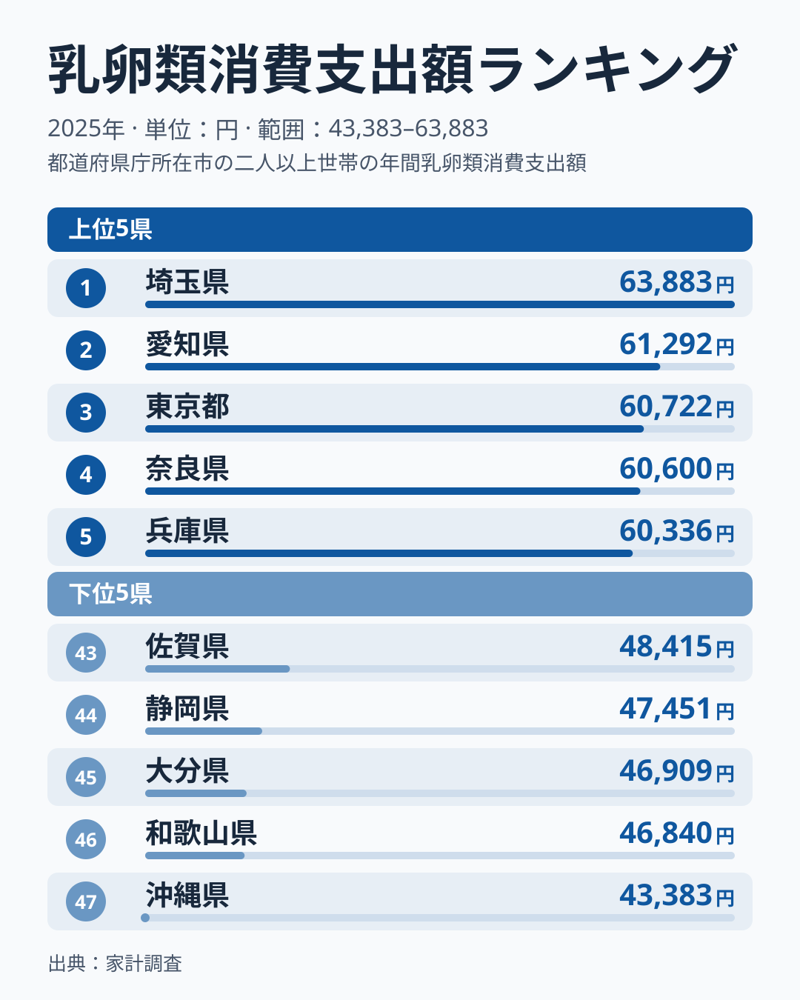
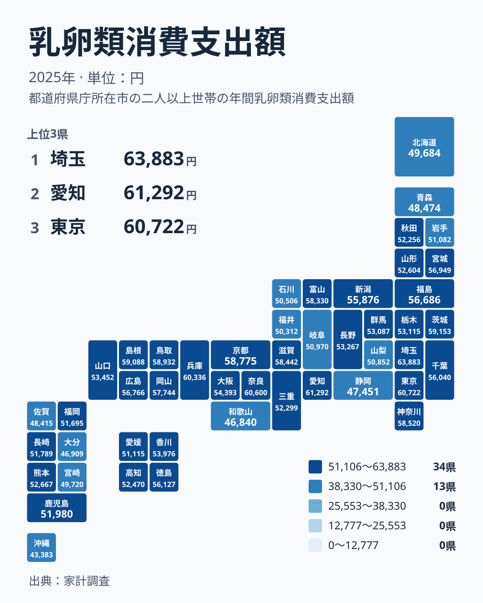

牛乳、ヨーグルト、チーズ、卵。どれも冷蔵庫に常備されている食品で、地域による違いは小さいように思えます。しかし家計調査の2025年の結果を都道府県別に並べると、乳卵類への支出には思った以上の開きがありました。この記事では、支出が多い県と少ない県の顔ぶれを確かめ、その背景を食文化や暮らし方、産地との関係から仮説として考えます。

## 乳卵類への支出は埼玉県が最多

2025年の乳卵類への支出で1位になったのは埼玉県で、63,883円でした。2位は愛知県の61,292円、3位は東京都の60,722円です。続く4位は奈良県の60,600円、5位は兵庫県の60,336円で、上位5県は60,000円台前半から半ばにかけて密集しています。

一方、最も少なかったのは47位の沖縄県で43,383円でした。埼玉県と沖縄県を比べると、同じ乳卵類でも年間の支出額には大きな差があります。埼玉県は沖縄県の約1.5倍にあたる水準ですが、この記事では実データにある金額と順位を並べて比べていきます。

> [!NOTE]
> ここでいう乳卵類は、牛乳、粉ミルク、ヨーグルト、バター、チーズなどの乳製品と、卵をまとめた区分です。家計調査は県庁所在市などを調査対象とする世帯調査で、県全体の平均ではなく、主に都市部の家計を映した数字です。

## 上位と下位の顔ぶれ

図は上位5県と下位5県を並べたものです。上位は埼玉県、愛知県、東京都、奈良県、兵庫県の順です。関東、中部、近畿に属する県が並んでいます。下位は沖縄県、和歌山県、大分県、静岡県、佐賀県の順に少なくなっています。

<source-link href="/ranking/dairy-eggs-group-consumption-expenditure">乳卵類への支出ランキングをもっと見る</source-link>

上位5県は、いずれも人口の多い大都市圏の県です。ただし、大都市圏の県がすべて上位に入るわけではありません。大阪府は20位で54,393円、千葉県は18位で56,040円と、順位は中ほどにあります。都市圏に位置することだけでは、この順位の並びは説明できません。

下位に目を向けると、沖縄県の43,383円が際立って低く、その上に和歌山県の46,840円、大分県の46,909円、静岡県の47,451円、佐賀県の48,415円が続きます。5県は九州・沖縄、近畿、中部と地方がばらばらで、特定の地方に固まっているわけではありません。少ない理由は、このデータだけでは分かりません。

## 地理分布で見る関東と近畿

タイルマップで全国を俯瞰すると、関東に支出の多い県が集まっている様子が見て取れます。関東では、埼玉県が1位、東京都が3位、茨城県が6位、神奈川県が10位、千葉県が18位、栃木県が24位、群馬県が25位です。関東の7県はすべて25位以内に入っています。

近畿では、奈良県が4位、兵庫県が5位、京都府が9位、滋賀県が11位と上位に並びます。大阪府は20位です。一方で和歌山県は46位で46,840円と、下位に入りました。この記事では三重県を近畿に含めるかどうかで解釈が割れないよう、三重県は近畿の記述から外し、29位で52,299円という順位だけを記しておきます。

中国地方では、島根県が7位で59,088円、鳥取県が8位で58,932円と上位に入りました。岡山県は13位、広島県は15位、山口県は22位です。島根県と鳥取県が上位に入った理由は、このデータからは分かりません。

> [!TIP]
> 順位を読むときは、順位そのものより金額の密集度に注目してください。上位は60,000円前後に集まっていますが、中位は50,000円台前半から半ばまで細かく並んでいます。順位が数個違っても金額差はわずかな場合が多く、順位だけで優劣を語るのは避けたほうが安全です。

## 食文化・産地・暮らしから読む仮説

支出額が高い理由を、食文化や産地の面から考えてみます。ただし家計調査は購入した金額を示すもので、食べた量を直接測っているわけではありません。ここから先は、データで確かめられていない仮説としてお読みください。

たとえば朝食の形です。パン食が中心の家庭では、牛乳やヨーグルト、チーズ、バター、卵を一緒に買う機会が増えるかもしれません。ただし、パン食の実データはこの記事にありません。愛知県は2位で61,292円ですが、喫茶店文化などとの結びつきも、確かめられたわけではない想像にとどまります。

次に、産地との関係です。北海道は酪農の本場として知られますが、乳卵類への支出は41位で49,684円と下位に近い結果でした。生産が盛んな土地だからといって、家計の支出が多くなるとは限らないことが分かります。理由としては、価格の違いや購入以外の入手経路が考えられますが、これも仮説です。

さらに、外食や惣菜の利用が多い世帯では、素材としての卵や乳製品の購入が減るかもしれません。沖縄県が47位で43,383円と最下位だった背景も、このデータだけでは説明できません。静岡県が44位で47,451円となった点も同様で、食文化との関係は別の統計と合わせて確かめる必要があります。

> [!WARNING]
> 家計調査は調査世帯の数に限りがあり、県庁所在市を中心とした標本調査です。特に人口の少ない県では、少数の世帯の購入傾向が結果に影響しやすく、順位が年によって入れ替わることがあります。1年分の順位を地域の恒久的な特徴とみなすのは慎重にしてください。

## 東北や中位の県との対比

乳卵類は性質の異なる品目の合計です。牛乳は飲用、卵は調理、ヨーグルトやチーズは朝食や間食など、使われ方が違います。ただし品目別の金額はこの記事にないため、どの品目が差を生んでいるかは分かりません。

東北の県を見てみましょう。宮城県は14位で56,949円、福島県は16位で56,686円と、比較的上位です。山形県は27位で52,604円、秋田県は30位で52,256円、岩手県は35位で51,082円、青森県は42位で48,474円です。北海道は41位で49,684円でした。同じ北海道・東北の中でも、14位から42位まで大きく開いています。

首位の埼玉県の63,883円と、東北の山形県の52,604円を並べると、金額の差がはっきりします。世帯の構成や子育て世帯の多さが埼玉県の首位に関係しているかもしれませんが、世帯構成のデータと合わせて確かめる必要がある仮説です。

県ごとの詳しい数字は、[埼玉県のデータ](/areas/11000)や[愛知県のデータ](/areas/23000)で確認できます。ほかの食料品や家計の指標とあわせて見たい場合は、[同じカテゴリの統計一覧](/category/economy)も参考になります。

## データについて

この記事で使ったのは、家計調査の2025年の結果にある乳卵類消費支出額です。単位は円で、都道府県別の年間の支出額を並べたものです。全47件の値と順位は、実データのとおりに掲載しています。

> [!NOTE]
> 乳卵類消費支出額は、消費した量ではなく、その年に支払った金額です。価格が高い地域では同じ量でも支出が大きくなります。また、世帯の人数や年齢構成の違いは調整されていないため、数字の差がそのまま食べる量の差を表すとは限りません。

## まとめ

乳卵類への支出は、2025年の結果で埼玉県が63,883円で1位、沖縄県が43,383円で47位でした。関東の7県はすべて25位以内に入り、下位は沖縄県、和歌山県、大分県、静岡県、佐賀県と、地方をまたいで散らばっています。

食文化や産地、暮らし方が支出に影響している可能性はありますが、このデータだけでは確かめられません。北海道が41位であるように、酪農が盛んな土地でも支出が多いとは限りません。数字を見るときは、購入金額という性格と標本調査の限界を踏まえたうえで、地域の食卓を想像する手がかりとして使ってください。
