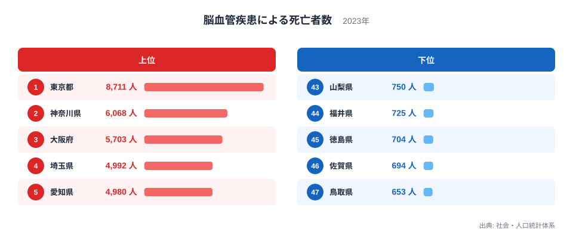
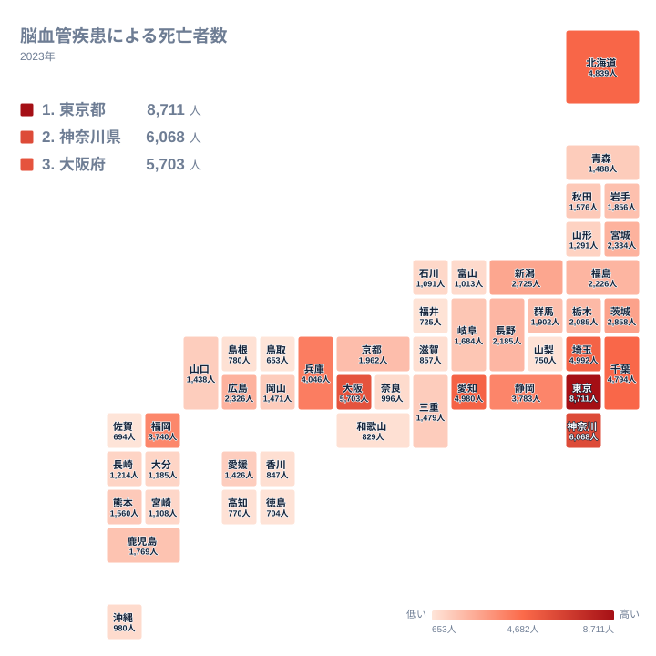

## 脳血管疾患の死亡者数は東京都が最多、鳥取県が最少

2023年の脳血管疾患による死亡者数で1位になったのは東京都で、8,711人でした。最少は47位の鳥取県で、653人です。最大と最小を比べると、およそ13倍の開きがあります。

脳血管疾患とは、脳の血管が詰まったり破れたりして起こる病気の総称です。脳梗塞や脳出血、くも膜下出血などが含まれます。この記事で見るのは亡くなった人の「人数」であり、病気のなりやすさを直接示す数字ではありません。

この記事では、人数の順位がどのように並ぶのかを、地方ごとの分布とあわせて確かめます。人数が多い都府県と少ない県の顔ぶれを見ると、人口規模の大きい都府県が上位に並ぶ傾向がうかがえます。ただし人口のデータは使っていないため、その背景は仮説として扱います。

> [!NOTE]
> この数字は脳血管疾患という一つの死因で亡くなった人の実数です。人口10万人あたりの率や年齢調整をした値ではありません。死亡者の多くは高齢層と考えられ、高齢者の人数が多い地域ほど数が膨らみやすい指標です。

## 上位5都府県と下位5県のランキング

<source-link href="/ranking/deaths-cerebrovascular-disease">脳血管疾患による死亡者数ランキングをもっと見る</source-link>

上位5位は、東京都が8,711人、神奈川県が6,068人、大阪府が5,703人、埼玉県が4,992人、愛知県が4,980人です。大都市圏を抱える都府県が並んでいます。4位の埼玉県と5位の愛知県は、わずか12人の差でした。

下位5位は、47位の鳥取県が653人、46位の佐賀県が694人、45位の徳島県が704人、44位の福井県が725人、43位の山梨県が750人です。下位の5県は653人から750人の間にひしめいており、順位が一つ違っても差は小さい水準です。

1位の東京都は、2位の神奈川県より2,643人多く、下位の県の10倍以上になっています。上位は差が大きく、下位は差が小さいという非対称な分布です。上位に人口規模の大きい都府県が並ぶことから、この指標は病気の多さだけでなく、地域の母数の大きさも映していると考えられます。

## 大都市圏に死亡者が集まる背景の仮説

上位5位はいずれも、関東・中部・近畿の大都市圏にある都府県です。関東では東京都が1位、神奈川県が2位、埼玉県が4位、千葉県が7位、茨城県が11位です。首都圏の周辺県が上位に連なっていることが分かります。

こうした並びについては、「戦後に産業が人を集めた都市部で、その世代が高齢期を迎えている」という仮説が考えられます。脳血管疾患は高齢者に多い病気なので、高齢者の絶対数が多い地域ほど死亡者数も大きくなる、という筋道です。ただし、この記事のデータには産業や人口移動、年齢構成の情報がなく、仮説を裏づけることはできません。

各都県の詳細は[東京都のデータ](/areas/13000)や[神奈川県のデータ](/areas/14000)で確認できます。人口や高齢化の状況とあわせて見ると、数字の意味がより具体的になります。

> [!WARNING]
> この統計だけでは、死亡者数が多い理由を特定できません。年齢構成、医療体制、集計が住所地基準か発生地基準かといった条件は、ここに示した数値からは確かめられません。順位の背景を語るときは、仮説であることを意識してください。

## 地理分布で見る全国の傾向

タイルマップを見ると、人数の多い県は関東、近畿、中部の一部、そして北海道と福岡県に集まっています。北海道は4,839人で6位、福岡県は3,740人で10位です。東京都から離れた地域にも、人数の多い県があることが分かります。

北海道・東北では、北海道の6位が突出しています。東北の6県は、宮城県の13位(2,334人)から、山形県の30位(1,291人)までに収まっています。東北の中でも、最多の宮城県と最少の山形県で1,043人の開きがあります。

中部では、静岡県が9位で3,783人、新潟県が12位で2,725人、長野県が16位で2,185人です。一方、山梨県は43位で750人、福井県は44位で725人と、同じ中部でも位置が大きく分かれます。なお本稿では地方の区分を冒頭の7区分に統一しており、福井県と山梨県は中部、三重県は近畿として扱います。

## 地方内の開きに注目する

地方ごとに最大と最小を並べると、同じ地方でも順位が大きく離れる様子が見えます。

- 関東では、東京都の1位(8,711人)から栃木県の17位(2,085人)、群馬県の19位(1,902人)まで広がっています。
- 近畿では、大阪府の3位(5,703人)に対し、和歌山県は40位(829人)です。
- 中国では、広島県の14位(2,326人)に対し、鳥取県は47位(653人)です。
- 四国では、愛媛県の29位(1,426人)に対し、徳島県は45位(704人)です。
- 九州・沖縄では、福岡県の10位(3,740人)に対し、佐賀県は46位(694人)です。

同じ地方の中でも、都市圏を持つ県とそうでない県で人数が大きく異なります。これは地方という単位よりも、県ごとの規模の違いが人数に反映されているためと考えられます。ただし、規模を示す人口のデータは本稿にないため、あくまで読み取りの見通しです。

> [!TIP]
> 死亡者数の順位を見るときは、まず上位が「大きな県の順」に近いかどうかを確かめます。たとえば沖縄県は37位の980人、長野県は16位の2,185人です。人数の順位だけで、その県で脳血管疾患が多いのか少ないのかは言えません。率の統計とあわせて見ると、読み違いを避けられます。

## 中位の県が示すもの

中位には、1,000人台から2,000人台の県が多く並びます。京都府が18位で1,962人、群馬県が19位で1,902人、岩手県が20位で1,856人、鹿児島県が21位で1,769人です。このあたりは順位が一つ違っても人数の差が小さく、数十人から100人程度で順位が入れ替わります。

順位の間隔が詰まっている中位では、わずかな人数の増減で順位が動きます。年ごとの変動も影響しやすいため、1位や47位の動きより、全体の分布の形を見るほうが実態に近づきます。

他の分野の統計と比べたい場合は、[同じカテゴリの統計一覧](/category/socialsecurity)から探せます。死亡者数に近い指標を並べて見ると、人数と率の関係をつかみやすくなります。

## データについて

この記事で使った統計は、社会・人口統計体系が公表する「脳血管疾患による死亡者数」の2023年の値で、単位は人です。全47都道府県の実数を、そのまま順位に並べています。

この数字は死因別の集計であり、脳血管疾患以外で亡くなった人は含まれません。また、記事中の背景に関する説明は、データから直接は確かめられない仮説です。地域の特徴を判断するには、人口あたりの死亡率や年齢構成の統計も必要になります。

## まとめ

2023年の脳血管疾患による死亡者数は、東京都の8,711人から鳥取県の653人まで、約13倍の幅がありました。上位は東京都、神奈川県、大阪府、埼玉県、愛知県と、人口規模の大きい都府県が並んでいます。下位は鳥取県、佐賀県、徳島県、福井県、山梨県でした。

同じ地方の中でも順位が大きく離れており、地方単位ではなく県ごとの規模が人数に表れていると考えられます。人数の大小だけで地域の健康状態を判断せず、率の指標とあわせて読むことが大切です。
