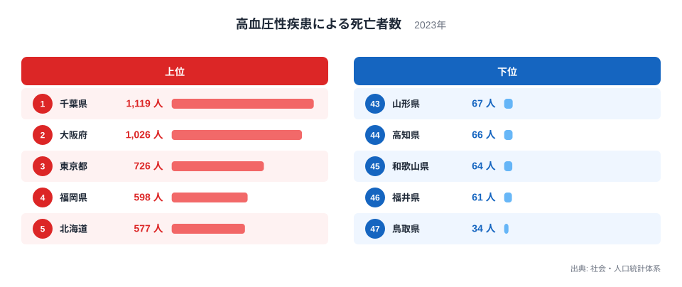
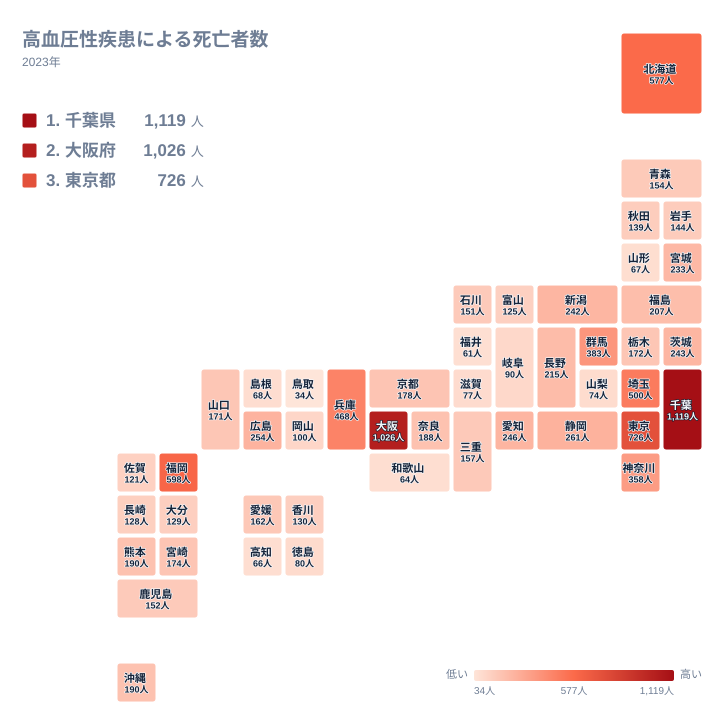

高血圧が原因で亡くなる人の数は、都道府県によってこれほど違うのでしょうか。2023年のデータでは、最も多い千葉県が1,119人、最も少ない鳥取県が34人でした。同じ日本の中で、これだけの差が生じています。

この記事では、高血圧性疾患による死亡者数の上位と下位を見比べながら、なぜその順になるのかを地理・産業構造・歴史の面から考えます。

## 上位と下位の顔ぶれ

まずは上位5県と下位5県を図で確認します。

<source-link href="/ranking/deaths-hypertensive-diseases">高血圧性疾患による死亡者数ランキングをもっと見る</source-link>

1位は千葉県で1,119人、2位は大阪府で1,026人、3位は東京都で726人です。4位は福岡県で598人、5位は北海道で577人でした。上位には大都市圏を抱える都道府県が並んでいます。

下位側を見ると、47位は鳥取県で34人です。46位の福井県は61人、45位の和歌山県は64人、44位の高知県は66人、43位の山形県は67人と続きます。上位の千葉県と最下位の鳥取県を比べると、1,119人と34人という大きな差があります。

> [!NOTE]
> ここで扱う数値は、高血圧性疾患による死亡者数(社会・人口統計体系、2023年、単位は人)です。人口あたりの率ではなく、実数です。人口の多い県ほど数字が大きくなりやすい点に注意してください。

この図で大切なのは、順位が「高血圧になりやすい県の順」とは限らないことです。人口規模や高齢者の数、死因の記載のされ方といった条件が重なって、この順位ができています。

## 人口規模が数を押し上げる

上位に並ぶ千葉県、大阪府、東京都、福岡県、北海道は、いずれも人口が多い地域です。死亡者数が実数で示される以上、人口の大きい地域が上に来るのは自然な流れといえます。

関東では、千葉県が1位で1,119人、東京都が3位で726人です。さらに埼玉県が6位で500人、群馬県が8位で383人、神奈川県が9位で358人と続きます。関東の多くの都県が10位以内に入っています。

近畿では、大阪府が2位で1,026人、兵庫県が7位で468人です。一方で、京都府は21位で178人、奈良県は20位で188人、滋賀県は40位で77人、和歌山県は45位で64人と、同じ近畿でも幅があります。

千葉県の詳しい数字は[千葉県のデータ](/areas/12000)、大阪府は[大阪府のデータ](/areas/27000)で確認できます。

> [!WARNING]
> 死亡者数は、死亡診断書に書かれた原因で分類されます。高血圧が背景にあっても、心疾患や脳血管疾患として記録される場合があります。そのため、この数字は高血圧に関わる死亡の全体像を表すものではありません。

## 地理分布で見る偏り

続いて、47都道府県の分布を地図で見ます。

地図を見ると、関東と近畿に数の多い県が集まっています。ただし、これは人口の集中を反映した面が大きいと考えられます。

北海道・東北では、北海道が5位で577人と突出しています。次いで宮城県が15位で233人、福島県が17位で207人、青森県が27位で154人、岩手県が30位で144人、秋田県が31位で139人、山形県が43位で67人です。広い北海道が1つの単位で集計されるため、数が大きくなっています。

中部では、新潟県が14位で242人、静岡県が10位で261人、愛知県が12位で246人、長野県が16位で215人です。一方で、福井県は46位で61人、山梨県は41位で74人、岐阜県は38位で90人と少なくなっています。

九州・沖縄では、福岡県が4位で598人と目立ちます。熊本県が18位で190人、沖縄県が19位で190人、宮崎県が22位で174人、鹿児島県が28位で152人です。中国では広島県が11位で254人、山口県が24位で171人、岡山県が37位で100人、島根県が42位で68人、鳥取県が47位で34人です。

> [!TIP]
> 順位を読むときは、人口の多い県と少ない県を同じ土俵で比べないことが大切です。気になる県が上位や下位にいる場合は、まず人口規模を確認し、そのうえで近隣の県との位置関係を見ると、特徴をつかみやすくなります。

## 上位と下位を分ける背景

上位の県には、都市部に高齢者が多く暮らしているという共通点があると考えられます。高度成長期に流入した世代が高齢期を迎え、都市圏の高齢者の実数が増えたことが、数字を押し上げている可能性があります。

産業構造の面では、大都市圏は第3次産業の比重が高く、医療機関も集中しています。医療機関が多い地域では、死因が診断書に明確に記される機会も多いと考えられます。ただし、これは本データだけから断定できることではありません。

下位の県は、鳥取県の34人、福井県の61人、和歌山県の64人、高知県の66人のように、人口規模の小さい県が目立ちます。人口が少ないと、年ごとの変動も大きくなりやすく、1年分の数字だけで傾向を決めつけるのは危険です。

歴史的には、地域ごとの食習慣や生活様式の違いが、高血圧との関わりで語られてきました。ただし、今回のデータは死亡者数の実数であり、そうした要因の影響を直接示すものではありません。背景は仮説として受け止めてください。

## 中位の県が示すもの

上位でも下位でもない県にも注目できます。10位の静岡県は261人、11位の広島県は254人、12位の愛知県は246人、13位の茨城県は243人と、200人台前半に県が密集しています。

さらに20位の奈良県が188人、21位の京都府が178人、22位の宮崎県が174人、23位の栃木県が172人と、100人台後半にも近い値が並びます。この帯では、わずかな差で順位が入れ替わりやすくなります。

たとえば、熊本県と沖縄県はどちらも190人です。順位は熊本県が18位、沖縄県が19位ですが、人数の上では同じです。順位の差をそのまま実態の差と読まないようにしてください。

同じ分野の他の指標は、[同じカテゴリの統計一覧](/category/population)から探せます。他の統計と並べて見ると、人口構成の影響をより立体的に把握できます。

## データについて

この記事で使った統計は、社会・人口統計体系の「高血圧性疾患による死亡者数」(2023年、単位は人)です。47都道府県すべての値を使い、記事内の数値と順位はこのデータにもとづいています。

数字は実数であり、人口あたりの率ではありません。そのため、「どの県が最も高血圧による死亡リスクが高いか」を直接示すものではありません。リスクを比べるには、年齢構成を調整した指標が別に必要です。

## まとめ

2023年の高血圧性疾患による死亡者数は、千葉県が1位で1,119人、大阪府が2位で1,026人、東京都が3位で726人でした。最少は鳥取県の34人です。

上位には人口の多い地域が並び、下位には人口の少ない県が並びます。この順位は、高血圧の起こりやすさそのものよりも、人口規模や高齢者の数、死因の記録のされ方を強く映していると考えられます。

数字を読むときは、実数か率かを確かめ、1年分の変動に注意し、近隣の県との位置関係もあわせて見てください。そうすることで、順位の裏にある事情が見えてきます。
