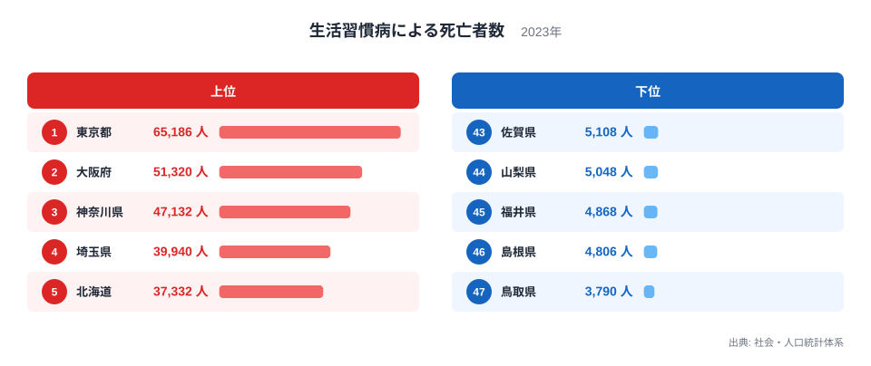
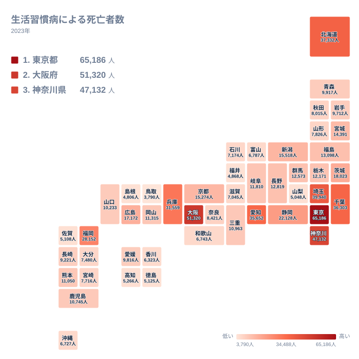

生活習慣病による死亡者数が最も多い県はどこでしょうか。2023年のデータでは、1位は東京都で65,186人でした。最下位の鳥取県は3,790人で、両者の開きは大きなものです。ただし、この数字は「人数」であり、危険度の高さをそのまま示すものではありません。この記事では、上位と下位がなぜその順になるのかを、実数の並びから読み取れる範囲で整理します。

## 上位と下位の顔ぶれ

まずは上位5都道府県と下位5都道府県を図で確認します。

<source-link href="/ranking/deaths-lifestyle-diseases">生活習慣病による死亡者数ランキングをもっと見る</source-link>

上位は東京都の65,186人、大阪府の51,320人、神奈川県の47,132人、埼玉県の39,940人、北海道の37,332人の順です。東京都、大阪府、神奈川県、埼玉県は大都市圏にある都府県で、人口の多い地域が上位に並んだ形です。北海道は5位で、関東や近畿以外の道県としては唯一の上位5位入りです。

下位は、47位の鳥取県が3,790人、46位の島根県が4,806人、45位の福井県が4,868人、44位の山梨県が5,048人、43位の佐賀県が5,108人です。上位の都府県とは、桁が一つ違うほどの水準です。

最大の東京都と最小の鳥取県を比べると、約17倍の開きがあります。この開きには、人口規模の違いが反映されている可能性があります。ただし、この記事で使えるデータは死亡者数の実数だけなので、人口の差がどこまで寄与しているかまでは確かめられません。

> [!NOTE]
> ここでの「生活習慣病による死亡者数」は、社会・人口統計体系に基づく2023年の死亡者数で、単位は人です。人口で割った率ではなく実数なので、人口の多い都道府県ほど大きくなりやすい指標です。

## 上位に大都市圏が並ぶ理由

上位を眺めて目に付くのは、東京都、大阪府、神奈川県、埼玉県と、大都市圏の都府県が並ぶことです。東京都、神奈川県、埼玉県に加え、千葉県も6位で36,303人でした。首都圏の4都県が、上位6位のうち4つを占めています。

そのあとには、愛知県が7位で35,652人、兵庫県が8位で31,559人、福岡県が9位で28,152人と続きます。上位9位までに、関東、近畿、中部、九州の中心的な都府県が顔をそろえた形です。大きな都市を抱える地域ほど順位が高いという傾向は、数字から読み取れます。

その理由として、住んでいる人の多さが第一に考えられます。加えて、地方から大都市圏へ移り住んだ世代が高齢期に入ったことも、一因として考えられます。ただし、これらはあくまで仮説です。この記事のデータには人口も年齢構成も含まれないため、どちらがどれだけ効いているかは示せません。

東京都の詳しい数値は[東京都のデータ](/areas/13000)、大阪府の詳しい数値は[大阪府のデータ](/areas/27000)で確認できます。人口や高齢化に関する他の指標とあわせて見ると、背景がつかみやすくなります。

> [!WARNING]
> この指標は年齢構成を調整していません。高齢者が多い県では死亡者数が増え、若い世代が多い県では減る可能性があります。県同士の「健康度」を比べる目的には、そのままでは使えません。

## 地理分布で見る全国のパターン

次に、47都道府県の分布を地図状に示した図を見ます。

関東では、東京都、神奈川県、埼玉県、千葉県が上位6位以内に入り、茨城県も11位で18,023人でした。群馬県は18位で12,573人、栃木県は19位で12,171人です。関東の7都県だけで見ても、最大の東京都は65,186人、最小の栃木県は12,171人で、地方の内側にも大きな幅があります。

近畿では、大阪府が2位、兵庫県が8位、京都府が14位で15,274人です。一方で、奈良県は30位で8,421人、滋賀県は36位で7,045人、和歌山県は38位で6,743人でした。近畿の最大は大阪府の51,320人、最小は和歌山県の6,743人で、同じ地方でも順位は大きく離れています。三重県は23位で10,963人です。

中部では、愛知県が7位、静岡県が10位で22,128人、新潟県が13位で15,518人と続きます。山梨県は44位で5,048人、福井県は45位で4,868人です。中部の最大は愛知県の35,652人、最小は福井県の4,868人でした。

> [!TIP]
> 地図で濃い色の県を見たときは、「その県は危ない」と読むのではなく、まず「その県は人数が多い」と読みます。そのうえで、人口あたりの死亡率や年齢調整後の指標を別に確認すると、実態に近づけます。

## 地方ブロックの内側にある差

中位から下位の県は数が多いため、地方ごとに最大と最小だけを比べて見ます。

北海道・東北では、北海道が5位で37,332人、最小の山形県は32位で7,826人でした。東北の中でも、宮城県は15位で14,391人、福島県は16位で13,098人、秋田県は31位で8,015人と、順位に開きがあります。

九州・沖縄では、福岡県が9位で28,152人、最小の佐賀県が43位で5,108人です。中国では、広島県が12位で17,172人、鳥取県が47位で3,790人でした。四国は、愛媛県が27位で9,816人、徳島県が42位で5,125人で、他の地方に比べると最大と最小の差は小さめです。

ここから言えるのは、どの地方でも、その中の最大の県が全国順位を大きく引き上げているということです。地方の名前だけで順位が決まるわけではなく、各地方の中心となる県と、その他の県との間に大きな差があります。これが人口規模の違いによるものかどうかは、人口のデータを重ねて確かめる必要があります。

## この数字から言えること

この指標が示すのは、生活習慣病で亡くなった人の実数の大きさです。上位は東京都、大阪府、神奈川県、埼玉県、北海道の順で、下位は鳥取県、島根県、福井県、山梨県、佐賀県の順でした。実数で見る限り、東京都と鳥取県の間には約17倍の開きがあります。

一方で、この数字だけから、ある県の生活習慣が良いか悪いかは言えません。人数の差を読み解くには、人口や年齢構成の指標が欠かせません。[同じカテゴリの統計一覧](/category/population)では、人口に関する指標を確認できます。実数と率の両方を見ることで、順位の意味がより正確に読み取れます。

## データについて

この記事で使った統計は、社会・人口統計体系の「生活習慣病による死亡者数」(2023年、単位は人)です。数値は各都道府県の実数であり、人口や年齢構成による補正は行っていません。記事中の順位は、この実数が大きい順に付けたものです。

最も多い東京都は65,186人、最も少ない鳥取県は3,790人でした。この記事の比較は、あくまで実数の比較であり、地域ごとの生活習慣の良し悪しを断定するものではありません。
