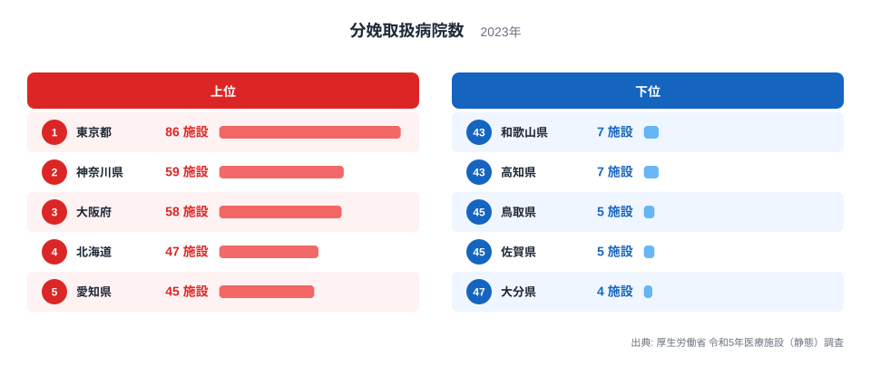
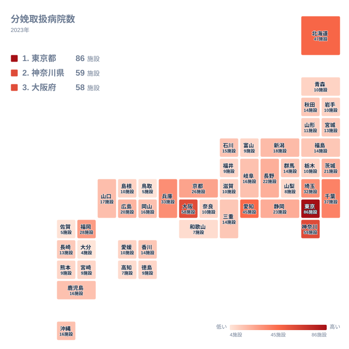

子どもを産む場所が身近にあるかどうかは、地域で暮らし続けられるかどうかに直結します。2023年の調査で、分娩を扱う病院の数は都道府県ごとに大きく開いていました。最も多い東京都は86施設、最も少ない大分県は4施設です。この記事では、その差がどのような背景から生まれたのかを、実データをもとに、確認できる範囲と仮説とを分けながら考えます。

## 分娩取扱病院数の上位と下位

まず、上位5都道府県と下位5県を並べて見てみましょう。

<source-link href="/ranking/delivery-hospital-count">分娩取扱病院数ランキングをもっと見る</source-link>

1位の東京都は86施設で、47位の大分県は4施設です。86を4で割ると21.5ですので、東京都は大分県の20倍を超える病院を抱えていることになります。同じ国の中で、出産を扱う病院の数がこれほど違うのは驚きです。

上位は、東京都が86施設、神奈川県が59施設、大阪府が58施設、北海道が47施設、愛知県が45施設です。2位と3位はわずか1施設差で、1位との間には27施設の開きがあります。東京都だけが突出していて、2位以下は大きな団子状に近い並びです。

下位は、大分県が4施設で47位です。佐賀県と鳥取県は5施設で、それぞれ46位と45位です。高知県と和歌山県は7施設で、それぞれ44位と43位です。ここで注目したいのは、下位5県の差が最大でも3施設しかない点です。下位では、1施設の増減が順位を大きく動かします。

下位の顔ぶれは、九州の大分県と佐賀県、中国の鳥取県、四国の高知県、近畿の和歌山県です。特定の一地方に固まるわけではなく、複数の地方に散らばっています。

> [!NOTE]
> ここでの分娩取扱病院は、分娩を実際に扱っている「病院」の施設数です。分娩を扱う診療所や助産所は含まれていません。出産の場として診療所が大きな役割を担う地域もあるため、この数字だけで地域の出産環境のすべてを測ることはできません。

## 上位はなぜ多いのか:人口と産業の集積

東京都、神奈川県、大阪府、愛知県は、いずれも大都市圏の中心を占める都府県です。人口が多ければ出産の件数も多くなり、分娩に対応する病院が成り立ちやすいと考えられます。企業や大学が集まる土地では、若い世代が流入しやすいことも、背景の一つかもしれません。

さらに、大都市には大学病院や、周産期医療の中核を担う大規模病院が集まりやすいと考えられます。分娩は夜間や休日にも対応が必要で、複数の医師と看護職の体制が要ります。人材の層が厚い都市部は、この体制を組みやすいのでしょう。ただし、これは一般的な見方であり、この記事のデータで直接確かめたものではありません。

首都圏と近畿圏の周辺にも目を向けましょう。千葉県は37施設で6位、兵庫県は33施設で7位、埼玉県は32施設で8位です。その次の9位が福岡県の28施設、10位が京都府の26施設で、11位の静岡県は23施設です。上位10位までは、4位の北海道を除けば、いずれも大都市やその周辺を含む都府県が占めています。

東京都と神奈川県の詳しい数値は、次のページで確認できます。

- [東京都のデータ](/areas/13000)
- [神奈川県のデータ](/areas/14000)

> [!WARNING]
> この指標は施設数であり、人口や出生数あたりの数ではありません。人口の多い都府県が上位に並びやすく、「多い」ことが「出産しやすい」ことを意味するとは限りません。また、同じ1施設でも、年間の分娩件数は病院ごとに大きく異なるはずですが、この数字からは分かりません。

## 下位はなぜ少ないのか:考えられる要因

下位に並ぶ大分県、佐賀県、鳥取県、高知県、和歌山県で、なぜ病院数が少ないのでしょうか。この記事のデータには人口や出生数が含まれていないため、断定はできません。ここでは、一般に指摘されることのある仮説として整理します。

一つは、出産の件数が限られる地域では、分娩を続けるための医師と設備を維持する負担が、相対的に重くなるという見方です。分娩は件数が少なくてもいつでも対応できる体制が必要で、小さな規模の病院ほど継続が難しい可能性があります。

もう一つは、医師の確保です。24時間体制の負担が大きい分娩では、医師が減ると残った医師に負担が集中し、さらに分娩の取り扱いをやめる病院が出るという循環が起こるとも言われます。産科医の不足が課題とされてきたという指摘もありますが、本記事のデータで検証したものではありません。

産業構造との関係も、仮説として考えられます。若い世代が進学や就職を機に大都市圏へ移る地域では、子育て世代が減り、分娩の需要が小さくなるかもしれません。ただし、需要と病院数のどちらが先に減ったのかは、この数字だけでは分かりません。

もちろん、病院数が少ないことが、すぐに出産に困ることを意味するわけではありません。少ない病院に分娩を集約し、機能を高める方針をとる地域もあるとされます。ただし、集約が進めば、妊婦が病院まで移動する距離が長くなる可能性があります。

> [!TIP]
> 少ない県の数字は、診療所で出産する人が多いかどうかで見え方が変わります。この指標は病院だけを数えているため、診療所での分娩が多い県では、病院数が少なくても出産の場が不足しているとは限りません。数字は「病院で分娩できる場所の数」と読んでください。

## 地理分布で見る分娩取扱病院数

次に、全国の分布をタイルマップで確認します。

地図で見ると、東京都、神奈川県、大阪府、愛知県のある大都市圏の色が濃くなっています。関東から東海、近畿へと、病院数の多い都府県が並ぶ様子が読み取れます。

一方で、中位の顔ぶれには、地方の県も目立ちます。福岡県は28施設で9位、静岡県は23施設で11位、長野県は22施設で12位、茨城県は21施設で13位、広島県は20施設で14位、新潟県は18施設で15位です。長野県と新潟県は、大都市圏の外にありながら、いずれも15位以内に入っています。

長野県が22施設で12位に入る理由は、データからは分かりません。山がちな県で、複数の都市が離れて存在することが関係しているのかもしれませんが、これは仮説にとどまります。広い県土を持つ県で病院数が多めに出る傾向があるのか、あるいは別の事情によるのかは、人口や面積のデータを合わせて見なければ判断できません。

北海道が47施設で4位に入っていることも、同様です。人口が多い東京都や大阪府と並ぶ位置にありますが、病院がどのように分布しているかは、この数字からは読み取れません。道内の位置ごとの病院数を調べて初めて、移動距離の問題を論じることができます。

17位から20位には、16施設の岐阜県、岡山県、鹿児島県、沖縄県が並びます。同じ16施設でも、県ごとに人口や地理が異なるため、一つの施設が担う範囲は違うはずです。同じ数字だからといって、同じ状況とは限りません。

東北では、秋田県、福島県が14施設で、それぞれ22位、23位です。宮城県は13施設で27位、山形県は11施設で29位、青森県と岩手県は10施設で、それぞれ30位と31位です。東北の6県は、14施設から10施設の範囲に収まっています。

同じカテゴリの統計もあわせてご覧ください。

- [同じカテゴリの統計一覧](/category/socialsecurity)

## 中位から下位にかけての県の姿

中位から下位の境目付近では、数字の差が小さくなります。10施設の県は、青森県、岩手県、栃木県、滋賀県、奈良県、島根県、愛媛県の7県で、30位から36位まで続きます。1施設の違いで順位が数位動くほど、込み合った領域です。

そのため、この辺りでは、順位の違いを過大に読まないことが大切です。順位だけで地域の優劣を語るのは適切ではありません。

さらに下では、9施設の県が富山県、福井県、徳島県、熊本県、宮崎県の5県です。山梨県は8施設で42位です。ここから先は、先に見た和歌山県と高知県の7施設、鳥取県と佐賀県の5施設、大分県の4施設へと続きます。

順位の並びを整理すると、次のようになります。

- 20施設以上は、東京都から広島県までの上位14都道府県
- 10施設台から10施設までは、新潟県から愛媛県までの22県
- 9施設以下は、富山県から大分県までの11県

上位14都道府県は全体の3割ほどにあたり、20施設以上の水準に届くのはこの範囲だけです。残りの県は、10施設前後に厚く集まっています。

## データについて

この記事の数値は、厚生労働省の令和5年医療施設（静態）調査による、2023年の分娩取扱病院数です。単位は施設で、都道府県ごとの病院数を集計しています。順位は施設数の多い順です。同じ施設数の県が複数ある場合も、データ上は順位が別々に付いています。診療所と助産所は含まれていません。

## まとめ:数の差が示すもの

分娩取扱病院数は、東京都の86施設から大分県の4施設まで、大きく開いています。上位は大都市圏を中心とした都府県が多く、下位は九州、中国、四国、近畿にまたがる県が並んでいます。

ただし、病院数の背景にある人口や出生数、医師の数は、この記事のデータには含まれていません。そのため、なぜその順位になるのかについては、仮説の域を出ない部分があります。数字を読むときは、病院だけを数えた指標であることと、施設数であって人口あたりではないことを、常に意識してください。

自分の住む県が何位か、そしてその数字の裏に何があるのかを知ることが、地域の出産環境を考える第一歩になります。
