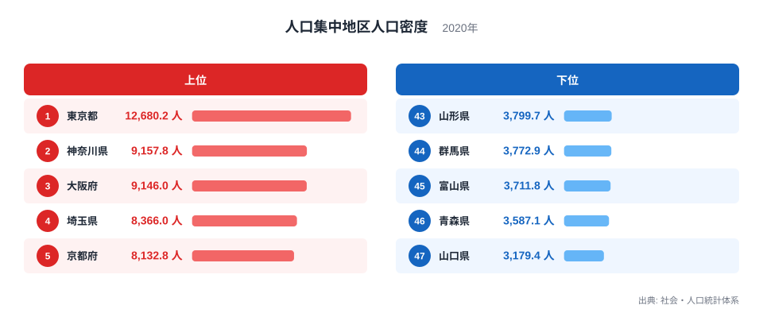
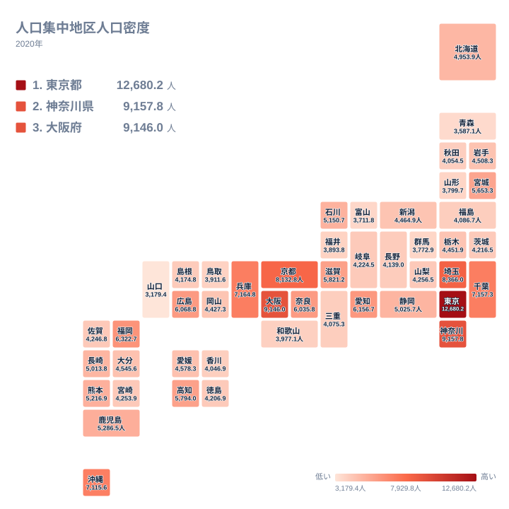

## 市街地の「濃さ」を比べる指標

都道府県の人口密度というと、県全体の人口を県の面積で割った数字を思い浮かべる方が多いと思います。ただ、その数字には山地や農地、森林も含まれるため、人が実際に暮らしている市街地の混み具合までは伝えてくれません。

そこで注目したいのが、人口集中地区の人口密度です。人口が密に集まった市街地だけを取り出し、一平方キロメートルあたりに何人が住んでいるかを示します。県の広さや山がちな地形の影響をある程度抑えられるため、「街そのものの濃さ」を比べるのに向いた指標です。

2020年の数値で見ると、最も高いのは東京都の12,680.2人で、最も低いのは山口県の3,179.4人です。最大と最小の比はおよそ4倍にあたります。同じ日本の市街地でも、これだけ密度に開きがあります。この記事では、上位と下位がどのような顔ぶれになっているのかを確かめ、その背景を地理・産業構造・歴史の面から考えます。ただし、背景を直接裏付ける数字は今回のデータにないため、理由の部分は仮説として読んでください。

> [!NOTE]
> 人口集中地区とは、国勢調査で設定される、人口密度の高い調査区が隣り合って一定の人口規模に達した市街地の区域です。市町村の境界とは一致しません。そのため、県庁所在地の中心部だけでなく、郊外の住宅地や、市町村をまたいで連なる市街地も含まれます。この記事の数値は、その区域に住む人を区域の面積で割った密度です。

## 上位と下位の顔ぶれ

まず、上位五県と下位五県を並べた図を見てください。

<source-link href="/ranking/densely-inhabited-district-population-density">人口集中地区人口密度ランキングをもっと見る</source-link>

上位五県は、東京都、神奈川県、大阪府、埼玉県、京都府の順です。関東の三都県に、近畿の大阪府と京都府が加わる形で、いずれも大都市圏の中心か、その隣にある都府県です。

図から読み取れる特徴は、1位の東京都が頭一つ抜けていることです。東京都は12,680.2人、2位の神奈川県は9,157.8人で、2位以下は9,000人前後から8,000人台前半に収まっています。東京都だけが別の水準にあることは、図の棒の長さからも一目で分かります。

下位五県は、山口県、青森県、富山県、群馬県、山形県です。所属は中国、東北、中部、関東と、地方がばらばらです。上位が大都市圏に偏っているのとは対照的に、下位には特定の地方への偏りが見られません。この点から、下位の低さは地域ごとの事情というより、市街地の広がり方に共通する何かがあるのではないか、という見方ができます。

最上位と最下位の比較では、東京都の12,680.2人に対して山口県は3,179.4人です。実際の数字で並べると、およそ4倍の差があることになります。

## 上位が高い理由として考えられること

東京都、神奈川県、埼玉県、大阪府、京都府は、いずれも大都市の周りに市街地が連なる都府県です。6位の兵庫県は7,164.8人、7位の千葉県は7,157.3人で、上位七県は関東の四都県と近畿の三府県で占められています。

この並びについては、鉄道網を軸にした都市の成り立ちが関係している、という見方があります。駅の周辺に住宅と商業が集まり、通勤・通学の人が流れ込む構造は、人口を狭い範囲に集めやすいと考えられます。また、地価の高い大都市では、同じ面積に多くの世帯を収める集合住宅が選ばれやすく、密度を押し上げている可能性があります。

歴史の面でも、大都市の周辺に住宅地が広がっていった経緯が、神奈川県や埼玉県、千葉県の高さにつながっているという見方があります。東京の隣接県が上位に入っているのは、東京への通勤圏として人口を受け止めてきたためかもしれません。大阪府、京都府、兵庫県についても、京阪神の都市圏を形づくってきた流れが背景にあると考えられます。

ただし、これらはあくまで一般的な説明です。鉄道の利用状況や住宅の種類といった数字は今回のデータに含まれていないため、どの要因がどの程度効いているかまでは、この記事では示せません。

東京都の突出についても同じです。2位の神奈川県との差は図から読み取れますが、その理由を裏付けるデータはありません。ここでは、差の大きさを確認するにとどめます。県ごとの詳しい数値は、[東京都のデータ](/areas/13000)と[神奈川県のデータ](/areas/14000)で見比べられます。

> [!TIP]
> 順位表で上位の県が互いに近い値になっていても、それは同じ性質の市街地だという意味ではありません。たとえば神奈川県の9,157.8人と大阪府の9,146人は並んで見えますが、一つの区域に含まれる市街地の広がりや、周辺の人口の動きは異なります。この指標は「区域の中の平均」なので、順位の近い県同士を比べるときは、順位よりも値の差に注目してください。

## 地理分布を地図で確かめる

次に、全国の分布をタイルマップで確認します。

地図で見ると、色の濃い県は関東と近畿に集まっています。一方で、大都市圏の外にありながら上位に入る県もあります。8位の沖縄県は7,115.6人で、10位の愛知県の6,156.7人や11位の広島県の6,068.8人を上回っています。

沖縄県については、島であり平地が限られるため、市街地が狭い範囲に集まりやすい可能性があります。ただし、これを裏付ける数字は今回のデータにはありません。大都市圏でなくても上位に入る県がある、という事実の確認にとどめておきます。

九州・沖縄の中では、9位の福岡県が6,322.7人と高く、16位の鹿児島県が5,286.5人、17位の熊本県が5,216.9人と続きます。同じ地方でも、順位には幅があります。

地方ごとの傾向をさらに確かめたい方は、[同じカテゴリの統計一覧](/category/population)から、人口に関する他の指標も合わせて見てみてください。

> [!WARNING]
> 人口集中地区は、国勢調査のたびに区域が設定し直されるため、範囲そのものが変わります。ある県の数値が前回より動いたとしても、住民が実際に増減したのか、区域の取り方が変わったのかを、この数字だけでは区別できません。また、区域内の人数を面積で割った平均なので、同じ区域の中にも混み合った場所と余裕のある場所が混ざっています。

## 中位の県をどう読むか

中位には、地方の中核都市を持つ県が並びます。12位の奈良県は6,035.8人、13位の滋賀県は5,821.2人で、いずれも近畿にあり、大都市圏に近い位置にあります。

大都市圏から離れた県でも、高めの位置にいる例があります。14位の高知県は5,794人、15位の宮城県は5,653.3人です。高知県は市街地が限られた範囲に集まっている可能性があり、宮城県は仙台という地方の大きな都市に人が集まっているためかもしれません。いずれも仮説にすぎませんが、大都市圏の外でも市街地が濃くなる県があることは、数字から確認できます。

北海道は21位で4,953.9人です。県域が広い北海道では、市街地の広がり方に余裕がある可能性があります。ただし、この点も今回のデータからは確かめられません。

## 下位が低い理由として考えられること

下位の山口県、青森県、富山県、群馬県、山形県には、自動車を使った暮らしが広がっている地域が多い、という見方があります。自動車での移動が前提になると、住宅も店も駐車場も広く取られ、市街地が薄く広がりやすくなります。

その場合、市街地の面積は大きくなっても、一平方キロメートルあたりの人数は増えにくくなります。下位の県に特定の地方への偏りがないのは、こうした暮らし方が地方を問わず見られるためかもしれません。

最下位の山口県は3,179.4人です。人口が一つの都市に集中せず、いくつかの都市に分かれている可能性もあります。一方、46位の青森県は3,587.1人、45位の富山県は3,711.8人です。群馬県は44位で3,772.9人、山形県は43位で3,799.7人となっています。

ただし、これらの説明は、自動車の保有状況や住宅の種類といった数字で確かめたものではありません。あくまで考え方の一つとして受け取ってください。

## 差の大きさを読むとき

最大の東京都は12,680.2人、最小の山口県は3,179.4人で、比にしておよそ4倍です。この数字は、市街地そのものの密度を表しています。県全体の人口密度とは別の物差しなので、たとえば人口の少ない県でも、市街地がまとまっていれば高い値になり得ます。

また、順位が一つ違うだけでも、値の差は県によって大きく異なります。上位では東京都と神奈川県の間に大きな開きがある一方、中位では値が近い県が連なっています。順位だけを見ると、この違いが隠れてしまいます。

## データについて

この記事で使った指標は、社会・人口統計体系にある人口集中地区人口密度です。対象は2020年で、単位は一平方キロメートルあたりの人数です。国勢調査の結果をもとに、人口集中地区に住む人口を、その地区の面積で割って求められています。

県全体の人口密度とは異なり、山林や農地の多くは含まれません。そのため、県の広さや地形による影響を抑えた、市街地同士の比較に向いた数字です。ただし、区域の設定が調査のたびに変わる点は念頭に置いてください。

東京都を頂点に大都市圏の都府県が上位を占め、下位には地方がばらばらに並ぶというのが、2020年の姿です。自分の暮らす県がどの位置にあるのか、ぜひ確かめてみてください。
