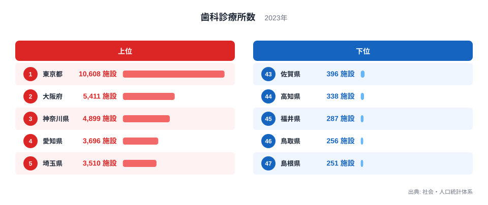
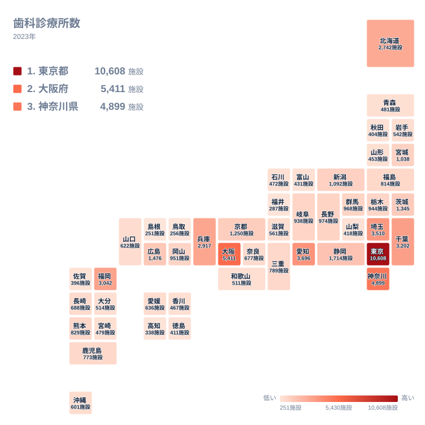

歯科診療所は、虫歯や歯周病の治療だけでなく、定期検診や予防の場としても暮らしに身近な存在です。ところが、その数を都道府県ごとに並べると、地域によって大きな開きがあります。2023年のデータでは、最も多い東京都が10,608施設、最も少ない島根県が251施設です。

この記事では、歯科診療所数の上位と下位がなぜその順になるのかを、地理・産業構造・歴史の面から考えます。ただし、人口や面積のデータは使わないため、理由の部分はあくまで「そう考えられる」という仮説として読んでください。根拠を示せない断定は避け、実データの値と順位を並べて確かめられる範囲を中心に述べます。

## 上位と下位の顔ぶれ

まず、上位5都府県と下位5県を図で確認します。

<source-link href="/ranking/dental-clinic-count">歯科診療所数ランキングをもっと見る</source-link>

この図から初めて見える比較は、上位5都府県の中での東京都の比重です。上位5都府県は、東京都の10,608施設、大阪府の5,411施設、神奈川県の4,899施設、愛知県の3,696施設、埼玉県の3,510施設です。東京都の施設数は、2位から5位の4府県のうち、大阪府と神奈川県を足した10,310施設を上回っています。1つの都が、2つの大府県の合計より多いという形です。

下位側では、47位の島根県が251施設、46位の鳥取県が256施設、45位の福井県が287施設、44位の高知県が338施設、43位の佐賀県が396施設です。5県すべてが400施設未満に収まっており、最下位の2県はともに中国地方の県です。この下位5県の最大値である佐賀県の396施設は、東京都の10,608施設と比べると、図の上でほとんど棒が見えないほど小さな値です。

実データにある最大と最小の比で見ると、東京都の10,608施設は島根県の251施設の40倍を超えています。都道府県間の差は、順位が1つ違うだけでは測れないほど大きいといえます。なお下位でも、43位と44位の間には58施設の差があり、5県が完全に横並びというわけではありません。

> [!NOTE]
> ここでの数値は「歯科診療所」の施設数です。病院に併設された歯科や歯科医師個人の人数とは別の集計で、出典は社会・人口統計体系の歯科診療所数(2023年)です。人口あたりに直していない絶対数なので、順位は診療所の多さを表すもので、通いやすさそのものではありません。

## 上位が大都市圏に集まる背景

歯科診療所は、患者が通える範囲に開業することで成り立つ施設です。そのため、人が多く集まる場所ほど診療所が成り立ちやすいと考えられます。東京都、大阪府、神奈川県、愛知県、埼玉県が上位を占めるのも、大都市圏に人が集まっていることが関係している可能性があります。

東京都は、住んでいる人だけでなく、通勤や通学で昼間に流入する人もいると考えられます。駅周辺やオフィス街に診療所が立地しやすいことが、1位の背景にあるのかもしれません。詳しい数字は[東京都のデータ](/areas/13000)で確認できます。

大阪府は5,411施設で2位です。近畿の中心にあたるため、周辺府県からの通院が含まれる可能性はありますが、このデータだけでは確かめられません。[大阪府のデータ](/areas/27000)とあわせて見ると、都市の規模と診療所数の関係を考える手がかりになります。

関東では、神奈川県が3位、埼玉県が5位、千葉県が3,202施設で6位です。東京都以外の関東の3県が、そろって6位以内に入っています。東京都に隣接する県が上位に並ぶ点は、首都圏の広がりと診療所数に関連がある可能性を示しています。

> [!TIP]
> 歯科診療所数は、歯科医師の人数や診療所の規模を表しません。同じ施設数でも、1施設あたりの歯科医師数や診療時間、対応できる診療内容は異なります。順位は「開業している拠点の数」として読み、医療の供給量そのものと混同しないようにしてください。

## 地理分布で見る地方ごとの違い

続いて、47都道府県の分布を地図で見ます。

地図では、関東から近畿にかけて数字の大きい府県が目立ちます。関東では東京都が10,608施設で1位ですが、同じ関東の栃木県は944施設で19位、群馬県は968施設で17位、茨城県は1,345施設で12位です。関東7都県の中で最も少ないのは栃木県の944施設で、東京都との間には10倍を超える開きがあります。同じ地方の中でも、都県によって大きく様子が異なります。

九州・沖縄では、福岡県が3,042施設で7位と抜けています。九州・沖縄でこれに次ぐのは熊本県の829施設で21位、鹿児島県の773施設で24位です。福岡県は熊本県の3倍を超える施設数ですが、その理由はこのデータだけでは断定できません。

北海道・東北では、北海道が2,742施設で9位、宮城県が1,038施設で15位です。東北の他県は、福島県が814施設で22位、岩手県が542施設で31位、青森県が481施設で34位、山形県が453施設で38位、秋田県が404施設で42位です。東北の中で宮城県が1,000施設を超えている点が目立ちます。

> [!WARNING]
> この記事の値は施設数だけで、診療所が県内のどこにあるか、休止中の診療所がどう扱われるかは分かりません。また、都道府県は県境で区切られるため、隣県から通う患者がいても施設数には反映されません。県ごとの数字は、住民の受診先をそのまま示すものではありません。

## 中国・四国で見る下位の事情

下位の島根県と鳥取県は、ともに中国地方です。ところが同じ中国地方でも、広島県は1,476施設で11位、岡山県は951施設で18位です。中国地方の5県の中で、下位に並ぶのは島根県と鳥取県で、広島県の施設数は島根県の5倍を超えています。同じ地方でも、診療所は一部の県に集まっていることが分かります。

四国では、愛媛県が636施設で27位、香川県が467施設で37位、徳島県が411施設で41位、高知県が338施設で44位です。四国で最も少ないのは高知県で、愛媛県とは298施設の差があります。地形や人口分布が影響している可能性は考えられますが、面積や人口のデータがないため、ここでは断定しません。

福井県は287施設で45位、佐賀県は396施設で43位です。福井県は中部、佐賀県は九州・沖縄に含まれます。佐賀県は福岡県の3,042施設が隣にありますが、通院が県境を越えているかどうかはこの統計からは分かりません。

## 中位の層はどこで密集するか

中位では、10位の静岡県が1,714施設、14位の新潟県が1,092施設、16位の長野県が974施設です。この3県は、いずれも中部に属します。

注目したいのは、16位から20位の並びです。16位の長野県が974施設、17位の群馬県が968施設、18位の岡山県が951施設、19位の栃木県が944施設、20位の岐阜県が938施設と、5県が36施設の範囲に収まっています。順位が1つ違うだけで入れ替わりうる、密集した層です。

一方、10位の静岡県の1,714施設から16位の長野県の974施設までは、6つの順位の間に740施設の落差があります。つまり、10位台前半は差が大きく、16位から20位にかけて密集するという形で、中位の中にも濃淡があります。この境目をどう読むかは、人口などの別の指標と重ねないと判断できません。

さらに詳しく他の指標と比べたい場合は、[同じカテゴリの統計一覧](/category/socialsecurity)から、医療や福祉に関する統計を探せます。

## データについて

この記事で使った歯科診療所数は、社会・人口統計体系の2023年の値で、単位は施設です。47都道府県すべての値を使い、記事中の数値と順位は実データに載っているものだけを引いています。

施設数は、診療所を1施設として数えた絶対数です。1施設あたりの歯科医師数や規模は含まれないため、施設数が多い県が歯科医師も多いとは限りません。この点を踏まえ、順位は診療所という拠点の数の比較として読んでください。
