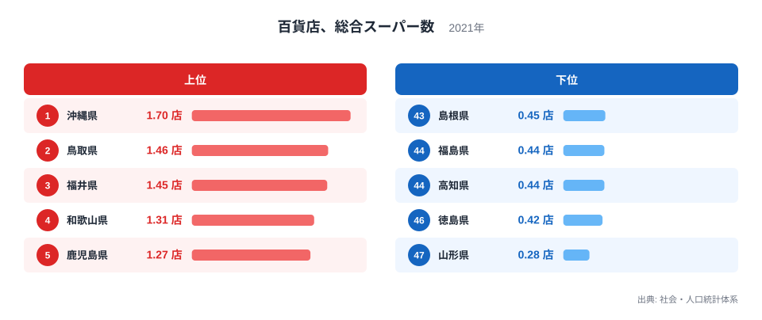
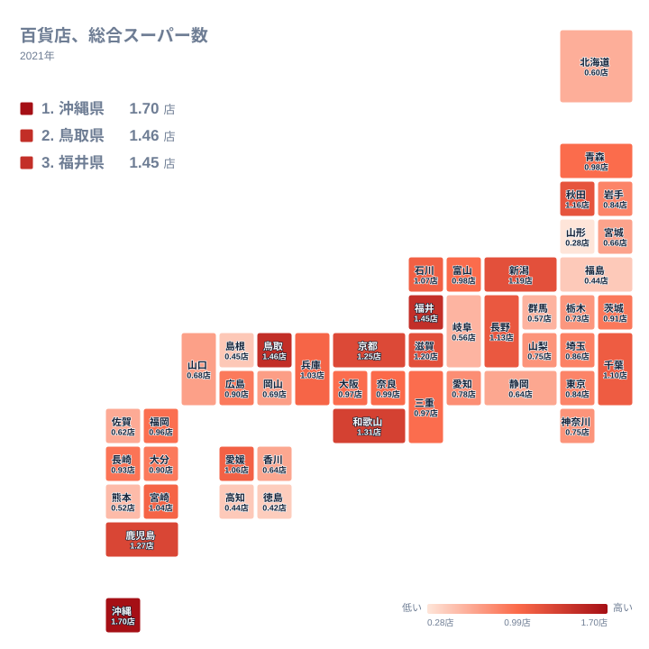

## 百貨店と総合スーパーの数は県でどれだけ違うのか

大型の百貨店や総合スーパーは、地域の買い物の中心になってきた存在です。ところが、その数は県によって大きく異なります。2021年の統計で最も多いのは沖縄県の1.7店で、最も少ないのは山形県の0.28店です。実データにある最大と最小の比を取ると、約6倍の開きがあります。

この記事では、上位と下位がなぜそのような順になるのかを、地理・産業構造・歴史の面から考えます。人口の多い大都市圏が上位に並ぶと思われがちですが、実際の顔ぶれは意外なものです。東京都は0.84店で28位、大阪府は0.97店で20位にとどまります。

> [!NOTE]
> ここで扱う指標は「百貨店、総合スーパー数」で、出典は社会・人口統計体系の2021年版です。単位は店で、県の規模をそろえた値として示されています。店舗の総数ではなく、規模をならした数字なので、数が多い県を「大型店の絶対数が多い県」と読むのは誤りです。

## 上位5県と下位5県の顔ぶれ

<source-link href="/ranking/department-supermarket-count-per-100k">百貨店、総合スーパー数ランキングをもっと見る</source-link>

上位5県は、1位の沖縄県が1.7店、2位の鳥取県が1.46店、3位の福井県が1.45店、4位の和歌山県が1.31店、5位の鹿児島県が1.27店です。大都市圏の県は一つも入っていません。九州・沖縄、中国、中部、近畿から、それぞれ県が顔を出しています。

下位5県は、43位の島根県が0.45店、44位の福島県が0.44店、45位の高知県が0.44店、46位の徳島県が0.42店、47位の山形県が0.28店です。上位と下位の差は、都市の大きさではなく、地域ごとの商業の成り立ちに由来すると考えるのが自然です。

上位の県に共通して見られるのは、中心的な商業施設が少数の大型店に集まりやすい点です。人口が限られた県では、日常の買い物を総合スーパーが幅広く担う傾向があります。そのため、規模をそろえた値では高く出やすくなります。

[沖縄県のデータ](/areas/47000)を見ると、1位の背景がよくわかります。[鳥取県のデータ](/areas/31000)でも、2位という意外な結果が確認できます。

## 沖縄県と鳥取県が上位に来る理由

沖縄県が1位なのは、島という地理条件が大きく関わっています。県外の大型商業地へ気軽に出かけられないため、県内で買い物を完結させる需要が強く、総合スーパー型の店が生活を支えてきた歴史があります。ただし、実データから因果まで断定はできません。あくまで地理と歴史から考えられる説明です。

鳥取県は1.46店で2位です。人口の小さな県で、店舗が少数でも値が高く出る面があります。日常の買い物を総合スーパーに頼る構造が、そのまま数字に表れていると考えられます。

福井県は1.45店で3位、和歌山県は1.31店で4位です。地方の中核都市に大型店が置かれ、周辺の暮らしを支える構図が共通しています。大都市に比べて専門店街や駅ビルなどの選択肢が少ないため、大型店の存在感が相対的に大きくなります。

> [!WARNING]
> この数字は店舗の売場面積や売上を反映していません。小さな総合スーパーも大きな百貨店も、同じ「1店」として数えられています。また2021年の1年分の値なので、閉店や統合が続いた直後の姿である可能性も踏まえて読む必要があります。

## 下位の県に見られる共通点

最下位の山形県は0.28店で、1位の沖縄県と比べると大きく離れています。福島県は44位で0.44店、高知県は45位で同じ0.44店、徳島県は46位で0.42店です。島根県も43位で0.45店と、下位に名を連ねています。

下位の県は、東北、四国、中国に分かれています。大型店の代わりに、ロードサイド型の専門店や、地域密着の食品スーパー、ドラッグストアが買い物を担っている可能性があります。この指標は百貨店と総合スーパーだけを数えるので、そうした業態の充実は反映されません。

つまり、下位だからといって買い物の環境が貧しいとは限りません。業態が別のものに置き換わっているだけかもしれません。数字は「大型店という形が少ない」ことしか語りません。

## 大都市圏が中位にとどまる理由

大都市圏の順位を見ると、東京都は0.84店で28位、神奈川県は0.75店で30位、愛知県は0.78店で29位です。埼玉県は0.86店で26位、大阪府は0.97店で20位、福岡県は0.96店で21位となっています。いずれも中位です。

大都市では、専門店、駅ビル、ショッピングモール、ネット通販など、買い物の選択肢が多様です。人口が多いため分母が大きくなり、規模をそろえた値は低めに出ます。大型店が多くても、人口がそれ以上に多ければ、数字は上がりません。

一方で千葉県は1.1店で11位、京都府は1.25店で6位、兵庫県は1.03店で15位と、大都市圏でも高めの県があります。京都府には古くからの商業の中心があり、歴史的に百貨店が根づいた土地柄が背景にあると考えられます。

## 地理分布から見える地域差

タイルマップで全体を眺めると、特定の地方だけが高いわけではないことがわかります。九州・沖縄では沖縄県が1.7店で1位、鹿児島県が1.27店で5位、宮崎県が1.04店で14位と高めです。一方で熊本県は0.52店で42位、佐賀県は0.62店で38位と低めです。

中部では福井県が3位、新潟県が1.19店で8位、長野県が1.13店で10位、石川県が1.07店で12位と上位が目立ちます。しかし岐阜県は0.56店で41位、静岡県は0.64店で36位と、同じ地方でも大きく分かれます。

近畿は和歌山県が4位、京都府が6位、滋賀県が1.2店で7位と上位に並びます。同じ近畿でも、三重県は0.97店で19位、奈良県は0.99店で16位と中位です。地方単位でひとくくりにはできないことが、この地図からわかります。

東北と北海道は全体に低めです。秋田県が1.16店で9位と健闘する一方、青森県は0.98店で17位、岩手県は0.84店で27位、宮城県は0.66店で35位、北海道は0.6店で39位です。山形県は最下位で、福島県も44位となっています。

> [!TIP]
> 順位が近い県は、値の差がごく小さい場合があります。たとえば青森県と富山県はどちらも0.98店で、順位は17位と18位です。順位だけで優劣を判断せず、値そのものも確かめるのが読み解くコツです。

## 地域差をどう受け止めるか

[同じカテゴリの統計一覧](/category/commercial)を合わせて見ると、小売業の姿は一つの指標だけでは測れないことがわかります。百貨店と総合スーパーの数は、商業の「形」の違いを映す指標です。多いから豊か、少ないから不便、と結びつけるのは適切ではありません。

沖縄県や鳥取県のように、規模の小さな県で大型店が生活の中心を担っている姿は、地域の暮らし方を映しています。反対に、山形県のように値が低い県では、別の業態が主役になっていると考えられます。

中位に並ぶ県の中にも、愛媛県の1.06店で13位、長崎県の0.93店で22位、茨城県の0.91店で23位、広島県と大分県の0.9店で24位と25位など、細かな違いがあります。身近な買い物の場所を思い浮かべながら数字を見ると、統計が実感に近づきます。

## データについて

この記事の数値は、社会・人口統計体系が公表する2021年の「百貨店、総合スーパー数」をもとにしています。単位は店で、全47都道府県の値が公表されています。記事中の順位は、この値が大きい順に付けたものです。同じ値の県が並ぶ場合も、データ上の順位をそのまま使っています。

百貨店と総合スーパーの定義は統計の調査上の区分に従うため、日常の感覚で使う「大型店」の範囲とは一致しないことがあります。他の小売業態と比べるときは、それぞれの指標の定義を確かめたうえで読み比べてください。
