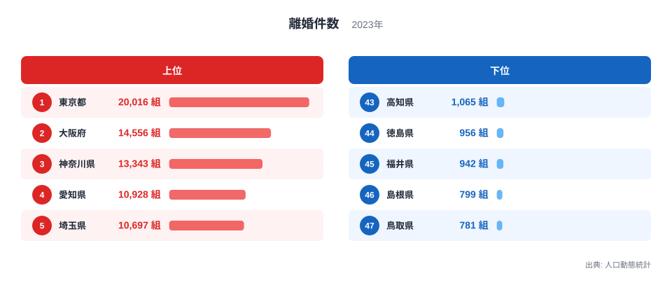
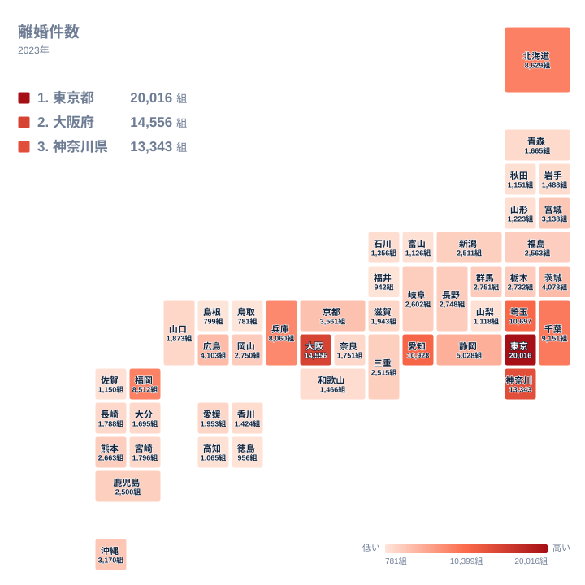

## 離婚件数が最も多い県はどこか

2023年の離婚件数で1位になったのは東京都で、20,016組でした。2位は大阪府の14,556組、3位は神奈川県の13,343組です。4位の愛知県は10,928組、5位の埼玉県は10,697組と続きます。

一方、最も少ないのは鳥取県の781組で、47位です。46位は島根県の799組、45位は福井県の942組でした。1位の東京都と47位の鳥取県を比べると、20,016組と781組ですから、約26倍の開きがあります。

ただし、この差は離婚の起こりやすさだけを表しているわけではありません。件数は「組」という実数ですから、そもそも夫婦の数が多い地域ほど大きくなると考えられます。その前提を押さえたうえで、まず上位5位と下位5位を図で確認します。

<source-link href="/ranking/divorces">離婚件数ランキングをもっと見る</source-link>

図でまず目を引くのは、上位5位がすべて1万組を超えていることです。5位の埼玉県は10,697組で、下位側で最も多い43位の高知県の1,065組と比べても、桁がひとつ違います。上位の顔ぶれは、東京都、大阪府、神奈川県、愛知県、埼玉県です。

下位には、鳥取県、島根県、福井県のほか、44位の徳島県が956組、43位の高知県が1,065組で並びます。下位5県は、いずれも781組から1,065組の範囲に収まっています。上位の最小である5位の埼玉県と比べても、開きは大きいままです。

この記事のデータには人口が含まれていないため、順位の背景は仮説の域を出ません。それでも、夫婦の数が多い地域ほど件数が大きくなりやすいという見方は、順位の並びと矛盾しません。下位に並ぶ県の水準が近いことも、図から確認できます。

> [!NOTE]
> ここでの離婚件数は、人口動態統計に基づく2023年の離婚届の件数で、単位は組です。人ではなく夫婦の組を数えています。この指標は、当事者がどこで暮らしていたかではなく、届出に記載された住所をもとに集計される点に注意が必要です。

## 地理分布で見る離婚件数

次の図は、都道府県をタイル状に並べて、離婚件数の分布を示したものです。

この図から読み取れるのは、件数の多い地域が首都圏、近畿、愛知県、福岡県といった大都市圏の周辺に集まっていることです。上位を見ると、東京都、神奈川県、埼玉県、千葉県の関東4都県に加えて、大阪府と愛知県が入っています。千葉県は6位の9,151組です。7位の北海道は8,629組、8位の福岡県は8,512組、9位の兵庫県は8,060組で、ここまでが8,000組を超える層です。

注目したいのは、9位と10位の間の段差です。9位の兵庫県は8,060組ですが、10位の静岡県は5,028組で、ここで大きく下がります。件数の上では、9位までと10位以降で水準が分かれています。

同じ地方の中でも差は大きく開きます。中国地方では広島県が11位の4,103組ですが、島根県は46位、鳥取県は47位です。近畿でも大阪府が2位である一方、和歌山県は35位の1,466組にとどまります。地方ごとにひとくくりにはできず、県ごとの規模の違いが影響している可能性があります。

> [!TIP]
> 離婚件数は、同居期間や結婚した年を問わず、その年に届けられた組を合算した数字です。結婚してまもない夫婦も長年連れ添った夫婦も同じ1組として数えるため、件数の多さを若い世代の離婚が多い証拠とは読めません。

## なぜこの順位になるのか

地理や産業、歴史が順位にどう結びつくのかは、このデータだけでは検証できません。ここでは、図から確かめられる範囲で、同じ地方の中の違いを見ていきます。

中部では、愛知県が4位の10,928組で、これに次ぐ10位の静岡県は5,028組です。同じ中部でも二つの県の間には大きな開きがあります。さらに下位に目を向けると、福井県は45位の942組で、山梨県は42位の1,118組、富山県は41位の1,126組です。山梨県と富山県は1,100組台で並び、福井県はそれよりやや少ない900組台です。

北海道・東北では、北海道が7位の8,629組と上位に入ります。宮城県は15位の3,138組で、この地方では2番目に多い水準です。北海道と宮城県の二つが、他の県より前に位置しています。

人口の多い大都市圏に件数が集まるのは、夫婦の数が多ければ届出も多くなるという単純な仕組みで説明できるかもしれません。ただし、産業構造や人口移動、歴史的な背景が件数にどう影響したかは、この記事のデータだけでは断定できません。件数と順位から言えるのは、大都市圏に多く、一部の県では少ないという分布までです。

## 中位の県に見る僅差

中位に目を向けると、件数が密集していることがわかります。16位の群馬県は2,751組、17位の岡山県は2,750組、18位の長野県は2,748組、19位の栃木県は2,732組と、4県が20組に満たない幅に収まっています。

この付近は、わずかな違いで順位が入れ替わりやすい領域です。順位に大きな意味を読み取りすぎず、2,700組台に4県が並ぶ層とみるのが安全です。20位の熊本県も2,663組で、近い水準に続いています。

こうした僅差の層では、1つの年の順位だけで県の特徴を語るのは避けたほうがよいでしょう。届出の時期や、ある年の偶然の偏りで、順位が数位動くことも十分に考えられるためです。

> [!WARNING]
> 離婚件数は、届出が受理された年に計上されます。協議が長引いた場合や、年末年始に届出が集中した場合は、実際に離婚を決めた時期と統計上の年がずれます。また、事実上の別居や、届出をしていない関係の解消はこの数字に含まれません。

## データについて

使用したのは、人口動態統計による2023年の離婚件数です。単位は組で、全47都道府県の値を用いています。この記事で触れた数値と順位は、すべてこの統計の値に基づいています。

件数は夫婦の組数であり、人口あたりの割合ではありません。そのため、順位は各県の人口規模に影響されている可能性があります。地域ごとの詳しい統計は、[東京都のデータ](/areas/13000)や[大阪府のデータ](/areas/27000)で確認できます。ほかの指標とあわせて見たい方は、[同じカテゴリの統計一覧](/category/population)も参考にしてください。

## まとめ

2023年の離婚件数は、東京都が20,016組で1位、大阪府が14,556組で2位、神奈川県が13,343組で3位でした。最も少ないのは鳥取県の781組で、1位との比は約26倍です。

件数は夫婦の数に左右されるため、離婚のしやすさを直接示すものではありません。中位の僅差の層は順位を過信せず、人口の規模をそろえた指標とあわせて読むと、各県の姿がより正確に見えてきます。
