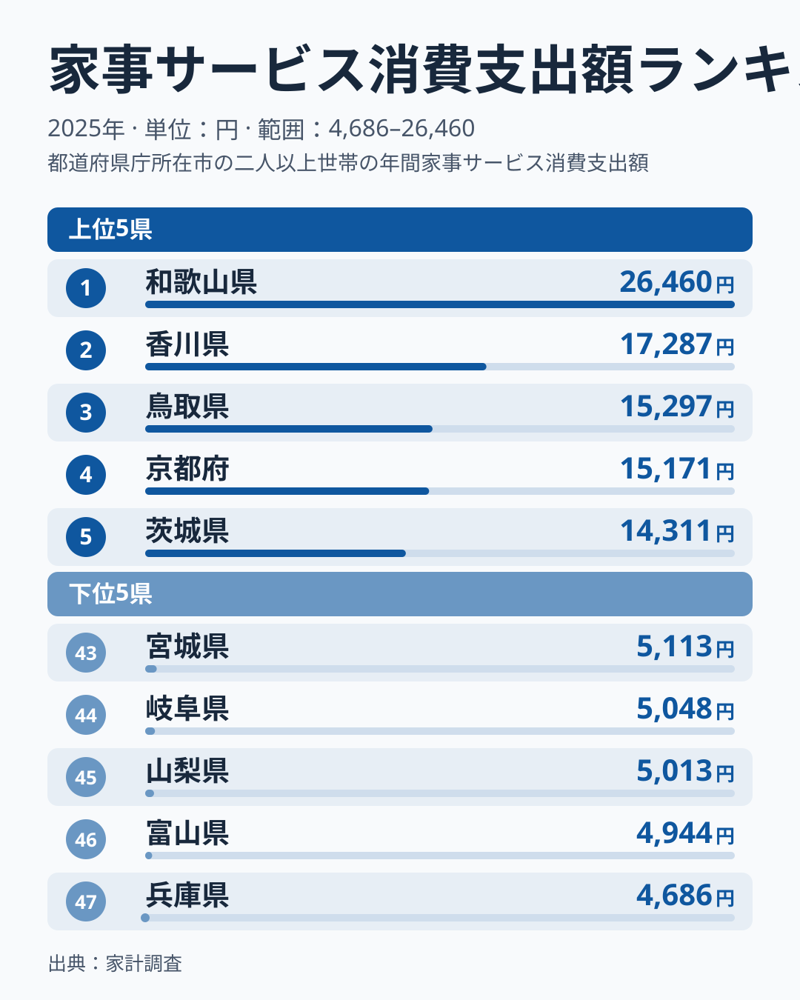
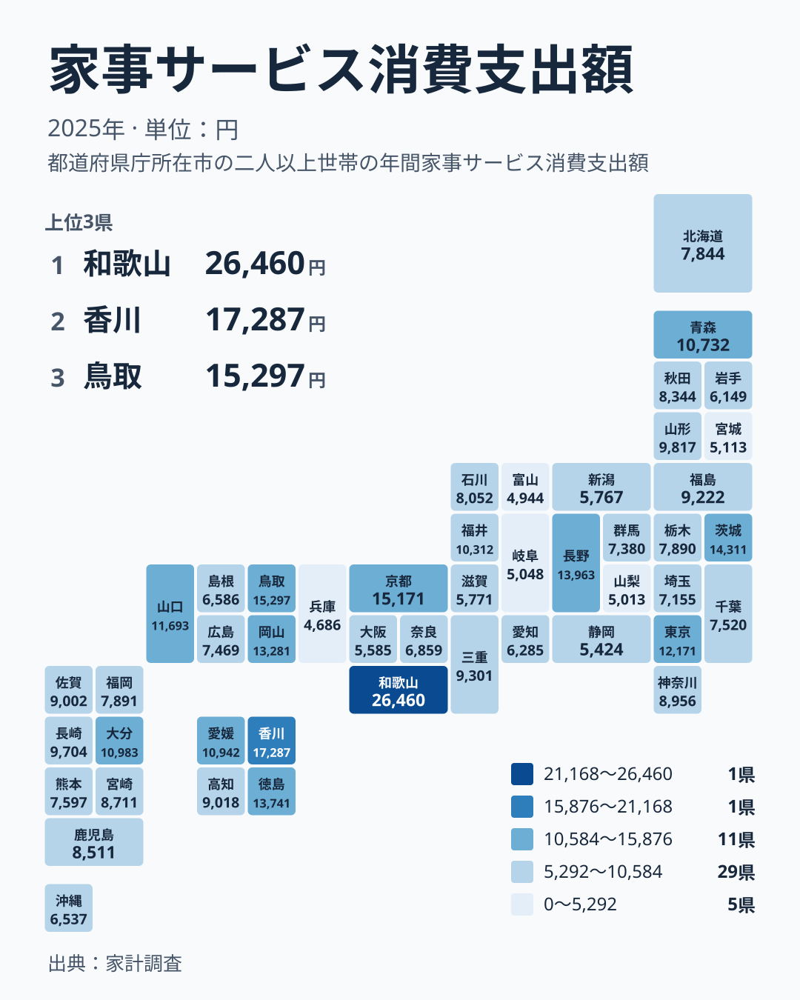

家事サービスへの支出は、1位の和歌山県が26,460円、最下位の兵庫県が4,686円です。同じ日本の中でも、家事を外に任せる金額にこれだけの開きがあります。ただ、この数字を「和歌山の人は家事が苦手」「兵庫の人は自分でやっている」と単純に読むのは早計です。この記事では、2025年の家計調査の結果を並べ、数字の裏にある暮らしの事情を考えます。

> [!NOTE]
> この指標は家計調査(2025年)の家事サービス消費支出額で、単位は円です。家計調査は県庁所在地などの世帯を対象にしており、県全体の平均とは限りません。また、平均は利用した世帯の支出に強く左右されます。利用しない世帯が多い支出ほど、数字は「平均的な家庭の姿」から離れやすくなります。

## 上位と下位の顔ぶれ

まずランキングの両端を見ます。

<source-link href="/ranking/domestic-services-group-consumption-expenditure">家事サービスへの支出ランキングをもっと見る</source-link>

図で目を引くのは、1位の和歌山県の突出です。1位の和歌山県は26,460円、2位の香川県は17,287円で、その差は約9,000円もあります。和歌山県は香川県の約1.5倍にあたります。2位から5位までは僅差で並んでおり、上位の中でも和歌山県だけが別格の位置にあります。

下位側は逆に、差がごく小さい範囲に固まっています。47位の兵庫県は4,686円で、43位の宮城県でも5,113円です。下位5県は5,000円前後に集まっていて、ここでは順位が1つ違っても金額の差はわずかです。

1位の和歌山県と最下位の兵庫県を比べると、約5.6倍です。ただ、この差が生活の豊かさや家事の負担の差をそのまま表すわけではありません。

> [!WARNING]
> 家計調査は標本調査で、都道府県別の結果は調査世帯の数が限られます。家事サービスは、利用する世帯と利用しない世帯がはっきり分かれる支出です。たまたま高額な利用をした世帯が入ると、平均が大きく動くことがあります。1位の和歌山県の突出も、この影響を受けている可能性があります。1年分の順位だけで地域の傾向を断定するのは避けてください。

## 地図で見る地域の偏り

次に、地理的な分布を確認します。

上位10県を地方別に見ると、近畿、四国、中国、関東、中部にまたがっています。近畿は和歌山県が1位、京都府が4位です。四国は香川県が2位、徳島県が7位です。中国は鳥取県が3位、岡山県が8位、山口県が10位です。関東は茨城県が5位、東京都が9位です。中部は長野県が6位です。上位10県のうち西日本の県が多いものの、東京都や茨城県も入っており、「西高東低」と言い切れる形ではありません。

関東の中でも位置は分かれます。茨城県が5位、東京都が9位と上位にある一方で、神奈川県は21位の8,956円、千葉県は30位の7,520円、埼玉県は33位の7,155円です。神奈川県は中位、千葉県と埼玉県は中位から下位寄りで、同じ関東でも県によって大きく異なります。

近畿は、1位の和歌山県と47位の兵庫県の両方を含みます。ほかにも大阪府が41位、滋賀県が39位で、近畿という単位でくくっても傾向が読み取りにくいことが分かります。中部も、長野県が6位である一方、富山県が46位、山梨県が45位、岐阜県が44位と、上位と下位の両方に県があります。北海道・東北は、青森県が13位、山形県が15位に対して、宮城県が43位、岩手県が38位と、こちらも幅があります。

## 都市部が高いとは限らない

家事サービスは、共働きの多い大都市ほど利用が多いと想像されがちです。しかし実際のデータは、その見方と単純には一致しません。東京都は12,171円で9位と上位にありますが、大阪府は5,585円で41位、愛知県は6,285円で37位です。神奈川県も21位にとどまります。

一方で、上位には和歌山県、香川県、鳥取県、徳島県といった県が並びます。この顔ぶれを見ると、都市の大きさだけでは説明しにくいように見えます。ただし、今回の実データには人口は含まれていないため、規模との関係を検証したわけではありません。

考えられる要因はいくつかあります。たとえば、高齢世帯の割合が高い地域では、掃除や庭の手入れ、家の管理などを外に頼む需要が出やすくなるかもしれません。同居家族や親族の助けが得られる地域では、外部サービスを使う必要が少なくなるかもしれません。ただし、世帯の年齢構成や住宅の種類は今回の実データに含まれていません。上の要因はあくまで読み解くための仮説で、データだけで真因を確定できるわけではありません。

> [!TIP]
> 順位を読むときは、1位との差よりも、中位の厚みを見るのが有効です。たとえば10位の山口県は11,693円、20位の佐賀県は9,002円、30位の千葉県は7,520円、40位の新潟県は5,767円です。上位に目を奪われやすいのですが、全体の大半はこの範囲に連なっています。自分の県がどの層にあるかを確かめると、極端な順位に振り回されずに済みます。

## 暮らしにとっての意味

この数字を、生活への含意として読み替えてみます。ここから先は、データで確かめられない部分を仮説として書きます。

まず事実として、香川県は17,287円で2位、鳥取県は15,297円で3位です。20位の佐賀県の9,002円と比べると、かなり高い水準にあります。こうした県で外部サービスを使う世帯の影響が平均を押し上げている可能性はありますが、その背景まではこの数字だけでは分かりません。

一方で、兵庫県の4,686円や富山県の4,944円のように低い県でも、家事の負担が軽いとは言えません。支出が少ないのは、家庭内で担う量が多いからかもしれませんし、サービスが身近にない、価格が合わないといった事情かもしれません。どちらなのかは、この指標だけでは判断できません。

また、平均が高い県でも、サービスを使っていない世帯は多いはずです。数字は「平均的な家庭の姿」ではなく、「利用した世帯の影響を含んだ平均」だと理解してください。

自分の地域が上位か下位かを確かめたい方は、[和歌山県のデータ](/areas/30000)や[香川県のデータ](/areas/37000)で、ほかの指標と並べて見ると立体的に理解できます。[同じカテゴリの統計一覧](/category/economy)からは、ほかの消費支出との関係も確かめられます。

## データについて

この記事で使った統計は、家計調査の家事サービス消費支出額(2025年、単位は円)です。全47都道府県の値が公表されており、順位は金額の大きい順に付けています。

本文で示した倍率は二つです。一つは1位の和歌山県の26,460円と最下位の兵庫県の4,686円の比で、約5.6倍です。もう一つは1位の和歌山県の26,460円と2位の香川県の17,287円の比で、約1.5倍です。いずれも実データにある値だけで計算しています。

家事サービスの支出は、年によって上下しやすい性質があるとみられます。ある1年の結果だけで地域差を固定的に捉えず、できれば複数年の推移とあわせて確認することをおすすめします。順位は出発点として使い、自分の暮らしに引き寄せて読むことが大切です。
