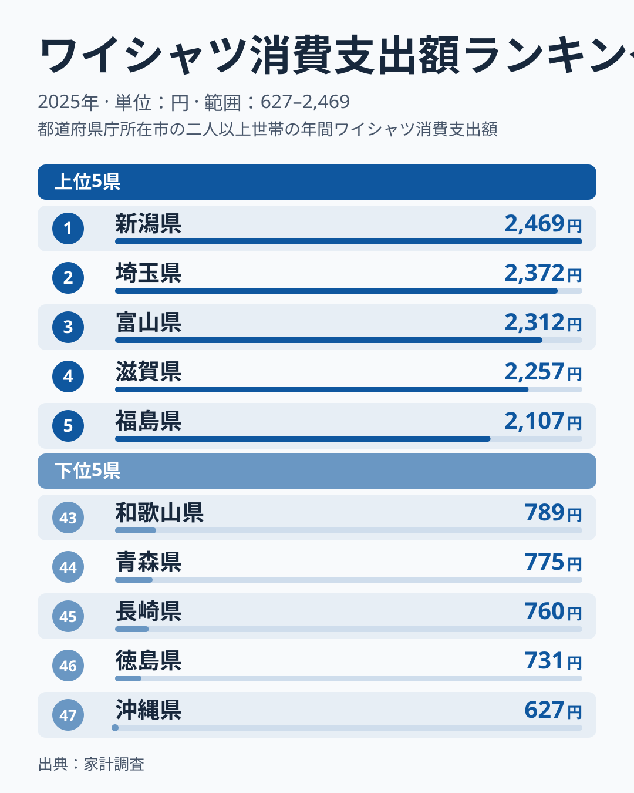
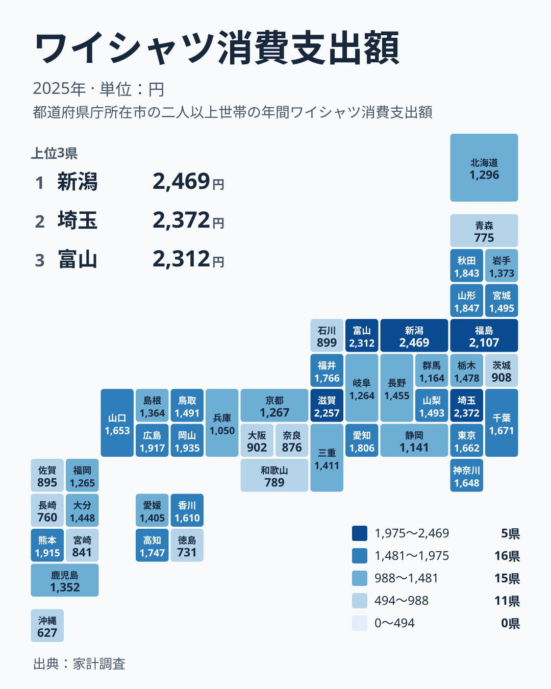

ワイシャツへの支出が最も多い都市はどこでしょうか。2025年の家計調査では、1位が新潟県で2,469円、47位が沖縄県で627円でした。同じ日本で、ワイシャツ1枚の買い方がここまで違うのは意外に感じられます。この記事では、数字の並びを生活の側から読み直し、なぜこうした差が生まれるのかを考えます。

## ワイシャツへの支出、上位と下位の顔ぶれ

まずは上位5県と下位5県を図で確認します。

<source-link href="/ranking/dress-shirt-consumption-expenditure">ワイシャツへの支出ランキングをもっと見る</source-link>

上位は、1位の新潟県が2,469円、2位の埼玉県が2,372円、3位の富山県が2,312円、4位の滋賀県が2,257円、5位の福島県が2,107円です。2,000円を超えたのはこの5県だけでした。

下位は、43位の和歌山県が789円、44位の青森県が775円、45位の長崎県が760円、46位の徳島県が731円、47位の沖縄県が627円です。1位の新潟県と47位の沖縄県を比べると、約4倍の開きがあります。

上位には中部、関東、近畿、北海道・東北の県が混じっています。地方の大きさや都市の規模だけでは説明しにくい並びです。ここで見えるのは、買う人の多さよりも、「ワイシャツをどれだけ日常的に着るか」という生活習慣の違いかもしれません。

## 大都市圏は意外と中位にとどまる

人口の多い都市部が上位を占めると考えがちですが、実際は違います。東京都は15位で1,662円、神奈川県は17位で1,648円、愛知県は11位で1,806円です。千葉県は14位で1,671円でした。

大阪府は38位で902円、京都府は31位で1,267円、兵庫県は36位で1,050円と、近畿の大都市は中位から下位に位置します。一方で、埼玉県は2位の2,372円と高く、同じ首都圏でも東京都とは差があります。

この結果から、読者の生活への含意として次の点が考えられます。

- 都心で働く人は、シャツをクリーニングや定期的な買い替えで回す傾向があり、1回あたりの購入額が分散しやすいこと
- 都市部の外側では、通勤用のワイシャツを実際に購入する頻度が高い可能性があること
- 衣料の購入先が通販や量販店に分かれ、家計調査の品目に表れにくい買い方が混じること

> [!NOTE]
> この指標は、家計調査で世帯が1年間にワイシャツへ支出した金額を、都道府県庁所在市などの単位で集計したものです。県全体の平均ではなく、調査対象となった都市の世帯の姿を映している点に注意が必要です。

## 地理分布で見ると地方の色が浮かぶ

次に、47都道府県の分布をタイルマップで確認します。

中部では、1位の新潟県、3位の富山県が上位に入り、12位の福井県は1,766円、11位の愛知県は1,806円です。いっぽうで、静岡県は35位で1,141円、石川県は39位で899円、岐阜県は33位で1,264円と、同じ中部でも順位が大きく分かれます。

中国では、6位の岡山県が1,935円、7位の広島県が1,917円と、上位に近い位置です。九州・沖縄では、8位の熊本県が1,915円である一方、47位の沖縄県は627円、45位の長崎県は760円、40位の佐賀県は895円です。同じ九州でも、熊本県と沖縄県で大きな差があります。

つまり、ワイシャツへの支出は、単純な東高西低や南北の差では説明できません。県ごとの勤め先の構成、通勤の仕方、服装の規範が複雑に絡んでいると考えるのが自然です。

> [!WARNING]
> 家計調査は標本調査で、1県あたりの調査世帯数は限られます。ワイシャツのように年間の購入回数が少ない品目では、少数の世帯の購入が平均を押し上げたり下げたりします。順位の小さな差は誤差の範囲かもしれません。

## 沖縄県の低さをどう読むか

最下位の沖縄県は627円です。47位という順位は、全国で最もワイシャツにお金をかけていないことを示します。背景として、暑い気候のなかで、かりゆしウェアのような業務にも使える服装が広く定着していることが挙げられます。ワイシャツの需要が小さければ、支出も小さくなります。

この点は統計の数字だけでは確かめられないため、あくまで生活の文脈から考えられる仮説です。ただ、買う服の種類が違えば、同じ「衣料費」でも内訳は大きく変わります。ワイシャツの支出が少ないことは、衣料全体の支出が少ないことを意味しません。

同じ見方は他の県にも当てはまります。46位の徳島県は731円、44位の青森県は775円でした。寒冷地や暖地、職種の違いによって、必要な服の組み合わせは変わります。内訳を分けて見ることで、数字の裏にある暮らしが見えやすくなります。

> [!TIP]
> 順位だけでなく、金額の水準も一緒に見てください。2位の埼玉県が2,372円、5位の福島県が2,107円と上位は近接していますが、中位は1,400円台に多くの県が並びます。順位が数位違っても金額差は小さいことがあります。

## 上位県に共通する背景を探る

上位の新潟県、埼玉県、富山県、滋賀県、福島県には、一見すると共通点が少ないように見えます。地方で見ても、新潟県と富山県は中部、埼玉県は関東、滋賀県は近畿、福島県は北海道・東北です。

それでも、通勤で毎日シャツを着る職場が多い、自家用車通勤が中心で服装がきちんとしている、あるいは冠婚葬祭などの場面で身なりを整える習慣が強いなど、複数の要因が考えられます。ここでも、県の統計を見るときには単一の理由に決めつけない姿勢が大切です。

さらに、山形県は9位で1,847円、秋田県は10位で1,843円と、東北でも上位に並びます。宮城県は19位で1,495円、岩手県は27位で1,373円、青森県は44位です。東北の中でも差が大きく、地方単位の印象で語れないことが分かります。

詳しく知りたい県があれば、[新潟県のデータ](/areas/15000)や[埼玉県のデータ](/areas/11000)で、他の指標との組み合わせを確かめられます。ほかの家計の分野は[同じカテゴリの統計一覧](/category/economy)からたどれます。

## 暮らしへの含意と見方のまとめ

ワイシャツへの支出の差は、単に「おしゃれかどうか」ではなく、働き方や気候、買い方の違いを映しています。新潟県の2,469円と沖縄県の627円は、その両端です。

読者がこの数字から持ち帰れる点を整理します。

- 自分の県の順位を知り、近い順位の県と比べて、金額の差が小さいかどうかを確かめること
- 同じ地方でも順位が大きく割れることを踏まえ、地方の印象で県を決めつけないこと
- 衣料費は品目ごとに内訳が変わるため、1つの品目だけで暮らしの豊かさを測らないこと

## データについて

この記事で使った指標は、家計調査の「ワイシャツ消費支出額」で、2025年の値を円で示したものです。世帯が1年間に支出した金額に基づくため、人口や世帯の構成が違う地域を並べたとき、単純な優劣を表すものではありません。数字は地域の暮らし方を考える入口として使い、結論を急がずに読み解くことが重要です。
