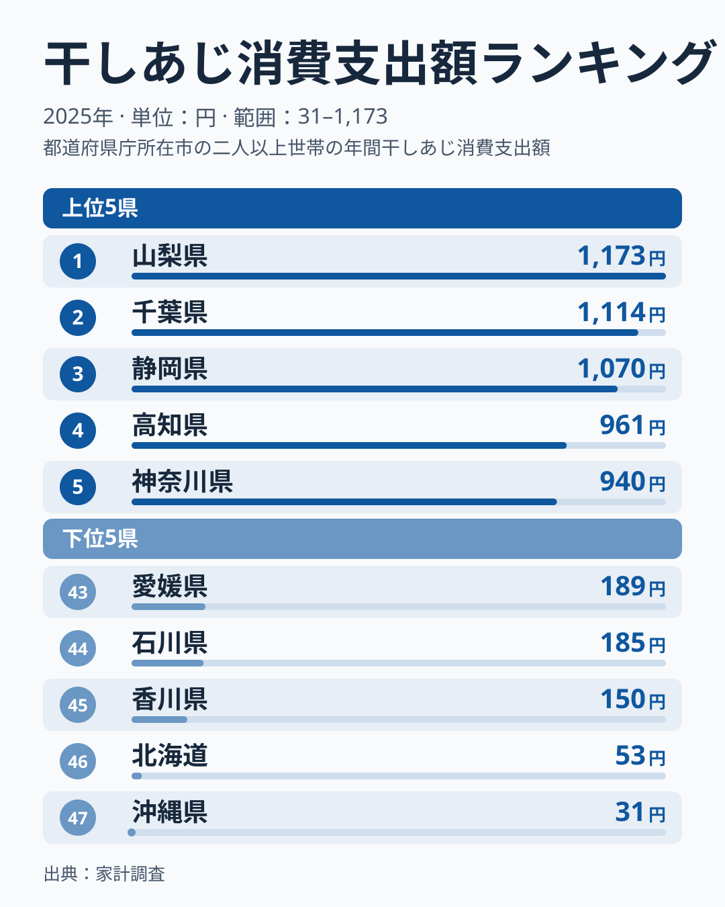
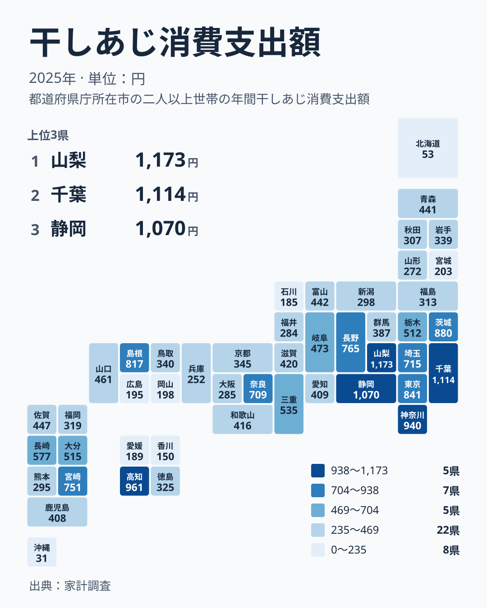

## 海のない山梨県が干しあじ支出で首位に

朝食の定番として思い浮かぶ干しあじは、どの地域でよく買われているのでしょうか。家計調査の2025年のデータで、干しあじへの年間支出額を都道府県別に見ると、首位は山梨県でした。支出額は1,173円です。海に面していない県が、漁港を抱える県を抑えて先頭に立ちました。

2位は千葉県で1,114円、3位は静岡県で1,070円です。上位3県はいずれも1,000円を超えています。4位の高知県は961円、5位の神奈川県は940円で、ここまでが900円台以上です。

一方、最下位の47位は沖縄県で31円、46位の北海道は53円にとどまります。首位の山梨県と最下位の沖縄県の間には、約38倍という大きな開きがあります。この記事では、食文化、産地、流通といった視点から、この差の背景を仮説として考えます。

[山梨県のデータ](/areas/19000)や[千葉県のデータ](/areas/12000)とあわせて読むと、地域ごとの食卓の違いが見えやすくなります。

> [!NOTE]
> 干しあじは干物の中でも、自宅用だけでなく贈答品や惣菜の一品として買われることがあります。この指標は「何を何のために買ったか」までは区別しないため、金額の多さが毎日の食卓での頻度を表しているとは限りません。

## 上位と下位を並べると見える落差

まず、上位5県と下位5県を一枚の図にまとめます。

<source-link href="/ranking/dried-mackerel-consumption-expenditure">干しあじへの支出ランキングをもっと見る</source-link>

上位は山梨県、千葉県、静岡県、高知県、神奈川県の順です。下位は47位の沖縄県、46位の北海道、45位の香川県、44位の石川県、43位の愛媛県です。上位5県は関東が2県、中部が2県、四国が1県です。下位5県は、沖縄県、北海道、四国2県、中部1県という内訳で、特定の地方に偏っていません。

図から読み取れるのは、上位の中での幅の小ささと、下位の中での幅の小ささです。上位5県は1,173円から940円の間に収まり、下位5県は31円から189円の間にあります。つまり、落差の大半は「上位グループ」と「下位グループ」の間に生まれており、グループの内側ではそれほど大きく開いていません。

もう一つ目を引くのは、北海道が46位に入っていることです。北海道は水産物の一大産地として知られますが、干しあじへの支出は少なめです。この北海道の例からは、産地の近さだけでは干しあじの支出を説明しにくいことがうかがえます。

> [!WARNING]
> 干しあじは、1世帯が年に何度も買う品目ではなく、数百円から1,000円ほどの金額が少数回の購入で決まります。家計調査は標本調査でもあるため、数世帯の買い方や年ごとの偶然で、順位が入れ替わりやすい品目です。順位が1つ2つ違うだけの県を、実力差と読むのは避けてください。

## 地図で見る関東・中部・太平洋側の厚み

続いて、都道府県ごとの水準を地図の上で確認します。

地図を眺めると、関東から中部にかけて濃い色が集まっています。山梨県、千葉県、静岡県、神奈川県、茨城県、東京都はいずれも上位です。茨城県は880円で6位、東京都は841円で7位です。首都圏とその周辺で、干しあじへの支出が厚いことが分かります。

関東の中でも差があります。埼玉県は715円で11位、栃木県は512円で16位、群馬県は387円で26位です。埼玉県のように海のない県でも11位に入っており、海の近さだけでは説明がつきません。

中部は県ごとのばらつきが大きい地方です。山梨県は1位、静岡県は3位、長野県は765円で9位と高い一方、新潟県は298円で34位、福井県は284円で37位、石川県は185円で44位です。

近畿では、奈良県が709円で12位、三重県が535円で14位と上位寄りです。一方、大阪府は285円で36位、兵庫県は252円で39位と、下位寄りの府県もあります。同じ地方の中にも、支出の水準が大きく違う県が混在しています。

> [!TIP]
> この指標を地図で読むときは、色の近い県どうしでも、中位では数十円の違いで順位が入れ替わる点に注意してください。たとえば20位の富山県は442円、21位の青森県は441円で、わずか1円差です。順位の差より、金額の差に注目すると読み違いを避けられます。

## 食文化と産地、流通から考える

干しあじの支出が多い県には、いくつかの背景が考えられます。ここからは断定ではなく、読み解きのための仮説として整理します。

1つ目は、干物を朝食に取り入れる習慣です。静岡県や神奈川県、千葉県は、干物づくりが盛んな地域を抱えると言われます。身近に干物を扱う店があり、家庭でも気軽に買える環境が、支出の多さにつながっている可能性があります。ただし、この記事のデータだけでは確かめられません。

2つ目は、流通の距離です。山梨県は海に面していませんが、静岡県や神奈川県、東京都といった干物の産地や大消費地に隣接しています。そのため、干物が日常的に届きやすい可能性があります。長野県が9位に入っていることも、この見方と矛盾しません。

3つ目は、地元の魚食文化の違いです。高知県は961円で4位です。カツオのイメージが強い県ですが、あじの干物が朝食や日常のおかずとして根づいているからかもしれません。島根県は817円で8位、宮崎県は751円で10位と、西日本にも上位の県があります。

4つ目は、好みの違いです。北海道や沖縄県で支出が少ないのは、別の魚や調理の文化が主役になっているためかもしれません。これも仮説の域を出ませんが、支出が少ないことを「魚を食べない」と読むのは早計です。

## 干物の中での立ち位置

干しあじは、塩ざけやほっけ、さんまの開きなどと並ぶ干物・塩蔵魚の一品目です。このデータは干しあじだけを扱っているため、他の品目との金額比較はできません。ただ、干しあじの支出が少ない県が、魚全体の消費も少ないとは限りません。[同じカテゴリの統計一覧](/category/economy)で他の食料品の指標と見比べると、各県の食生活の個性がより立体的に見えてきます。

## データについて

この記事で使ったのは、家計調査の干しあじ消費支出額で、2025年の1世帯あたり年間支出額を円で表したものです。調査は都道府県庁所在地などの世帯を基にした集計のため、県全体の傾向を完全に表すものではありません。

表示している金額と順位は、実データの値をそのまま使っています。

## 読み終えて

干しあじへの支出が最も多かったのは山梨県で、千葉県と静岡県が続きました。関東から中部にかけて上位が集まる一方、北海道や沖縄県は少なく、産地の近さだけでは説明しにくい分布です。

自分の県の値を見るときは、金額の大小だけでなく、隣り合う県との違いや、干物以外の魚の食べ方にも目を向けてみてください。数字の裏にある食卓の背景が見えてきます。
