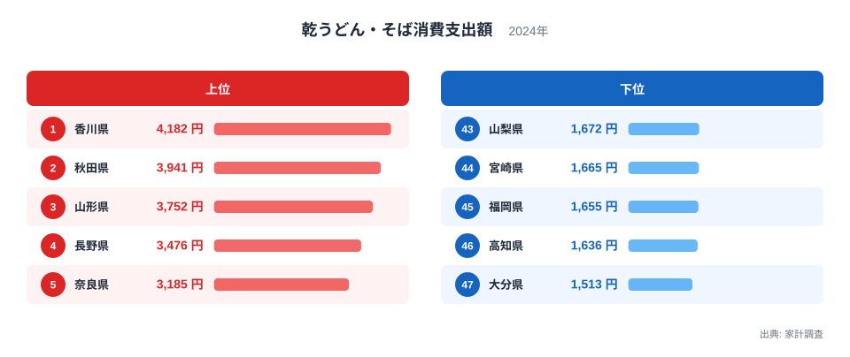
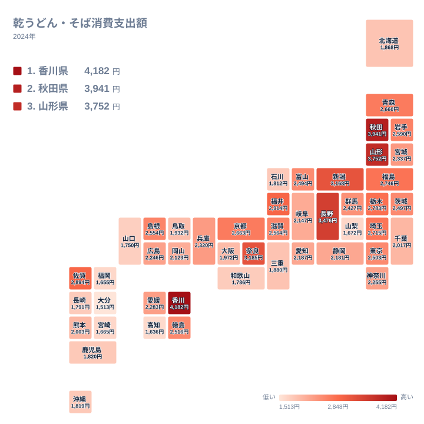

乾うどん・そばは、どの家庭の棚にもありそうな保存食です。それでも、1年間にどれだけ家計から支出されるかは県によって大きく違います。2024年の家計調査では、最も多い香川県が4,182円、最も少ない大分県が1,513円でした。この記事では、その差がどこから生まれるのかを、食文化・産地・気候といった切り口から読み解きます。

## 乾うどん・そばへの支出、上位と下位の顔ぶれ

まず、上位5県と下位5県を図で確認します。

<source-link href="/ranking/dried-udon-soba-consumption-expenditure">乾うどん・そばへの支出ランキングをもっと見る</source-link>

1位は香川県で4,182円です。2位は秋田県で3,941円、3位は山形県で3,752円、4位は長野県で3,476円、5位は奈良県で3,185円と続きます。うどんの本場として知られる香川県が首位に立ち、そばどころとして名高い東北や信州の県がその後ろに並んでいます。うどんとそばという二つの麺文化の代表格が、上位をほぼ占めている構図です。

一方、下位に目を向けると、47位が大分県で1,513円、46位が高知県で1,636円、45位が福岡県で1,655円、44位が宮崎県で1,665円、43位が山梨県で1,672円です。上位と下位の開きは大きく、最大の香川県と最小の大分県を比べると、約2.8倍という差になります。

注目したいのは、下位に九州の県が多いことです。大分県、宮崎県、福岡県はいずれも九州・沖縄の県で、ここに四国の高知県と中部の山梨県が加わります。九州では、乾麺を家庭でゆでるよりも、外食や生麺、あるいは別の麺類で麺料理を楽しむ習慣が影響している可能性があります。ただし、この統計だけでは理由までは断定できません。

> [!NOTE]
> ここでの金額は、家計調査における「乾うどん・そば消費支出額」で、1世帯が1年間に購入した乾麺への支出です。外食で食べるうどんやそば、生麺、ゆで麺、カップ麺は含まれません。「麺をどれだけ食べるか」ではなく、「家庭で乾麺をどれだけ買うか」を示す数字です。

## 食文化が支出を押し上げる：うどん県とそば県

香川県は、讃岐うどんの本場です。ただ、讃岐うどんの多くは店で食べる生麺やゆで麺のイメージが強く、乾麺の支出が全国1位であることは少し意外かもしれません。家庭での常備や贈答用として乾麺が根付いていることが、数字に表れているとも考えられます。

そばの側では、秋田県が3,941円で2位、山形県が3,752円で3位、長野県が3,476円で4位です。いずれも、そばの栽培や郷土のそば料理で知られる地域です。地元でそばが身近な食べ物であれば、家庭でも乾そばを買う機会が増えるのは自然な流れでしょう。

さらに、東北の県は上位から中位に広く分布しています。福島県は2,746円で10位、青森県は2,660円で13位、岩手県は2,590円で14位です。北海道・東北の七つの県のうち、北海道だけは1,868円で36位と大きく離れています。同じ地方でも、そばやうどんを家庭で食べる習慣の強さには差があることがわかります。

> [!TIP]
> 順位が近い県どうしの金額差は小さいことがあります。たとえば10位の福島県は2,746円、11位の埼玉県は2,715円で、差はわずかです。上位や下位の端を見るときは順位だけでなく、金額の開きも合わせて確認してください。

## 地理分布で見る：東北から信州、近畿へ

次に、地理的な広がりを図で見てみます。

分布を眺めると、支出が多い県は東北と中部、近畿、四国の一部に点在しています。秋田県と山形県は東北、長野県と新潟県は中部、奈良県は近畿、香川県は四国です。新潟県は3,168円で6位、福井県は2,914円で7位と、中部の県が上位に複数入っています。

関東では、栃木県が2,783円で9位、埼玉県が2,715円で11位と比較的高い一方、東京都は2,503円で18位、千葉県は2,017円で31位です。関東の中でも、県によって位置づけが分かれます。近畿でも、奈良県が5位、京都府が2,663円で12位、滋賀県が2,564円で15位と上位から中位に入る一方、大阪府は1,972円で33位、和歌山県は1,786円で41位です。

このように、単純な東西や南北の傾向では説明しきれません。産地や郷土料理、世帯の買い方など、複数の要因が重なって地域ごとの差を作っていると考えられます。

> [!WARNING]
> 家計調査は全国の限られた世帯を対象にした標本調査です。県庁所在地など調査対象の都市の世帯が中心で、県全体の消費をそのまま表すわけではありません。順位が近い県の差は、標本の偏りによる誤差の範囲かもしれないので、小さな差の解釈には慎重になる必要があります。

## 麺類の対比：生麺・外食との関係

乾うどん・そばの支出が少ない県は、麺を食べていないわけではありません。外食文化が発達している地域や、生麺・ゆで麺を好む地域では、乾麺の購入が少なくなる傾向が考えられます。福岡県は1,655円で45位ですが、福岡県は外食でうどんやラーメンを楽しむ文化が根強い県として知られています。このデータは家庭での乾麺購入だけを映すため、そうした外食中心の食べ方は反映されません。

また、保存性の高い乾麺は、贈答や備蓄の需要とも結びつきます。産地として知られる県では、お中元やお歳暮の習慣が乾麺の購入に影響している可能性があります。香川県や長野県、山形県、秋田県の上位は、そうした背景を想像させます。

一方、大都市圏では、スーパーやコンビニで多様な麺類が手に入ります。東京都は2,503円で18位、愛知県は2,187円で27位、大阪府は1,972円で33位と、中位から下位に並びます。選択肢が多い分、乾うどん・そばの比重は下がっているのかもしれません。

## 上位と下位の差が示すもの

最後に、全体を振り返ります。1位の香川県は4,182円で、47位の大分県は1,513円です。この差は約2.8倍で、家計調査の中でも食文化の違いがはっきり出る品目といえます。

- 上位は、うどんの香川県とそばどころの秋田県、山形県、長野県が占めています。
- 下位には、大分県、高知県、福岡県、宮崎県、山梨県が並びます。
- 中位には、東京都や愛知県のような大都市圏が入ります。

地域の食文化は、日々の買い物の積み重ねに表れます。気になる県の詳しい数値は、[香川県のデータ](/areas/37000)や[秋田県のデータ](/areas/05000)で確認できます。ほかの食料品の支出と比べたいときは、[同じカテゴリの統計一覧](/category/economy)も参考になります。

## データについて

この記事で使った統計は、家計調査の「乾うどん・そば消費支出額」で、2024年の値です。単位は円で、全47都道府県の数値を使っています。家計調査は世帯の家計簿をもとにした調査であり、購入した乾麺の金額が集計されます。倍率として示した約2.8倍は、1位の香川県と47位の大分県の値を比べたものです。
