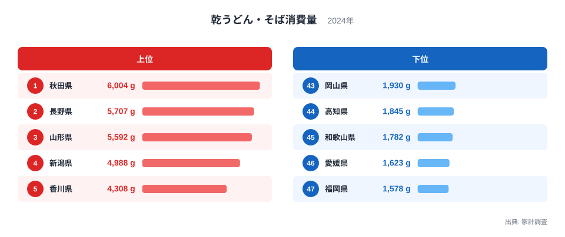
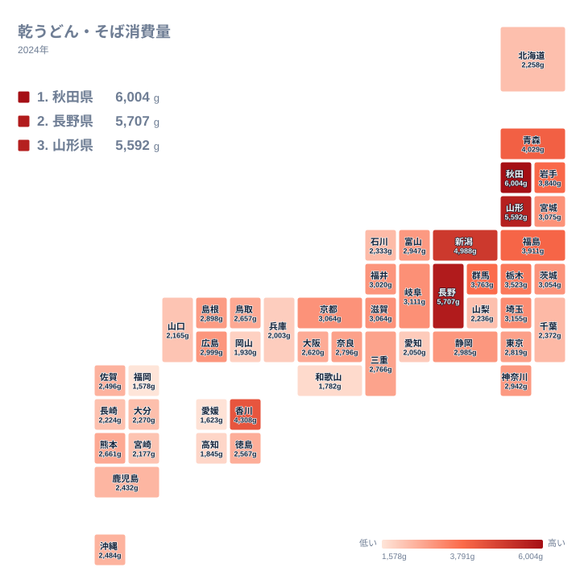

「うどんの国」といえば香川県、「そばの国」といえば長野県を思い浮かべる方が多いと思います。ところが家計調査で乾麺の購入量を並べてみると、トップに立つのはそのどちらでもありません。2024年の1位は秋田県で、6,004gでした。長野県は2位、香川県は5位です。

この記事では、乾うどんと乾そばを合わせた消費量の都道府県差を、食文化・気候・産地・歴史との結びつきという視点から眺めます。ただし、データから直接わかるのは「どの県でどれだけ購入されたか」までです。その背景は仮説として示し、確かめられないことは確かめられないと書きます。

## 1位は秋田県、2位は長野県

2024年の乾うどん・そばの消費量で1位だったのは、[秋田県](/areas/05000)の6,004gです。2位は[長野県](/areas/20000)の5,707g、3位は山形県の5,592gと続きます。上位3県は、いずれも東北か信越の県です。

秋田県が首位になった理由は、このデータだけでは説明できません。仮説としては、雪の多い冬に備えて保存のきく乾麺を買い置く暮らし方や、稲庭うどんに代表される乾麺づくりの伝統が関係しているかもしれません。ただし、これらはあくまで見方の一つであり、今回の数字で確かめたわけではありません。

長野県は、そばの名産地として全国に知られています。それでも家計調査が捉えるのは、世帯が購入した乾麺の量です。打ち立ての生そばを店で食べる機会が多ければ、その分は数字に表れません。そば処としての知名度と乾麺の購入量が、必ずしも同じ尺度ではないことは覚えておきたい点です。

## 上位と下位の顔ぶれを見比べる

次の図は、上位5県と下位5県を並べたものです。

<source-link href="/ranking/dried-udon-soba-consumption-quantity">乾うどん・そば消費量ランキングをもっと見る</source-link>

上位5県は、秋田県、長野県、山形県、新潟県、香川県の順です。1位の秋田県6,004gと5位の香川県4,308gの間には、1,696gの開きがあります。上位5県の中でも、1位から3位までは5,500gを超え、4位以降とは一段の差があることが読み取れます。

下位5県は、43位の岡山県から47位の福岡県までで、いずれも西日本の県です。1位の秋田県と47位の福岡県1,578gを比べると、約3.8倍の差があります。同じ国内で、乾麺の購入量がここまで違うことに驚く方も多いのではないでしょうか。

上位は東北・信越に多く、下位は西日本に多いというのが、図から読み取れる大づかみな傾向です。寒さや雪の深さといった気候が関係しているかもしれませんが、気候と購入量の関係を示す数値は今回のデータにないため、仮説の域を出ません。

> [!NOTE]
> この指標は、世帯が購入した乾うどんと乾そばの量(グラム)です。うどんとそばを合算しているため、どちらが多く食べられているかは、この数字からはわかりません。生麺、ゆで麺、外食は含まれていないため、「麺をどれだけ食べるか」ではなく「乾麺をどれだけ買うか」を示す数字として読む必要があります。

## 地理分布で見ると東北・信越に濃い色が集まる

続いて、都道府県の位置関係がわかるタイルマップを見てみましょう。

地図で見ると、色の濃い県は東北から信越にかけて集まっています。青森県4,029g、福島県3,911g、岩手県3,840gも含め、東北の6県はすべて上位10位以内に入っています。さらに群馬県3,763g、栃木県3,523gと、北関東まで比較的高い値が続いています。

これに対して、西日本は全体に色が薄く、43位から47位の5県はすべて西日本の県です。そのなかで香川県は4,308gで5位に入り、西日本では上位に入った唯一の県です。ただし、6位の青森県4,029gや7位の福島県3,911gとの差は大きくありません。香川県が飛び抜けているというより、東北の県々と肩を並べる位置にいると見るのが正確です。

香川県はうどんで知られる県ですが、この数字はうどんとそばの合計であり、うどんだけの購入量とは言えません。うどんの消費量が多いことの表れだという見方もありますが、内訳を示すデータはないため、確かなことは言えません。

大都市圏は中位から下位に位置します。東京都は2,819gで23位、大阪府は2,620gで28位、愛知県は2,050gで41位でした。外食の選択肢が多いことが関係しているという見方もありますが、これも今回のデータで確かめたものではありません。北海道は2,258gで36位と、そばの産地というイメージからすると低めの位置です。

> [!WARNING]
> 家計調査は標本調査であり、県全体を完全に数え上げたものではありません。ここで特に注意したいのは、この指標が「購入した乾麺の量」だという点です。贈答で受け取った乾麺や、自分で打ったそば、店で食べたそばやうどんは含まれません。そば処と呼ばれる県の食文化の厚みが、この数字にそのまま映るとは限りません。

## 食文化・産地・歴史との結びつきを仮説として考える

ここからは、データの外にある話を、仮説として整理します。数字が示すのは購入量の差であり、その理由ではありません。

一つ目は気候です。寒冷で雪の多い地域では、保存のきく食品を備える暮らしが根づいてきたという見方があります。乾麺は軽くて傷みにくいため、そうした暮らしに合う食品です。上位に東北・信越の県が多い背景として、気候が関係しているかもしれません。ただし、同じ上位でも香川県は瀬戸内の県であり、気候だけで説明できるわけではありません。

二つ目は産地です。そばは冷涼な気候でも育つため、東北や信州の山間部で広く栽培されてきたといわれます。そばを日常的に食べる習慣があれば、乾麺の購入も多くなるという考え方もできます。一方で、この記事のデータにはそばの収穫量などは含まれず、産地と購入量の結びつきを数字で示すことはできません。

三つ目は贈答や買い置きの習慣です。お中元やお歳暮に乾麺を選ぶ習慣が一部の地域に根づいているという話もあります。ただ、贈答で受け取った分は購入量に入らないため、この指標との関係はむしろ複雑です。

> [!TIP]
> 順位を読むときは、「その県の人が麺を食べない」のではなく、「乾麺を買う量が少ない」と読むのがコツです。47位の福岡県は1,578gですが、それは生麺や外食など別の形で麺を食べている可能性と両立します。他の麺類の購入量は今回のデータにないため、麺全体の消費量の多寡は判断できません。

## 関連品目との対比は、この記事では確かめられない

本来であれば、乾麺と生うどん・ゆで麺・中華麺・即席麺などの購入量を並べて比べることで、地域ごとの麺の選び方の違いが見えてくるはずです。しかし、この記事で使えるのは乾うどん・そばの購入量だけです。

そのため、「乾麺が少ない県は別の麺を多く食べている」といったことは、今回のデータからは言えません。関連品目の統計を並べて読むことで、はじめて確かめられる論点です。気になる方は、[同じカテゴリの統計一覧](/category/economy)から、ほかの食料品の統計もあわせて見てみてください。

## データについて

この記事で使った数値は、家計調査(総務省統計局)の2024年の結果にもとづく「乾うどん・そば消費量」です。単位はグラム(g)で、世帯が購入した乾うどんと乾そばの量を合算しています。

家計調査は標本調査であり、県全体の消費を厳密に表すものではありません。また、うどんとそばの内訳や、生麺・外食などの消費は含まれません。こうした制約を踏まえたうえで、地域ごとの傾向をつかむ材料として読んでいただければと思います。

## まとめ

2024年の乾うどん・そば消費量で、1位は秋田県の6,004g、2位は長野県の5,707g、3位は山形県の5,592gでした。最下位の福岡県は1,578gで、1位とは約3.8倍の差があります。上位は東北・信越に多く、下位は西日本に多いという傾向が、ランキングと地図の両方から読み取れます。

気候や産地、贈答の習慣などが関係しているかもしれませんが、いずれも今回のデータで確かめたものではなく、仮説にとどまります。香川県が西日本で唯一上位に入った点も、うどんとそばの内訳がわからない以上、解釈には慎重さが必要です。気になる県は[秋田県のデータ](/areas/05000)や[長野県のデータ](/areas/20000)で、ほかの指標とあわせて確かめてみてください。
